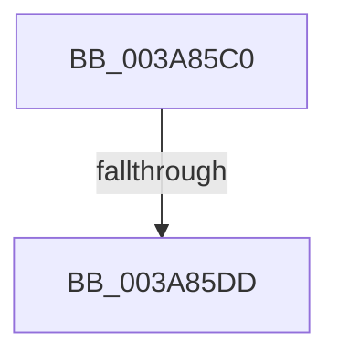

# AuthzBasepCopyoutSecurityAttributeValues

- RVA: `0x003A85C0`–`0x003A85E1` (길이 `33` bytes)
- VA: `0x00000001403A85C0`
- 실행 섹션: `.text`
- PDB 이름 있음: `예`; PDB Function 태그: `아니요`
- unwind 정보 RVA: `0x00089D90`
- 디코드: `11`개 명령, `33/33` bytes 표시
- 미해석 바이트: `0` (있으면 어셈블리에 `.byte`로 보존)

> 이 문서는 커널 이미지의 기계어와 PDB 기호를 분석해 생성했습니다. 4번과 5번은 함수 원형과 자료형을 바이너리 사용 방식에서 추정한 C 해석이며 원본 소스 복구 결과는 아닙니다.

## 1. Dependencies

- 직접 호출 지점: **0**; 고유 호출 대상: **0**
- 직접 호출자로 확인된 함수: **1**
- RIP 상대 이미지 참조: **0**

### Outgoing calls
- 직접 디코드된 call 명령이 없습니다.

### Direct callers
- [AuthzBasepCopyoutSecurityAttributes](AuthzBasepCopyoutSecurityAttributes_function_003A8100.md) at `0x003A8246`
- [AuthzBasepCopyoutSecurityAttributes](AuthzBasepCopyoutSecurityAttributes_function_003A8100.md) at `0x003A8349`

### Static image references
- 디코드된 RIP-relative 메모리 참조가 없습니다.

## 2. Other-region calls and transfers

- 다른 실행 섹션으로 향하는 call: **0**
- call이 아닌 외부 분기/꼬리 이동: **1**
  - `0x003A85D7` → [sub_003A880D](Unknown_function_003A880D.md) (`tail-transfer`)

## 3. Assembly (complete function range)

```asm
003A85C0  40 53                           push rbx
003A85C2  56                              push rsi
003A85C3  57                              push rdi
003A85C4  48 83 EC 30                     sub rsp, 0x30
003A85C8  33 FF                           xor edi, edi
003A85CA  4B 8D 34 08                     lea rsi, [r8 + r9]
003A85CE  49 8B D8                        mov rbx, r8
003A85D1  4C 8B D9                        mov r11, rcx
003A85D4  49 3B F0                        cmp rsi, r8
003A85D7  0F 82 30 02 00 00               jb 0x1403a880d
003A85DD  0F B7 49 30                     movzx ecx, word ptr [rcx + 0x30]
```

## 4. C-style interpretation (structured pseudocode)

```c
void __fastcall AuthzBasepCopyoutSecurityAttributeValues(__int64 a1, __int64 a2, __int64 a3, __int64 a4)
{
    __int64 v_rdi;
    __int64 v_rsp;

    v_rsp = (v_rsp) - (48);
    v_rdi = 0;
    return;
}
```

## 5. (Beta) C Style

```c
void AuthzBasepCopyoutSecurityAttributeValues(void *Arg1, int64_t Arg2, void *Arg3, int64_t Arg4)
{
    uint8_t *arg1 = (uint8_t *)Arg1;
    uint8_t *arg3 = (uint8_t *)Arg3;

    int64_t local_rdi;
    int64_t local_rsp;

    local_rsp = (local_rsp) - (48);
    local_rdi = 0;
    return;
}
```

### 관측된 메모리 오프셋

구조체 형식이 확인되지 않은 접근은 인자 기준의 오프셋으로만 기록했습니다.

| 기준 인자 | 오프셋 표현 | 폭 (bit) | 접근 |
|---|---:|---:|---|
| `Arg1` | `+ 0x30` | `16` | `R` |
| `Arg3` | `+ 0x0 + r9*1` | `64` | `R` |

## 6. Execution-region graph

[열기: 2D/3D 그래프와 함수 탐색 컨트롤 패널](../../../control-panel.html?section=text&rva=0x003A85C0&view=graph)

- 2D 그래프는 위에서 아래로 흐르고, 3D 그래프는 빈 공간을 드래그해 회전합니다. Shift+드래그는 이동, 휠은 확대·축소, 함수 노드 선택은 대상 보고서 이동입니다.

### Static fallback


