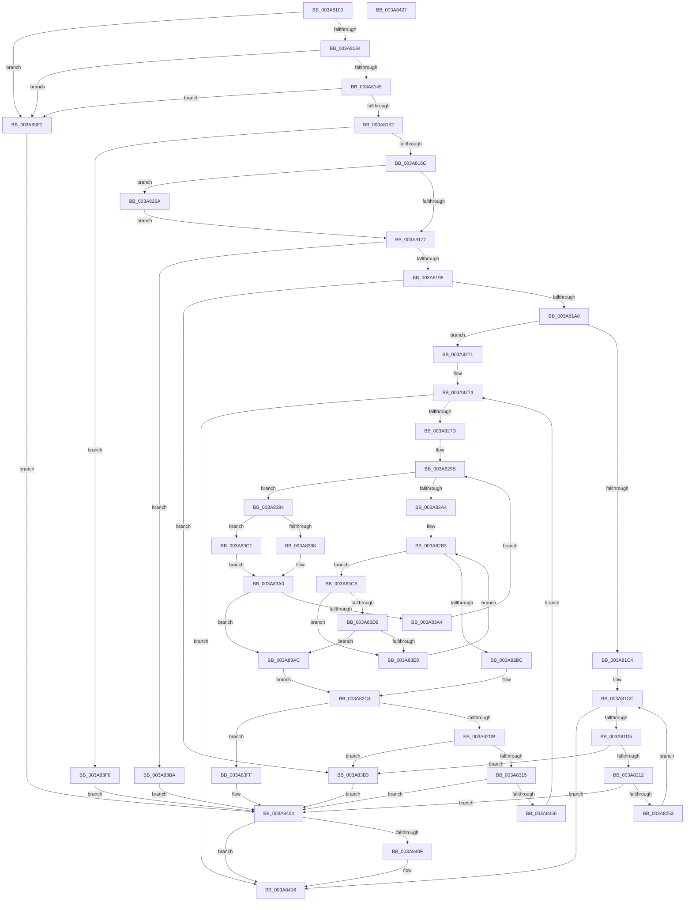

# AuthzBasepCopyoutSecurityAttributes

- RVA: `0x003A8100`–`0x003A8428` (길이 `808` bytes)
- VA: `0x00000001403A8100`
- 실행 섹션: `.text`
- PDB 이름 있음: `예`; PDB Function 태그: `아니요`
- unwind 정보 RVA: `0x00089D74`
- 디코드: `205`개 명령, `808/808` bytes 표시
- 미해석 바이트: `0` (있으면 어셈블리에 `.byte`로 보존)

> 이 문서는 커널 이미지의 기계어와 PDB 기호를 분석해 생성했습니다. 4번과 5번은 함수 원형과 자료형을 바이너리 사용 방식에서 추정한 C 해석이며 원본 소스 복구 결과는 아닙니다.

## 1. Dependencies

- 직접 호출 지점: **8**; 고유 호출 대상: **6**
- 직접 호출자로 확인된 함수: **2**
- RIP 상대 이미지 참조: **0**

### Outgoing calls
- `0x003A815A` → [memset](../6C/memset_function_006C6C40.md) (function, `0x006C6C40`)
- `0x003A8224` → [memcpy](../6C/memcpy_function_006C6840.md) (function, `0x006C6840`)
- `0x003A8246` → [AuthzBasepCopyoutSecurityAttributeValues](AuthzBasepCopyoutSecurityAttributeValues_function_003A85C0.md) (function, `0x003A85C0`)
- `0x003A8327` → [memcpy](../6C/memcpy_function_006C6840.md) (function, `0x006C6840`)
- `0x003A8349` → [AuthzBasepCopyoutSecurityAttributeValues](AuthzBasepCopyoutSecurityAttributeValues_function_003A85C0.md) (function, `0x003A85C0`)
- `0x003A839B` → [RtlEqualUnicodeString](../../page/93/RtlEqualUnicodeString_function_00932A20.md) (function, `0x00932A20`)
- `0x003A83C1` → [AuthzBasepEqualUnicodeStringCaseSensitive](AuthzBasepEqualUnicodeStringCaseSensitive_function_003A8A44.md) (function, `0x003A8A44`)
- `0x003A83E0` → [AuthzBasepEqualUnicodeString](AuthzBasepEqualUnicodeString_function_003A8A80.md) (function, `0x003A8A80`)

### Direct callers
- [sub_003A7982](Unknown_function_003A7982.md) at `0x003A7A44`
- [sub_003A7F1E](Unknown_function_003A7F1E.md) at `0x003A7FD9`

### Static image references
- 디코드된 RIP-relative 메모리 참조가 없습니다.

## 2. Other-region calls and transfers

- 다른 실행 섹션으로 향하는 call: **1**
  - `0x003A839B` → [RtlEqualUnicodeString](../../page/93/RtlEqualUnicodeString_function_00932A20.md) (`.text` → `PAGE`)
- 별도 외부 분기/꼬리 이동을 확인하지 못했습니다.

## 3. Assembly (complete function range)

```asm
003A8100  44 89 44 24 18                  mov dword ptr [rsp + 0x18], r8d
003A8105  48 89 54 24 10                  mov qword ptr [rsp + 0x10], rdx
003A810A  48 89 4C 24 08                  mov qword ptr [rsp + 8], rcx
003A810F  53                              push rbx
003A8110  55                              push rbp
003A8111  56                              push rsi
003A8112  57                              push rdi
003A8113  41 54                           push r12
003A8115  41 55                           push r13
003A8117  41 56                           push r14
003A8119  41 57                           push r15
003A811B  48 83 EC 48                     sub rsp, 0x48
003A811F  4D 8B F9                        mov r15, r9
003A8122  41 8B E8                        mov ebp, r8d
003A8125  4C 8B F2                        mov r14, rdx
003A8128  48 8B F9                        mov rdi, rcx
003A812B  4D 85 C9                        test r9, r9
003A812E  0F 84 BD 02 00 00               je 0x1403a83f1
003A8134  48 8B 84 24 B0 00 00 00         mov rax, qword ptr [rsp + 0xb0]
003A813C  48 85 C0                        test rax, rax
003A813F  0F 84 AC 02 00 00               je 0x1403a83f1
003A8145  4D 8D 24 01                     lea r12, [r9 + rax]
003A8149  4D 3B E1                        cmp r12, r9
003A814C  0F 82 9F 02 00 00               jb 0x1403a83f1
003A8152  4C 8B C0                        mov r8, rax
003A8155  33 D2                           xor edx, edx
003A8157  49 8B C9                        mov rcx, r9
003A815A  E8 E1 EA 31 00                  call 0x1406c6c40
003A815F  49 8D 5F 10                     lea rbx, [r15 + 0x10]
003A8163  49 3B DC                        cmp rbx, r12
003A8166  0F 87 8C 02 00 00               ja 0x1403a83f8
003A816C  8B CD                           mov ecx, ebp
003A816E  4D 85 F6                        test r14, r14
003A8171  0F 84 F3 00 00 00               je 0x1403a826a
003A8177  45 33 C9                        xor r9d, r9d
003A817A  8B C1                           mov eax, ecx
003A817C  BA 28 00 00 00                  mov edx, 0x28
003A8181  4C 89 8C 24 A8 00 00 00         mov qword ptr [rsp + 0xa8], r9
003A8189  48 F7 E2                        mul rdx
003A818C  4C 8B C0                        mov r8, rax
003A818F  48 85 D2                        test rdx, rdx
003A8192  0F 85 22 02 00 00               jne 0x1403a83ba
003A8198  4A 8D 34 03                     lea rsi, [rbx + r8]
003A819C  41 8B C1                        mov eax, r9d
003A819F  49 3B F4                        cmp rsi, r12
003A81A2  0F 87 0B 02 00 00               ja 0x1403a83b3
003A81A8  49 89 5F 08                     mov qword ptr [r15 + 8], rbx
003A81AC  48 83 C3 18                     add rbx, 0x18
003A81B0  41 C7 07 01 00 00 00            mov dword ptr [r15], 1
003A81B7  41 89 4F 04                     mov dword ptr [r15 + 4], ecx
003A81BB  4D 85 F6                        test r14, r14
003A81BE  0F 85 AD 00 00 00               jne 0x1403a8271
003A81C4  4C 8B 77 08                     mov r14, qword ptr [rdi + 8]
003A81C8  48 8D 6F 08                     lea rbp, [rdi + 8]
003A81CC  4C 3B F5                        cmp r14, rbp
003A81CF  0F 84 41 02 00 00               je 0x1403a8416
003A81D5  41 0F B7 46 30                  movzx eax, word ptr [r14 + 0x30]
003A81DA  48 8D 4E 01                     lea rcx, [rsi + 1]
003A81DE  66 89 43 F8                     mov word ptr [rbx - 8], ax
003A81E2  48 83 E1 FE                     and rcx, 0xfffffffffffffffe
003A81E6  41 8B 46 3C                     mov eax, dword ptr [r14 + 0x3c]
003A81EA  89 03                           mov dword ptr [rbx], eax
003A81EC  66 44 89 4B FA                  mov word ptr [rbx - 6], r9w
003A81F1  41 8B 46 34                     mov eax, dword ptr [r14 + 0x34]
003A81F5  89 43 FC                        mov dword ptr [rbx - 4], eax
003A81F8  45 0F B7 46 20                  movzx r8d, word ptr [r14 + 0x20]
003A81FD  4C 89 84 24 A8 00 00 00         mov qword ptr [rsp + 0xa8], r8
003A8205  4A 8D 34 01                     lea rsi, [rcx + r8]
003A8209  49 3B F4                        cmp rsi, r12
003A820C  0F 87 A1 01 00 00               ja 0x1403a83b3
003A8212  66 44 89 43 E8                  mov word ptr [rbx - 0x18], r8w
003A8217  66 44 89 43 EA                  mov word ptr [rbx - 0x16], r8w
003A821C  48 89 4B F0                     mov qword ptr [rbx - 0x10], rcx
003A8220  49 8B 56 28                     mov rdx, qword ptr [r14 + 0x28]
003A8224  E8 17 E6 31 00                  call 0x1406c6840
003A8229  48 8D 84 24 A8 00 00 00         lea rax, [rsp + 0xa8]
003A8231  4D 8B CC                        mov r9, r12
003A8234  4C 2B CE                        sub r9, rsi
003A8237  48 89 44 24 20                  mov qword ptr [rsp + 0x20], rax
003A823C  4C 8B C6                        mov r8, rsi
003A823F  48 8D 53 E8                     lea rdx, [rbx - 0x18]
003A8243  49 8B CE                        mov rcx, r14
003A8246  E8 75 03 00 00                  call 0x1403a85c0
003A824B  85 C0                           test eax, eax
003A824D  0F 88 B1 01 00 00               js 0x1403a8404
003A8253  48 03 B4 24 A8 00 00 00         add rsi, qword ptr [rsp + 0xa8]
003A825B  48 83 C3 28                     add rbx, 0x28
003A825F  4D 8B 36                        mov r14, qword ptr [r14]
003A8262  45 33 C9                        xor r9d, r9d
003A8265  E9 62 FF FF FF                  jmp 0x1403a81cc
003A826A  8B 0F                           mov ecx, dword ptr [rdi]
003A826C  E9 06 FF FF FF                  jmp 0x1403a8177
003A8271  45 8B E9                        mov r13d, r9d
003A8274  44 3B ED                        cmp r13d, ebp
003A8277  0F 83 99 01 00 00               jae 0x1403a8416
003A827D  41 8B ED                        mov ebp, r13d
003A8280  48 C1 E5 04                     shl rbp, 4
003A8284  49 03 EE                        add rbp, r14
003A8287  4C 89 4C 24 30                  mov qword ptr [rsp + 0x30], r9
003A828C  4C 8D 77 08                     lea r14, [rdi + 8]
003A8290  C6 84 24 A8 00 00 00 00         mov byte ptr [rsp + 0xa8], 0
003A8298  49 8B 3E                        mov rdi, qword ptr [r14]
003A829B  49 3B FE                        cmp rdi, r14
003A829E  0F 85 E0 00 00 00               jne 0x1403a8384
003A82A4  48 8B BC 24 90 00 00 00         mov rdi, qword ptr [rsp + 0x90]
003A82AC  48 83 C7 20                     add rdi, 0x20
003A82B0  4C 8B 37                        mov r14, qword ptr [rdi]
003A82B3  4C 3B F7                        cmp r14, rdi
003A82B6  0F 85 0C 01 00 00               jne 0x1403a83c8
003A82BC  0F B6 84 24 A8 00 00 00         movzx eax, byte ptr [rsp + 0xa8]
003A82C4  45 33 C9                        xor r9d, r9d
003A82C7  84 C0                           test al, al
003A82C9  41 8B E9                        mov ebp, r9d
003A82CC  48 0F 45 6C 24 30               cmovne rbp, qword ptr [rsp + 0x30]
003A82D2  48 85 ED                        test rbp, rbp
003A82D5  0F 84 24 01 00 00               je 0x1403a83ff
003A82DB  0F B7 45 30                     movzx eax, word ptr [rbp + 0x30]
003A82DF  48 8D 4E 01                     lea rcx, [rsi + 1]
003A82E3  66 89 43 F8                     mov word ptr [rbx - 8], ax
003A82E7  48 83 E1 FE                     and rcx, 0xfffffffffffffffe
003A82EB  8B 45 3C                        mov eax, dword ptr [rbp + 0x3c]
003A82EE  89 03                           mov dword ptr [rbx], eax
003A82F0  66 44 89 4B FA                  mov word ptr [rbx - 6], r9w
003A82F5  8B 45 34                        mov eax, dword ptr [rbp + 0x34]
003A82F8  89 43 FC                        mov dword ptr [rbx - 4], eax
003A82FB  44 0F B7 45 20                  movzx r8d, word ptr [rbp + 0x20]
003A8300  4C 89 84 24 A8 00 00 00         mov qword ptr [rsp + 0xa8], r8
003A8308  4A 8D 34 01                     lea rsi, [rcx + r8]
003A830C  49 3B F4                        cmp rsi, r12
003A830F  0F 87 9E 00 00 00               ja 0x1403a83b3
003A8315  66 44 89 43 E8                  mov word ptr [rbx - 0x18], r8w
003A831A  66 44 89 43 EA                  mov word ptr [rbx - 0x16], r8w
003A831F  48 89 4B F0                     mov qword ptr [rbx - 0x10], rcx
003A8323  48 8B 55 28                     mov rdx, qword ptr [rbp + 0x28]
003A8327  E8 14 E5 31 00                  call 0x1406c6840
003A832C  48 8D 84 24 A8 00 00 00         lea rax, [rsp + 0xa8]
003A8334  4D 8B CC                        mov r9, r12
003A8337  4C 2B CE                        sub r9, rsi
003A833A  48 89 44 24 20                  mov qword ptr [rsp + 0x20], rax
003A833F  4C 8B C6                        mov r8, rsi
003A8342  48 8D 53 E8                     lea rdx, [rbx - 0x18]
003A8346  48 8B CD                        mov rcx, rbp
003A8349  E8 72 02 00 00                  call 0x1403a85c0
003A834E  85 C0                           test eax, eax
003A8350  0F 88 AE 00 00 00               js 0x1403a8404
003A8356  48 03 B4 24 A8 00 00 00         add rsi, qword ptr [rsp + 0xa8]
003A835E  41 FF C5                        inc r13d
003A8361  48 8B BC 24 90 00 00 00         mov rdi, qword ptr [rsp + 0x90]
003A8369  48 83 C3 28                     add rbx, 0x28
003A836D  4C 8B B4 24 98 00 00 00         mov r14, qword ptr [rsp + 0x98]
003A8375  45 33 C9                        xor r9d, r9d
003A8378  8B AC 24 A0 00 00 00            mov ebp, dword ptr [rsp + 0xa0]
003A837F  E9 F0 FE FF FF                  jmp 0x1403a8274
003A8384  48 89 7C 24 30                  mov qword ptr [rsp + 0x30], rdi
003A8389  48 8D 4F 20                     lea rcx, [rdi + 0x20]
003A838D  44 0F 20 C0                     mov rax, cr8
003A8391  48 8B D5                        mov rdx, rbp
003A8394  3C 02                           cmp al, 2
003A8396  73 29                           jae 0x1403a83c1
003A8398  41 B0 01                        mov r8b, 1
003A839B  E8 80 A6 58 00                  call 0x140932a20
003A83A0  84 C0                           test al, al
003A83A2  75 08                           jne 0x1403a83ac
003A83A4  48 8B 3F                        mov rdi, qword ptr [rdi]
003A83A7  E9 EF FE FF FF                  jmp 0x1403a829b
003A83AC  B0 01                           mov al, 1
003A83AE  E9 11 FF FF FF                  jmp 0x1403a82c4
003A83B3  B8 05 00 00 80                  mov eax, 0x80000005
003A83B8  EB 4A                           jmp 0x1403a8404
003A83BA  B8 95 00 00 C0                  mov eax, 0xc0000095
003A83BF  EB 43                           jmp 0x1403a8404
003A83C1  E8 7E 06 00 00                  call 0x1403a8a44
003A83C6  EB D8                           jmp 0x1403a83a0
003A83C8  41 8B 46 28                     mov eax, dword ptr [r14 + 0x28]
003A83CC  49 8D 4E F0                     lea rcx, [r14 - 0x10]
003A83D0  48 89 4C 24 30                  mov qword ptr [rsp + 0x30], rcx
003A83D5  A8 01                           test al, 1
003A83D7  75 10                           jne 0x1403a83e9
003A83D9  48 83 C1 20                     add rcx, 0x20
003A83DD  48 8B D5                        mov rdx, rbp
003A83E0  E8 9B 06 00 00                  call 0x1403a8a80
003A83E5  84 C0                           test al, al
003A83E7  75 C3                           jne 0x1403a83ac
003A83E9  4D 8B 36                        mov r14, qword ptr [r14]
003A83EC  E9 C2 FE FF FF                  jmp 0x1403a82b3
003A83F1  B8 0D 00 00 C0                  mov eax, 0xc000000d
003A83F6  EB 0C                           jmp 0x1403a8404
003A83F8  B8 23 00 00 C0                  mov eax, 0xc0000023
003A83FD  EB 05                           jmp 0x1403a8404
003A83FF  B8 25 02 00 C0                  mov eax, 0xc0000225
003A8404  48 83 BC 24 B0 00 00 00 10      cmp qword ptr [rsp + 0xb0], 0x10
003A840D  72 07                           jb 0x1403a8416
003A840F  0F 57 C0                        xorps xmm0, xmm0
003A8412  41 0F 11 07                     movups xmmword ptr [r15], xmm0
003A8416  48 83 C4 48                     add rsp, 0x48
003A841A  41 5F                           pop r15
003A841C  41 5E                           pop r14
003A841E  41 5D                           pop r13
003A8420  41 5C                           pop r12
003A8422  5F                              pop rdi
003A8423  5E                              pop rsi
003A8424  5D                              pop rbp
003A8425  5B                              pop rbx
003A8426  C3                              ret
003A8427  CC                              int3
```

## 4. C-style interpretation (structured pseudocode)

```c
__int64 __fastcall AuthzBasepCopyoutSecurityAttributes(__int64 a1, __int64 a2, int a3, __int64 a4, __int64 a5)
{
    __int64 result;
    __int64 v_r13;
    __int64 v_rbp;
    __int64 v_rbx;
    __int64 v_rdi;
    __int64 v_rsi;
    __int64 v_rsp;
    unsigned __int64 v_stack_m58;
    unsigned __int64 v_stack_m68;
    unsigned __int64 v_stack_p10;
    unsigned int v_stack_p18;
    unsigned __int64 v_stack_p20;
    unsigned __int64 v_stack_p8;

    v_stack_p18 = a3;
    v_stack_p10 = a2;
    v_stack_p8 = a1;
    v_rsp = (v_rsp) - (72);
    if (a4 == 0) goto loc_003A83F1;
    if (a5 == 0) goto loc_003A83F1;
    if ((a4 + a5 * 1) < a4) goto loc_003A83F1;
    a2 = 0;
    result = memset(a4, a2, a5, a4);
    if ((a4 + 16) > (a4 + a5 * 1)) goto loc_003A83F8;
    if (0 == 0) goto loc_003A826A;
loc_003A8177:
    a4 = 0;
    v_stack_p20 = 0;
    if (40 != 0) goto loc_003A83BA;
    if ((a4 + 16 + (unsigned int)((unsigned int)((unsigned int)((unsigned int)((unsigned int)(a3))))) * 1) > (a4 + a5 * 1)) goto loc_003A83B3;
    *(unsigned __int64 *)(a4 + 8) = a4 + 16;
    v_rbx = (a4 + 16) + (24);
    *(unsigned int *)(a4) = 1;
    *(unsigned int *)(a4 + 4) = (unsigned int)((unsigned int)((unsigned int)((unsigned int)(a3))));
    if (0 != 0) goto loc_003A8271;
loc_003A81CC:
    if ((*(unsigned __int64 *)(a1 + 8)) == (a1 + 8)) goto loc_003A8416;
    *(unsigned __int16 *)(v_rbx - 8) = (unsigned __int16)(*(unsigned __int16 *)(*(unsigned __int64 *)(a1 + 8) + 48));
    a1 = (a4 + 16 + (unsigned int)((unsigned int)((unsigned int)((unsigned int)((unsigned int)(a3))))) * 1 + 1) & (-2);
    *(unsigned int *)(v_rbx) = (unsigned int)((unsigned int)(*(unsigned int *)(*(unsigned __int64 *)(a1 + 8) + 60)));
    *(unsigned __int16 *)(v_rbx - 6) = 0;
    *(unsigned int *)(v_rbx - 4) = (unsigned int)((unsigned int)(*(unsigned int *)(*(unsigned __int64 *)(a1 + 8) + 52)));
    v_stack_p20 = *(unsigned __int16 *)(*(unsigned __int64 *)(a1 + 8) + 32);
    if ((a1 + *(unsigned __int16 *)(*(unsigned __int64 *)(a1 + 8) + 32) * 1) > (a4 + a5 * 1)) goto loc_003A83B3;
    *(unsigned __int16 *)(v_rbx - 24) = (unsigned __int16)(*(unsigned __int16 *)(*(unsigned __int64 *)(a1 + 8) + 32));
    *(unsigned __int16 *)(v_rbx - 22) = (unsigned __int16)(*(unsigned __int16 *)(*(unsigned __int64 *)(a1 + 8) + 32));
    *(unsigned __int64 *)(v_rbx - 16) = a1;
    result = memcpy(a1, *(unsigned __int64 *)(*(unsigned __int64 *)(a1 + 8) + 40), *(unsigned __int16 *)(*(unsigned __int64 *)(a1 + 8) + 32), a4);
    a4 = (a4 + a5 * 1) - (a1 + *(unsigned __int16 *)(*(unsigned __int64 *)(a1 + 8) + 32) * 1);
    v_stack_m68 = v_stack_p20;
    result = AuthzBasepCopyoutSecurityAttributeValues(*(unsigned __int64 *)(a1 + 8), v_rbx - 24, a1 + *(unsigned __int16 *)(*(unsigned __int64 *)(a1 + 8) + 32) * 1, a4);
    if (sign_flag) goto loc_003A8404;
    v_rsi = (a1 + *(unsigned __int16 *)(*(unsigned __int64 *)(a1 + 8) + 32) * 1) + (v_stack_p20);
    v_rbx = (v_rbx) + (40);
    a4 = 0;
    goto loc_003A81CC;
loc_003A826A:
    goto loc_003A8177;
loc_003A8271:
loc_003A8274:
    if (0 >= ((unsigned int)(a1 + 8))) goto loc_003A8416;
    v_rbp = (0) << (4);
    v_rbp = (v_rbp) + (*(unsigned __int64 *)(*(unsigned __int64 *)(a1 + 8)));
    v_stack_m58 = 0;
    v_stack_p20 = 0;
loc_003A829B:
    if ((*(unsigned __int64 *)(a1 + 8)) != (a1 + 8)) goto loc_003A8384;
    v_rdi = (v_stack_p8) + (32);
loc_003A82B3:
    if ((*(unsigned __int64 *)(v_rdi)) != v_rdi) goto loc_003A83C8;
loc_003A82C4:
    a4 = 0;
    v_rbp = 0;
    if ((unsigned __int8)(v_stack_p20) != 0) { v_rbp = v_stack_m58; }
    if (v_rbp == 0) goto loc_003A83FF;
    *(unsigned __int16 *)(v_rbx - 8) = (unsigned __int16)(*(unsigned __int16 *)(v_rbp + 48));
    a1 = (v_rsi + 1) & (-2);
    *(unsigned int *)(v_rbx) = (unsigned int)((unsigned int)(*(unsigned int *)(v_rbp + 60)));
    *(unsigned __int16 *)(v_rbx - 6) = 0;
    *(unsigned int *)(v_rbx - 4) = (unsigned int)((unsigned int)(*(unsigned int *)(v_rbp + 52)));
    v_stack_p20 = *(unsigned __int16 *)(v_rbp + 32);
    if ((a1 + *(unsigned __int16 *)(v_rbp + 32) * 1) > (a4 + a5 * 1)) goto loc_003A83B3;
    *(unsigned __int16 *)(v_rbx - 24) = (unsigned __int16)(*(unsigned __int16 *)(v_rbp + 32));
    *(unsigned __int16 *)(v_rbx - 22) = (unsigned __int16)(*(unsigned __int16 *)(v_rbp + 32));
    *(unsigned __int64 *)(v_rbx - 16) = a1;
    result = memcpy(a1, *(unsigned __int64 *)(v_rbp + 40), *(unsigned __int16 *)(v_rbp + 32), a4);
    a4 = (a4 + a5 * 1) - (a1 + *(unsigned __int16 *)(v_rbp + 32) * 1);
    v_stack_m68 = v_stack_p20;
    result = AuthzBasepCopyoutSecurityAttributeValues(v_rbp, v_rbx - 24, a1 + *(unsigned __int16 *)(v_rbp + 32) * 1, a4);
    if (sign_flag) goto loc_003A8404;
    v_rsi = (a1 + *(unsigned __int16 *)(v_rbp + 32) * 1) + (v_stack_p20);
    v_r13 = (unsigned int)((0) + 1);
    v_rbx = (v_rbx) + (40);
    a4 = 0;
    goto loc_003A8274;
loc_003A8384:
    v_stack_m58 = v_stack_p8;
    if (((unsigned __int8)(v_cr8)) >= 2) goto loc_003A83C1;
    result = RtlEqualUnicodeString(v_stack_p8 + 32, (unsigned int)(v_stack_p18), 1, a4);
loc_003A83A0:
    if ((unsigned __int8)(result) != 0) goto loc_003A83AC;
    goto loc_003A829B;
loc_003A83AC:
    goto loc_003A82C4;
loc_003A83B3:
    goto loc_003A8404;
loc_003A83BA:
    goto loc_003A8404;
loc_003A83C1:
    result = AuthzBasepEqualUnicodeStringCaseSensitive(v_stack_p8 + 32, (unsigned int)(v_stack_p18), 1, a4);
    goto loc_003A83A0;
loc_003A83C8:
    v_stack_m58 = v_stack_p10 - 16;
    if ((((unsigned __int8)((unsigned int)(*(unsigned int *)(v_stack_p10 + 40)))) & (1)) != 0) goto loc_003A83E9;
    a1 = (v_stack_p10 - 16) + (32);
    result = AuthzBasepEqualUnicodeString(a1, (unsigned int)(v_stack_p18), 1, a4);
    if ((unsigned __int8)(result) != 0) goto loc_003A83AC;
loc_003A83E9:
    goto loc_003A82B3;
loc_003A83F1:
    goto loc_003A8404;
loc_003A83F8:
    goto loc_003A8404;
loc_003A83FF:
loc_003A8404:
    if (a5 >= 16) {
        *(unsigned __int64 *)(a4) = v_xmm0;
    }
    v_rsp = (v_rsp) + (72);
    return (unsigned int)(0xC0000225ULL);
}
```

## 5. (Beta) C Style

```c
int64_t AuthzBasepCopyoutSecurityAttributes(void *Arg1, int64_t Arg2, int32_t Arg3, void *Arg4, int64_t Arg5)
{
    uint8_t *arg1 = (uint8_t *)Arg1;
    uint8_t *arg4 = (uint8_t *)Arg4;

    int64_t result;
    int64_t local_r13;
    int64_t local_rbp;
    int64_t local_rbx;
    int64_t local_rdi;
    int64_t local_rsi;
    int64_t local_rsp;
    uint64_t v_stack_m58;
    uint64_t v_stack_m68;
    uint64_t v_stack_p10;
    uint32_t v_stack_p18;
    uint64_t v_stack_p20;
    uint64_t v_stack_p8;

    v_stack_p18 = Arg3;
    v_stack_p10 = Arg2;
    v_stack_p8 = Arg1;
    local_rsp = (local_rsp) - (72);
    if (Arg4 == NULL) goto loc_003A83F1;
    if (Arg5 == 0) goto loc_003A83F1;
    if ((Arg4 + Arg5 * 1) < Arg4) goto loc_003A83F1;
    Arg2 = 0;
    result = memset(Arg4, Arg2, Arg5, Arg4);
    if ((Arg4 + 16) > (Arg4 + Arg5 * 1)) goto loc_003A83F8;
    if (0 == 0) goto loc_003A826A;
loc_003A8177:
    Arg4 = 0;
    v_stack_p20 = 0;
    if (40 != 0) goto loc_003A83BA;
    if ((Arg4 + 16 + (uint32_t)((uint32_t)((uint32_t)((uint32_t)((uint32_t)(Arg3))))) * 1) > (Arg4 + Arg5 * 1)) goto loc_003A83B3;
    *(void **)(arg4 + 0x8) = Arg4 + 16;
    local_rbx = (Arg4 + 16) + (24);
    *(uint32_t *)(arg4) = 1;
    *(uint32_t *)(arg4 + 0x4) = (uint32_t)((uint32_t)((uint32_t)((uint32_t)(Arg3))));
    if (0 != 0) goto loc_003A8271;
loc_003A81CC:
    if ((*(uint64_t *)(arg1 + 0x8)) == (Arg1 + 8)) goto loc_003A8416;
    *(uint16_t *)(local_rbx - 0x8) = (uint16_t)(*(uint16_t *)(*(uint64_t *)(arg1 + 0x8) + 0x30));
    Arg1 = (Arg4 + 16 + (uint32_t)((uint32_t)((uint32_t)((uint32_t)((uint32_t)(Arg3))))) * 1 + 1) & (-2);
    *(uint32_t *)(local_rbx) = (uint32_t)((uint32_t)(*(uint32_t *)(*(uint64_t *)(arg1 + 0x8) + 0x3C)));
    *(uint16_t *)(local_rbx - 0x6) = 0;
    *(uint32_t *)(local_rbx - 0x4) = (uint32_t)((uint32_t)(*(uint32_t *)(*(uint64_t *)(arg1 + 0x8) + 0x34)));
    v_stack_p20 = *(uint16_t *)(*(uint64_t *)(arg1 + 0x8) + 0x20);
    if ((Arg1 + *(uint16_t *)(*(uint64_t *)(arg1 + 0x8) + 0x20) * 1) > (Arg4 + Arg5 * 1)) goto loc_003A83B3;
    *(uint16_t *)(local_rbx - 0x18) = (uint16_t)(*(uint16_t *)(*(uint64_t *)(arg1 + 0x8) + 0x20));
    *(uint16_t *)(local_rbx - 0x16) = (uint16_t)(*(uint16_t *)(*(uint64_t *)(arg1 + 0x8) + 0x20));
    *(void **)(local_rbx - 0x10) = Arg1;
    result = memcpy(Arg1, *(uint64_t *)(*(uint64_t *)(arg1 + 0x8) + 0x28), *(uint16_t *)(*(uint64_t *)(arg1 + 0x8) + 0x20), Arg4);
    Arg4 = (Arg4 + Arg5 * 1) - (Arg1 + *(uint16_t *)(*(uint64_t *)(arg1 + 0x8) + 0x20) * 1);
    v_stack_m68 = v_stack_p20;
    result = AuthzBasepCopyoutSecurityAttributeValues(*(uint64_t *)(arg1 + 0x8), local_rbx - 24, Arg1 + *(uint16_t *)(*(uint64_t *)(arg1 + 0x8) + 0x20) * 1, Arg4);
    if (sign_flag) goto loc_003A8404;
    local_rsi = (Arg1 + *(uint16_t *)(*(uint64_t *)(arg1 + 0x8) + 0x20) * 1) + (v_stack_p20);
    local_rbx = (local_rbx) + (40);
    Arg4 = 0;
    goto loc_003A81CC;
loc_003A826A:
    goto loc_003A8177;
loc_003A8271:
loc_003A8274:
    if (0 >= ((uint32_t)(Arg1 + 8))) goto loc_003A8416;
    local_rbp = (0) << (4);
    local_rbp = (local_rbp) + (*(uint64_t *)(*(uint64_t *)(arg1 + 0x8)));
    v_stack_m58 = 0;
    v_stack_p20 = 0;
loc_003A829B:
    if ((*(uint64_t *)(arg1 + 0x8)) != (Arg1 + 8)) goto loc_003A8384;
    local_rdi = (v_stack_p8) + (32);
loc_003A82B3:
    if ((*(uint64_t *)(local_rdi)) != local_rdi) goto loc_003A83C8;
loc_003A82C4:
    Arg4 = 0;
    local_rbp = 0;
    if ((uint8_t)(v_stack_p20) != 0) { local_rbp = v_stack_m58; }
    if (local_rbp == 0) goto loc_003A83FF;
    *(uint16_t *)(local_rbx - 0x8) = (uint16_t)(*(uint16_t *)(local_rbp + 0x30));
    Arg1 = (local_rsi + 1) & (-2);
    *(uint32_t *)(local_rbx) = (uint32_t)((uint32_t)(*(uint32_t *)(local_rbp + 0x3C)));
    *(uint16_t *)(local_rbx - 0x6) = 0;
    *(uint32_t *)(local_rbx - 0x4) = (uint32_t)((uint32_t)(*(uint32_t *)(local_rbp + 0x34)));
    v_stack_p20 = *(uint16_t *)(local_rbp + 0x20);
    if ((Arg1 + *(uint16_t *)(local_rbp + 0x20) * 1) > (Arg4 + Arg5 * 1)) goto loc_003A83B3;
    *(uint16_t *)(local_rbx - 0x18) = (uint16_t)(*(uint16_t *)(local_rbp + 0x20));
    *(uint16_t *)(local_rbx - 0x16) = (uint16_t)(*(uint16_t *)(local_rbp + 0x20));
    *(void **)(local_rbx - 0x10) = Arg1;
    result = memcpy(Arg1, *(uint64_t *)(local_rbp + 0x28), *(uint16_t *)(local_rbp + 0x20), Arg4);
    Arg4 = (Arg4 + Arg5 * 1) - (Arg1 + *(uint16_t *)(local_rbp + 0x20) * 1);
    v_stack_m68 = v_stack_p20;
    result = AuthzBasepCopyoutSecurityAttributeValues(local_rbp, local_rbx - 24, Arg1 + *(uint16_t *)(local_rbp + 0x20) * 1, Arg4);
    if (sign_flag) goto loc_003A8404;
    local_rsi = (Arg1 + *(uint16_t *)(local_rbp + 0x20) * 1) + (v_stack_p20);
    local_r13 = (uint32_t)((0) + 1);
    local_rbx = (local_rbx) + (40);
    Arg4 = 0;
    goto loc_003A8274;
loc_003A8384:
    v_stack_m58 = v_stack_p8;
    if (((uint8_t)(v_cr8)) >= 2) goto loc_003A83C1;
    result = RtlEqualUnicodeString(v_stack_p8 + 32, (uint32_t)(v_stack_p18), 1, Arg4);
loc_003A83A0:
    if ((uint8_t)(result) != 0) goto loc_003A83AC;
    goto loc_003A829B;
loc_003A83AC:
    goto loc_003A82C4;
loc_003A83B3:
    goto loc_003A8404;
loc_003A83BA:
    goto loc_003A8404;
loc_003A83C1:
    result = AuthzBasepEqualUnicodeStringCaseSensitive(v_stack_p8 + 32, (uint32_t)(v_stack_p18), 1, Arg4);
    goto loc_003A83A0;
loc_003A83C8:
    v_stack_m58 = v_stack_p10 - 16;
    if ((((uint8_t)((uint32_t)(*(uint32_t *)(v_stack_p10 + 0x28)))) & (1)) != 0) goto loc_003A83E9;
    Arg1 = (v_stack_p10 - 16) + (32);
    result = AuthzBasepEqualUnicodeString(Arg1, (uint32_t)(v_stack_p18), 1, Arg4);
    if ((uint8_t)(result) != 0) goto loc_003A83AC;
loc_003A83E9:
    goto loc_003A82B3;
loc_003A83F1:
    goto loc_003A8404;
loc_003A83F8:
    goto loc_003A8404;
loc_003A83FF:
loc_003A8404:
    if (Arg5 >= 16) {
        *(uint64_t *)(arg4) = v_xmm0;
    }
    local_rsp = (local_rsp) + (72);
    return (uint32_t)(0xC0000225ULL);
}
```

### 관측된 메모리 오프셋

구조체 형식이 확인되지 않은 접근은 인자 기준의 오프셋으로만 기록했습니다.

| 기준 인자 | 오프셋 표현 | 폭 (bit) | 접근 |
|---|---:|---:|---|
| `Arg1` | `+ 0x0` | `32` | `R` |
| `Arg1` | `+ 0x8` | `64` | `R` |
| `Arg4` | `+ 0x0` | `32` | `W` |
| `Arg4` | `+ 0x0` | `128` | `R` |
| `Arg4` | `+ 0x4` | `32` | `W` |
| `Arg4` | `+ 0x8` | `64` | `W` |
| `Arg4` | `+ 0x10` | `64` | `R` |

## 6. Execution-region graph

[열기: 2D/3D 그래프와 함수 탐색 컨트롤 패널](../../../control-panel.html?section=text&rva=0x003A8100&view=graph)

- 2D 그래프는 위에서 아래로 흐르고, 3D 그래프는 빈 공간을 드래그해 회전합니다. Shift+드래그는 이동, 휠은 확대·축소, 함수 노드 선택은 대상 보고서 이동입니다.

### Static fallback


