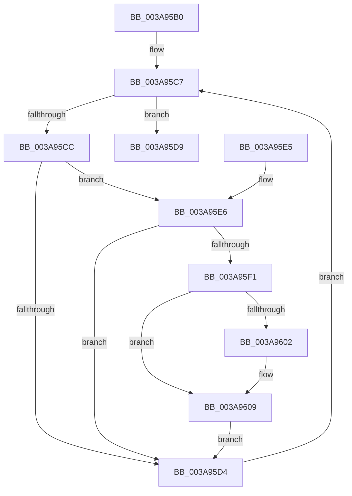

# AuthzBasepDeleteAllSecurityAttributeValues

- RVA: `0x003A95B0`–`0x003A9620` (길이 `112` bytes)
- VA: `0x00000001403A95B0`
- 실행 섹션: `.text`
- PDB 이름 있음: `예`; PDB Function 태그: `아니요`
- unwind 정보 RVA: `0x00089F6C`
- 디코드: `38`개 명령, `112/112` bytes 표시
- 미해석 바이트: `0` (있으면 어셈블리에 `.byte`로 보존)

> 이 문서는 커널 이미지의 기계어와 PDB 기호를 분석해 생성했습니다. 4번과 5번은 함수 원형과 자료형을 바이너리 사용 방식에서 추정한 C 해석이며 원본 소스 복구 결과는 아닙니다.

## 1. Dependencies

- 직접 호출 지점: **1**; 고유 호출 대상: **1**
- 직접 호출자로 확인된 함수: **2**
- RIP 상대 이미지 참조: **0**

### Outgoing calls
- `0x003A95BB` → [AuthzBasepFreeSecurityAttributeValues](AuthzBasepFreeSecurityAttributeValues_function_003A9630.md) (function, `0x003A9630`)

### Direct callers
- [AuthzBasepDeleteSecurityAttribute](AuthzBasepDeleteSecurityAttribute_function_003A8AA8.md) at `0x003A8B58`
- [AuthzBasepDeleteAllSecurityAttributes](../69/AuthzBasepDeleteAllSecurityAttributes_function_0069D568.md) at `0x0069D59B`

### Static image references
- 디코드된 RIP-relative 메모리 참조가 없습니다.

## 2. Other-region calls and transfers

- 다른 실행 섹션으로 향하는 call: **0**
- 별도 외부 분기/꼬리 이동을 확인하지 못했습니다.

## 3. Assembly (complete function range)

```asm
003A95B0  40 53                           push rbx
003A95B2  48 83 EC 20                     sub rsp, 0x20
003A95B6  B2 01                           mov dl, 1
003A95B8  48 8B D9                        mov rbx, rcx
003A95BB  E8 70 00 00 00                  call 0x1403a9630
003A95C0  48 8D 53 48                     lea rdx, [rbx + 0x48]
003A95C4  48 8B 02                        mov rax, qword ptr [rdx]
003A95C7  48 3B C2                        cmp rax, rdx
003A95CA  74 0D                           je 0x1403a95d9
003A95CC  8B 48 20                        mov ecx, dword ptr [rax + 0x20]
003A95CF  F6 C1 02                        test cl, 2
003A95D2  74 12                           je 0x1403a95e6
003A95D4  48 8B 00                        mov rax, qword ptr [rax]
003A95D7  EB EE                           jmp 0x1403a95c7
003A95D9  8B 43 3C                        mov eax, dword ptr [rbx + 0x3c]
003A95DC  89 43 40                        mov dword ptr [rbx + 0x40], eax
003A95DF  48 83 C4 20                     add rsp, 0x20
003A95E3  5B                              pop rbx
003A95E4  C3                              ret
003A95E5  CC                              int3
003A95E6  83 C9 04                        or ecx, 4
003A95E9  89 48 20                        mov dword ptr [rax + 0x20], ecx
003A95EC  F6 C1 02                        test cl, 2
003A95EF  75 E3                           jne 0x1403a95d4
003A95F1  4C 8D 43 60                     lea r8, [rbx + 0x60]
003A95F5  4D 8B 48 08                     mov r9, qword ptr [r8 + 8]
003A95F9  48 8D 48 10                     lea rcx, [rax + 0x10]
003A95FD  4D 39 01                        cmp qword ptr [r9], r8
003A9600  74 07                           je 0x1403a9609
003A9602  B9 03 00 00 00                  mov ecx, 3
003A9607  CD 29                           int 0x29
003A9609  4C 89 01                        mov qword ptr [rcx], r8
003A960C  4C 89 49 08                     mov qword ptr [rcx + 8], r9
003A9610  49 89 09                        mov qword ptr [r9], rcx
003A9613  49 89 48 08                     mov qword ptr [r8 + 8], rcx
003A9617  83 48 20 02                     or dword ptr [rax + 0x20], 2
003A961B  FF 43 58                        inc dword ptr [rbx + 0x58]
003A961E  EB B4                           jmp 0x1403a95d4
```

## 4. C-style interpretation (structured pseudocode)

```c
__int64 __fastcall AuthzBasepDeleteAllSecurityAttributeValues(__int64 a1)
{
    __int64 result;
    __int64 v_rsp;

    v_rsp = (v_rsp) - (32);
    result = AuthzBasepFreeSecurityAttributeValues(a1, 1, a3, a4);
loc_003A95C7:
    if ((*(unsigned __int64 *)(a1 + 72)) == (a1 + 72)) goto loc_003A95D9;
    if ((((unsigned __int8)((unsigned int)(*(unsigned int *)(*(unsigned __int64 *)(a1 + 72) + 32)))) & (2)) == 0) goto loc_003A95E6;
loc_003A95D4:
    goto loc_003A95C7;
loc_003A95D9:
    *(unsigned int *)(a1 + 64) = (unsigned int)((unsigned int)(*(unsigned int *)(a1 + 60)));
    v_rsp = (v_rsp) + (32);
    return (unsigned int)(*(unsigned int *)(a1 + 60));
loc_003A95E6:
    a1 = (unsigned int)(((unsigned int)(*(unsigned int *)(*(unsigned __int64 *)(a1 + 72) + 32))) | (4));
    *(unsigned int *)((unsigned int)(*(unsigned int *)(a1 + 60)) + 32) = (unsigned int)(a1);
    if ((((unsigned __int8)(a1)) & (2)) != 0) goto loc_003A95D4;
    if ((*(unsigned __int64 *)(*(unsigned __int64 *)(a1 + 96 + 8))) != (a1 + 96)) {
        a1 = 3;
    }
    *(unsigned __int64 *)(a1) = a1 + 96;
    *(unsigned __int64 *)(a1 + 8) = *(unsigned __int64 *)(a1 + 96 + 8);
    *(unsigned __int64 *)(*(unsigned __int64 *)(a1 + 96 + 8)) = a1;
    *(unsigned __int64 *)(a1 + 96 + 8) = a1;
    goto loc_003A95D4;
}
```

## 5. (Beta) C Style

```c
int64_t AuthzBasepDeleteAllSecurityAttributeValues(void *Arg1)
{
    uint8_t *arg1 = (uint8_t *)Arg1;

    int64_t result;
    int64_t local_rsp;

    local_rsp = (local_rsp) - (32);
    result = AuthzBasepFreeSecurityAttributeValues(Arg1, 1, a3, a4);
loc_003A95C7:
    if ((*(uint64_t *)(arg1 + 0x48)) == (Arg1 + 72)) goto loc_003A95D9;
    if ((((uint8_t)((uint32_t)(*(uint32_t *)(*(uint64_t *)(arg1 + 0x48) + 0x20)))) & (2)) == 0) goto loc_003A95E6;
loc_003A95D4:
    goto loc_003A95C7;
loc_003A95D9:
    *(uint32_t *)(arg1 + 0x40) = (uint32_t)((uint32_t)(*(uint32_t *)(arg1 + 0x3C)));
    local_rsp = (local_rsp) + (32);
    return (uint32_t)(*(uint32_t *)(arg1 + 0x3C));
loc_003A95E6:
    Arg1 = (uint32_t)(((uint32_t)(*(uint32_t *)(*(uint64_t *)(arg1 + 0x48) + 0x20))) | (4));
    *(uint32_t *)((uint32_t)(*(uint32_t *)(arg1 + 0x3C)) + 0x20) = (uint32_t)(Arg1);
    if ((((uint8_t)(Arg1)) & (2)) != 0) goto loc_003A95D4;
    if ((*(uint64_t *)(*(uint64_t *)(arg1 + 0x60 + 0x8))) != (Arg1 + 96)) {
        Arg1 = 3;
    }
    *(void **)(arg1) = Arg1 + 96;
    *(uint64_t *)(arg1 + 0x8) = *(uint64_t *)(arg1 + 0x60 + 0x8);
    *(void **)(*(uint64_t *)(arg1 + 0x60 + 0x8)) = Arg1;
    *(void **)(arg1 + 0x60 + 0x8) = Arg1;
    goto loc_003A95D4;
}
```

### 관측된 메모리 오프셋

구조체 형식이 확인되지 않은 접근은 인자 기준의 오프셋으로만 기록했습니다.

| 기준 인자 | 오프셋 표현 | 폭 (bit) | 접근 |
|---|---:|---:|---|
| `Arg1` | `+ 0x0` | `64` | `R` |
| `Arg1` | `+ 0x8` | `64` | `R` |
| `Arg1` | `+ 0x8` | `64` | `W` |
| `Arg1` | `+ 0x3C` | `32` | `R` |
| `Arg1` | `+ 0x40` | `32` | `W` |
| `Arg1` | `+ 0x48` | `64` | `R` |
| `Arg1` | `+ 0x58` | `32` | `R/W` |
| `Arg1` | `+ 0x60` | `64` | `R` |

## 6. Execution-region graph

[열기: 2D/3D 그래프와 함수 탐색 컨트롤 패널](../../../control-panel.html?section=text&rva=0x003A95B0&view=graph)

- 2D 그래프는 위에서 아래로 흐르고, 3D 그래프는 빈 공간을 드래그해 회전합니다. Shift+드래그는 이동, 휠은 확대·축소, 함수 노드 선택은 대상 보고서 이동입니다.

### Static fallback


