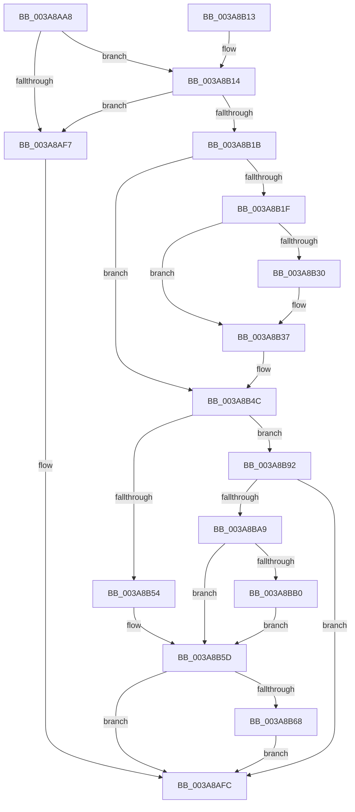

# AuthzBasepDeleteSecurityAttribute

- RVA: `0x003A8AA8`–`0x003A8BB6` (길이 `270` bytes)
- VA: `0x00000001403A8AA8`
- 실행 섹션: `.text`
- PDB 이름 있음: `예`; PDB Function 태그: `아니요`
- unwind 정보 RVA: `0x00089E7C`
- 디코드: `80`개 명령, `270/270` bytes 표시
- 미해석 바이트: `0` (있으면 어셈블리에 `.byte`로 보존)

> 이 문서는 커널 이미지의 기계어와 PDB 기호를 분석해 생성했습니다. 4번과 5번은 함수 원형과 자료형을 바이너리 사용 방식에서 추정한 C 해석이며 원본 소스 복구 결과는 아닙니다.

## 1. Dependencies

- 직접 호출 지점: **6**; 고유 호출 대상: **6**
- 직접 호출자로 확인된 함수: **2**
- RIP 상대 이미지 참조: **0**

### Outgoing calls
- `0x003A8AEA` → [AuthzBasepFindSecurityAttribute](AuthzBasepFindSecurityAttribute_function_003A8980.md) (function, `0x003A8980`)
- `0x003A8B58` → [AuthzBasepDeleteAllSecurityAttributeValues](AuthzBasepDeleteAllSecurityAttributeValues_function_003A95B0.md) (function, `0x003A95B0`)
- `0x003A8B74` → [AuthzBasepRemoveSecurityAttributeFromLists](AuthzBasepRemoveSecurityAttributeFromLists_function_003A9960.md) (function, `0x003A9960`)
- `0x003A8B7E` → [AuthzBasepFreeSecurityAttributeValues](AuthzBasepFreeSecurityAttributeValues_function_003A9630.md) (function, `0x003A9630`)
- `0x003A8B88` → [ExFreePoolWithTag](../../poolcode/B8/ExFreePoolWithTag_function_00B82870.md) (function, `0x00B82870`)
- `0x003A8B9A` → [AuthzBasepDeleteSecurityAttributeValues](../4F/AuthzBasepDeleteSecurityAttributeValues_function_004F9B00.md) (function, `0x004F9B00`)

### Direct callers
- [AuthzBasepReplaceSecurityAttribute](AuthzBasepReplaceSecurityAttribute_function_003A8CAC.md) at `0x003A8CDF`
- [AuthzBasepSetSecurityAttributesToken](AuthzBasepSetSecurityAttributesToken_function_003A8D1C.md) at `0x003A8DE0`

### Static image references
- 디코드된 RIP-relative 메모리 참조가 없습니다.

## 2. Other-region calls and transfers

- 다른 실행 섹션으로 향하는 call: **1**
  - `0x003A8B88` → [ExFreePoolWithTag](../../poolcode/B8/ExFreePoolWithTag_function_00B82870.md) (`.text` → `POOLCODE`)
- 별도 외부 분기/꼬리 이동을 확인하지 못했습니다.

## 3. Assembly (complete function range)

```asm
003A8AA8  48 8B C4                        mov rax, rsp
003A8AAB  48 89 58 08                     mov qword ptr [rax + 8], rbx
003A8AAF  48 89 68 18                     mov qword ptr [rax + 0x18], rbp
003A8AB3  48 89 70 20                     mov qword ptr [rax + 0x20], rsi
003A8AB7  57                              push rdi
003A8AB8  48 83 EC 30                     sub rsp, 0x30
003A8ABC  0F 57 C0                        xorps xmm0, xmm0
003A8ABF  48 8B F2                        mov rsi, rdx
003A8AC2  0F 11 40 E8                     movups xmmword ptr [rax - 0x18], xmm0
003A8AC6  33 FF                           xor edi, edi
003A8AC8  48 8B E9                        mov rbp, rcx
003A8ACB  40 88 78 10                     mov byte ptr [rax + 0x10], dil
003A8ACF  0F B7 02                        movzx eax, word ptr [rdx]
003A8AD2  66 89 44 24 20                  mov word ptr [rsp + 0x20], ax
003A8AD7  66 89 44 24 22                  mov word ptr [rsp + 0x22], ax
003A8ADC  48 8B 42 08                     mov rax, qword ptr [rdx + 8]
003A8AE0  48 8D 54 24 20                  lea rdx, [rsp + 0x20]
003A8AE5  48 89 44 24 28                  mov qword ptr [rsp + 0x28], rax
003A8AEA  E8 91 FE FF FF                  call 0x1403a8980
003A8AEF  48 8B D8                        mov rbx, rax
003A8AF2  48 85 C0                        test rax, rax
003A8AF5  75 1D                           jne 0x1403a8b14
003A8AF7  BF 25 02 00 C0                  mov edi, 0xc0000225
003A8AFC  48 8B 5C 24 40                  mov rbx, qword ptr [rsp + 0x40]
003A8B01  8B C7                           mov eax, edi
003A8B03  48 8B 6C 24 50                  mov rbp, qword ptr [rsp + 0x50]
003A8B08  48 8B 74 24 58                  mov rsi, qword ptr [rsp + 0x58]
003A8B0D  48 83 C4 30                     add rsp, 0x30
003A8B11  5F                              pop rdi
003A8B12  C3                              ret
003A8B13  CC                              int3
003A8B14  8B 40 38                        mov eax, dword ptr [rax + 0x38]
003A8B17  A8 04                           test al, 4
003A8B19  75 DC                           jne 0x1403a8af7
003A8B1B  A8 02                           test al, 2
003A8B1D  75 2D                           jne 0x1403a8b4c
003A8B1F  48 8D 4D 20                     lea rcx, [rbp + 0x20]
003A8B23  48 8B 51 08                     mov rdx, qword ptr [rcx + 8]
003A8B27  48 8D 43 10                     lea rax, [rbx + 0x10]
003A8B2B  48 39 0A                        cmp qword ptr [rdx], rcx
003A8B2E  74 07                           je 0x1403a8b37
003A8B30  B9 03 00 00 00                  mov ecx, 3
003A8B35  CD 29                           int 0x29
003A8B37  48 89 08                        mov qword ptr [rax], rcx
003A8B3A  48 89 50 08                     mov qword ptr [rax + 8], rdx
003A8B3E  48 89 02                        mov qword ptr [rdx], rax
003A8B41  48 89 41 08                     mov qword ptr [rcx + 8], rax
003A8B45  83 4B 38 02                     or dword ptr [rbx + 0x38], 2
003A8B49  FF 45 18                        inc dword ptr [rbp + 0x18]
003A8B4C  48 8B CB                        mov rcx, rbx
003A8B4F  39 7E 18                        cmp dword ptr [rsi + 0x18], edi
003A8B52  75 3E                           jne 0x1403a8b92
003A8B54  83 4B 38 04                     or dword ptr [rbx + 0x38], 4
003A8B58  E8 53 0A 00 00                  call 0x1403a95b0
003A8B5D  8B 4B 38                        mov ecx, dword ptr [rbx + 0x38]
003A8B60  80 E1 05                        and cl, 5
003A8B63  80 F9 04                        cmp cl, 4
003A8B66  75 94                           jne 0x1403a8afc
003A8B68  41 B1 01                        mov r9b, 1
003A8B6B  45 33 C0                        xor r8d, r8d
003A8B6E  48 8B D3                        mov rdx, rbx
003A8B71  48 8B CD                        mov rcx, rbp
003A8B74  E8 E7 0D 00 00                  call 0x1403a9960
003A8B79  48 8B CB                        mov rcx, rbx
003A8B7C  33 D2                           xor edx, edx
003A8B7E  E8 AD 0A 00 00                  call 0x1403a9630
003A8B83  33 D2                           xor edx, edx
003A8B85  48 8B CB                        mov rcx, rbx
003A8B88  E8 E3 9C 7D 00                  call 0x140b82870
003A8B8D  E9 6A FF FF FF                  jmp 0x1403a8afc
003A8B92  4C 8D 44 24 48                  lea r8, [rsp + 0x48]
003A8B97  48 8B D6                        mov rdx, rsi
003A8B9A  E8 61 0F 15 00                  call 0x1404f9b00
003A8B9F  8B F8                           mov edi, eax
003A8BA1  85 C0                           test eax, eax
003A8BA3  0F 88 53 FF FF FF               js 0x1403a8afc
003A8BA9  80 7C 24 48 00                  cmp byte ptr [rsp + 0x48], 0
003A8BAE  74 AD                           je 0x1403a8b5d
003A8BB0  83 4B 38 04                     or dword ptr [rbx + 0x38], 4
003A8BB4  EB A7                           jmp 0x1403a8b5d
```

## 4. C-style interpretation (structured pseudocode)

```c
__int64 __fastcall AuthzBasepDeleteSecurityAttribute(__int64 a1, __int64 a2, int a3)
{
    __int64 result;
    __int64 v_rdi;
    __int64 v_rsp;
    unsigned __int64 v_stack_m10;
    unsigned __int16 v_stack_m16;
    unsigned __int16 v_stack_m18;
    unsigned __int64 v_stack_p18;
    unsigned __int64 v_stack_p20;
    unsigned __int64 v_stack_p48;
    unsigned __int64 v_stack_p8;

    *(unsigned __int64 *)(v_rsp + 8) = v_rbx;
    *(unsigned __int64 *)(v_rsp + 24) = v_rbp;
    *(unsigned __int64 *)(v_rsp + 32) = v_rsi;
    v_rsp = (v_rsp) - (48);
    *(unsigned __int64 *)(v_rsp - 24) = v_xmm0;
    v_rdi = 0;
    *(unsigned __int8 *)(v_rsp + 16) = 0;
    v_stack_m18 = (unsigned __int16)(*(unsigned __int16 *)(a2));
    v_stack_m16 = (unsigned __int16)(*(unsigned __int16 *)(a2));
    v_stack_m10 = *(unsigned __int64 *)(a2 + 8);
    result = AuthzBasepFindSecurityAttribute(a1, v_stack_m18, a3, a4);
    if (result != 0) goto loc_003A8B14;
loc_003A8AF7:
loc_003A8AFC:
    v_rsp = (v_rsp) + (48);
    return (unsigned int)((unsigned int)((unsigned int)(0xC0000225ULL)));
loc_003A8B14:
    if ((((unsigned __int8)((unsigned int)(*(unsigned int *)((unsigned int)((unsigned int)((unsigned int)(0xC0000225ULL))) + 56)))) & (4)) != 0) goto loc_003A8AF7;
    if ((((unsigned __int8)((unsigned int)(*(unsigned int *)((unsigned int)((unsigned int)((unsigned int)(0xC0000225ULL))) + 56)))) & (2)) != 0) goto loc_003A8B4C;
    if ((*(unsigned __int64 *)(*(unsigned __int64 *)(v_stack_p18 + 32 + 8))) != (v_stack_p18 + 32)) {
        a1 = 3;
    }
    *(unsigned __int64 *)(v_stack_p8 + 16) = a1;
    *(unsigned __int64 *)(v_stack_p8 + 16 + 8) = *(unsigned __int64 *)(v_stack_p18 + 32 + 8);
    *(unsigned __int64 *)(*(unsigned __int64 *)(v_stack_p18 + 32 + 8)) = v_stack_p8 + 16;
    *(unsigned __int64 *)(a1 + 8) = v_stack_p8 + 16;
loc_003A8B4C:
    if ((*(unsigned int *)(v_stack_p20 + 24)) != ((unsigned int)((unsigned int)(0xC0000225ULL)))) goto loc_003A8B92;
    result = AuthzBasepDeleteAllSecurityAttributeValues(v_stack_p8, *(unsigned __int64 *)(v_stack_p18 + 32 + 8), a3, a4);
loc_003A8B5D:
    a1 = (unsigned __int8)(((unsigned int)(*(unsigned int *)(v_stack_p8 + 56))) & (5));
    if (((unsigned __int8)(a1)) != 4) goto loc_003A8AFC;
    a3 = 0;
    result = AuthzBasepRemoveSecurityAttributeFromLists(v_stack_p18, v_stack_p8, a3, 1);
    a2 = 0;
    result = AuthzBasepFreeSecurityAttributeValues(v_stack_p8, a2, a3, 1);
    a2 = 0;
    result = ExFreePoolWithTag(v_stack_p8, a2, a3, 1);
    goto loc_003A8AFC;
loc_003A8B92:
    result = AuthzBasepDeleteSecurityAttributeValues(v_stack_p8, v_stack_p20, v_stack_p48, 1);
    if (sign_flag) goto loc_003A8AFC;
    if (v_stack_p48 == 0) goto loc_003A8B5D;
    goto loc_003A8B5D;
}
```

## 5. (Beta) C Style

```c
int64_t AuthzBasepDeleteSecurityAttribute(void *Arg1, void *Arg2, int32_t Arg3)
{
    uint8_t *arg1 = (uint8_t *)Arg1;
    uint8_t *arg2 = (uint8_t *)Arg2;

    int64_t result;
    int64_t local_rdi;
    int64_t local_rsp;
    uint64_t v_stack_m10;
    uint16_t v_stack_m16;
    uint16_t v_stack_m18;
    uint64_t v_stack_p18;
    uint64_t v_stack_p20;
    uint64_t v_stack_p48;
    uint64_t v_stack_p8;

    *(uint64_t *)(local_rsp + 0x8) = local_rbx;
    *(uint64_t *)(local_rsp + 0x18) = local_rbp;
    *(uint64_t *)(local_rsp + 0x20) = local_rsi;
    local_rsp = (local_rsp) - (48);
    *(uint64_t *)(local_rsp - 0x18) = v_xmm0;
    local_rdi = 0;
    *(uint8_t *)(local_rsp + 0x10) = 0;
    v_stack_m18 = (uint16_t)(*(uint16_t *)(arg2));
    v_stack_m16 = (uint16_t)(*(uint16_t *)(arg2));
    v_stack_m10 = *(uint64_t *)(arg2 + 0x8);
    result = AuthzBasepFindSecurityAttribute(Arg1, v_stack_m18, Arg3, a4);
    if (result != 0) goto loc_003A8B14;
loc_003A8AF7:
loc_003A8AFC:
    local_rsp = (local_rsp) + (48);
    return (uint32_t)((uint32_t)((uint32_t)(0xC0000225ULL)));
loc_003A8B14:
    if ((((uint8_t)((uint32_t)(*(uint32_t *)((uint32_t)((uint32_t)((uint32_t)(0xC0000225ULL))) + 0x38)))) & (4)) != 0) goto loc_003A8AF7;
    if ((((uint8_t)((uint32_t)(*(uint32_t *)((uint32_t)((uint32_t)((uint32_t)(0xC0000225ULL))) + 0x38)))) & (2)) != 0) goto loc_003A8B4C;
    if ((*(uint64_t *)(*(uint64_t *)(v_stack_p18 + 0x20 + 0x8))) != (v_stack_p18 + 32)) {
        Arg1 = 3;
    }
    *(void **)(v_stack_p8 + 0x10) = Arg1;
    *(uint64_t *)(v_stack_p8 + 0x10 + 0x8) = *(uint64_t *)(v_stack_p18 + 0x20 + 0x8);
    *(uint64_t *)(*(uint64_t *)(v_stack_p18 + 0x20 + 0x8)) = v_stack_p8 + 16;
    *(uint64_t *)(arg1 + 0x8) = v_stack_p8 + 16;
loc_003A8B4C:
    if ((*(uint32_t *)(v_stack_p20 + 0x18)) != ((uint32_t)((uint32_t)(0xC0000225ULL)))) goto loc_003A8B92;
    result = AuthzBasepDeleteAllSecurityAttributeValues(v_stack_p8, *(uint64_t *)(v_stack_p18 + 0x20 + 0x8), Arg3, a4);
loc_003A8B5D:
    Arg1 = (uint8_t)(((uint32_t)(*(uint32_t *)(v_stack_p8 + 0x38))) & (5));
    if (((uint8_t)(Arg1)) != 4) goto loc_003A8AFC;
    Arg3 = 0;
    result = AuthzBasepRemoveSecurityAttributeFromLists(v_stack_p18, v_stack_p8, Arg3, 1);
    Arg2 = 0;
    result = AuthzBasepFreeSecurityAttributeValues(v_stack_p8, Arg2, Arg3, 1);
    Arg2 = 0;
    result = ExFreePoolWithTag(v_stack_p8, Arg2, Arg3, 1);
    goto loc_003A8AFC;
loc_003A8B92:
    result = AuthzBasepDeleteSecurityAttributeValues(v_stack_p8, v_stack_p20, v_stack_p48, 1);
    if (sign_flag) goto loc_003A8AFC;
    if (v_stack_p48 == 0) goto loc_003A8B5D;
    goto loc_003A8B5D;
}
```

### 관측된 메모리 오프셋

구조체 형식이 확인되지 않은 접근은 인자 기준의 오프셋으로만 기록했습니다.

| 기준 인자 | 오프셋 표현 | 폭 (bit) | 접근 |
|---|---:|---:|---|
| `Arg1` | `+ 0x8` | `64` | `R` |
| `Arg1` | `+ 0x18` | `32` | `R/W` |
| `Arg1` | `+ 0x20` | `64` | `R` |
| `Arg2` | `+ 0x0` | `16` | `R` |
| `Arg2` | `+ 0x8` | `64` | `R` |
| `Arg2` | `+ 0x18` | `32` | `R` |

## 6. Execution-region graph

[열기: 2D/3D 그래프와 함수 탐색 컨트롤 패널](../../../control-panel.html?section=text&rva=0x003A8AA8&view=graph)

- 2D 그래프는 위에서 아래로 흐르고, 3D 그래프는 빈 공간을 드래그해 회전합니다. Shift+드래그는 이동, 휠은 확대·축소, 함수 노드 선택은 대상 보고서 이동입니다.

### Static fallback


