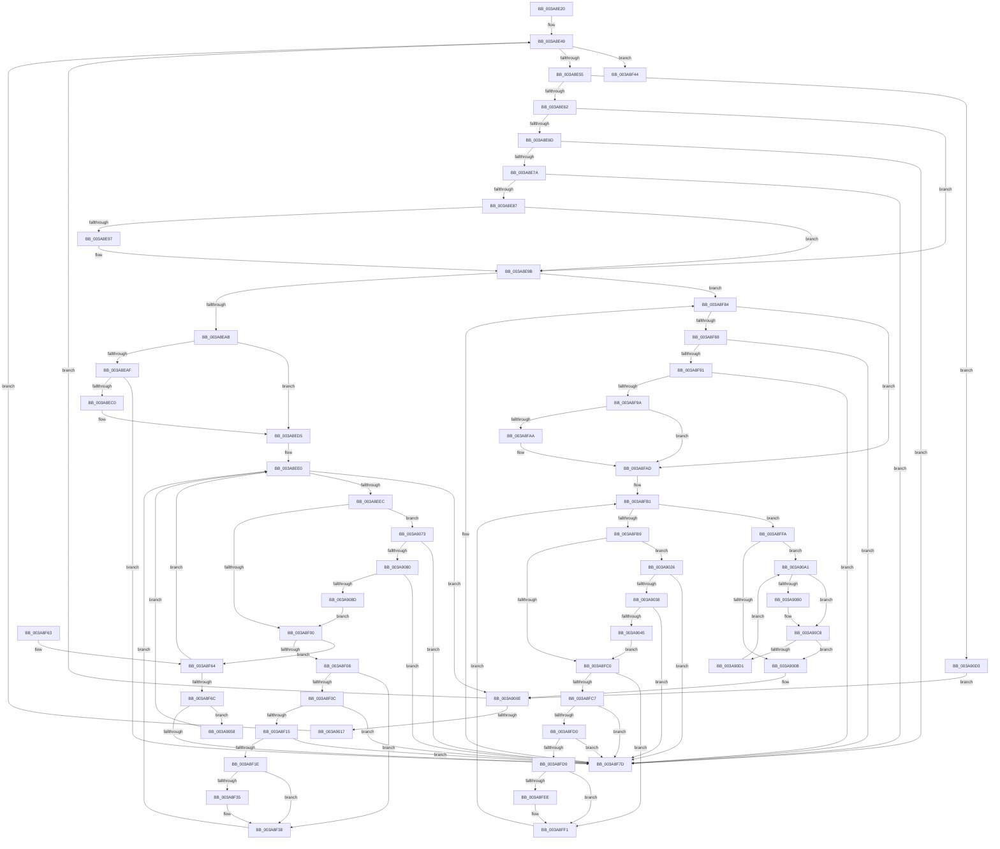

# AuthzBasepFinaliseSecurityAttributesList

- RVA: `0x003A8E20`–`0x003A90E6` (길이 `710` bytes)
- VA: `0x00000001403A8E20`
- 실행 섹션: `.text`
- PDB 이름 있음: `예`; PDB Function 태그: `아니요`
- unwind 정보 RVA: `0x00089ED0`
- 디코드: `204`개 명령, `710/710` bytes 표시
- 미해석 바이트: `0` (있으면 어셈블리에 `.byte`로 보존)

> 이 문서는 커널 이미지의 기계어와 PDB 기호를 분석해 생성했습니다. 4번과 5번은 함수 원형과 자료형을 바이너리 사용 방식에서 추정한 C 해석이며 원본 소스 복구 결과는 아닙니다.

## 1. Dependencies

- 직접 호출 지점: **6**; 고유 호출 대상: **3**
- 직접 호출자로 확인된 함수: **1**
- RIP 상대 이미지 참조: **0**

### Outgoing calls
- `0x003A8F3D` → [ExFreePoolWithTag](../../poolcode/B8/ExFreePoolWithTag_function_00B82870.md) (function, `0x00B82870`)
- `0x003A8FF3` → [ExFreePoolWithTag](../../poolcode/B8/ExFreePoolWithTag_function_00B82870.md) (function, `0x00B82870`)
- `0x003A901C` → [ExFreePoolWithTag](../../poolcode/B8/ExFreePoolWithTag_function_00B82870.md) (function, `0x00B82870`)
- `0x003A90B9` → [AuthzBasepRemoveSecurityAttributeValueFromLists](../30/AuthzBasepRemoveSecurityAttributeValueFromLists_function_00302E00.md) (function, `0x00302E00`)
- `0x003A90C3` → [ExFreePoolWithTag](../../poolcode/B8/ExFreePoolWithTag_function_00B82870.md) (function, `0x00B82870`)
- `0x003A90D9` → [AuthzBasepRollbackSecurityAttributeChanges](../69/AuthzBasepRollbackSecurityAttributeChanges_function_0069D5C0.md) (function, `0x0069D5C0`)

### Direct callers
- [AuthzBasepSetSecurityAttributesToken](AuthzBasepSetSecurityAttributesToken_function_003A8D1C.md) at `0x003A8DBC`

### Static image references
- 디코드된 RIP-relative 메모리 참조가 없습니다.

## 2. Other-region calls and transfers

- 다른 실행 섹션으로 향하는 call: **4**
  - `0x003A8F3D` → [ExFreePoolWithTag](../../poolcode/B8/ExFreePoolWithTag_function_00B82870.md) (`.text` → `POOLCODE`)
  - `0x003A8FF3` → [ExFreePoolWithTag](../../poolcode/B8/ExFreePoolWithTag_function_00B82870.md) (`.text` → `POOLCODE`)
  - `0x003A901C` → [ExFreePoolWithTag](../../poolcode/B8/ExFreePoolWithTag_function_00B82870.md) (`.text` → `POOLCODE`)
  - `0x003A90C3` → [ExFreePoolWithTag](../../poolcode/B8/ExFreePoolWithTag_function_00B82870.md) (`.text` → `POOLCODE`)
- 별도 외부 분기/꼬리 이동을 확인하지 못했습니다.

## 3. Assembly (complete function range)

```asm
003A8E20  48 89 5C 24 10                  mov qword ptr [rsp + 0x10], rbx
003A8E25  48 89 74 24 18                  mov qword ptr [rsp + 0x18], rsi
003A8E2A  48 89 7C 24 20                  mov qword ptr [rsp + 0x20], rdi
003A8E2F  41 54                           push r12
003A8E31  41 56                           push r14
003A8E33  41 57                           push r15
003A8E35  48 83 EC 20                     sub rsp, 0x20
003A8E39  44 0F B6 E2                     movzx r12d, dl
003A8E3D  48 89 6C 24 40                  mov qword ptr [rsp + 0x40], rbp
003A8E42  4C 8B F9                        mov r15, rcx
003A8E45  48 8D 71 20                     lea rsi, [rcx + 0x20]
003A8E49  48 8B 06                        mov rax, qword ptr [rsi]
003A8E4C  48 3B C6                        cmp rax, rsi
003A8E4F  0F 84 EF 00 00 00               je 0x1403a8f44
003A8E55  48 8D 58 F0                     lea rbx, [rax - 0x10]
003A8E59  45 84 E4                        test r12b, r12b
003A8E5C  0F 84 71 02 00 00               je 0x1403a90d3
003A8E62  8B 4B 38                        mov ecx, dword ptr [rbx + 0x38]
003A8E65  40 32 ED                        xor bpl, bpl
003A8E68  F6 C1 02                        test cl, 2
003A8E6B  74 2E                           je 0x1403a8e9b
003A8E6D  48 8B 10                        mov rdx, qword ptr [rax]
003A8E70  48 39 42 08                     cmp qword ptr [rdx + 8], rax
003A8E74  0F 85 03 01 00 00               jne 0x1403a8f7d
003A8E7A  48 8B 48 08                     mov rcx, qword ptr [rax + 8]
003A8E7E  48 39 01                        cmp qword ptr [rcx], rax
003A8E81  0F 85 F6 00 00 00               jne 0x1403a8f7d
003A8E87  48 89 11                        mov qword ptr [rcx], rdx
003A8E8A  48 89 4A 08                     mov qword ptr [rdx + 8], rcx
003A8E8E  83 63 38 FD                     and dword ptr [rbx + 0x38], 0xfffffffd
003A8E92  4D 85 FF                        test r15, r15
003A8E95  74 04                           je 0x1403a8e9b
003A8E97  41 FF 4F 18                     dec dword ptr [r15 + 0x18]
003A8E9B  8B 43 38                        mov eax, dword ptr [rbx + 0x38]
003A8E9E  8B C8                           mov ecx, eax
003A8EA0  83 E1 01                        and ecx, 1
003A8EA3  A8 04                           test al, 4
003A8EA5  0F 85 D9 00 00 00               jne 0x1403a8f84
003A8EAB  85 C9                           test ecx, ecx
003A8EAD  75 26                           jne 0x1403a8ed5
003A8EAF  49 8B 4F 10                     mov rcx, qword ptr [r15 + 0x10]
003A8EB3  49 8D 47 08                     lea rax, [r15 + 8]
003A8EB7  48 39 01                        cmp qword ptr [rcx], rax
003A8EBA  0F 85 BD 00 00 00               jne 0x1403a8f7d
003A8EC0  48 89 03                        mov qword ptr [rbx], rax
003A8EC3  48 89 4B 08                     mov qword ptr [rbx + 8], rcx
003A8EC7  48 89 19                        mov qword ptr [rcx], rbx
003A8ECA  48 89 58 08                     mov qword ptr [rax + 8], rbx
003A8ECE  83 4B 38 01                     or dword ptr [rbx + 0x38], 1
003A8ED2  41 FF 07                        inc dword ptr [r15]
003A8ED5  48 8D 7B 60                     lea rdi, [rbx + 0x60]
003A8ED9  0F 1F 80 00 00 00 00            nop dword ptr [rax]
003A8EE0  48 8B 0F                        mov rcx, qword ptr [rdi]
003A8EE3  48 3B CF                        cmp rcx, rdi
003A8EE6  0F 84 22 01 00 00               je 0x1403a900e
003A8EEC  8B 41 10                        mov eax, dword ptr [rcx + 0x10]
003A8EEF  4C 8D 41 F0                     lea r8, [rcx - 0x10]
003A8EF3  8B D0                           mov edx, eax
003A8EF5  83 E2 04                        and edx, 4
003A8EF8  A8 02                           test al, 2
003A8EFA  0F 85 73 01 00 00               jne 0x1403a9073
003A8F00  41 8B 40 20                     mov eax, dword ptr [r8 + 0x20]
003A8F04  85 D2                           test edx, edx
003A8F06  74 5C                           je 0x1403a8f64
003A8F08  A8 01                           test al, 1
003A8F0A  74 2C                           je 0x1403a8f38
003A8F0C  49 8B 08                        mov rcx, qword ptr [r8]
003A8F0F  4C 39 41 08                     cmp qword ptr [rcx + 8], r8
003A8F13  75 68                           jne 0x1403a8f7d
003A8F15  49 8B 40 08                     mov rax, qword ptr [r8 + 8]
003A8F19  4C 39 00                        cmp qword ptr [rax], r8
003A8F1C  75 5F                           jne 0x1403a8f7d
003A8F1E  48 89 08                        mov qword ptr [rax], rcx
003A8F21  48 89 41 08                     mov qword ptr [rcx + 8], rax
003A8F25  41 83 60 20 FE                  and dword ptr [r8 + 0x20], 0xfffffffe
003A8F2A  FF 4B 3C                        dec dword ptr [rbx + 0x3c]
003A8F2D  41 8B 40 20                     mov eax, dword ptr [r8 + 0x20]
003A8F31  A8 04                           test al, 4
003A8F33  74 03                           je 0x1403a8f38
003A8F35  FF 4B 40                        dec dword ptr [rbx + 0x40]
003A8F38  33 D2                           xor edx, edx
003A8F3A  49 8B C8                        mov rcx, r8
003A8F3D  E8 2E 99 7D 00                  call 0x140b82870
003A8F42  EB 9C                           jmp 0x1403a8ee0
003A8F44  48 8B 6C 24 40                  mov rbp, qword ptr [rsp + 0x40]
003A8F49  48 8B 5C 24 48                  mov rbx, qword ptr [rsp + 0x48]
003A8F4E  48 8B 74 24 50                  mov rsi, qword ptr [rsp + 0x50]
003A8F53  48 8B 7C 24 58                  mov rdi, qword ptr [rsp + 0x58]
003A8F58  48 83 C4 20                     add rsp, 0x20
003A8F5C  41 5F                           pop r15
003A8F5E  41 5E                           pop r14
003A8F60  41 5C                           pop r12
003A8F62  C3                              ret
003A8F63  CC                              int3
003A8F64  A8 01                           test al, 1
003A8F66  0F 85 74 FF FF FF               jne 0x1403a8ee0
003A8F6C  48 8B 4B 50                     mov rcx, qword ptr [rbx + 0x50]
003A8F70  48 8D 43 48                     lea rax, [rbx + 0x48]
003A8F74  48 39 01                        cmp qword ptr [rcx], rax
003A8F77  0F 84 DB 00 00 00               je 0x1403a9058
003A8F7D  B9 03 00 00 00                  mov ecx, 3
003A8F82  CD 29                           int 0x29
003A8F84  85 C9                           test ecx, ecx
003A8F86  74 25                           je 0x1403a8fad
003A8F88  48 8B 0B                        mov rcx, qword ptr [rbx]
003A8F8B  48 39 59 08                     cmp qword ptr [rcx + 8], rbx
003A8F8F  75 EC                           jne 0x1403a8f7d
003A8F91  48 8B 43 08                     mov rax, qword ptr [rbx + 8]
003A8F95  48 39 18                        cmp qword ptr [rax], rbx
003A8F98  75 E3                           jne 0x1403a8f7d
003A8F9A  48 89 08                        mov qword ptr [rax], rcx
003A8F9D  48 89 41 08                     mov qword ptr [rcx + 8], rax
003A8FA1  83 63 38 FE                     and dword ptr [rbx + 0x38], 0xfffffffe
003A8FA5  4D 85 FF                        test r15, r15
003A8FA8  74 03                           je 0x1403a8fad
003A8FAA  41 FF 0F                        dec dword ptr [r15]
003A8FAD  48 8D 7B 48                     lea rdi, [rbx + 0x48]
003A8FB1  48 8B 0F                        mov rcx, qword ptr [rdi]
003A8FB4  48 3B CF                        cmp rcx, rdi
003A8FB7  74 41                           je 0x1403a8ffa
003A8FB9  8B 41 20                        mov eax, dword ptr [rcx + 0x20]
003A8FBC  A8 02                           test al, 2
003A8FBE  75 66                           jne 0x1403a9026
003A8FC0  8B 41 20                        mov eax, dword ptr [rcx + 0x20]
003A8FC3  A8 01                           test al, 1
003A8FC5  74 2A                           je 0x1403a8ff1
003A8FC7  48 8B 11                        mov rdx, qword ptr [rcx]
003A8FCA  48 39 4A 08                     cmp qword ptr [rdx + 8], rcx
003A8FCE  75 AD                           jne 0x1403a8f7d
003A8FD0  48 8B 41 08                     mov rax, qword ptr [rcx + 8]
003A8FD4  48 39 08                        cmp qword ptr [rax], rcx
003A8FD7  75 A4                           jne 0x1403a8f7d
003A8FD9  48 89 10                        mov qword ptr [rax], rdx
003A8FDC  48 89 42 08                     mov qword ptr [rdx + 8], rax
003A8FE0  83 61 20 FE                     and dword ptr [rcx + 0x20], 0xfffffffe
003A8FE4  FF 4B 3C                        dec dword ptr [rbx + 0x3c]
003A8FE7  8B 41 20                        mov eax, dword ptr [rcx + 0x20]
003A8FEA  A8 04                           test al, 4
003A8FEC  74 03                           je 0x1403a8ff1
003A8FEE  FF 4B 40                        dec dword ptr [rbx + 0x40]
003A8FF1  33 D2                           xor edx, edx
003A8FF3  E8 78 98 7D 00                  call 0x140b82870
003A8FF8  EB B7                           jmp 0x1403a8fb1
003A8FFA  4C 8B 73 60                     mov r14, qword ptr [rbx + 0x60]
003A8FFE  48 8D 7B 60                     lea rdi, [rbx + 0x60]
003A9002  4C 3B F7                        cmp r14, rdi
003A9005  0F 85 96 00 00 00               jne 0x1403a90a1
003A900B  40 B5 01                        mov bpl, 1
003A900E  40 84 ED                        test bpl, bpl
003A9011  0F 84 32 FE FF FF               je 0x1403a8e49
003A9017  33 D2                           xor edx, edx
003A9019  48 8B CB                        mov rcx, rbx
003A901C  E8 4F 98 7D 00                  call 0x140b82870
003A9021  E9 23 FE FF FF                  jmp 0x1403a8e49
003A9026  4C 8B 41 10                     mov r8, qword ptr [rcx + 0x10]
003A902A  48 8D 41 10                     lea rax, [rcx + 0x10]
003A902E  49 39 40 08                     cmp qword ptr [r8 + 8], rax
003A9032  0F 85 45 FF FF FF               jne 0x1403a8f7d
003A9038  48 8B 50 08                     mov rdx, qword ptr [rax + 8]
003A903C  48 39 02                        cmp qword ptr [rdx], rax
003A903F  0F 85 38 FF FF FF               jne 0x1403a8f7d
003A9045  4C 89 02                        mov qword ptr [rdx], r8
003A9048  49 89 50 08                     mov qword ptr [r8 + 8], rdx
003A904C  83 61 20 FD                     and dword ptr [rcx + 0x20], 0xfffffffd
003A9050  FF 4B 58                        dec dword ptr [rbx + 0x58]
003A9053  E9 68 FF FF FF                  jmp 0x1403a8fc0
003A9058  49 89 00                        mov qword ptr [r8], rax
003A905B  49 89 48 08                     mov qword ptr [r8 + 8], rcx
003A905F  4C 89 01                        mov qword ptr [rcx], r8
003A9062  4C 89 40 08                     mov qword ptr [rax + 8], r8
003A9066  41 83 48 20 01                  or dword ptr [r8 + 0x20], 1
003A906B  FF 43 3C                        inc dword ptr [rbx + 0x3c]
003A906E  E9 6D FE FF FF                  jmp 0x1403a8ee0
003A9073  4C 8B 09                        mov r9, qword ptr [rcx]
003A9076  49 39 49 08                     cmp qword ptr [r9 + 8], rcx
003A907A  0F 85 FD FE FF FF               jne 0x1403a8f7d
003A9080  48 8B 41 08                     mov rax, qword ptr [rcx + 8]
003A9084  48 39 08                        cmp qword ptr [rax], rcx
003A9087  0F 85 F0 FE FF FF               jne 0x1403a8f7d
003A908D  4C 89 08                        mov qword ptr [rax], r9
003A9090  49 89 41 08                     mov qword ptr [r9 + 8], rax
003A9094  41 83 60 20 FD                  and dword ptr [r8 + 0x20], 0xfffffffd
003A9099  FF 4B 58                        dec dword ptr [rbx + 0x58]
003A909C  E9 5F FE FF FF                  jmp 0x1403a8f00
003A90A1  41 8B 46 10                     mov eax, dword ptr [r14 + 0x10]
003A90A5  4D 8D 5E F0                     lea r11, [r14 - 0x10]
003A90A9  4D 8B 36                        mov r14, qword ptr [r14]
003A90AC  A8 01                           test al, 1
003A90AE  75 18                           jne 0x1403a90c8
003A90B0  45 33 C0                        xor r8d, r8d
003A90B3  49 8B D3                        mov rdx, r11
003A90B6  48 8B CB                        mov rcx, rbx
003A90B9  E8 42 9D F5 FF                  call 0x140302e00
003A90BE  49 8B CB                        mov rcx, r11
003A90C1  33 D2                           xor edx, edx
003A90C3  E8 A8 97 7D 00                  call 0x140b82870
003A90C8  4C 3B F7                        cmp r14, rdi
003A90CB  0F 84 3A FF FF FF               je 0x1403a900b
003A90D1  EB CE                           jmp 0x1403a90a1
003A90D3  48 8B D3                        mov rdx, rbx
003A90D6  49 8B CF                        mov rcx, r15
003A90D9  E8 E2 44 2F 00                  call 0x14069d5c0
003A90DE  0F B6 E8                        movzx ebp, al
003A90E1  E9 28 FF FF FF                  jmp 0x1403a900e
```

## 4. C-style interpretation (structured pseudocode)

```c
__int64 __fastcall AuthzBasepFinaliseSecurityAttributesList(__int64 a1, unsigned __int8 a2)
{
    __int64 result;
    __int64 v_rbp;
    __int64 v_rsp;
    unsigned __int64 v_stack_p10;
    unsigned __int64 v_stack_p18;
    unsigned __int64 v_stack_p20;
    unsigned __int64 v_stack_p8;

    v_stack_p10 = v_rbx;
    v_stack_p18 = v_rsi;
    v_stack_p20 = v_rdi;
    v_rsp = (v_rsp) - (32);
    v_stack_p8 = v_rbp;
loc_003A8E49:
    if ((*(unsigned __int64 *)(a1 + 32)) == (a1 + 32)) goto loc_003A8F44;
    if (a2 == 0) goto loc_003A90D3;
    v_rbp = 0;
    if ((((unsigned __int8)((unsigned int)(*(unsigned int *)(*(unsigned __int64 *)(a1 + 32) - 16 + 56)))) & (2)) == 0) goto loc_003A8E9B;
    if ((*(unsigned __int64 *)(*(unsigned __int64 *)(*(unsigned __int64 *)(a1 + 32)) + 8)) != (*(unsigned __int64 *)(a1 + 32))) goto loc_003A8F7D;
    if ((*(unsigned __int64 *)(*(unsigned __int64 *)(*(unsigned __int64 *)(a1 + 32) + 8))) != (*(unsigned __int64 *)(a1 + 32))) goto loc_003A8F7D;
    *(unsigned __int64 *)(*(unsigned __int64 *)(*(unsigned __int64 *)(a1 + 32) + 8)) = *(unsigned __int64 *)(*(unsigned __int64 *)(a1 + 32));
    *(unsigned __int64 *)(*(unsigned __int64 *)(*(unsigned __int64 *)(a1 + 32)) + 8) = *(unsigned __int64 *)(*(unsigned __int64 *)(a1 + 32) + 8);
    if (a1 != 0) {
    }
    a1 = (unsigned int)(((unsigned int)((unsigned int)((unsigned int)(*(unsigned int *)(*(unsigned __int64 *)(a1 + 32) - 16 + 56))))) & (1));
    if ((((unsigned __int8)((unsigned int)(*(unsigned int *)(*(unsigned __int64 *)(a1 + 32) - 16 + 56)))) & (4)) != 0) goto loc_003A8F84;
    if ((unsigned int)(a1) != 0) goto loc_003A8ED5;
    if ((*(unsigned __int64 *)(*(unsigned __int64 *)(a1 + 16))) != (a1 + 8)) goto loc_003A8F7D;
    *(unsigned __int64 *)(*(unsigned __int64 *)(a1 + 32) - 16) = a1 + 8;
    *(unsigned __int64 *)(*(unsigned __int64 *)(a1 + 32) - 16 + 8) = *(unsigned __int64 *)(a1 + 16);
    *(unsigned __int64 *)(*(unsigned __int64 *)(a1 + 16)) = *(unsigned __int64 *)(a1 + 32) - 16;
    *(unsigned __int64 *)(a1 + 8 + 8) = *(unsigned __int64 *)(a1 + 32) - 16;
loc_003A8ED5:
loc_003A8EE0:
    if ((*(unsigned __int64 *)(*(unsigned __int64 *)(a1 + 32) - 16 + 96)) == (*(unsigned __int64 *)(a1 + 32) - 16 + 96)) goto loc_003A900E;
    a2 = (unsigned int)(((unsigned int)((unsigned int)((unsigned int)(*(unsigned int *)(*(unsigned __int64 *)(*(unsigned __int64 *)(a1 + 32) - 16 + 96) + 16))))) & (4));
    if ((((unsigned __int8)((unsigned int)(*(unsigned int *)(*(unsigned __int64 *)(*(unsigned __int64 *)(a1 + 32) - 16 + 96) + 16)))) & (2)) != 0) goto loc_003A9073;
loc_003A8F00:
    if (a2 == 0) goto loc_003A8F64;
    if ((((unsigned __int8)((unsigned int)(*(unsigned int *)(*(unsigned __int64 *)(*(unsigned __int64 *)(a1 + 32) - 16 + 96) - 16 + 32)))) & (1)) == 0) goto loc_003A8F38;
    if ((*(unsigned __int64 *)(*(unsigned __int64 *)(*(unsigned __int64 *)(*(unsigned __int64 *)(a1 + 32) - 16 + 96) - 16) + 8)) != (*(unsigned __int64 *)(*(unsigned __int64 *)(a1 + 32) - 16 + 96) - 16)) goto loc_003A8F7D;
    if ((*(unsigned __int64 *)(*(unsigned __int64 *)(*(unsigned __int64 *)(*(unsigned __int64 *)(a1 + 32) - 16 + 96) - 16 + 8))) != (*(unsigned __int64 *)(*(unsigned __int64 *)(a1 + 32) - 16 + 96) - 16)) goto loc_003A8F7D;
    *(unsigned __int64 *)(*(unsigned __int64 *)(*(unsigned __int64 *)(*(unsigned __int64 *)(a1 + 32) - 16 + 96) - 16 + 8)) = *(unsigned __int64 *)(*(unsigned __int64 *)(*(unsigned __int64 *)(a1 + 32) - 16 + 96) - 16);
    *(unsigned __int64 *)(*(unsigned __int64 *)(*(unsigned __int64 *)(*(unsigned __int64 *)(a1 + 32) - 16 + 96) - 16) + 8) = *(unsigned __int64 *)(*(unsigned __int64 *)(*(unsigned __int64 *)(a1 + 32) - 16 + 96) - 16 + 8);
    if ((((unsigned __int8)((unsigned int)(*(unsigned int *)(*(unsigned __int64 *)(*(unsigned __int64 *)(a1 + 32) - 16 + 96) - 16 + 32)))) & (4)) != 0) {
    }
    a2 = 0;
    result = ExFreePoolWithTag(*(unsigned __int64 *)(*(unsigned __int64 *)(a1 + 32) - 16 + 96) - 16, a2, *(unsigned __int64 *)(*(unsigned __int64 *)(a1 + 32) - 16 + 96) - 16, a4);
    goto loc_003A8EE0;
loc_003A8F44:
    v_rsp = (v_rsp) + (32);
    return result;
loc_003A8F64:
    if ((((unsigned __int8)(result)) & (1)) != 0) goto loc_003A8EE0;
    if ((*(unsigned __int64 *)(*(unsigned __int64 *)(v_stack_p10 + 80))) == (v_stack_p10 + 72)) goto loc_003A9058;
loc_003A8F7D:
loc_003A8F84:
    if (3 == 0) goto loc_003A8FAD;
    if ((*(unsigned __int64 *)(*(unsigned __int64 *)(v_stack_p10) + 8)) != v_stack_p10) goto loc_003A8F7D;
    if ((*(unsigned __int64 *)(*(unsigned __int64 *)(v_stack_p10 + 8))) != v_stack_p10) goto loc_003A8F7D;
    *(unsigned __int64 *)(*(unsigned __int64 *)(v_stack_p10 + 8)) = *(unsigned __int64 *)(v_stack_p10);
    *(unsigned __int64 *)(*(unsigned __int64 *)(v_stack_p10) + 8) = *(unsigned __int64 *)(v_stack_p10 + 8);
    if (a1 != 0) {
    }
loc_003A8FB1:
    if ((*(unsigned __int64 *)(v_stack_p10 + 72)) == (v_stack_p10 + 72)) goto loc_003A8FFA;
    if ((((unsigned __int8)((unsigned int)(*(unsigned int *)(*(unsigned __int64 *)(v_stack_p10 + 72) + 32)))) & (2)) != 0) goto loc_003A9026;
loc_003A8FC0:
    if ((((unsigned __int8)((unsigned int)(*(unsigned int *)(*(unsigned __int64 *)(v_stack_p10 + 72) + 32)))) & (1)) == 0) goto loc_003A8FF1;
    if ((*(unsigned __int64 *)(*(unsigned __int64 *)(*(unsigned __int64 *)(v_stack_p10 + 72)) + 8)) != (*(unsigned __int64 *)(v_stack_p10 + 72))) goto loc_003A8F7D;
    if ((*(unsigned __int64 *)(*(unsigned __int64 *)(*(unsigned __int64 *)(v_stack_p10 + 72) + 8))) != (*(unsigned __int64 *)(v_stack_p10 + 72))) goto loc_003A8F7D;
    *(unsigned __int64 *)(*(unsigned __int64 *)(*(unsigned __int64 *)(v_stack_p10 + 72) + 8)) = *(unsigned __int64 *)(*(unsigned __int64 *)(v_stack_p10 + 72));
    *(unsigned __int64 *)(*(unsigned __int64 *)(*(unsigned __int64 *)(v_stack_p10 + 72)) + 8) = *(unsigned __int64 *)(*(unsigned __int64 *)(v_stack_p10 + 72) + 8);
    if ((((unsigned __int8)((unsigned int)(*(unsigned int *)(*(unsigned __int64 *)(v_stack_p10 + 72) + 32)))) & (4)) != 0) {
    }
    a2 = 0;
    result = ExFreePoolWithTag(*(unsigned __int64 *)(v_stack_p10 + 72), a2, *(unsigned __int64 *)(*(unsigned __int64 *)(a1 + 32) - 16 + 96) - 16, a4);
    goto loc_003A8FB1;
loc_003A8FFA:
    if ((*(unsigned __int64 *)(v_stack_p10 + 96)) != (v_stack_p10 + 96)) goto loc_003A90A1;
loc_003A900B:
loc_003A900E:
    if (1 == 0) goto loc_003A8E49;
    a2 = 0;
    result = ExFreePoolWithTag(v_stack_p10, a2, *(unsigned __int64 *)(*(unsigned __int64 *)(a1 + 32) - 16 + 96) - 16, a4);
    goto loc_003A8E49;
loc_003A9026:
    if ((*(unsigned __int64 *)(*(unsigned __int64 *)(v_stack_p10 + 16) + 8)) != (v_stack_p10 + 16)) goto loc_003A8F7D;
    if ((*(unsigned __int64 *)(*(unsigned __int64 *)(v_stack_p10 + 16 + 8))) != (v_stack_p10 + 16)) goto loc_003A8F7D;
    *(unsigned __int64 *)(*(unsigned __int64 *)(v_stack_p10 + 16 + 8)) = *(unsigned __int64 *)(v_stack_p10 + 16);
    *(unsigned __int64 *)(*(unsigned __int64 *)(v_stack_p10 + 16) + 8) = *(unsigned __int64 *)(v_stack_p10 + 16 + 8);
    goto loc_003A8FC0;
loc_003A9058:
    *(unsigned __int64 *)(*(unsigned __int64 *)(v_stack_p10 + 16)) = v_stack_p10 + 16;
    *(unsigned __int64 *)(*(unsigned __int64 *)(v_stack_p10 + 16) + 8) = v_stack_p10;
    *(unsigned __int64 *)(v_stack_p10) = *(unsigned __int64 *)(v_stack_p10 + 16);
    *(unsigned __int64 *)(v_stack_p10 + 16 + 8) = *(unsigned __int64 *)(v_stack_p10 + 16);
    goto loc_003A8EE0;
loc_003A9073:
    if ((*(unsigned __int64 *)(*(unsigned __int64 *)(v_stack_p10) + 8)) != v_stack_p10) goto loc_003A8F7D;
    if ((*(unsigned __int64 *)(*(unsigned __int64 *)(v_stack_p10 + 8))) != v_stack_p10) goto loc_003A8F7D;
    *(unsigned __int64 *)(*(unsigned __int64 *)(v_stack_p10 + 8)) = *(unsigned __int64 *)(v_stack_p10);
    *(unsigned __int64 *)(*(unsigned __int64 *)(v_stack_p10) + 8) = *(unsigned __int64 *)(v_stack_p10 + 8);
    goto loc_003A8F00;
loc_003A90A1:
    result = (unsigned int)(*(unsigned int *)(*(unsigned __int64 *)(v_stack_p10 + 96) + 16));
    if ((((unsigned __int8)((unsigned int)(*(unsigned int *)(*(unsigned __int64 *)(v_stack_p10 + 96) + 16)))) & (1)) == 0) {
        a3 = 0;
        a2 = *(unsigned __int64 *)(v_stack_p10 + 96) - 16;
        a1 = v_stack_p10;
        result = AuthzBasepRemoveSecurityAttributeValueFromLists(a1, a2, a3, *(unsigned __int64 *)(v_stack_p10));
        a1 = *(unsigned __int64 *)(v_stack_p10 + 96) - 16;
        a2 = 0;
        result = ExFreePoolWithTag(a1, a2, a3, *(unsigned __int64 *)(v_stack_p10));
    }
    if ((*(unsigned __int64 *)(*(unsigned __int64 *)(v_stack_p10 + 96))) == (v_stack_p10 + 96)) goto loc_003A900B;
    goto loc_003A90A1;
loc_003A90D3:
    result = AuthzBasepRollbackSecurityAttributeChanges(a1, v_stack_p10, a3, *(unsigned __int64 *)(v_stack_p10));
    goto loc_003A900E;
}
```

## 5. (Beta) C Style

```c
int64_t AuthzBasepFinaliseSecurityAttributesList(void *Arg1, uint8_t Arg2)
{
    uint8_t *arg1 = (uint8_t *)Arg1;

    int64_t result;
    int64_t local_rbp;
    int64_t local_rsp;
    uint64_t v_stack_p10;
    uint64_t v_stack_p18;
    uint64_t v_stack_p20;
    uint64_t v_stack_p8;

    v_stack_p10 = local_rbx;
    v_stack_p18 = local_rsi;
    v_stack_p20 = local_rdi;
    local_rsp = (local_rsp) - (32);
    v_stack_p8 = local_rbp;
loc_003A8E49:
    if ((*(uint64_t *)(arg1 + 0x20)) == (Arg1 + 32)) goto loc_003A8F44;
    if (Arg2 == 0) goto loc_003A90D3;
    local_rbp = 0;
    if ((((uint8_t)((uint32_t)(*(uint32_t *)(*(uint64_t *)(arg1 + 0x20) - 0x10 + 0x38)))) & (2)) == 0) goto loc_003A8E9B;
    if ((*(uint64_t *)(*(uint64_t *)(*(uint64_t *)(arg1 + 0x20)) + 0x8)) != (*(uint64_t *)(arg1 + 0x20))) goto loc_003A8F7D;
    if ((*(uint64_t *)(*(uint64_t *)(*(uint64_t *)(arg1 + 0x20) + 0x8))) != (*(uint64_t *)(arg1 + 0x20))) goto loc_003A8F7D;
    *(uint64_t *)(*(uint64_t *)(*(uint64_t *)(arg1 + 0x20) + 0x8)) = *(uint64_t *)(*(uint64_t *)(arg1 + 0x20));
    *(uint64_t *)(*(uint64_t *)(*(uint64_t *)(arg1 + 0x20)) + 0x8) = *(uint64_t *)(*(uint64_t *)(arg1 + 0x20) + 0x8);
    if (Arg1 != NULL) {
    }
    Arg1 = (uint32_t)(((uint32_t)((uint32_t)((uint32_t)(*(uint32_t *)(*(uint64_t *)(arg1 + 0x20) - 0x10 + 0x38))))) & (1));
    if ((((uint8_t)((uint32_t)(*(uint32_t *)(*(uint64_t *)(arg1 + 0x20) - 0x10 + 0x38)))) & (4)) != 0) goto loc_003A8F84;
    if ((uint32_t)(Arg1) != 0) goto loc_003A8ED5;
    if ((*(uint64_t *)(*(uint64_t *)(arg1 + 0x10))) != (Arg1 + 8)) goto loc_003A8F7D;
    *(void **)(*(uint64_t *)(arg1 + 0x20) - 0x10) = Arg1 + 8;
    *(uint64_t *)(*(uint64_t *)(arg1 + 0x20) - 0x10 + 0x8) = *(uint64_t *)(arg1 + 0x10);
    *(uint64_t *)(*(uint64_t *)(arg1 + 0x10)) = *(uint64_t *)(arg1 + 0x20) - 16;
    *(uint64_t *)(arg1 + 0x8 + 0x8) = *(uint64_t *)(arg1 + 0x20) - 16;
loc_003A8ED5:
loc_003A8EE0:
    if ((*(uint64_t *)(*(uint64_t *)(arg1 + 0x20) - 0x10 + 0x60)) == (*(uint64_t *)(arg1 + 0x20) - 16 + 96)) goto loc_003A900E;
    Arg2 = (uint32_t)(((uint32_t)((uint32_t)((uint32_t)(*(uint32_t *)(*(uint64_t *)(*(uint64_t *)(arg1 + 0x20) - 0x10 + 0x60) + 0x10))))) & (4));
    if ((((uint8_t)((uint32_t)(*(uint32_t *)(*(uint64_t *)(*(uint64_t *)(arg1 + 0x20) - 0x10 + 0x60) + 0x10)))) & (2)) != 0) goto loc_003A9073;
loc_003A8F00:
    if (Arg2 == 0) goto loc_003A8F64;
    if ((((uint8_t)((uint32_t)(*(uint32_t *)(*(uint64_t *)(*(uint64_t *)(arg1 + 0x20) - 0x10 + 0x60) - 0x10 + 0x20)))) & (1)) == 0) goto loc_003A8F38;
    if ((*(uint64_t *)(*(uint64_t *)(*(uint64_t *)(*(uint64_t *)(arg1 + 0x20) - 0x10 + 0x60) - 0x10) + 0x8)) != (*(uint64_t *)(*(uint64_t *)(arg1 + 0x20) - 0x10 + 0x60) - 16)) goto loc_003A8F7D;
    if ((*(uint64_t *)(*(uint64_t *)(*(uint64_t *)(*(uint64_t *)(arg1 + 0x20) - 0x10 + 0x60) - 0x10 + 0x8))) != (*(uint64_t *)(*(uint64_t *)(arg1 + 0x20) - 0x10 + 0x60) - 16)) goto loc_003A8F7D;
    *(uint64_t *)(*(uint64_t *)(*(uint64_t *)(*(uint64_t *)(arg1 + 0x20) - 0x10 + 0x60) - 0x10 + 0x8)) = *(uint64_t *)(*(uint64_t *)(*(uint64_t *)(arg1 + 0x20) - 0x10 + 0x60) - 0x10);
    *(uint64_t *)(*(uint64_t *)(*(uint64_t *)(*(uint64_t *)(arg1 + 0x20) - 0x10 + 0x60) - 0x10) + 0x8) = *(uint64_t *)(*(uint64_t *)(*(uint64_t *)(arg1 + 0x20) - 0x10 + 0x60) - 0x10 + 0x8);
    if ((((uint8_t)((uint32_t)(*(uint32_t *)(*(uint64_t *)(*(uint64_t *)(arg1 + 0x20) - 0x10 + 0x60) - 0x10 + 0x20)))) & (4)) != 0) {
    }
    Arg2 = 0;
    result = ExFreePoolWithTag(*(uint64_t *)(*(uint64_t *)(arg1 + 0x20) - 0x10 + 0x60) - 16, Arg2, *(uint64_t *)(*(uint64_t *)(arg1 + 0x20) - 0x10 + 0x60) - 16, a4);
    goto loc_003A8EE0;
loc_003A8F44:
    local_rsp = (local_rsp) + (32);
    return result;
loc_003A8F64:
    if ((((uint8_t)(result)) & (1)) != 0) goto loc_003A8EE0;
    if ((*(uint64_t *)(*(uint64_t *)(v_stack_p10 + 0x50))) == (v_stack_p10 + 72)) goto loc_003A9058;
loc_003A8F7D:
loc_003A8F84:
    if (3 == 0) goto loc_003A8FAD;
    if ((*(uint64_t *)(*(uint64_t *)(v_stack_p10) + 0x8)) != v_stack_p10) goto loc_003A8F7D;
    if ((*(uint64_t *)(*(uint64_t *)(v_stack_p10 + 0x8))) != v_stack_p10) goto loc_003A8F7D;
    *(uint64_t *)(*(uint64_t *)(v_stack_p10 + 0x8)) = *(uint64_t *)(v_stack_p10);
    *(uint64_t *)(*(uint64_t *)(v_stack_p10) + 0x8) = *(uint64_t *)(v_stack_p10 + 0x8);
    if (Arg1 != NULL) {
    }
loc_003A8FB1:
    if ((*(uint64_t *)(v_stack_p10 + 0x48)) == (v_stack_p10 + 72)) goto loc_003A8FFA;
    if ((((uint8_t)((uint32_t)(*(uint32_t *)(*(uint64_t *)(v_stack_p10 + 0x48) + 0x20)))) & (2)) != 0) goto loc_003A9026;
loc_003A8FC0:
    if ((((uint8_t)((uint32_t)(*(uint32_t *)(*(uint64_t *)(v_stack_p10 + 0x48) + 0x20)))) & (1)) == 0) goto loc_003A8FF1;
    if ((*(uint64_t *)(*(uint64_t *)(*(uint64_t *)(v_stack_p10 + 0x48)) + 0x8)) != (*(uint64_t *)(v_stack_p10 + 0x48))) goto loc_003A8F7D;
    if ((*(uint64_t *)(*(uint64_t *)(*(uint64_t *)(v_stack_p10 + 0x48) + 0x8))) != (*(uint64_t *)(v_stack_p10 + 0x48))) goto loc_003A8F7D;
    *(uint64_t *)(*(uint64_t *)(*(uint64_t *)(v_stack_p10 + 0x48) + 0x8)) = *(uint64_t *)(*(uint64_t *)(v_stack_p10 + 0x48));
    *(uint64_t *)(*(uint64_t *)(*(uint64_t *)(v_stack_p10 + 0x48)) + 0x8) = *(uint64_t *)(*(uint64_t *)(v_stack_p10 + 0x48) + 0x8);
    if ((((uint8_t)((uint32_t)(*(uint32_t *)(*(uint64_t *)(v_stack_p10 + 0x48) + 0x20)))) & (4)) != 0) {
    }
    Arg2 = 0;
    result = ExFreePoolWithTag(*(uint64_t *)(v_stack_p10 + 0x48), Arg2, *(uint64_t *)(*(uint64_t *)(arg1 + 0x20) - 0x10 + 0x60) - 16, a4);
    goto loc_003A8FB1;
loc_003A8FFA:
    if ((*(uint64_t *)(v_stack_p10 + 0x60)) != (v_stack_p10 + 96)) goto loc_003A90A1;
loc_003A900B:
loc_003A900E:
    if (1 == 0) goto loc_003A8E49;
    Arg2 = 0;
    result = ExFreePoolWithTag(v_stack_p10, Arg2, *(uint64_t *)(*(uint64_t *)(arg1 + 0x20) - 0x10 + 0x60) - 16, a4);
    goto loc_003A8E49;
loc_003A9026:
    if ((*(uint64_t *)(*(uint64_t *)(v_stack_p10 + 0x10) + 0x8)) != (v_stack_p10 + 16)) goto loc_003A8F7D;
    if ((*(uint64_t *)(*(uint64_t *)(v_stack_p10 + 0x10 + 0x8))) != (v_stack_p10 + 16)) goto loc_003A8F7D;
    *(uint64_t *)(*(uint64_t *)(v_stack_p10 + 0x10 + 0x8)) = *(uint64_t *)(v_stack_p10 + 0x10);
    *(uint64_t *)(*(uint64_t *)(v_stack_p10 + 0x10) + 0x8) = *(uint64_t *)(v_stack_p10 + 0x10 + 0x8);
    goto loc_003A8FC0;
loc_003A9058:
    *(uint64_t *)(*(uint64_t *)(v_stack_p10 + 0x10)) = v_stack_p10 + 16;
    *(uint64_t *)(*(uint64_t *)(v_stack_p10 + 0x10) + 0x8) = v_stack_p10;
    *(uint64_t *)(v_stack_p10) = *(uint64_t *)(v_stack_p10 + 0x10);
    *(uint64_t *)(v_stack_p10 + 0x10 + 0x8) = *(uint64_t *)(v_stack_p10 + 0x10);
    goto loc_003A8EE0;
loc_003A9073:
    if ((*(uint64_t *)(*(uint64_t *)(v_stack_p10) + 0x8)) != v_stack_p10) goto loc_003A8F7D;
    if ((*(uint64_t *)(*(uint64_t *)(v_stack_p10 + 0x8))) != v_stack_p10) goto loc_003A8F7D;
    *(uint64_t *)(*(uint64_t *)(v_stack_p10 + 0x8)) = *(uint64_t *)(v_stack_p10);
    *(uint64_t *)(*(uint64_t *)(v_stack_p10) + 0x8) = *(uint64_t *)(v_stack_p10 + 0x8);
    goto loc_003A8F00;
loc_003A90A1:
    result = (uint32_t)(*(uint32_t *)(*(uint64_t *)(v_stack_p10 + 0x60) + 0x10));
    if ((((uint8_t)((uint32_t)(*(uint32_t *)(*(uint64_t *)(v_stack_p10 + 0x60) + 0x10)))) & (1)) == 0) {
        a3 = 0;
        Arg2 = *(uint64_t *)(v_stack_p10 + 0x60) - 16;
        Arg1 = v_stack_p10;
        result = AuthzBasepRemoveSecurityAttributeValueFromLists(Arg1, Arg2, a3, *(uint64_t *)(v_stack_p10));
        Arg1 = *(uint64_t *)(v_stack_p10 + 0x60) - 16;
        Arg2 = 0;
        result = ExFreePoolWithTag(Arg1, Arg2, a3, *(uint64_t *)(v_stack_p10));
    }
    if ((*(uint64_t *)(*(uint64_t *)(v_stack_p10 + 0x60))) == (v_stack_p10 + 96)) goto loc_003A900B;
    goto loc_003A90A1;
loc_003A90D3:
    result = AuthzBasepRollbackSecurityAttributeChanges(Arg1, v_stack_p10, a3, *(uint64_t *)(v_stack_p10));
    goto loc_003A900E;
}
```

### 관측된 메모리 오프셋

구조체 형식이 확인되지 않은 접근은 인자 기준의 오프셋으로만 기록했습니다.

| 기준 인자 | 오프셋 표현 | 폭 (bit) | 접근 |
|---|---:|---:|---|
| `Arg1` | `+ 0x0` | `64` | `R` |
| `Arg1` | `+ 0x20` | `64` | `R` |

## 6. Execution-region graph

[열기: 2D/3D 그래프와 함수 탐색 컨트롤 패널](../../../control-panel.html?section=text&rva=0x003A8E20&view=graph)

- 2D 그래프는 위에서 아래로 흐르고, 3D 그래프는 빈 공간을 드래그해 회전합니다. Shift+드래그는 이동, 휠은 확대·축소, 함수 노드 선택은 대상 보고서 이동입니다.

### Static fallback


