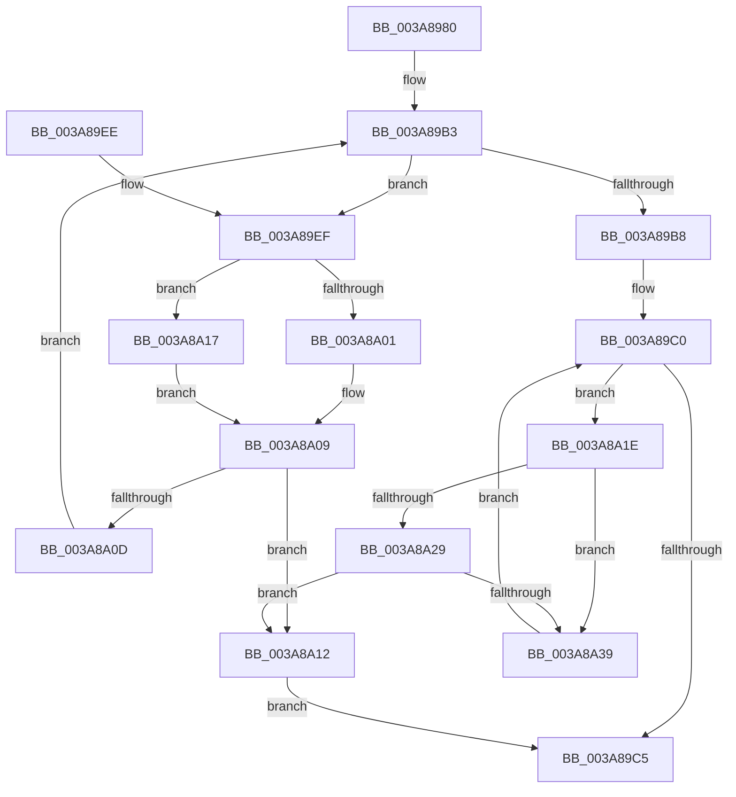

# AuthzBasepFindSecurityAttribute

- RVA: `0x003A8980`–`0x003A8A3E` (길이 `190` bytes)
- VA: `0x00000001403A8980`
- 실행 섹션: `.text`
- PDB 이름 있음: `예`; PDB Function 태그: `아니요`
- unwind 정보 RVA: `0x00089E5C`
- 디코드: `61`개 명령, `190/190` bytes 표시
- 미해석 바이트: `0` (있으면 어셈블리에 `.byte`로 보존)

> 이 문서는 커널 이미지의 기계어와 PDB 기호를 분석해 생성했습니다. 4번과 5번은 함수 원형과 자료형을 바이너리 사용 방식에서 추정한 C 해석이며 원본 소스 복구 결과는 아닙니다.

## 1. Dependencies

- 직접 호출 지점: **3**; 고유 호출 대상: **3**
- 직접 호출자로 확인된 함수: **4**
- RIP 상대 이미지 참조: **0**

### Outgoing calls
- `0x003A8A04` → [RtlEqualUnicodeString](../../page/93/RtlEqualUnicodeString_function_00932A20.md) (function, `0x00932A20`)
- `0x003A8A17` → [AuthzBasepEqualUnicodeStringCaseSensitive](AuthzBasepEqualUnicodeStringCaseSensitive_function_003A8A44.md) (function, `0x003A8A44`)
- `0x003A8A30` → [AuthzBasepEqualUnicodeString](AuthzBasepEqualUnicodeString_function_003A8A80.md) (function, `0x003A8A80`)

### Direct callers
- [AuthzBasepDeleteSecurityAttribute](AuthzBasepDeleteSecurityAttribute_function_003A8AA8.md) at `0x003A8AEA`
- [AuthzBasepAddSecurityAttribute](AuthzBasepAddSecurityAttribute_function_003A8BE4.md) at `0x003A8C1D`
- [AuthzBasepCompareSecurityAttributesInformation](../../page/82/AuthzBasepCompareSecurityAttributesInformation_function_00821D94.md) at `0x00821DCA`
- [AuthzBasepCompareLegacySecurityAttributesInformation](../../page/8F/AuthzBasepCompareLegacySecurityAttributesInformation_function_008F7374.md) at `0x008F73B8`

### Static image references
- 디코드된 RIP-relative 메모리 참조가 없습니다.

## 2. Other-region calls and transfers

- 다른 실행 섹션으로 향하는 call: **1**
  - `0x003A8A04` → [RtlEqualUnicodeString](../../page/93/RtlEqualUnicodeString_function_00932A20.md) (`.text` → `PAGE`)
- 별도 외부 분기/꼬리 이동을 확인하지 못했습니다.

## 3. Assembly (complete function range)

```asm
003A8980  48 89 5C 24 08                  mov qword ptr [rsp + 8], rbx
003A8985  48 89 6C 24 10                  mov qword ptr [rsp + 0x10], rbp
003A898A  48 89 74 24 18                  mov qword ptr [rsp + 0x18], rsi
003A898F  48 89 7C 24 20                  mov qword ptr [rsp + 0x20], rdi
003A8994  41 54                           push r12
003A8996  41 56                           push r14
003A8998  41 57                           push r15
003A899A  48 83 EC 20                     sub rsp, 0x20
003A899E  48 8B 59 08                     mov rbx, qword ptr [rcx + 8]
003A89A2  48 8D 79 08                     lea rdi, [rcx + 8]
003A89A6  33 F6                           xor esi, esi
003A89A8  4C 8B E2                        mov r12, rdx
003A89AB  8B EE                           mov ebp, esi
003A89AD  45 32 FF                        xor r15b, r15b
003A89B0  4C 8B F1                        mov r14, rcx
003A89B3  48 3B DF                        cmp rbx, rdi
003A89B6  75 37                           jne 0x1403a89ef
003A89B8  49 8B 7E 20                     mov rdi, qword ptr [r14 + 0x20]
003A89BC  49 8D 5E 20                     lea rbx, [r14 + 0x20]
003A89C0  48 3B FB                        cmp rdi, rbx
003A89C3  75 59                           jne 0x1403a8a1e
003A89C5  48 8B 5C 24 40                  mov rbx, qword ptr [rsp + 0x40]
003A89CA  45 84 FF                        test r15b, r15b
003A89CD  48 8B 7C 24 58                  mov rdi, qword ptr [rsp + 0x58]
003A89D2  48 0F 45 F5                     cmovne rsi, rbp
003A89D6  48 8B 6C 24 48                  mov rbp, qword ptr [rsp + 0x48]
003A89DB  48 8B C6                        mov rax, rsi
003A89DE  48 8B 74 24 50                  mov rsi, qword ptr [rsp + 0x50]
003A89E3  48 83 C4 20                     add rsp, 0x20
003A89E7  41 5F                           pop r15
003A89E9  41 5E                           pop r14
003A89EB  41 5C                           pop r12
003A89ED  C3                              ret
003A89EE  CC                              int3
003A89EF  48 8B EB                        mov rbp, rbx
003A89F2  48 8D 4B 20                     lea rcx, [rbx + 0x20]
003A89F6  44 0F 20 C0                     mov rax, cr8
003A89FA  49 8B D4                        mov rdx, r12
003A89FD  3C 02                           cmp al, 2
003A89FF  73 16                           jae 0x1403a8a17
003A8A01  41 B0 01                        mov r8b, 1
003A8A04  E8 17 A0 58 00                  call 0x140932a20
003A8A09  84 C0                           test al, al
003A8A0B  75 05                           jne 0x1403a8a12
003A8A0D  48 8B 1B                        mov rbx, qword ptr [rbx]
003A8A10  EB A1                           jmp 0x1403a89b3
003A8A12  41 B7 01                        mov r15b, 1
003A8A15  EB AE                           jmp 0x1403a89c5
003A8A17  E8 28 00 00 00                  call 0x1403a8a44
003A8A1C  EB EB                           jmp 0x1403a8a09
003A8A1E  8B 47 28                        mov eax, dword ptr [rdi + 0x28]
003A8A21  48 8D 6F F0                     lea rbp, [rdi - 0x10]
003A8A25  A8 01                           test al, 1
003A8A27  75 10                           jne 0x1403a8a39
003A8A29  48 8D 4D 20                     lea rcx, [rbp + 0x20]
003A8A2D  49 8B D4                        mov rdx, r12
003A8A30  E8 4B 00 00 00                  call 0x1403a8a80
003A8A35  84 C0                           test al, al
003A8A37  75 D9                           jne 0x1403a8a12
003A8A39  48 8B 3F                        mov rdi, qword ptr [rdi]
003A8A3C  EB 82                           jmp 0x1403a89c0
```

## 4. C-style interpretation (structured pseudocode)

```c
__int64 __fastcall AuthzBasepFindSecurityAttribute(__int64 a1, __int64 a2)
{
    __int64 result;
    __int64 v_r15;
    __int64 v_rsi;
    __int64 v_rsp;
    unsigned __int64 v_stack_p10;
    unsigned __int64 v_stack_p18;
    unsigned __int64 v_stack_p20;
    unsigned __int64 v_stack_p8;

    v_stack_p8 = v_rbx;
    v_stack_p10 = v_rbp;
    v_stack_p18 = v_rsi;
    v_stack_p20 = v_rdi;
    v_rsp = (v_rsp) - (32);
    v_rsi = 0;
    v_r15 = 0;
loc_003A89B3:
    if ((*(unsigned __int64 *)(a1 + 8)) != (a1 + 8)) goto loc_003A89EF;
loc_003A89C0:
    if ((*(unsigned __int64 *)(a1 + 32)) != (a1 + 32)) goto loc_003A8A1E;
loc_003A89C5:
    if (0 != 0) { v_rsi = 0; }
    v_rsp = (v_rsp) + (32);
    return v_rsi;
loc_003A89EF:
    if (((unsigned __int8)(v_cr8)) >= 2) goto loc_003A8A17;
    result = RtlEqualUnicodeString(v_stack_p8 + 32, a2, 1, a4);
loc_003A8A09:
    if ((unsigned __int8)(result) != 0) goto loc_003A8A12;
    goto loc_003A89B3;
loc_003A8A12:
    goto loc_003A89C5;
loc_003A8A17:
    result = AuthzBasepEqualUnicodeStringCaseSensitive(v_stack_p8 + 32, a2, 1, a4);
    goto loc_003A8A09;
loc_003A8A1E:
    if ((((unsigned __int8)((unsigned int)(*(unsigned int *)(v_stack_p20 + 40)))) & (1)) != 0) goto loc_003A8A39;
    result = AuthzBasepEqualUnicodeString(v_stack_p20 - 16 + 32, a2, 1, a4);
    if ((unsigned __int8)(result) != 0) goto loc_003A8A12;
loc_003A8A39:
    goto loc_003A89C0;
}
```

## 5. (Beta) C Style

```c
int64_t AuthzBasepFindSecurityAttribute(void *Arg1, int64_t Arg2)
{
    uint8_t *arg1 = (uint8_t *)Arg1;

    int64_t result;
    int64_t local_r15;
    int64_t local_rsi;
    int64_t local_rsp;
    uint64_t v_stack_p10;
    uint64_t v_stack_p18;
    uint64_t v_stack_p20;
    uint64_t v_stack_p8;

    v_stack_p8 = local_rbx;
    v_stack_p10 = local_rbp;
    v_stack_p18 = local_rsi;
    v_stack_p20 = local_rdi;
    local_rsp = (local_rsp) - (32);
    local_rsi = 0;
    local_r15 = 0;
loc_003A89B3:
    if ((*(uint64_t *)(arg1 + 0x8)) != (Arg1 + 8)) goto loc_003A89EF;
loc_003A89C0:
    if ((*(uint64_t *)(arg1 + 0x20)) != (Arg1 + 32)) goto loc_003A8A1E;
loc_003A89C5:
    if (0 != 0) { local_rsi = 0; }
    local_rsp = (local_rsp) + (32);
    return local_rsi;
loc_003A89EF:
    if (((uint8_t)(v_cr8)) >= 2) goto loc_003A8A17;
    result = RtlEqualUnicodeString(v_stack_p8 + 32, Arg2, 1, a4);
loc_003A8A09:
    if ((uint8_t)(result) != 0) goto loc_003A8A12;
    goto loc_003A89B3;
loc_003A8A12:
    goto loc_003A89C5;
loc_003A8A17:
    result = AuthzBasepEqualUnicodeStringCaseSensitive(v_stack_p8 + 32, Arg2, 1, a4);
    goto loc_003A8A09;
loc_003A8A1E:
    if ((((uint8_t)((uint32_t)(*(uint32_t *)(v_stack_p20 + 0x28)))) & (1)) != 0) goto loc_003A8A39;
    result = AuthzBasepEqualUnicodeString(v_stack_p20 - 16 + 32, Arg2, 1, a4);
    if ((uint8_t)(result) != 0) goto loc_003A8A12;
loc_003A8A39:
    goto loc_003A89C0;
}
```

### 관측된 메모리 오프셋

구조체 형식이 확인되지 않은 접근은 인자 기준의 오프셋으로만 기록했습니다.

| 기준 인자 | 오프셋 표현 | 폭 (bit) | 접근 |
|---|---:|---:|---|
| `Arg1` | `+ 0x8` | `64` | `R` |
| `Arg1` | `+ 0x20` | `64` | `R` |

## 6. Execution-region graph

[열기: 2D/3D 그래프와 함수 탐색 컨트롤 패널](../../../control-panel.html?section=text&rva=0x003A8980&view=graph)

- 2D 그래프는 위에서 아래로 흐르고, 3D 그래프는 빈 공간을 드래그해 회전합니다. Shift+드래그는 이동, 휠은 확대·축소, 함수 노드 선택은 대상 보고서 이동입니다.

### Static fallback


