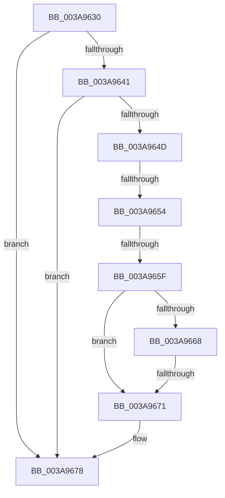

# AuthzBasepFreeSecurityAttributeValues

- RVA: `0x003A9630`–`0x003A967C` (길이 `76` bytes)
- VA: `0x00000001403A9630`
- 실행 섹션: `.text`
- PDB 이름 있음: `예`; PDB Function 태그: `아니요`
- unwind 정보 RVA: `0x00089F78`
- 디코드: `25`개 명령, `76/76` bytes 표시
- 미해석 바이트: `0` (있으면 어셈블리에 `.byte`로 보존)

> 이 문서는 커널 이미지의 기계어와 PDB 기호를 분석해 생성했습니다. 4번과 5번은 함수 원형과 자료형을 바이너리 사용 방식에서 추정한 C 해석이며 원본 소스 복구 결과는 아닙니다.

## 1. Dependencies

- 직접 호출 지점: **0**; 고유 호출 대상: **0**
- 직접 호출자로 확인된 함수: **3**
- RIP 상대 이미지 참조: **0**

### Outgoing calls
- 직접 디코드된 call 명령이 없습니다.

### Direct callers
- [AuthzBasepDeleteSecurityAttribute](AuthzBasepDeleteSecurityAttribute_function_003A8AA8.md) at `0x003A8B7E`
- [AuthzBasepDeleteAllSecurityAttributeValues](AuthzBasepDeleteAllSecurityAttributeValues_function_003A95B0.md) at `0x003A95BB`
- [AuthzBasepRollbackSecurityAttributeChanges](../69/AuthzBasepRollbackSecurityAttributeChanges_function_0069D5C0.md) at `0x0069D5FB`
- [AuthzBasepRollbackSecurityAttributeChanges](../69/AuthzBasepRollbackSecurityAttributeChanges_function_0069D5C0.md) at `0x0069D60A`

### Static image references
- 디코드된 RIP-relative 메모리 참조가 없습니다.

## 2. Other-region calls and transfers

- 다른 실행 섹션으로 향하는 call: **0**
- call이 아닌 외부 분기/꼬리 이동: **3**
  - `0x003A9652` → [sub_003A9699 + 0x1](Unknown_function_003A9699.md) (`tail-transfer`)
  - `0x003A9659` → [sub_003A9699 + 0x4A](Unknown_function_003A9699.md) (`tail-transfer`)
  - `0x003A966F` → [sub_003A9699 + 0x2D](Unknown_function_003A9699.md) (`tail-transfer`)

## 3. Assembly (complete function range)

```asm
003A9630  48 89 5C 24 10                  mov qword ptr [rsp + 0x10], rbx
003A9635  57                              push rdi
003A9636  48 83 EC 20                     sub rsp, 0x20
003A963A  48 8B D9                        mov rbx, rcx
003A963D  84 D2                           test dl, dl
003A963F  75 37                           jne 0x1403a9678
003A9641  48 8D 79 48                     lea rdi, [rcx + 0x48]
003A9645  48 8B 0F                        mov rcx, qword ptr [rdi]
003A9648  48 3B CF                        cmp rcx, rdi
003A964B  74 2B                           je 0x1403a9678
003A964D  8B 41 20                        mov eax, dword ptr [rcx + 0x20]
003A9650  A8 02                           test al, 2
003A9652  75 46                           jne 0x1403a969a
003A9654  8B 41 20                        mov eax, dword ptr [rcx + 0x20]
003A9657  A8 01                           test al, 1
003A9659  0F 84 84 00 00 00               je 0x1403a96e3
003A965F  48 8B 11                        mov rdx, qword ptr [rcx]
003A9662  48 39 4A 08                     cmp qword ptr [rdx + 8], rcx
003A9666  75 09                           jne 0x1403a9671
003A9668  48 8B 41 08                     mov rax, qword ptr [rcx + 8]
003A966C  48 39 08                        cmp qword ptr [rax], rcx
003A966F  74 55                           je 0x1403a96c6
003A9671  B9 03 00 00 00                  mov ecx, 3
003A9676  CD 29                           int 0x29
003A9678  48 8D 7B 60                     lea rdi, [rbx + 0x60]
```

## 4. C-style interpretation (structured pseudocode)

```c
__int64 __fastcall AuthzBasepFreeSecurityAttributeValues(__int64 a1, unsigned __int8 a2)
{
    __int64 v_rsp;
    unsigned __int64 v_stack_p10;

    v_stack_p10 = v_rbx;
    v_rsp = (v_rsp) - (32);
    if (a2 != 0) goto loc_003A9678;
    if ((*(unsigned __int64 *)(a1 + 72)) == (a1 + 72)) goto loc_003A9678;
    if ((*(unsigned __int64 *)(*(unsigned __int64 *)(*(unsigned __int64 *)(a1 + 72)) + 8)) != (*(unsigned __int64 *)(a1 + 72))) goto loc_003A9671;
loc_003A9671:
loc_003A9678:
    return *(unsigned __int64 *)(*(unsigned __int64 *)(a1 + 72) + 8);
}
```

## 5. (Beta) C Style

```c
int64_t AuthzBasepFreeSecurityAttributeValues(void *Arg1, uint8_t Arg2)
{
    uint8_t *arg1 = (uint8_t *)Arg1;

    int64_t local_rsp;
    uint64_t v_stack_p10;

    v_stack_p10 = local_rbx;
    local_rsp = (local_rsp) - (32);
    if (Arg2 != 0) goto loc_003A9678;
    if ((*(uint64_t *)(arg1 + 0x48)) == (Arg1 + 72)) goto loc_003A9678;
    if ((*(uint64_t *)(*(uint64_t *)(*(uint64_t *)(arg1 + 0x48)) + 0x8)) != (*(uint64_t *)(arg1 + 0x48))) goto loc_003A9671;
loc_003A9671:
loc_003A9678:
    return *(uint64_t *)(*(uint64_t *)(arg1 + 0x48) + 0x8);
}
```

### 관측된 메모리 오프셋

구조체 형식이 확인되지 않은 접근은 인자 기준의 오프셋으로만 기록했습니다.

| 기준 인자 | 오프셋 표현 | 폭 (bit) | 접근 |
|---|---:|---:|---|
| `Arg1` | `+ 0x0` | `64` | `R` |
| `Arg1` | `+ 0x48` | `64` | `R` |
| `Arg1` | `+ 0x60` | `64` | `R` |

## 6. Execution-region graph

[열기: 2D/3D 그래프와 함수 탐색 컨트롤 패널](../../../control-panel.html?section=text&rva=0x003A9630&view=graph)

- 2D 그래프는 위에서 아래로 흐르고, 3D 그래프는 빈 공간을 드래그해 회전합니다. Shift+드래그는 이동, 휠은 확대·축소, 함수 노드 선택은 대상 보고서 이동입니다.

### Static fallback


