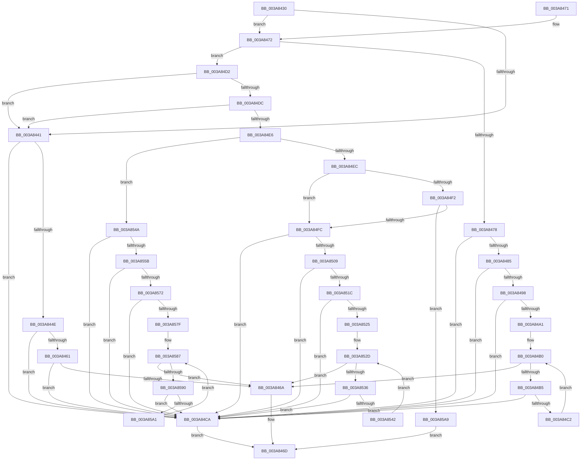

# AuthzBasepGetSecurityAttributeValueCopyoutBufferSize

- RVA: `0x003A8430`–`0x003A85B4` (길이 `388` bytes)
- VA: `0x00000001403A8430`
- 실행 섹션: `.text`
- PDB 이름 있음: `예`; PDB Function 태그: `아니요`
- unwind 정보 RVA: `0x000DB714`
- 디코드: `111`개 명령, `388/388` bytes 표시
- 미해석 바이트: `0` (있으면 어셈블리에 `.byte`로 보존)

> 이 문서는 커널 이미지의 기계어와 PDB 기호를 분석해 생성했습니다. 4번과 5번은 함수 원형과 자료형을 바이너리 사용 방식에서 추정한 C 해석이며 원본 소스 복구 결과는 아닙니다.

## 1. Dependencies

- 직접 호출 지점: **0**; 고유 호출 대상: **0**
- 직접 호출자로 확인된 함수: **2**
- RIP 상대 이미지 참조: **0**

### Outgoing calls
- 직접 디코드된 call 명령이 없습니다.

### Direct callers
- [sub_003A7982](Unknown_function_003A7982.md) at `0x003A79E9`
- [sub_003A7982](Unknown_function_003A7982.md) at `0x003A7A8F`
- [sub_003A7F1E](Unknown_function_003A7F1E.md) at `0x003A7F86`
- [sub_003A7F1E](Unknown_function_003A7F1E.md) at `0x003A8016`

### Static image references
- 디코드된 RIP-relative 메모리 참조가 없습니다.

## 2. Other-region calls and transfers

- 다른 실행 섹션으로 향하는 call: **0**
- 별도 외부 분기/꼬리 이동을 확인하지 못했습니다.

## 3. Assembly (complete function range)

```asm
003A8430  44 0F B7 41 30                  movzx r8d, word ptr [rcx + 0x30]
003A8435  4C 8B D2                        mov r10, rdx
003A8438  4C 8B 0A                        mov r9, qword ptr [rdx]
003A843B  41 83 F8 06                     cmp r8d, 6
003A843F  75 31                           jne 0x1403a8472
003A8441  4D 8D 41 07                     lea r8, [r9 + 7]
003A8445  49 83 E0 F8                     and r8, 0xfffffffffffffff8
003A8449  4D 3B C1                        cmp r8, r9
003A844C  72 7C                           jb 0x1403a84ca
003A844E  8B 41 3C                        mov eax, dword ptr [rcx + 0x3c]
003A8451  45 33 C9                        xor r9d, r9d
003A8454  B9 08 00 00 00                  mov ecx, 8
003A8459  48 F7 E1                        mul rcx
003A845C  48 85 D2                        test rdx, rdx
003A845F  75 69                           jne 0x1403a84ca
003A8461  49 8D 14 00                     lea rdx, [r8 + rax]
003A8465  49 3B D0                        cmp rdx, r8
003A8468  72 60                           jb 0x1403a84ca
003A846A  49 89 12                        mov qword ptr [r10], rdx
003A846D  41 8B C1                        mov eax, r9d
003A8470  C3                              ret
003A8471  CC                              int3
003A8472  41 83 F8 03                     cmp r8d, 3
003A8476  75 5A                           jne 0x1403a84d2
003A8478  4D 8D 41 07                     lea r8, [r9 + 7]
003A847C  49 83 E0 F8                     and r8, 0xfffffffffffffff8
003A8480  4D 3B C1                        cmp r8, r9
003A8483  72 45                           jb 0x1403a84ca
003A8485  8B 41 3C                        mov eax, dword ptr [rcx + 0x3c]
003A8488  BA 10 00 00 00                  mov edx, 0x10
003A848D  48 F7 E2                        mul rdx
003A8490  45 33 C9                        xor r9d, r9d
003A8493  48 85 D2                        test rdx, rdx
003A8496  75 32                           jne 0x1403a84ca
003A8498  49 8D 14 00                     lea rdx, [r8 + rax]
003A849C  49 3B D0                        cmp rdx, r8
003A849F  72 29                           jb 0x1403a84ca
003A84A1  48 8B 41 48                     mov rax, qword ptr [rcx + 0x48]
003A84A5  4C 8D 59 48                     lea r11, [rcx + 0x48]
003A84A9  0F 1F 80 00 00 00 00            nop dword ptr [rax]
003A84B0  49 3B C3                        cmp rax, r11
003A84B3  74 B5                           je 0x1403a846a
003A84B5  44 0F B7 40 28                  movzx r8d, word ptr [rax + 0x28]
003A84BA  4C 03 C2                        add r8, rdx
003A84BD  4C 3B C2                        cmp r8, rdx
003A84C0  72 08                           jb 0x1403a84ca
003A84C2  48 8B 00                        mov rax, qword ptr [rax]
003A84C5  49 8B D0                        mov rdx, r8
003A84C8  EB E6                           jmp 0x1403a84b0
003A84CA  41 B9 95 00 00 C0               mov r9d, 0xc0000095
003A84D0  EB 9B                           jmp 0x1403a846d
003A84D2  41 83 E8 01                     sub r8d, 1
003A84D6  0F 84 65 FF FF FF               je 0x1403a8441
003A84DC  41 83 E8 01                     sub r8d, 1
003A84E0  0F 84 5B FF FF FF               je 0x1403a8441
003A84E6  41 83 E8 02                     sub r8d, 2
003A84EA  74 5E                           je 0x1403a854a
003A84EC  41 83 E8 01                     sub r8d, 1
003A84F0  74 0A                           je 0x1403a84fc
003A84F2  41 83 F8 0B                     cmp r8d, 0xb
003A84F6  0F 85 AD 00 00 00               jne 0x1403a85a9
003A84FC  4D 8D 41 07                     lea r8, [r9 + 7]
003A8500  49 83 E0 F8                     and r8, 0xfffffffffffffff8
003A8504  4D 3B C1                        cmp r8, r9
003A8507  72 C1                           jb 0x1403a84ca
003A8509  8B 41 3C                        mov eax, dword ptr [rcx + 0x3c]
003A850C  BA 10 00 00 00                  mov edx, 0x10
003A8511  48 F7 E2                        mul rdx
003A8514  45 33 C9                        xor r9d, r9d
003A8517  48 85 D2                        test rdx, rdx
003A851A  75 AE                           jne 0x1403a84ca
003A851C  49 8D 14 00                     lea rdx, [r8 + rax]
003A8520  49 3B D0                        cmp rdx, r8
003A8523  72 A5                           jb 0x1403a84ca
003A8525  4C 8D 59 48                     lea r11, [rcx + 0x48]
003A8529  48 8B 49 48                     mov rcx, qword ptr [rcx + 0x48]
003A852D  49 3B CB                        cmp rcx, r11
003A8530  0F 84 34 FF FF FF               je 0x1403a846a
003A8536  44 8B 41 30                     mov r8d, dword ptr [rcx + 0x30]
003A853A  4C 03 C2                        add r8, rdx
003A853D  4C 3B C2                        cmp r8, rdx
003A8540  72 88                           jb 0x1403a84ca
003A8542  48 8B 09                        mov rcx, qword ptr [rcx]
003A8545  49 8B D0                        mov rdx, r8
003A8548  EB E3                           jmp 0x1403a852d
003A854A  4D 8D 41 07                     lea r8, [r9 + 7]
003A854E  49 83 E0 F8                     and r8, 0xfffffffffffffff8
003A8552  4D 3B C1                        cmp r8, r9
003A8555  0F 82 6F FF FF FF               jb 0x1403a84ca
003A855B  8B 41 3C                        mov eax, dword ptr [rcx + 0x3c]
003A855E  BA 18 00 00 00                  mov edx, 0x18
003A8563  48 F7 E2                        mul rdx
003A8566  45 33 C9                        xor r9d, r9d
003A8569  48 85 D2                        test rdx, rdx
003A856C  0F 85 58 FF FF FF               jne 0x1403a84ca
003A8572  49 8D 14 00                     lea rdx, [r8 + rax]
003A8576  49 3B D0                        cmp rdx, r8
003A8579  0F 82 4B FF FF FF               jb 0x1403a84ca
003A857F  4C 8D 59 48                     lea r11, [rcx + 0x48]
003A8583  48 8B 49 48                     mov rcx, qword ptr [rcx + 0x48]
003A8587  49 3B CB                        cmp rcx, r11
003A858A  0F 84 DA FE FF FF               je 0x1403a846a
003A8590  44 0F B7 41 30                  movzx r8d, word ptr [rcx + 0x30]
003A8595  4C 03 C2                        add r8, rdx
003A8598  4C 3B C2                        cmp r8, rdx
003A859B  0F 82 29 FF FF FF               jb 0x1403a84ca
003A85A1  48 8B 09                        mov rcx, qword ptr [rcx]
003A85A4  49 8B D0                        mov rdx, r8
003A85A7  EB DE                           jmp 0x1403a8587
003A85A9  41 B9 0D 00 00 C0               mov r9d, 0xc000000d
003A85AF  E9 B9 FE FF FF                  jmp 0x1403a846d
```

## 4. C-style interpretation (structured pseudocode)

```c
__int64 __fastcall AuthzBasepGetSecurityAttributeValueCopyoutBufferSize(__int64 a1, __int64 a2)
{
    if (((unsigned int)(*(unsigned __int16 *)(a1 + 48))) != 6) goto loc_003A8472;
loc_003A8441:
    a3 = (*(unsigned __int64 *)(a2) + 7) & (-8);
    if (a3 < (*(unsigned __int64 *)(a2))) goto loc_003A84CA;
    a4 = 0;
    if (a2 != 0) goto loc_003A84CA;
    if ((a3 + (unsigned int)(*(unsigned int *)(a1 + 60)) * 1) < a3) goto loc_003A84CA;
loc_003A846A:
    *(unsigned __int64 *)(a2) = a3 + (unsigned int)(*(unsigned int *)(a1 + 60)) * 1;
loc_003A846D:
    return 0;
loc_003A8472:
    if (((unsigned int)(a3)) != 3) goto loc_003A84D2;
    a3 = (a4 + 7) & (-8);
    if (a3 < 0) goto loc_003A84CA;
    a4 = 0;
    if (16 != 0) goto loc_003A84CA;
    if ((a3 + (unsigned int)(*(unsigned int *)(8 + 60)) * 1) < a3) goto loc_003A84CA;
loc_003A84B0:
    if ((*(unsigned __int64 *)(8 + 72)) == (8 + 72)) goto loc_003A846A;
    a3 = (*(unsigned __int16 *)(*(unsigned __int64 *)(8 + 72) + 40)) + (a3 + (unsigned int)(*(unsigned int *)(8 + 60)) * 1);
    if (a3 < (a3 + (unsigned int)(*(unsigned int *)(8 + 60)) * 1)) goto loc_003A84CA;
    goto loc_003A84B0;
loc_003A84CA:
    goto loc_003A846D;
loc_003A84D2:
    a3 = (unsigned int)((a3) - (1));
    if (condition_is_equal) goto loc_003A8441;
    a3 = (unsigned int)((a3) - (1));
    if (condition_is_equal) goto loc_003A8441;
    a3 = (unsigned int)((a3) - (2));
    if (condition_is_equal) goto loc_003A854A;
    a3 = (unsigned int)((a3) - (1));
    if (condition_is_equal) goto loc_003A84FC;
    if (((unsigned int)(a3)) != 11) goto loc_003A85A9;
loc_003A84FC:
    a3 = ((unsigned int)(0xC0000095ULL) + 7) & (-8);
    if (a3 < ((unsigned int)(0xC0000095ULL))) goto loc_003A84CA;
    a4 = 0;
    if (16 != 0) goto loc_003A84CA;
    if ((a3 + (unsigned int)(*(unsigned int *)(8 + 60)) * 1) < a3) goto loc_003A84CA;
loc_003A852D:
    if ((*(unsigned __int64 *)(8 + 72)) == (8 + 72)) goto loc_003A846A;
    a3 = ((unsigned int)(*(unsigned int *)(*(unsigned __int64 *)(8 + 72) + 48))) + (a3 + (unsigned int)(*(unsigned int *)(8 + 60)) * 1);
    if (a3 < (a3 + (unsigned int)(*(unsigned int *)(8 + 60)) * 1)) goto loc_003A84CA;
    goto loc_003A852D;
loc_003A854A:
    a3 = (a4 + 7) & (-8);
    if (a3 < 0) goto loc_003A84CA;
    a4 = 0;
    if (24 != 0) goto loc_003A84CA;
    if ((a3 + (unsigned int)(*(unsigned int *)(*(unsigned __int64 *)(*(unsigned __int64 *)(8 + 72)) + 60)) * 1) < a3) goto loc_003A84CA;
loc_003A8587:
    if ((*(unsigned __int64 *)(*(unsigned __int64 *)(*(unsigned __int64 *)(8 + 72)) + 72)) == (*(unsigned __int64 *)(*(unsigned __int64 *)(8 + 72)) + 72)) goto loc_003A846A;
    a3 = (*(unsigned __int16 *)(*(unsigned __int64 *)(*(unsigned __int64 *)(*(unsigned __int64 *)(8 + 72)) + 72) + 48)) + (a3 + (unsigned int)(*(unsigned int *)(*(unsigned __int64 *)(*(unsigned __int64 *)(8 + 72)) + 60)) * 1);
    if (a3 < (a3 + (unsigned int)(*(unsigned int *)(*(unsigned __int64 *)(*(unsigned __int64 *)(8 + 72)) + 60)) * 1)) goto loc_003A84CA;
    goto loc_003A8587;
loc_003A85A9:
    goto loc_003A846D;
}
```

## 5. (Beta) C Style

```c
int64_t AuthzBasepGetSecurityAttributeValueCopyoutBufferSize(void *Arg1, void *Arg2)
{
    uint8_t *arg1 = (uint8_t *)Arg1;
    uint8_t *arg2 = (uint8_t *)Arg2;

    if (((uint32_t)(*(uint16_t *)(arg1 + 0x30))) != 6) goto loc_003A8472;
loc_003A8441:
    a3 = (*(uint64_t *)(arg2) + 7) & (-8);
    if (a3 < (*(uint64_t *)(arg2))) goto loc_003A84CA;
    a4 = 0;
    if (Arg2 != NULL) goto loc_003A84CA;
    if ((a3 + (uint32_t)(*(uint32_t *)(arg1 + 0x3C)) * 1) < a3) goto loc_003A84CA;
loc_003A846A:
    *(uint64_t *)(arg2) = a3 + (uint32_t)(*(uint32_t *)(arg1 + 0x3C)) * 1;
loc_003A846D:
    return 0;
loc_003A8472:
    if (((uint32_t)(a3)) != 3) goto loc_003A84D2;
    a3 = (a4 + 7) & (-8);
    if (a3 < 0) goto loc_003A84CA;
    a4 = 0;
    if (16 != 0) goto loc_003A84CA;
    if ((a3 + (uint32_t)(*(uint32_t *)(8 + 0x3C)) * 1) < a3) goto loc_003A84CA;
loc_003A84B0:
    if ((*(uint64_t *)(8 + 0x48)) == (8 + 72)) goto loc_003A846A;
    a3 = (*(uint16_t *)(*(uint64_t *)(8 + 0x48) + 0x28)) + (a3 + (uint32_t)(*(uint32_t *)(8 + 0x3C)) * 1);
    if (a3 < (a3 + (uint32_t)(*(uint32_t *)(8 + 0x3C)) * 1)) goto loc_003A84CA;
    goto loc_003A84B0;
loc_003A84CA:
    goto loc_003A846D;
loc_003A84D2:
    a3 = (uint32_t)((a3) - (1));
    if (condition_is_equal) goto loc_003A8441;
    a3 = (uint32_t)((a3) - (1));
    if (condition_is_equal) goto loc_003A8441;
    a3 = (uint32_t)((a3) - (2));
    if (condition_is_equal) goto loc_003A854A;
    a3 = (uint32_t)((a3) - (1));
    if (condition_is_equal) goto loc_003A84FC;
    if (((uint32_t)(a3)) != 11) goto loc_003A85A9;
loc_003A84FC:
    a3 = ((uint32_t)(0xC0000095ULL) + 7) & (-8);
    if (a3 < ((uint32_t)(0xC0000095ULL))) goto loc_003A84CA;
    a4 = 0;
    if (16 != 0) goto loc_003A84CA;
    if ((a3 + (uint32_t)(*(uint32_t *)(8 + 0x3C)) * 1) < a3) goto loc_003A84CA;
loc_003A852D:
    if ((*(uint64_t *)(8 + 0x48)) == (8 + 72)) goto loc_003A846A;
    a3 = ((uint32_t)(*(uint32_t *)(*(uint64_t *)(8 + 0x48) + 0x30))) + (a3 + (uint32_t)(*(uint32_t *)(8 + 0x3C)) * 1);
    if (a3 < (a3 + (uint32_t)(*(uint32_t *)(8 + 0x3C)) * 1)) goto loc_003A84CA;
    goto loc_003A852D;
loc_003A854A:
    a3 = (a4 + 7) & (-8);
    if (a3 < 0) goto loc_003A84CA;
    a4 = 0;
    if (24 != 0) goto loc_003A84CA;
    if ((a3 + (uint32_t)(*(uint32_t *)(*(uint64_t *)(*(uint64_t *)(8 + 0x48)) + 0x3C)) * 1) < a3) goto loc_003A84CA;
loc_003A8587:
    if ((*(uint64_t *)(*(uint64_t *)(*(uint64_t *)(8 + 0x48)) + 0x48)) == (*(uint64_t *)(*(uint64_t *)(8 + 0x48)) + 72)) goto loc_003A846A;
    a3 = (*(uint16_t *)(*(uint64_t *)(*(uint64_t *)(*(uint64_t *)(8 + 0x48)) + 0x48) + 0x30)) + (a3 + (uint32_t)(*(uint32_t *)(*(uint64_t *)(*(uint64_t *)(8 + 0x48)) + 0x3C)) * 1);
    if (a3 < (a3 + (uint32_t)(*(uint32_t *)(*(uint64_t *)(*(uint64_t *)(8 + 0x48)) + 0x3C)) * 1)) goto loc_003A84CA;
    goto loc_003A8587;
loc_003A85A9:
    goto loc_003A846D;
}
```

### 관측된 메모리 오프셋

구조체 형식이 확인되지 않은 접근은 인자 기준의 오프셋으로만 기록했습니다.

| 기준 인자 | 오프셋 표현 | 폭 (bit) | 접근 |
|---|---:|---:|---|
| `Arg1` | `+ 0x30` | `16` | `R` |
| `Arg1` | `+ 0x3C` | `32` | `R` |
| `Arg1` | `+ 0x48` | `64` | `R` |
| `Arg2` | `+ 0x0` | `64` | `R` |
| `Arg2` | `+ 0x0` | `64` | `W` |

## 6. Execution-region graph

[열기: 2D/3D 그래프와 함수 탐색 컨트롤 패널](../../../control-panel.html?section=text&rva=0x003A8430&view=graph)

- 2D 그래프는 위에서 아래로 흐르고, 3D 그래프는 빈 공간을 드래그해 회전합니다. Shift+드래그는 이동, 휠은 확대·축소, 함수 노드 선택은 대상 보고서 이동입니다.

### Static fallback


