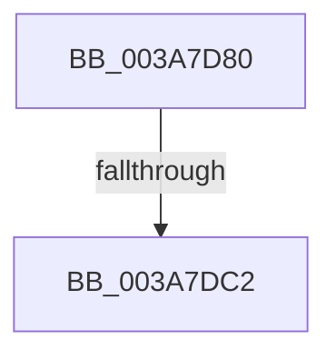

# AuthzBasepQuerySecurityAttributesToken

- RVA: `0x003A7D80`–`0x003A7DCC` (길이 `76` bytes)
- VA: `0x00000001403A7D80`
- 실행 섹션: `.text`
- PDB 이름 있음: `예`; PDB Function 태그: `아니요`
- unwind 정보 RVA: `0x00089CB8`
- 디코드: `22`개 명령, `76/76` bytes 표시
- 미해석 바이트: `0` (있으면 어셈블리에 `.byte`로 보존)

> 이 문서는 커널 이미지의 기계어와 PDB 기호를 분석해 생성했습니다. 4번과 5번은 함수 원형과 자료형을 바이너리 사용 방식에서 추정한 C 해석이며 원본 소스 복구 결과는 아닙니다.

## 1. Dependencies

- 직접 호출 지점: **0**; 고유 호출 대상: **0**
- 직접 호출자로 확인된 함수: **3**
- RIP 상대 이미지 참조: **0**

### Outgoing calls
- 직접 디코드된 call 명령이 없습니다.

### Direct callers
- [sub_003A7CA5](Unknown_function_003A7CA5.md) at `0x003A7CEC`
- [sub_006E041A](../6E/Unknown_function_006E041A.md) at `0x006E04D9`
- [NtQueryInformationToken](../../page/AE/NtQueryInformationToken_function_00AECDD0.md) at `0x00AEF57B`
- [NtQueryInformationToken](../../page/AE/NtQueryInformationToken_function_00AECDD0.md) at `0x00AEF5C3`

### Static image references
- 디코드된 RIP-relative 메모리 참조가 없습니다.

## 2. Other-region calls and transfers

- 다른 실행 섹션으로 향하는 call: **0**
- call이 아닌 외부 분기/꼬리 이동: **2**
  - `0x003A7DBC` → [sub_003A806A](Unknown_function_003A806A.md) (`tail-transfer`)
  - `0x003A7DC6` → [sub_003A7E78](Unknown_function_003A7E78.md) (`tail-transfer`)

## 3. Assembly (complete function range)

```asm
003A7D80  4C 89 4C 24 20                  mov qword ptr [rsp + 0x20], r9
003A7D85  44 89 44 24 18                  mov dword ptr [rsp + 0x18], r8d
003A7D8A  48 89 54 24 10                  mov qword ptr [rsp + 0x10], rdx
003A7D8F  48 89 4C 24 08                  mov qword ptr [rsp + 8], rcx
003A7D94  55                              push rbp
003A7D95  57                              push rdi
003A7D96  41 54                           push r12
003A7D98  41 55                           push r13
003A7D9A  41 57                           push r15
003A7D9C  48 83 EC 60                     sub rsp, 0x60
003A7DA0  4C 8B BC 24 B8 00 00 00         mov r15, qword ptr [rsp + 0xb8]
003A7DA8  33 FF                           xor edi, edi
003A7DAA  4D 8B E1                        mov r12, r9
003A7DAD  41 8B E8                        mov ebp, r8d
003A7DB0  4C 8B EA                        mov r13, rdx
003A7DB3  41 89 3F                        mov dword ptr [r15], edi
003A7DB6  44 8B 11                        mov r10d, dword ptr [rcx]
003A7DB9  45 85 D2                        test r10d, r10d
003A7DBC  0F 84 A8 02 00 00               je 0x1403a806a
003A7DC2  8B CF                           mov ecx, edi
003A7DC4  3B CD                           cmp ecx, ebp
003A7DC6  0F 82 AC 00 00 00               jb 0x1403a7e78
```

## 4. C-style interpretation (structured pseudocode)

```c
void __fastcall AuthzBasepQuerySecurityAttributesToken(__int64 a1, __int64 a2, int a3, __int64 a4, __int64 a5, __int64 a6)
{
    __int64 v_rdi;
    __int64 v_rsp;
    unsigned __int64 v_stack_p10;
    unsigned int v_stack_p18;
    unsigned __int64 v_stack_p20;
    unsigned __int64 v_stack_p8;

    v_stack_p20 = a4;
    v_stack_p18 = a3;
    v_stack_p10 = a2;
    v_stack_p8 = a1;
    v_rsp = (v_rsp) - (96);
    v_rdi = 0;
    *(unsigned int *)(a6) = 0;
}
```

## 5. (Beta) C Style

```c
void AuthzBasepQuerySecurityAttributesToken(void *Arg1, int64_t Arg2, int32_t Arg3, int64_t Arg4, uint64_t Arg5, void *Arg6)
{
    uint8_t *arg1 = (uint8_t *)Arg1;
    uint8_t *arg6 = (uint8_t *)Arg6;

    int64_t local_rdi;
    int64_t local_rsp;
    uint64_t v_stack_p10;
    uint32_t v_stack_p18;
    uint64_t v_stack_p20;
    uint64_t v_stack_p8;

    v_stack_p20 = Arg4;
    v_stack_p18 = Arg3;
    v_stack_p10 = Arg2;
    v_stack_p8 = Arg1;
    local_rsp = (local_rsp) - (96);
    local_rdi = 0;
    *(uint32_t *)(arg6) = 0;
}
```

### 관측된 메모리 오프셋

구조체 형식이 확인되지 않은 접근은 인자 기준의 오프셋으로만 기록했습니다.

| 기준 인자 | 오프셋 표현 | 폭 (bit) | 접근 |
|---|---:|---:|---|
| `Arg1` | `+ 0x0` | `32` | `R` |
| `Arg6` | `+ 0x0` | `32` | `W` |

## 6. Execution-region graph

[열기: 2D/3D 그래프와 함수 탐색 컨트롤 패널](../../../control-panel.html?section=text&rva=0x003A7D80&view=graph)

- 2D 그래프는 위에서 아래로 흐르고, 3D 그래프는 빈 공간을 드래그해 회전합니다. Shift+드래그는 이동, 휠은 확대·축소, 함수 노드 선택은 대상 보고서 이동입니다.

### Static fallback


