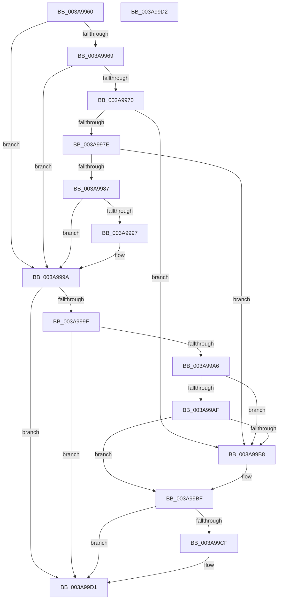

# AuthzBasepRemoveSecurityAttributeFromLists

- RVA: `0x003A9960`–`0x003A99D3` (길이 `115` bytes)
- VA: `0x00000001403A9960`
- 실행 섹션: `.text`
- PDB 이름 있음: `예`; PDB Function 태그: `아니요`
- unwind 정보 RVA: `0x000DB714`
- 디코드: `40`개 명령, `115/115` bytes 표시
- 미해석 바이트: `0` (있으면 어셈블리에 `.byte`로 보존)

> 이 문서는 커널 이미지의 기계어와 PDB 기호를 분석해 생성했습니다. 4번과 5번은 함수 원형과 자료형을 바이너리 사용 방식에서 추정한 C 해석이며 원본 소스 복구 결과는 아닙니다.

## 1. Dependencies

- 직접 호출 지점: **0**; 고유 호출 대상: **0**
- 직접 호출자로 확인된 함수: **2**
- RIP 상대 이미지 참조: **0**

### Outgoing calls
- 직접 디코드된 call 명령이 없습니다.

### Direct callers
- [AuthzBasepDeleteSecurityAttribute](AuthzBasepDeleteSecurityAttribute_function_003A8AA8.md) at `0x003A8B74`
- [AuthzBasepRollbackSecurityAttributeChanges](../69/AuthzBasepRollbackSecurityAttributeChanges_function_0069D5C0.md) at `0x0069D5E6`

### Static image references
- 디코드된 RIP-relative 메모리 참조가 없습니다.

## 2. Other-region calls and transfers

- 다른 실행 섹션으로 향하는 call: **0**
- 별도 외부 분기/꼬리 이동을 확인하지 못했습니다.

## 3. Assembly (complete function range)

```asm
003A9960  45 0F B6 D0                     movzx r10d, r8b
003A9964  45 84 C9                        test r9b, r9b
003A9967  74 31                           je 0x1403a999a
003A9969  8B 42 38                        mov eax, dword ptr [rdx + 0x38]
003A996C  A8 02                           test al, 2
003A996E  74 2A                           je 0x1403a999a
003A9970  4C 8B 4A 10                     mov r9, qword ptr [rdx + 0x10]
003A9974  48 8D 42 10                     lea rax, [rdx + 0x10]
003A9978  49 39 41 08                     cmp qword ptr [r9 + 8], rax
003A997C  75 3A                           jne 0x1403a99b8
003A997E  4C 8B 40 08                     mov r8, qword ptr [rax + 8]
003A9982  49 39 00                        cmp qword ptr [r8], rax
003A9985  75 31                           jne 0x1403a99b8
003A9987  4D 89 08                        mov qword ptr [r8], r9
003A998A  4D 89 41 08                     mov qword ptr [r9 + 8], r8
003A998E  83 62 38 FD                     and dword ptr [rdx + 0x38], 0xfffffffd
003A9992  48 85 C9                        test rcx, rcx
003A9995  74 03                           je 0x1403a999a
003A9997  FF 49 18                        dec dword ptr [rcx + 0x18]
003A999A  45 84 D2                        test r10b, r10b
003A999D  74 32                           je 0x1403a99d1
003A999F  8B 42 38                        mov eax, dword ptr [rdx + 0x38]
003A99A2  A8 01                           test al, 1
003A99A4  74 2B                           je 0x1403a99d1
003A99A6  4C 8B 02                        mov r8, qword ptr [rdx]
003A99A9  49 39 50 08                     cmp qword ptr [r8 + 8], rdx
003A99AD  75 09                           jne 0x1403a99b8
003A99AF  48 8B 42 08                     mov rax, qword ptr [rdx + 8]
003A99B3  48 39 10                        cmp qword ptr [rax], rdx
003A99B6  74 07                           je 0x1403a99bf
003A99B8  B9 03 00 00 00                  mov ecx, 3
003A99BD  CD 29                           int 0x29
003A99BF  4C 89 00                        mov qword ptr [rax], r8
003A99C2  49 89 40 08                     mov qword ptr [r8 + 8], rax
003A99C6  83 62 38 FE                     and dword ptr [rdx + 0x38], 0xfffffffe
003A99CA  48 85 C9                        test rcx, rcx
003A99CD  74 02                           je 0x1403a99d1
003A99CF  FF 09                           dec dword ptr [rcx]
003A99D1  C3                              ret
003A99D2  CC                              int3
```

## 4. C-style interpretation (structured pseudocode)

```c
__int64 __fastcall AuthzBasepRemoveSecurityAttributeFromLists(__int64 a1, __int64 a2, unsigned __int8 a3, unsigned __int8 a4)
{
    if (a4 == 0) goto loc_003A999A;
    if ((((unsigned __int8)((unsigned int)(*(unsigned int *)(a2 + 56)))) & (2)) == 0) goto loc_003A999A;
    if ((*(unsigned __int64 *)(*(unsigned __int64 *)(a2 + 16) + 8)) != (a2 + 16)) goto loc_003A99B8;
    if ((*(unsigned __int64 *)(*(unsigned __int64 *)(a2 + 16 + 8))) != (a2 + 16)) goto loc_003A99B8;
    *(unsigned __int64 *)(*(unsigned __int64 *)(a2 + 16 + 8)) = *(unsigned __int64 *)(a2 + 16);
    *(unsigned __int64 *)(*(unsigned __int64 *)(a2 + 16) + 8) = *(unsigned __int64 *)(a2 + 16 + 8);
    if (a1 != 0) {
    }
    if (a3 == 0) goto loc_003A99D1;
    if ((((unsigned __int8)((unsigned int)(*(unsigned int *)(a2 + 56)))) & (1)) == 0) goto loc_003A99D1;
    if ((*(unsigned __int64 *)(*(unsigned __int64 *)(a2) + 8)) != a2) goto loc_003A99B8;
    if ((*(unsigned __int64 *)(*(unsigned __int64 *)(a2 + 8))) != a2) {
        a1 = 3;
    }
    *(unsigned __int64 *)(*(unsigned __int64 *)(a2 + 8)) = *(unsigned __int64 *)(a2);
    *(unsigned __int64 *)(*(unsigned __int64 *)(a2) + 8) = *(unsigned __int64 *)(a2 + 8);
    if (a1 != 0) {
    }
    return *(unsigned __int64 *)(a2 + 8);
}
```

## 5. (Beta) C Style

```c
int64_t AuthzBasepRemoveSecurityAttributeFromLists(int64_t Arg1, void *Arg2, uint8_t Arg3, uint8_t Arg4)
{
    uint8_t *arg2 = (uint8_t *)Arg2;

    if (Arg4 == 0) goto loc_003A999A;
    if ((((uint8_t)((uint32_t)(*(uint32_t *)(arg2 + 0x38)))) & (2)) == 0) goto loc_003A999A;
    if ((*(uint64_t *)(*(uint64_t *)(arg2 + 0x10) + 0x8)) != (Arg2 + 16)) goto loc_003A99B8;
    if ((*(uint64_t *)(*(uint64_t *)(arg2 + 0x10 + 0x8))) != (Arg2 + 16)) goto loc_003A99B8;
    *(uint64_t *)(*(uint64_t *)(arg2 + 0x10 + 0x8)) = *(uint64_t *)(arg2 + 0x10);
    *(uint64_t *)(*(uint64_t *)(arg2 + 0x10) + 0x8) = *(uint64_t *)(arg2 + 0x10 + 0x8);
    if (Arg1 != 0) {
    }
    if (Arg3 == 0) goto loc_003A99D1;
    if ((((uint8_t)((uint32_t)(*(uint32_t *)(arg2 + 0x38)))) & (1)) == 0) goto loc_003A99D1;
    if ((*(uint64_t *)(*(uint64_t *)(arg2) + 0x8)) != Arg2) goto loc_003A99B8;
    if ((*(uint64_t *)(*(uint64_t *)(arg2 + 0x8))) != Arg2) {
        Arg1 = 3;
    }
    *(uint64_t *)(*(uint64_t *)(arg2 + 0x8)) = *(uint64_t *)(arg2);
    *(uint64_t *)(*(uint64_t *)(arg2) + 0x8) = *(uint64_t *)(arg2 + 0x8);
    if (Arg1 != 0) {
    }
    return *(uint64_t *)(arg2 + 0x8);
}
```

### 관측된 메모리 오프셋

구조체 형식이 확인되지 않은 접근은 인자 기준의 오프셋으로만 기록했습니다.

| 기준 인자 | 오프셋 표현 | 폭 (bit) | 접근 |
|---|---:|---:|---|
| `Arg2` | `+ 0x0` | `64` | `R` |
| `Arg2` | `+ 0x8` | `64` | `R` |
| `Arg2` | `+ 0x10` | `64` | `R` |
| `Arg2` | `+ 0x38` | `32` | `R` |
| `Arg2` | `+ 0x38` | `32` | `R/W` |

## 6. Execution-region graph

[열기: 2D/3D 그래프와 함수 탐색 컨트롤 패널](../../../control-panel.html?section=text&rva=0x003A9960&view=graph)

- 2D 그래프는 위에서 아래로 흐르고, 3D 그래프는 빈 공간을 드래그해 회전합니다. Shift+드래그는 이동, 휠은 확대·축소, 함수 노드 선택은 대상 보고서 이동입니다.

### Static fallback


