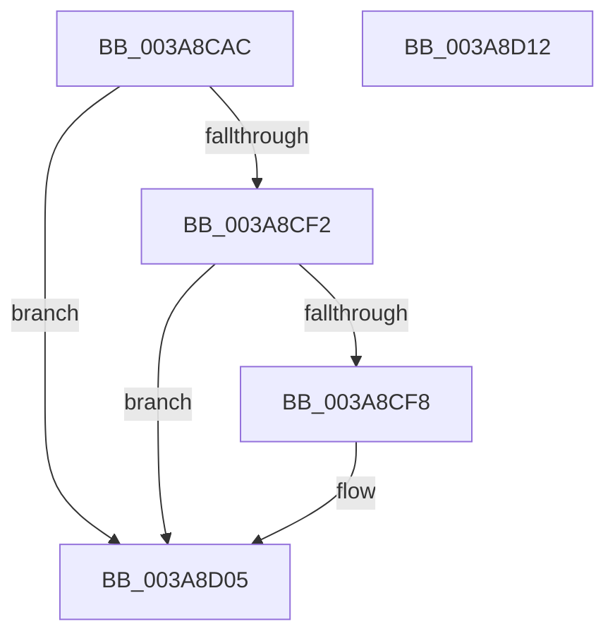

# AuthzBasepReplaceSecurityAttribute

- RVA: `0x003A8CAC`–`0x003A8D13` (길이 `103` bytes)
- VA: `0x00000001403A8CAC`
- 실행 섹션: `.text`
- PDB 이름 있음: `예`; PDB Function 태그: `아니요`
- unwind 정보 RVA: `0x00089EA4`
- 디코드: `32`개 명령, `103/103` bytes 표시
- 미해석 바이트: `0` (있으면 어셈블리에 `.byte`로 보존)

> 이 문서는 커널 이미지의 기계어와 PDB 기호를 분석해 생성했습니다. 4번과 5번은 함수 원형과 자료형을 바이너리 사용 방식에서 추정한 C 해석이며 원본 소스 복구 결과는 아닙니다.

## 1. Dependencies

- 직접 호출 지점: **2**; 고유 호출 대상: **2**
- 직접 호출자로 확인된 함수: **1**
- RIP 상대 이미지 참조: **0**

### Outgoing calls
- `0x003A8CDF` → [AuthzBasepDeleteSecurityAttribute](AuthzBasepDeleteSecurityAttribute_function_003A8AA8.md) (function, `0x003A8AA8`)
- `0x003A8CFE` → [AuthzBasepAddSecurityAttribute](AuthzBasepAddSecurityAttribute_function_003A8BE4.md) (function, `0x003A8BE4`)

### Direct callers
- [AuthzBasepSetSecurityAttributesToken](AuthzBasepSetSecurityAttributesToken_function_003A8D1C.md) at `0x003A8D9F`

### Static image references
- 디코드된 RIP-relative 메모리 참조가 없습니다.

## 2. Other-region calls and transfers

- 다른 실행 섹션으로 향하는 call: **0**
- 별도 외부 분기/꼬리 이동을 확인하지 못했습니다.

## 3. Assembly (complete function range)

```asm
003A8CAC  48 8B C4                        mov rax, rsp
003A8CAF  48 89 58 08                     mov qword ptr [rax + 8], rbx
003A8CB3  57                              push rdi
003A8CB4  48 83 EC 50                     sub rsp, 0x50
003A8CB8  0F 10 02                        movups xmm0, xmmword ptr [rdx]
003A8CBB  48 8B DA                        mov rbx, rdx
003A8CBE  48 8B F9                        mov rdi, rcx
003A8CC1  0F 10 4A 10                     movups xmm1, xmmword ptr [rdx + 0x10]
003A8CC5  0F 11 40 C8                     movups xmmword ptr [rax - 0x38], xmm0
003A8CC9  F2 0F 10 42 20                  movsd xmm0, qword ptr [rdx + 0x20]
003A8CCE  48 8D 50 C8                     lea rdx, [rax - 0x38]
003A8CD2  0F 11 48 D8                     movups xmmword ptr [rax - 0x28], xmm1
003A8CD6  83 60 E0 00                     and dword ptr [rax - 0x20], 0
003A8CDA  F2 0F 11 40 E8                  movsd qword ptr [rax - 0x18], xmm0
003A8CDF  E8 C4 FD FF FF                  call 0x1403a8aa8
003A8CE4  33 C9                           xor ecx, ecx
003A8CE6  3D 25 02 00 C0                  cmp eax, 0xc0000225
003A8CEB  0F 45 C8                        cmovne ecx, eax
003A8CEE  85 C9                           test ecx, ecx
003A8CF0  78 13                           js 0x1403a8d05
003A8CF2  83 7B 18 00                     cmp dword ptr [rbx + 0x18], 0
003A8CF6  74 0D                           je 0x1403a8d05
003A8CF8  48 8B D3                        mov rdx, rbx
003A8CFB  48 8B CF                        mov rcx, rdi
003A8CFE  E8 E1 FE FF FF                  call 0x1403a8be4
003A8D03  8B C8                           mov ecx, eax
003A8D05  48 8B 5C 24 60                  mov rbx, qword ptr [rsp + 0x60]
003A8D0A  8B C1                           mov eax, ecx
003A8D0C  48 83 C4 50                     add rsp, 0x50
003A8D10  5F                              pop rdi
003A8D11  C3                              ret
003A8D12  CC                              int3
```

## 4. C-style interpretation (structured pseudocode)

```c
__int64 __fastcall AuthzBasepReplaceSecurityAttribute(__int64 a1, __int64 a2)
{
    __int64 result;
    __int64 v_rsp;
    unsigned __int64 v_stack_p8;

    *(unsigned __int64 *)(v_rsp + 8) = v_rbx;
    v_rsp = (v_rsp) - (80);
    *(unsigned __int64 *)(v_rsp - 56) = v_xmm0;
    *(unsigned __int64 *)(v_rsp - 40) = v_xmm1;
    *(unsigned __int64 *)(v_rsp - 24) = v_xmm0;
    result = AuthzBasepDeleteSecurityAttribute(a1, v_rsp - 56, a3, a4);
    a1 = 0;
    if (((unsigned int)(result)) != 0xC0000225ULL) { a1 = (unsigned int)(result); }
    if (sign_flag) goto loc_003A8D05;
    if ((*(unsigned int *)(a2 + 24)) != 0) {
        a2 = a2;
        a1 = a1;
        result = AuthzBasepAddSecurityAttribute(a1, a2, a3, a4);
        a1 = (unsigned int)(result);
    }
    v_rsp = (v_rsp) + (80);
    return (unsigned int)((unsigned int)(a1));
}
```

## 5. (Beta) C Style

```c
int64_t AuthzBasepReplaceSecurityAttribute(int64_t Arg1, void *Arg2)
{
    uint8_t *arg2 = (uint8_t *)Arg2;

    int64_t result;
    int64_t local_rsp;
    uint64_t v_stack_p8;

    *(uint64_t *)(local_rsp + 0x8) = local_rbx;
    local_rsp = (local_rsp) - (80);
    *(uint64_t *)(local_rsp - 0x38) = v_xmm0;
    *(uint64_t *)(local_rsp - 0x28) = v_xmm1;
    *(uint64_t *)(local_rsp - 0x18) = v_xmm0;
    result = AuthzBasepDeleteSecurityAttribute(Arg1, local_rsp - 56, a3, a4);
    Arg1 = 0;
    if (((uint32_t)(result)) != 0xC0000225ULL) { Arg1 = (uint32_t)(result); }
    if (sign_flag) goto loc_003A8D05;
    if ((*(uint32_t *)(arg2 + 0x18)) != 0) {
        Arg2 = Arg2;
        Arg1 = Arg1;
        result = AuthzBasepAddSecurityAttribute(Arg1, Arg2, a3, a4);
        Arg1 = (uint32_t)(result);
    }
    local_rsp = (local_rsp) + (80);
    return (uint32_t)((uint32_t)(Arg1));
}
```

### 관측된 메모리 오프셋

구조체 형식이 확인되지 않은 접근은 인자 기준의 오프셋으로만 기록했습니다.

| 기준 인자 | 오프셋 표현 | 폭 (bit) | 접근 |
|---|---:|---:|---|
| `Arg2` | `+ 0x0` | `128` | `R` |
| `Arg2` | `+ 0x10` | `128` | `R` |
| `Arg2` | `+ 0x18` | `32` | `R` |
| `Arg2` | `+ 0x20` | `64` | `R` |

## 6. Execution-region graph

[열기: 2D/3D 그래프와 함수 탐색 컨트롤 패널](../../../control-panel.html?section=text&rva=0x003A8CAC&view=graph)

- 2D 그래프는 위에서 아래로 흐르고, 3D 그래프는 빈 공간을 드래그해 회전합니다. Shift+드래그는 이동, 휠은 확대·축소, 함수 노드 선택은 대상 보고서 이동입니다.

### Static fallback


