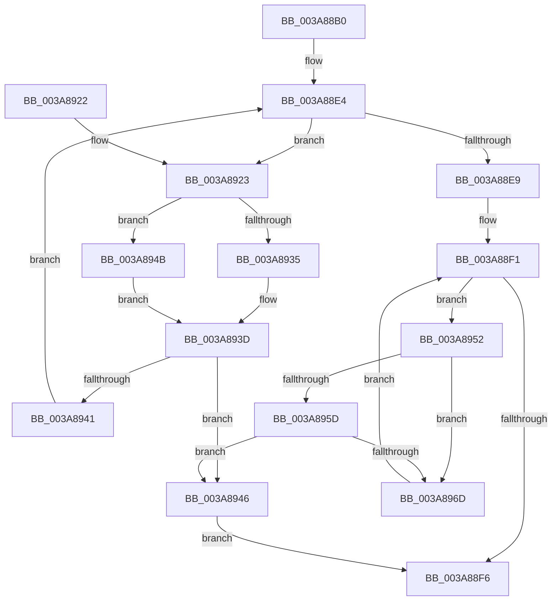

# AuthzBasepSecurityAttributePresent

- RVA: `0x003A88B0`–`0x003A8975` (길이 `197` bytes)
- VA: `0x00000001403A88B0`
- 실행 섹션: `.text`
- PDB 이름 있음: `예`; PDB Function 태그: `아니요`
- unwind 정보 RVA: `0x00089E3C`
- 디코드: `62`개 명령, `197/197` bytes 표시
- 미해석 바이트: `0` (있으면 어셈블리에 `.byte`로 보존)

> 이 문서는 커널 이미지의 기계어와 PDB 기호를 분석해 생성했습니다. 4번과 5번은 함수 원형과 자료형을 바이너리 사용 방식에서 추정한 C 해석이며 원본 소스 복구 결과는 아닙니다.

## 1. Dependencies

- 직접 호출 지점: **3**; 고유 호출 대상: **3**
- 직접 호출자로 확인된 함수: **1**
- RIP 상대 이미지 참조: **0**

### Outgoing calls
- `0x003A8938` → [RtlEqualUnicodeString](../../page/93/RtlEqualUnicodeString_function_00932A20.md) (function, `0x00932A20`)
- `0x003A894B` → [AuthzBasepEqualUnicodeStringCaseSensitive](AuthzBasepEqualUnicodeStringCaseSensitive_function_003A8A44.md) (function, `0x003A8A44`)
- `0x003A8964` → [AuthzBasepEqualUnicodeString](AuthzBasepEqualUnicodeString_function_003A8A80.md) (function, `0x003A8A80`)

### Direct callers
- [sub_003A7B8C](Unknown_function_003A7B8C.md) at `0x003A7BBA`

### Static image references
- 디코드된 RIP-relative 메모리 참조가 없습니다.

## 2. Other-region calls and transfers

- 다른 실행 섹션으로 향하는 call: **1**
  - `0x003A8938` → [RtlEqualUnicodeString](../../page/93/RtlEqualUnicodeString_function_00932A20.md) (`.text` → `PAGE`)
- 별도 외부 분기/꼬리 이동을 확인하지 못했습니다.

## 3. Assembly (complete function range)

```asm
003A88B0  48 89 5C 24 08                  mov qword ptr [rsp + 8], rbx
003A88B5  48 89 6C 24 10                  mov qword ptr [rsp + 0x10], rbp
003A88BA  48 89 74 24 18                  mov qword ptr [rsp + 0x18], rsi
003A88BF  48 89 7C 24 20                  mov qword ptr [rsp + 0x20], rdi
003A88C4  41 54                           push r12
003A88C6  41 56                           push r14
003A88C8  41 57                           push r15
003A88CA  48 83 EC 20                     sub rsp, 0x20
003A88CE  48 8B 59 08                     mov rbx, qword ptr [rcx + 8]
003A88D2  48 8D 79 08                     lea rdi, [rcx + 8]
003A88D6  33 F6                           xor esi, esi
003A88D8  4C 8B E2                        mov r12, rdx
003A88DB  44 8B F6                        mov r14d, esi
003A88DE  45 32 FF                        xor r15b, r15b
003A88E1  48 8B E9                        mov rbp, rcx
003A88E4  48 3B DF                        cmp rbx, rdi
003A88E7  75 3A                           jne 0x1403a8923
003A88E9  48 8B 7D 20                     mov rdi, qword ptr [rbp + 0x20]
003A88ED  48 8D 5D 20                     lea rbx, [rbp + 0x20]
003A88F1  48 3B FB                        cmp rdi, rbx
003A88F4  75 5C                           jne 0x1403a8952
003A88F6  48 8B 5C 24 40                  mov rbx, qword ptr [rsp + 0x40]
003A88FB  45 84 FF                        test r15b, r15b
003A88FE  48 8B 6C 24 48                  mov rbp, qword ptr [rsp + 0x48]
003A8903  48 8B 7C 24 58                  mov rdi, qword ptr [rsp + 0x58]
003A8908  49 0F 45 F6                     cmovne rsi, r14
003A890C  48 85 F6                        test rsi, rsi
003A890F  48 8B 74 24 50                  mov rsi, qword ptr [rsp + 0x50]
003A8914  0F 95 C0                        setne al
003A8917  48 83 C4 20                     add rsp, 0x20
003A891B  41 5F                           pop r15
003A891D  41 5E                           pop r14
003A891F  41 5C                           pop r12
003A8921  C3                              ret
003A8922  CC                              int3
003A8923  4C 8B F3                        mov r14, rbx
003A8926  48 8D 4B 20                     lea rcx, [rbx + 0x20]
003A892A  44 0F 20 C0                     mov rax, cr8
003A892E  49 8B D4                        mov rdx, r12
003A8931  3C 02                           cmp al, 2
003A8933  73 16                           jae 0x1403a894b
003A8935  41 B0 01                        mov r8b, 1
003A8938  E8 E3 A0 58 00                  call 0x140932a20
003A893D  84 C0                           test al, al
003A893F  75 05                           jne 0x1403a8946
003A8941  48 8B 1B                        mov rbx, qword ptr [rbx]
003A8944  EB 9E                           jmp 0x1403a88e4
003A8946  41 B7 01                        mov r15b, 1
003A8949  EB AB                           jmp 0x1403a88f6
003A894B  E8 F4 00 00 00                  call 0x1403a8a44
003A8950  EB EB                           jmp 0x1403a893d
003A8952  8B 47 28                        mov eax, dword ptr [rdi + 0x28]
003A8955  4C 8D 77 F0                     lea r14, [rdi - 0x10]
003A8959  A8 01                           test al, 1
003A895B  75 10                           jne 0x1403a896d
003A895D  49 8D 4E 20                     lea rcx, [r14 + 0x20]
003A8961  49 8B D4                        mov rdx, r12
003A8964  E8 17 01 00 00                  call 0x1403a8a80
003A8969  84 C0                           test al, al
003A896B  75 D9                           jne 0x1403a8946
003A896D  48 8B 3F                        mov rdi, qword ptr [rdi]
003A8970  E9 7C FF FF FF                  jmp 0x1403a88f1
```

## 4. C-style interpretation (structured pseudocode)

```c
__int64 __fastcall AuthzBasepSecurityAttributePresent(__int64 a1, __int64 a2)
{
    __int64 result;
    __int64 v_r15;
    __int64 v_rsi;
    __int64 v_rsp;
    unsigned __int64 v_stack_p10;
    unsigned __int64 v_stack_p18;
    unsigned __int64 v_stack_p20;
    unsigned __int64 v_stack_p8;

    v_stack_p8 = v_rbx;
    v_stack_p10 = v_rbp;
    v_stack_p18 = v_rsi;
    v_stack_p20 = v_rdi;
    v_rsp = (v_rsp) - (32);
    v_rsi = 0;
    v_r15 = 0;
loc_003A88E4:
    if ((*(unsigned __int64 *)(a1 + 8)) != (a1 + 8)) goto loc_003A8923;
loc_003A88F1:
    if ((*(unsigned __int64 *)(a1 + 32)) != (a1 + 32)) goto loc_003A8952;
loc_003A88F6:
    if (0 != 0) { v_rsi = 0; }
    result = (v_rsi != 0) ? 1 : 0;
    v_rsp = (v_rsp) + (32);
    return result;
loc_003A8923:
    if (((unsigned __int8)(v_cr8)) >= 2) goto loc_003A894B;
    result = RtlEqualUnicodeString(v_stack_p8 + 32, a2, 1, a4);
loc_003A893D:
    if ((unsigned __int8)(result) != 0) goto loc_003A8946;
    goto loc_003A88E4;
loc_003A8946:
    goto loc_003A88F6;
loc_003A894B:
    result = AuthzBasepEqualUnicodeStringCaseSensitive(v_stack_p8 + 32, a2, 1, a4);
    goto loc_003A893D;
loc_003A8952:
    if ((((unsigned __int8)((unsigned int)(*(unsigned int *)(v_stack_p20 + 40)))) & (1)) != 0) goto loc_003A896D;
    result = AuthzBasepEqualUnicodeString(v_stack_p20 - 16 + 32, a2, 1, a4);
    if ((unsigned __int8)(result) != 0) goto loc_003A8946;
loc_003A896D:
    goto loc_003A88F1;
}
```

## 5. (Beta) C Style

```c
int64_t AuthzBasepSecurityAttributePresent(void *Arg1, int64_t Arg2)
{
    uint8_t *arg1 = (uint8_t *)Arg1;

    int64_t result;
    int64_t local_r15;
    int64_t local_rsi;
    int64_t local_rsp;
    uint64_t v_stack_p10;
    uint64_t v_stack_p18;
    uint64_t v_stack_p20;
    uint64_t v_stack_p8;

    v_stack_p8 = local_rbx;
    v_stack_p10 = local_rbp;
    v_stack_p18 = local_rsi;
    v_stack_p20 = local_rdi;
    local_rsp = (local_rsp) - (32);
    local_rsi = 0;
    local_r15 = 0;
loc_003A88E4:
    if ((*(uint64_t *)(arg1 + 0x8)) != (Arg1 + 8)) goto loc_003A8923;
loc_003A88F1:
    if ((*(uint64_t *)(arg1 + 0x20)) != (Arg1 + 32)) goto loc_003A8952;
loc_003A88F6:
    if (0 != 0) { local_rsi = 0; }
    result = (local_rsi != 0) ? 1 : 0;
    local_rsp = (local_rsp) + (32);
    return result;
loc_003A8923:
    if (((uint8_t)(v_cr8)) >= 2) goto loc_003A894B;
    result = RtlEqualUnicodeString(v_stack_p8 + 32, Arg2, 1, a4);
loc_003A893D:
    if ((uint8_t)(result) != 0) goto loc_003A8946;
    goto loc_003A88E4;
loc_003A8946:
    goto loc_003A88F6;
loc_003A894B:
    result = AuthzBasepEqualUnicodeStringCaseSensitive(v_stack_p8 + 32, Arg2, 1, a4);
    goto loc_003A893D;
loc_003A8952:
    if ((((uint8_t)((uint32_t)(*(uint32_t *)(v_stack_p20 + 0x28)))) & (1)) != 0) goto loc_003A896D;
    result = AuthzBasepEqualUnicodeString(v_stack_p20 - 16 + 32, Arg2, 1, a4);
    if ((uint8_t)(result) != 0) goto loc_003A8946;
loc_003A896D:
    goto loc_003A88F1;
}
```

### 관측된 메모리 오프셋

구조체 형식이 확인되지 않은 접근은 인자 기준의 오프셋으로만 기록했습니다.

| 기준 인자 | 오프셋 표현 | 폭 (bit) | 접근 |
|---|---:|---:|---|
| `Arg1` | `+ 0x8` | `64` | `R` |
| `Arg1` | `+ 0x20` | `64` | `R` |

## 6. Execution-region graph

[열기: 2D/3D 그래프와 함수 탐색 컨트롤 패널](../../../control-panel.html?section=text&rva=0x003A88B0&view=graph)

- 2D 그래프는 위에서 아래로 흐르고, 3D 그래프는 빈 공간을 드래그해 회전합니다. Shift+드래그는 이동, 휠은 확대·축소, 함수 노드 선택은 대상 보고서 이동입니다.

### Static fallback


