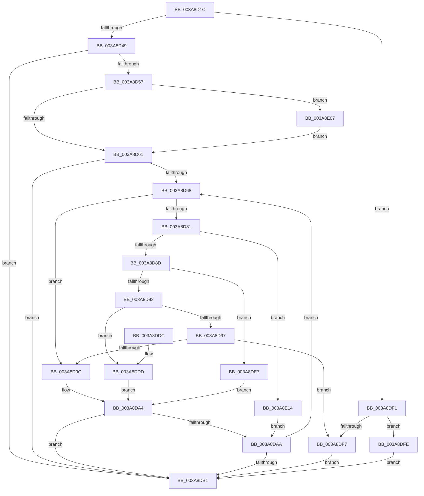

# AuthzBasepSetSecurityAttributesToken

- RVA: `0x003A8D1C`–`0x003A8E18` (길이 `252` bytes)
- VA: `0x00000001403A8D1C`
- 실행 섹션: `.text`
- PDB 이름 있음: `예`; PDB Function 태그: `아니요`
- unwind 정보 RVA: `0x00089EB4`
- 디코드: `79`개 명령, `252/252` bytes 표시
- 미해석 바이트: `0` (있으면 어셈블리에 `.byte`로 보존)

> 이 문서는 커널 이미지의 기계어와 PDB 기호를 분석해 생성했습니다. 4번과 5번은 함수 원형과 자료형을 바이너리 사용 방식에서 추정한 C 해석이며 원본 소스 복구 결과는 아닙니다.

## 1. Dependencies

- 직접 호출 지점: **7**; 고유 호출 대상: **7**
- 직접 호출자로 확인된 함수: **14**
- RIP 상대 이미지 참조: **0**

### Outgoing calls
- `0x003A8D4C` → [AuthzBasepValidateSecurityAttributes](AuthzBasepValidateSecurityAttributes_function_003A90EC.md) (function, `0x003A90EC`)
- `0x003A8D9F` → [AuthzBasepReplaceSecurityAttribute](AuthzBasepReplaceSecurityAttribute_function_003A8CAC.md) (function, `0x003A8CAC`)
- `0x003A8DBC` → [AuthzBasepFinaliseSecurityAttributesList](AuthzBasepFinaliseSecurityAttributesList_function_003A8E20.md) (function, `0x003A8E20`)
- `0x003A8DE0` → [AuthzBasepDeleteSecurityAttribute](AuthzBasepDeleteSecurityAttribute_function_003A8AA8.md) (function, `0x003A8AA8`)
- `0x003A8DEA` → [AuthzBasepAddSecurityAttribute](AuthzBasepAddSecurityAttribute_function_003A8BE4.md) (function, `0x003A8BE4`)
- `0x003A8DFE` → [AuthzBasepFreeSecurityAttributesList](../30/AuthzBasepFreeSecurityAttributesList_function_00301230.md) (function, `0x00301230`)
- `0x003A8E0A` → [AuthzBasepDeleteAllSecurityAttributes](../69/AuthzBasepDeleteAllSecurityAttributes_function_0069D568.md) (function, `0x0069D568`)

### Direct callers
- [SepInternalSetSecurityAttributesToken](SepInternalSetSecurityAttributesToken_function_003A9474.md) at `0x003A951E`
- [SepVerifyDesktopAppxPackageName](SepVerifyDesktopAppxPackageName_function_003A9728.md) at `0x003A98C0`
- [SepDesktopAppxSubProcessToken](../45/SepDesktopAppxSubProcessToken_function_0045BD90.md) at `0x0045C06E`
- [SepDesktopAppxSubProcessToken](../45/SepDesktopAppxSubProcessToken_function_0045BD90.md) at `0x0045C0A8`
- [SepDesktopAppModifyTokenBreakaway](../60/SepDesktopAppModifyTokenBreakaway_function_00608170.md) at `0x006081E8`
- [SepSetTokenAllApplicationPackagesPolicy](../60/SepSetTokenAllApplicationPackagesPolicy_function_00609A90.md) at `0x00609B03`
- [SeSetSecurityAttributesTokenEx](../60/SeSetSecurityAttributesTokenEx_function_00609C00.md) at `0x00609CE9`
- [SepSetSingletonEntry](../60/SepSetSingletonEntry_function_00609DA0.md) at `0x00609E35`
- [sub_006E041A](../6E/Unknown_function_006E041A.md) at `0x006E050E`
- [SepSetUserClaimAttributesToken](../../page/7A/SepSetUserClaimAttributesToken_function_007A36C0.md) at `0x007A3746`
- [AuthzBasepInitializeSystemSecurityAttributes](../../page/82/AuthzBasepInitializeSystemSecurityAttributes_function_00821E08.md) at `0x00821EA7`
- [SepSetProcessUniqueAttribute](../../page/A4/SepSetProcessUniqueAttribute_function_00A424C8.md) at `0x00A42597`
- [NtSetInformationToken](../../page/AF/NtSetInformationToken_function_00AF0530.md) at `0x00AF15EC`
- [SepAddTokenOriginClaim](../../page/AF/SepAddTokenOriginClaim_function_00AF2130.md) at `0x00AF2242`
- [SepAddTokenOriginClaim](../../page/AF/SepAddTokenOriginClaim_function_00AF2130.md) at `0x00AF236F`
- [sub_00B3F630](../../page/B3/Unknown_function_00B3F630.md) at `0x00B3F661`
- [sub_00B3F630](../../page/B3/Unknown_function_00B3F630.md) at `0x00B3F6AA`

### Static image references
- 디코드된 RIP-relative 메모리 참조가 없습니다.

## 2. Other-region calls and transfers

- 다른 실행 섹션으로 향하는 call: **0**
- 별도 외부 분기/꼬리 이동을 확인하지 못했습니다.

## 3. Assembly (complete function range)

```asm
003A8D1C  48 89 5C 24 08                  mov qword ptr [rsp + 8], rbx
003A8D21  48 89 6C 24 10                  mov qword ptr [rsp + 0x10], rbp
003A8D26  48 89 74 24 18                  mov qword ptr [rsp + 0x18], rsi
003A8D2B  57                              push rdi
003A8D2C  41 56                           push r14
003A8D2E  41 57                           push r15
003A8D30  48 83 EC 20                     sub rsp, 0x20
003A8D34  44 8B 32                        mov r14d, dword ptr [rdx]
003A8D37  49 8B F0                        mov rsi, r8
003A8D3A  4C 8B FA                        mov r15, rdx
003A8D3D  48 8B F9                        mov rdi, rcx
003A8D40  4D 85 C0                        test r8, r8
003A8D43  0F 84 A8 00 00 00               je 0x1403a8df1
003A8D49  49 8B C8                        mov rcx, r8
003A8D4C  E8 9B 03 00 00                  call 0x1403a90ec
003A8D51  8B D8                           mov ebx, eax
003A8D53  85 C0                           test eax, eax
003A8D55  78 5A                           js 0x1403a8db1
003A8D57  41 83 FE 01                     cmp r14d, 1
003A8D5B  0F 84 A6 00 00 00               je 0x1403a8e07
003A8D61  33 ED                           xor ebp, ebp
003A8D63  39 6E 04                        cmp dword ptr [rsi + 4], ebp
003A8D66  76 49                           jbe 0x1403a8db1
003A8D68  48 8B 46 08                     mov rax, qword ptr [rsi + 8]
003A8D6C  48 8D 0C AD 00 00 00 00         lea rcx, [rbp*4]
003A8D74  48 03 CD                        add rcx, rbp
003A8D77  48 8D 14 C8                     lea rdx, [rax + rcx*8]
003A8D7B  41 83 FE 01                     cmp r14d, 1
003A8D7F  74 1B                           je 0x1403a8d9c
003A8D81  41 8B 0C AF                     mov ecx, dword ptr [r15 + rbp*4]
003A8D85  85 C9                           test ecx, ecx
003A8D87  0F 84 87 00 00 00               je 0x1403a8e14
003A8D8D  83 E9 02                        sub ecx, 2
003A8D90  74 55                           je 0x1403a8de7
003A8D92  83 E9 01                        sub ecx, 1
003A8D95  74 46                           je 0x1403a8ddd
003A8D97  83 F9 01                        cmp ecx, 1
003A8D9A  75 5B                           jne 0x1403a8df7
003A8D9C  48 8B CF                        mov rcx, rdi
003A8D9F  E8 08 FF FF FF                  call 0x1403a8cac
003A8DA4  8B D8                           mov ebx, eax
003A8DA6  85 C0                           test eax, eax
003A8DA8  78 07                           js 0x1403a8db1
003A8DAA  FF C5                           inc ebp
003A8DAC  3B 6E 04                        cmp ebp, dword ptr [rsi + 4]
003A8DAF  72 B7                           jb 0x1403a8d68
003A8DB1  8B D3                           mov edx, ebx
003A8DB3  48 8B CF                        mov rcx, rdi
003A8DB6  C1 EA 1F                        shr edx, 0x1f
003A8DB9  80 F2 01                        xor dl, 1
003A8DBC  E8 5F 00 00 00                  call 0x1403a8e20
003A8DC1  48 8B 6C 24 48                  mov rbp, qword ptr [rsp + 0x48]
003A8DC6  8B C3                           mov eax, ebx
003A8DC8  48 8B 5C 24 40                  mov rbx, qword ptr [rsp + 0x40]
003A8DCD  48 8B 74 24 50                  mov rsi, qword ptr [rsp + 0x50]
003A8DD2  48 83 C4 20                     add rsp, 0x20
003A8DD6  41 5F                           pop r15
003A8DD8  41 5E                           pop r14
003A8DDA  5F                              pop rdi
003A8DDB  C3                              ret
003A8DDC  CC                              int3
003A8DDD  48 8B CF                        mov rcx, rdi
003A8DE0  E8 C3 FC FF FF                  call 0x1403a8aa8
003A8DE5  EB BD                           jmp 0x1403a8da4
003A8DE7  48 8B CF                        mov rcx, rdi
003A8DEA  E8 F5 FD FF FF                  call 0x1403a8be4
003A8DEF  EB B3                           jmp 0x1403a8da4
003A8DF1  41 83 FE 01                     cmp r14d, 1
003A8DF5  74 07                           je 0x1403a8dfe
003A8DF7  BB 0D 00 00 C0                  mov ebx, 0xc000000d
003A8DFC  EB B3                           jmp 0x1403a8db1
003A8DFE  E8 2D 84 F5 FF                  call 0x140301230
003A8E03  33 DB                           xor ebx, ebx
003A8E05  EB AA                           jmp 0x1403a8db1
003A8E07  48 8B CF                        mov rcx, rdi
003A8E0A  E8 59 47 2F 00                  call 0x14069d568
003A8E0F  E9 4D FF FF FF                  jmp 0x1403a8d61
003A8E14  33 DB                           xor ebx, ebx
003A8E16  EB 92                           jmp 0x1403a8daa
```

## 4. C-style interpretation (structured pseudocode)

```c
__int64 __fastcall AuthzBasepSetSecurityAttributesToken(__int64 a1, __int64 a2, __int64 a3)
{
    __int64 result;
    __int64 v_rbp;
    __int64 v_rbx;
    __int64 v_rsp;
    unsigned __int64 v_stack_p10;
    unsigned __int64 v_stack_p18;
    unsigned __int64 v_stack_p8;

    v_stack_p8 = v_rbx;
    v_stack_p10 = v_rbp;
    v_stack_p18 = v_rsi;
    v_rsp = (v_rsp) - (32);
    if (a3 == 0) goto loc_003A8DF1;
    result = AuthzBasepValidateSecurityAttributes(a3, a2, a3, a4);
    if (sign_flag) goto loc_003A8DB1;
    if (((unsigned int)((unsigned int)(*(unsigned int *)(a2)))) == 1) goto loc_003A8E07;
loc_003A8D61:
    v_rbp = 0;
    if ((*(unsigned int *)(a3 + 4)) <= 0) goto loc_003A8DB1;
loc_003A8D68:
    a1 = (v_rbp * 4) + (0);
    if (((unsigned int)((unsigned int)(*(unsigned int *)(a2)))) == 1) goto loc_003A8D9C;
    if ((unsigned int)((unsigned int)(*(unsigned int *)(a2 + v_rbp * 4))) == 0) goto loc_003A8E14;
    a1 = (unsigned int)(((unsigned int)(*(unsigned int *)(a2 + v_rbp * 4))) - (2));
    if (condition_is_equal) goto loc_003A8DE7;
    a1 = (unsigned int)((a1) - (1));
    if (condition_is_equal) goto loc_003A8DDD;
    if (((unsigned int)(a1)) != 1) goto loc_003A8DF7;
loc_003A8D9C:
    result = AuthzBasepReplaceSecurityAttribute(a1, *(unsigned __int64 *)(a3 + 8) + a1 * 8, a3, a4);
loc_003A8DA4:
    if (sign_flag) goto loc_003A8DB1;
loc_003A8DAA:
    v_rbp = (unsigned int)((v_rbp) + 1);
    if (((unsigned int)(v_rbp)) < (*(unsigned int *)(a3 + 4))) goto loc_003A8D68;
loc_003A8DB1:
    a2 = (unsigned int)(((unsigned int)((unsigned int)((unsigned int)((unsigned int)(result))))) >> (31));
    a2 = (unsigned __int8)((a2) ^ (1));
    result = AuthzBasepFinaliseSecurityAttributesList(a1, a2, a3, a4);
    v_rsp = (v_rsp) + (32);
    return (unsigned int)((unsigned int)((unsigned int)((unsigned int)(result))));
loc_003A8DDD:
    result = AuthzBasepDeleteSecurityAttribute(a1, a2, a3, a4);
    goto loc_003A8DA4;
loc_003A8DE7:
    result = AuthzBasepAddSecurityAttribute(a1, a2, a3, a4);
    goto loc_003A8DA4;
loc_003A8DF1:
    if (((unsigned int)((unsigned int)(*(unsigned int *)(a2)))) == 1) goto loc_003A8DFE;
loc_003A8DF7:
    goto loc_003A8DB1;
loc_003A8DFE:
    result = AuthzBasepFreeSecurityAttributesList(a1, a2, a3, a4);
    v_rbx = 0;
    goto loc_003A8DB1;
loc_003A8E07:
    result = AuthzBasepDeleteAllSecurityAttributes(a1, a2, a3, a4);
    goto loc_003A8D61;
loc_003A8E14:
    v_rbx = 0;
    goto loc_003A8DAA;
}
```

## 5. (Beta) C Style

```c
int64_t AuthzBasepSetSecurityAttributesToken(int64_t Arg1, void *Arg2, void *Arg3)
{
    uint8_t *arg2 = (uint8_t *)Arg2;
    uint8_t *arg3 = (uint8_t *)Arg3;

    int64_t result;
    int64_t local_rbp;
    int64_t local_rbx;
    int64_t local_rsp;
    uint64_t v_stack_p10;
    uint64_t v_stack_p18;
    uint64_t v_stack_p8;

    v_stack_p8 = local_rbx;
    v_stack_p10 = local_rbp;
    v_stack_p18 = local_rsi;
    local_rsp = (local_rsp) - (32);
    if (Arg3 == NULL) goto loc_003A8DF1;
    result = AuthzBasepValidateSecurityAttributes(Arg3, Arg2, Arg3, a4);
    if (sign_flag) goto loc_003A8DB1;
    if (((uint32_t)((uint32_t)(*(uint32_t *)(arg2)))) == 1) goto loc_003A8E07;
loc_003A8D61:
    local_rbp = 0;
    if ((*(uint32_t *)(arg3 + 0x4)) <= 0) goto loc_003A8DB1;
loc_003A8D68:
    Arg1 = (local_rbp * 4) + (0);
    if (((uint32_t)((uint32_t)(*(uint32_t *)(arg2)))) == 1) goto loc_003A8D9C;
    if ((uint32_t)((uint32_t)(*(uint32_t *)(arg2 + local_rbp * 4))) == 0) goto loc_003A8E14;
    Arg1 = (uint32_t)(((uint32_t)(*(uint32_t *)(arg2 + local_rbp * 4))) - (2));
    if (condition_is_equal) goto loc_003A8DE7;
    Arg1 = (uint32_t)((Arg1) - (1));
    if (condition_is_equal) goto loc_003A8DDD;
    if (((uint32_t)(Arg1)) != 1) goto loc_003A8DF7;
loc_003A8D9C:
    result = AuthzBasepReplaceSecurityAttribute(Arg1, *(uint64_t *)(arg3 + 0x8) + Arg1 * 8, Arg3, a4);
loc_003A8DA4:
    if (sign_flag) goto loc_003A8DB1;
loc_003A8DAA:
    local_rbp = (uint32_t)((local_rbp) + 1);
    if (((uint32_t)(local_rbp)) < (*(uint32_t *)(arg3 + 0x4))) goto loc_003A8D68;
loc_003A8DB1:
    Arg2 = (uint32_t)(((uint32_t)((uint32_t)((uint32_t)((uint32_t)(result))))) >> (31));
    Arg2 = (uint8_t)((Arg2) ^ (1));
    result = AuthzBasepFinaliseSecurityAttributesList(Arg1, Arg2, Arg3, a4);
    local_rsp = (local_rsp) + (32);
    return (uint32_t)((uint32_t)((uint32_t)((uint32_t)(result))));
loc_003A8DDD:
    result = AuthzBasepDeleteSecurityAttribute(Arg1, Arg2, Arg3, a4);
    goto loc_003A8DA4;
loc_003A8DE7:
    result = AuthzBasepAddSecurityAttribute(Arg1, Arg2, Arg3, a4);
    goto loc_003A8DA4;
loc_003A8DF1:
    if (((uint32_t)((uint32_t)(*(uint32_t *)(arg2)))) == 1) goto loc_003A8DFE;
loc_003A8DF7:
    goto loc_003A8DB1;
loc_003A8DFE:
    result = AuthzBasepFreeSecurityAttributesList(Arg1, Arg2, Arg3, a4);
    local_rbx = 0;
    goto loc_003A8DB1;
loc_003A8E07:
    result = AuthzBasepDeleteAllSecurityAttributes(Arg1, Arg2, Arg3, a4);
    goto loc_003A8D61;
loc_003A8E14:
    local_rbx = 0;
    goto loc_003A8DAA;
}
```

### 관측된 메모리 오프셋

구조체 형식이 확인되지 않은 접근은 인자 기준의 오프셋으로만 기록했습니다.

| 기준 인자 | 오프셋 표현 | 폭 (bit) | 접근 |
|---|---:|---:|---|
| `Arg2` | `+ 0x0` | `32` | `R` |
| `Arg2` | `+ 0x0 + rbp*4` | `32` | `R` |
| `Arg3` | `+ 0x4` | `32` | `R` |
| `Arg3` | `+ 0x8` | `64` | `R` |

## 6. Execution-region graph

[열기: 2D/3D 그래프와 함수 탐색 컨트롤 패널](../../../control-panel.html?section=text&rva=0x003A8D1C&view=graph)

- 2D 그래프는 위에서 아래로 흐르고, 3D 그래프는 빈 공간을 드래그해 회전합니다. Shift+드래그는 이동, 휠은 확대·축소, 함수 노드 선택은 대상 보고서 이동입니다.

### Static fallback


