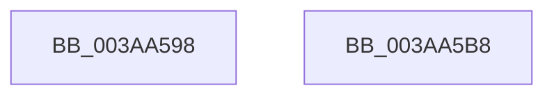

# B_TREE&lt;_SM_PAGE_KEY,ST_STORE&lt;SM_TRAITS&gt;::_ST_PAGE_ENTRY,4096,NP_CONTEXT,B_TREE_KEY_COMPARATOR&lt;_SM_PAGE_KEY&gt; &gt;::BTreeDeleteNode

- RVA: `0x003AA598`–`0x003AA5B9` (길이 `33` bytes)
- VA: `0x00000001403AA598`
- 실행 섹션: `.text`
- PDB 이름 있음: `예`; PDB Function 태그: `아니요`
- unwind 정보 RVA: `0x0005C788`
- 디코드: `10`개 명령, `33/33` bytes 표시
- 미해석 바이트: `0` (있으면 어셈블리에 `.byte`로 보존)

> 이 문서는 커널 이미지의 기계어와 PDB 기호를 분석해 생성했습니다. 4번과 5번은 함수 원형과 자료형을 바이너리 사용 방식에서 추정한 C 해석이며 원본 소스 복구 결과는 아닙니다.

## 1. Dependencies

- 직접 호출 지점: **1**; 고유 호출 대상: **1**
- 직접 호출자로 확인된 함수: **11**
- RIP 상대 이미지 참조: **0**

### Outgoing calls
- `0x003AA5AE` → [NP_CONTEXT::NpNodeFree](NP_CONTEXT_NpNodeFree_function_003AA5C0.md) (function, `0x003AA5C0`)

### Direct callers
- [B_TREE&lt;unsigned long,ST_STORE&lt;SM_TRAITS&gt;::_ST_HASH_ENTRY,4096,NP_CONTEXT,ST_STORE&lt;SM_TRAITS&gt;::ST_HASH_ENTRY_COMPARATOR&gt;::BTreeNodeFree](B_TREE_unsigned_long_ST_STORE_SM_TRAITS__ST_HASH_ENTRY_4096_NP_CONTEXT_ST_STORE_SM_TRAITS_ST_HASH_EN_function_003A99DC.md) at `0x003A9A0A`
- [B_TREE&lt;unsigned long,ST_STORE&lt;SM_TRAITS&gt;::_ST_HASH_ENTRY,4096,NP_CONTEXT,ST_STORE&lt;SM_TRAITS&gt;::ST_HASH_ENTRY_COMPARATOR&gt;::BTreeMergeNodes](B_TREE_unsigned_long_ST_STORE_SM_TRAITS__ST_HASH_ENTRY_4096_NP_CONTEXT_ST_STORE_SM_TRAITS_ST_HASH_EN_function_003AA404.md) at `0x003AA4FF`
- [B_TREE&lt;unsigned long,ST_STORE&lt;SM_TRAITS&gt;::_ST_REGION_ENTRY,4096,NP_CONTEXT,ST_STORE&lt;SM_TRAITS&gt;::ST_REGION_ENTRY_COMPARATOR&gt;::BTreeSplitChild](B_TREE_unsigned_long_ST_STORE_SM_TRAITS__ST_REGION_ENTRY_4096_NP_CONTEXT_ST_STORE_SM_TRAITS_ST_REGIO_function_003AAAA4.md) at `0x003AAC6A`
- [B_TREE&lt;_SM_PAGE_KEY,ST_STORE&lt;SM_TRAITS&gt;::_ST_PAGE_ENTRY,4096,NP_CONTEXT,B_TREE_KEY_COMPARATOR&lt;_SM_PAGE_KEY&gt; &gt;::BTreeMergeNodes](B_TREE__SM_PAGE_KEY_ST_STORE_SM_TRAITS__ST_PAGE_ENTRY_4096_NP_CONTEXT_B_TREE_KEY_COMPARATOR__SM_PAGE_function_003AADC4.md) at `0x003AAEBB`
- [B_TREE&lt;_SM_PAGE_KEY,ST_STORE&lt;SM_TRAITS&gt;::_ST_PAGE_ENTRY,4096,NP_CONTEXT,B_TREE_KEY_COMPARATOR&lt;_SM_PAGE_KEY&gt; &gt;::BTreeSplitChild](B_TREE__SM_PAGE_KEY_ST_STORE_SM_TRAITS__ST_PAGE_ENTRY_4096_NP_CONTEXT_B_TREE_KEY_COMPARATOR__SM_PAGE_function_003AAF50.md) at `0x003AB100`
- [sub_003AB41E](Unknown_function_003AB41E.md) at `0x003AB459`
- [sub_003ADD08](Unknown_function_003ADD08.md) at `0x003ADD43`
- [sub_003AE62C](Unknown_function_003AE62C.md) at `0x003AE667`
- [B_TREE&lt;unsigned long,ST_STORE&lt;SM_TRAITS&gt;::_ST_REGION_ENTRY,4096,NP_CONTEXT,ST_STORE&lt;SM_TRAITS&gt;::ST_REGION_ENTRY_COMPARATOR&gt;::BTreeMergeNodes](B_TREE_unsigned_long_ST_STORE_SM_TRAITS__ST_REGION_ENTRY_4096_NP_CONTEXT_ST_STORE_SM_TRAITS_ST_REGIO_function_003AF47C.md) at `0x003AF577`
- [B_TREE&lt;unsigned long,ST_STORE&lt;SM_TRAITS&gt;::_ST_HASH_ENTRY,4096,NP_CONTEXT,ST_STORE&lt;SM_TRAITS&gt;::ST_HASH_ENTRY_COMPARATOR&gt;::BTreeSplitChild](B_TREE_unsigned_long_ST_STORE_SM_TRAITS__ST_HASH_ENTRY_4096_NP_CONTEXT_ST_STORE_SM_TRAITS_ST_HASH_EN_function_003AF610.md) at `0x003AF7D6`
- [B_TREE&lt;_SM_PAGE_KEY,ST_STORE&lt;SM_TRAITS&gt;::_ST_PAGE_ENTRY,4096,NP_CONTEXT,B_TREE_KEY_COMPARATOR&lt;_SM_PAGE_KEY&gt; &gt;::BTreeNodeFree](B_TREE__SM_PAGE_KEY_ST_STORE_SM_TRAITS__ST_PAGE_ENTRY_4096_NP_CONTEXT_B_TREE_KEY_COMPARATOR__SM_PAGE_function_003AFED0.md) at `0x003AFF6D`

### Static image references
- 디코드된 RIP-relative 메모리 참조가 없습니다.

## 2. Other-region calls and transfers

- 다른 실행 섹션으로 향하는 call: **0**
- 별도 외부 분기/꼬리 이동을 확인하지 못했습니다.

## 3. Assembly (complete function range)

```asm
003AA598  48 83 EC 28                     sub rsp, 0x28
003AA59C  44 0F B6 42 03                  movzx r8d, byte ptr [rdx + 3]
003AA5A1  48 8D 41 10                     lea rax, [rcx + 0x10]
003AA5A5  48 F7 D9                        neg rcx
003AA5A8  48 1B C9                        sbb rcx, rcx
003AA5AB  48 23 C8                        and rcx, rax
003AA5AE  E8 0D 00 00 00                  call 0x1403aa5c0
003AA5B3  48 83 C4 28                     add rsp, 0x28
003AA5B7  C3                              ret
003AA5B8  CC                              int3
```

## 4. C-style interpretation (structured pseudocode)

```c
__int64 __fastcall B_TREE__SM_PAGE_KEY_ST_STORE_SM_TRAITS____ST_PAGE_ENTRY_4096_NP_CONTEXT_B_TREE_KEY_COMPARATOR__SM_PA(__int64 a1, __int64 a2)
{
    __int64 result;
    __int64 v_rsp;

    v_rsp = (v_rsp) - (40);
    a1 = -(a1);
    a1 = (a1) & (a1 + 16);
    result = NP_CONTEXT__NpNodeFree(a1, a2, *(unsigned __int8 *)(a2 + 3), a4);
    v_rsp = (v_rsp) + (40);
    return result;
}
```

## 5. (Beta) C Style

```c
int64_t B_TREE__SM_PAGE_KEY_ST_STORE_SM_TRAITS____ST_PAGE_ENTRY_4096_NP_CONTEXT_B_TREE_KEY_COMPARATOR__SM_PA(void *Arg1, void *Arg2)
{
    uint8_t *arg1 = (uint8_t *)Arg1;
    uint8_t *arg2 = (uint8_t *)Arg2;

    int64_t result;
    int64_t local_rsp;

    local_rsp = (local_rsp) - (40);
    Arg1 = -(Arg1);
    Arg1 = (Arg1) & (Arg1 + 16);
    result = NP_CONTEXT__NpNodeFree(Arg1, Arg2, *(uint8_t *)(arg2 + 0x3), a4);
    local_rsp = (local_rsp) + (40);
    return result;
}
```

### 관측된 메모리 오프셋

구조체 형식이 확인되지 않은 접근은 인자 기준의 오프셋으로만 기록했습니다.

| 기준 인자 | 오프셋 표현 | 폭 (bit) | 접근 |
|---|---:|---:|---|
| `Arg1` | `+ 0x10` | `64` | `R` |
| `Arg2` | `+ 0x3` | `8` | `R` |

## 6. Execution-region graph

[열기: 2D/3D 그래프와 함수 탐색 컨트롤 패널](../../../control-panel.html?section=text&rva=0x003AA598&view=graph)

- 2D 그래프는 위에서 아래로 흐르고, 3D 그래프는 빈 공간을 드래그해 회전합니다. Shift+드래그는 이동, 휠은 확대·축소, 함수 노드 선택은 대상 보고서 이동입니다.

### Static fallback


