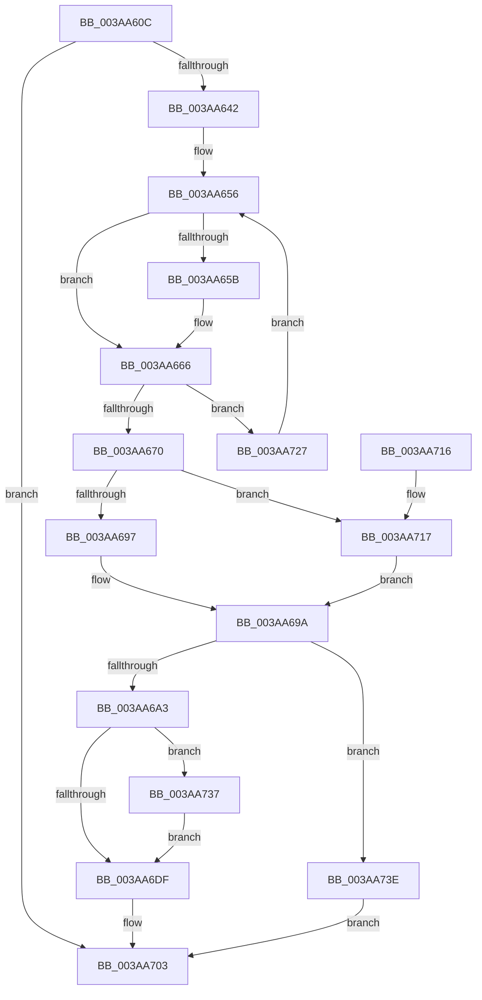

# B_TREE&lt;_SM_PAGE_KEY,ST_STORE&lt;SM_TRAITS&gt;::_ST_PAGE_ENTRY,4096,NP_CONTEXT,B_TREE_KEY_COMPARATOR&lt;_SM_PAGE_KEY&gt; &gt;::BTreeFindLeafSiblingEx

- RVA: `0x003AA60C`–`0x003AA744` (길이 `312` bytes)
- VA: `0x00000001403AA60C`
- 실행 섹션: `.text`
- PDB 이름 있음: `예`; PDB Function 태그: `아니요`
- unwind 정보 RVA: `0x0008B7C4`
- 디코드: `89`개 명령, `312/312` bytes 표시
- 미해석 바이트: `0` (있으면 어셈블리에 `.byte`로 보존)

> 이 문서는 커널 이미지의 기계어와 PDB 기호를 분석해 생성했습니다. 4번과 5번은 함수 원형과 자료형을 바이너리 사용 방식에서 추정한 C 해석이며 원본 소스 복구 결과는 아닙니다.

## 1. Dependencies

- 직접 호출 지점: **4**; 고유 호출 대상: **4**
- 직접 호출자로 확인된 함수: **2**
- RIP 상대 이미지 참조: **0**

### Outgoing calls
- `0x003AA635` → [B_TREE<_SM_PAGE_KEY,ST_STORE<SM_TRAITS>::_ST_PAGE_ENTRY,4096,NP_CONTEXT,B_TREE_KEY_COMPARATOR<_SM_PAGE_KEY> >::BTreeFindSeperatorIndexEntry](B_TREE__SM_PAGE_KEY_ST_STORE_SM_TRAITS__ST_PAGE_ENTRY_4096_NP_CONTEXT_B_TREE_KEY_COMPARATOR__SM_PAGE_function_003AA74C.md) (function, `0x003AA74C`)
- `0x003AA6E7` → [B_TREE<_SM_PAGE_KEY,ST_STORE<SM_TRAITS>::_ST_PAGE_ENTRY,4096,NP_CONTEXT,B_TREE_KEY_COMPARATOR<_SM_PAGE_KEY> >::BTreeDescendToSibling](B_TREE__SM_PAGE_KEY_ST_STORE_SM_TRAITS__ST_PAGE_ENTRY_4096_NP_CONTEXT_B_TREE_KEY_COMPARATOR__SM_PAGE_function_003AA7C0.md) (function, `0x003AA7C0`)
- `0x003AA71A` → [NP_CONTEXT::NpLeafRefInternal](NP_CONTEXT_NpLeafRefInternal_function_003AA340.md) (function, `0x003AA340`)
- `0x003AA737` → [NP_CONTEXT::NpLeafDerefInternal](NP_CONTEXT_NpLeafDerefInternal_function_003A9A70.md) (function, `0x003A9A70`)

### Direct callers
- [ST_STORE&lt;SM_TRAITS&gt;::StDmpSinglePageLookup](ST_STORE_SM_TRAITS_StDmpSinglePageLookup_function_003ABFF0.md) at `0x003AC328`
- [B_TREE&lt;_SM_PAGE_KEY,ST_STORE&lt;SM_TRAITS&gt;::_ST_PAGE_ENTRY,4096,NP_CONTEXT,B_TREE_KEY_COMPARATOR&lt;_SM_PAGE_KEY&gt; &gt;::BTreeFindLeafSibling](../41/B_TREE__SM_PAGE_KEY_ST_STORE_SM_TRAITS__ST_PAGE_ENTRY_4096_NP_CONTEXT_B_TREE_KEY_COMPARATOR__SM_PAGE_function_00410EF0.md) at `0x00410FB6`

### Static image references
- 디코드된 RIP-relative 메모리 참조가 없습니다.

## 2. Other-region calls and transfers

- 다른 실행 섹션으로 향하는 call: **0**
- 별도 외부 분기/꼬리 이동을 확인하지 못했습니다.

## 3. Assembly (complete function range)

```asm
003AA60C  48 8B C4                        mov rax, rsp
003AA60F  48 89 58 08                     mov qword ptr [rax + 8], rbx
003AA613  48 89 70 10                     mov qword ptr [rax + 0x10], rsi
003AA617  57                              push rdi
003AA618  48 83 EC 30                     sub rsp, 0x30
003AA61C  48 8B FA                        mov rdi, rdx
003AA61F  4C 8D 40 E8                     lea r8, [rax - 0x18]
003AA623  48 8B F1                        mov rsi, rcx
003AA626  0F 57 C0                        xorps xmm0, xmm0
003AA629  33 DB                           xor ebx, ebx
003AA62B  48 8B CF                        mov rcx, rdi
003AA62E  0F 11 40 E8                     movups xmmword ptr [rax - 0x18], xmm0
003AA632  8D 53 01                        lea edx, [rbx + 1]
003AA635  E8 12 01 00 00                  call 0x1403aa74c
003AA63A  85 C0                           test eax, eax
003AA63C  0F 84 C1 00 00 00               je 0x1403aa703
003AA642  48 8B 44 24 28                  mov rax, qword ptr [rsp + 0x28]
003AA647  33 C9                           xor ecx, ecx
003AA649  48 8B 54 24 20                  mov rdx, qword ptr [rsp + 0x20]
003AA64E  48 8D 58 08                     lea rbx, [rax + 8]
003AA652  48 83 C0 10                     add rax, 0x10
003AA656  48 85 C9                        test rcx, rcx
003AA659  74 0B                           je 0x1403aa666
003AA65B  48 89 11                        mov qword ptr [rcx], rdx
003AA65E  48 89 41 08                     mov qword ptr [rcx + 8], rax
003AA662  48 83 C1 10                     add rcx, 0x10
003AA666  80 7A 02 02                     cmp byte ptr [rdx + 2], 2
003AA66A  0F 85 B7 00 00 00               jne 0x1403aa727
003AA670  44 8B 47 20                     mov r8d, dword ptr [rdi + 0x20]
003AA674  4C 8D 4E 10                     lea r9, [rsi + 0x10]
003AA678  41 83 E0 01                     and r8d, 1
003AA67C  48 8B C6                        mov rax, rsi
003AA67F  45 03 C0                        add r8d, r8d
003AA682  48 F7 D8                        neg rax
003AA685  48 1B C9                        sbb rcx, rcx
003AA688  49 23 C9                        and rcx, r9
003AA68B  48 8B 01                        mov rax, qword ptr [rcx]
003AA68E  83 38 FF                        cmp dword ptr [rax], -1
003AA691  0F 85 80 00 00 00               jne 0x1403aa717
003AA697  48 8B 1B                        mov rbx, qword ptr [rbx]
003AA69A  48 85 DB                        test rbx, rbx
003AA69D  0F 84 9B 00 00 00               je 0x1403aa73e
003AA6A3  8B 47 18                        mov eax, dword ptr [rdi + 0x18]
003AA6A6  83 E8 02                        sub eax, 2
003AA6A9  48 C1 E0 04                     shl rax, 4
003AA6AD  48 03 07                        add rax, qword ptr [rdi]
003AA6B0  4C 8B 40 08                     mov r8, qword ptr [rax + 8]
003AA6B4  48 8B 00                        mov rax, qword ptr [rax]
003AA6B7  49 8D 50 F8                     lea rdx, [r8 - 8]
003AA6BB  48 8D 48 10                     lea rcx, [rax + 0x10]
003AA6BF  48 83 C0 08                     add rax, 8
003AA6C3  4C 3B C1                        cmp r8, rcx
003AA6C6  48 0F 46 D0                     cmovbe rdx, rax
003AA6CA  48 8D 46 10                     lea rax, [rsi + 0x10]
003AA6CE  48 F7 DE                        neg rsi
003AA6D1  48 1B C9                        sbb rcx, rcx
003AA6D4  48 23 C8                        and rcx, rax
003AA6D7  48 8B 01                        mov rax, qword ptr [rcx]
003AA6DA  83 38 FF                        cmp dword ptr [rax], -1
003AA6DD  75 58                           jne 0x1403aa737
003AA6DF  4C 8B C7                        mov r8, rdi
003AA6E2  48 8D 4C 24 20                  lea rcx, [rsp + 0x20]
003AA6E7  E8 D4 00 00 00                  call 0x1403aa7c0
003AA6EC  8B 57 18                        mov edx, dword ptr [rdi + 0x18]
003AA6EF  48 8D 4B 10                     lea rcx, [rbx + 0x10]
003AA6F3  FF CA                           dec edx
003AA6F5  48 C1 E2 04                     shl rdx, 4
003AA6F9  48 03 17                        add rdx, qword ptr [rdi]
003AA6FC  48 89 1A                        mov qword ptr [rdx], rbx
003AA6FF  48 89 4A 08                     mov qword ptr [rdx + 8], rcx
003AA703  48 8B 74 24 48                  mov rsi, qword ptr [rsp + 0x48]
003AA708  48 8B C3                        mov rax, rbx
003AA70B  48 8B 5C 24 40                  mov rbx, qword ptr [rsp + 0x40]
003AA710  48 83 C4 30                     add rsp, 0x30
003AA714  5F                              pop rdi
003AA715  C3                              ret
003AA716  CC                              int3
003AA717  48 8B D3                        mov rdx, rbx
003AA71A  E8 21 FC FF FF                  call 0x1403aa340
003AA71F  48 8B D8                        mov rbx, rax
003AA722  E9 73 FF FF FF                  jmp 0x1403aa69a
003AA727  48 8B 13                        mov rdx, qword ptr [rbx]
003AA72A  48 8D 5A 08                     lea rbx, [rdx + 8]
003AA72E  48 8D 42 10                     lea rax, [rdx + 0x10]
003AA732  E9 1F FF FF FF                  jmp 0x1403aa656
003AA737  E8 34 F3 FF FF                  call 0x1403a9a70
003AA73C  EB A1                           jmp 0x1403aa6df
003AA73E  48 83 CB FF                     or rbx, 0xffffffffffffffff
003AA742  EB BF                           jmp 0x1403aa703
```

## 4. C-style interpretation (structured pseudocode)

```c
__int64 __fastcall B_TREE__SM_PAGE_KEY_ST_STORE_SM_TRAITS____ST_PAGE_ENTRY_4096_NP_CONTEXT_B_TREE_KEY_COMPARATOR__SM_PA(__int64 a1, __int64 a2)
{
    __int64 result;
    __int64 v_rbx;
    __int64 v_rsi;
    __int64 v_rsp;
    unsigned __int64 v_stack_m10;
    unsigned __int64 v_stack_m18;
    unsigned __int64 v_stack_p10;
    unsigned __int64 v_stack_p8;

    *(unsigned __int64 *)(v_rsp + 8) = v_rbx;
    *(unsigned __int64 *)(v_rsp + 16) = v_rsi;
    v_rsp = (v_rsp) - (48);
    v_rbx = 0;
    *(unsigned __int64 *)(v_rsp - 24) = v_xmm0;
    result = B_TREE__SM_PAGE_KEY_ST_STORE_SM_TRAITS____ST_PAGE_ENTRY_4096_NP_CONTEXT_B_TREE_KEY_COMPARATOR__SM_PA(a2, v_rbx + 1, v_rsp - 24, a4);
    if ((unsigned int)(result) == 0) goto loc_003AA703;
    a1 = 0;
    result = (v_stack_m10) + (16);
loc_003AA656:
    if (0 != 0) {
        *(unsigned __int64 *)(a1) = v_stack_m18;
        *(unsigned __int64 *)(a1 + 8) = result;
        a1 = (a1) + (16);
    }
    if ((*(unsigned __int8 *)(v_stack_m18 + 2)) != 2) goto loc_003AA727;
    a3 = (unsigned int)(((unsigned int)(*(unsigned int *)(a2 + 32))) & (1));
    a3 = (unsigned int)((a3) + ((unsigned int)(a3)));
    result = -(a1);
    a1 = (a1) & (a1 + 16);
    if ((*(unsigned int *)(*(unsigned __int64 *)(a1))) != -1) goto loc_003AA717;
loc_003AA69A:
    if (*(unsigned __int64 *)(v_stack_m10 + 8) == 0) goto loc_003AA73E;
    result = (unsigned int)(((unsigned int)(*(unsigned int *)(a2 + 24))) - (2));
    result = (result) << (4);
    result = (result) + (*(unsigned __int64 *)(a2));
    result = (*(unsigned __int64 *)(result)) + (8);
    a2 = *(unsigned __int64 *)(result + 8) - 8;
    if ((*(unsigned __int64 *)(result + 8)) <= (*(unsigned __int64 *)(result) + 16)) { a2 = result; }
    v_rsi = -(a1);
    a1 = (*(unsigned __int64 *)(result) + 16) & (a1 + 16);
    if ((*(unsigned int *)(*(unsigned __int64 *)(a1))) != -1) goto loc_003AA737;
loc_003AA6DF:
    result = B_TREE__SM_PAGE_KEY_ST_STORE_SM_TRAITS____ST_PAGE_ENTRY_4096_NP_CONTEXT_B_TREE_KEY_COMPARATOR__SM_PA(v_stack_m18, a2, a2, a1 + 16);
    a2 = (unsigned int)(((unsigned int)(*(unsigned int *)(a2 + 24))) - 1);
    a2 = (a2) << (4);
    a2 = (a2) + (*(unsigned __int64 *)(a2));
    *(unsigned __int64 *)(a2) = *(unsigned __int64 *)(v_stack_m10 + 8);
    *(unsigned __int64 *)(a2 + 8) = *(unsigned __int64 *)(v_stack_m10 + 8) + 16;
loc_003AA703:
    v_rsp = (v_rsp) + (48);
    return *(unsigned __int64 *)(v_stack_m10 + 8);
loc_003AA717:
    result = NP_CONTEXT__NpLeafRefInternal(*(unsigned __int64 *)(v_stack_m10 + 8) + 16, v_stack_p8, a2, a1 + 16);
    goto loc_003AA69A;
loc_003AA727:
    goto loc_003AA656;
loc_003AA737:
    result = NP_CONTEXT__NpLeafDerefInternal(*(unsigned __int64 *)(v_stack_m10 + 8) + 16, *(unsigned __int64 *)(result), a2, a1 + 16);
    goto loc_003AA6DF;
loc_003AA73E:
    v_rbx = (*(unsigned __int64 *)(result) + 8) | (-1);
    goto loc_003AA703;
}
```

## 5. (Beta) C Style

```c
int64_t B_TREE__SM_PAGE_KEY_ST_STORE_SM_TRAITS____ST_PAGE_ENTRY_4096_NP_CONTEXT_B_TREE_KEY_COMPARATOR__SM_PA(void *Arg1, void *Arg2)
{
    uint8_t *arg1 = (uint8_t *)Arg1;
    uint8_t *arg2 = (uint8_t *)Arg2;

    int64_t result;
    int64_t local_rbx;
    int64_t local_rsi;
    int64_t local_rsp;
    uint64_t v_stack_m10;
    uint64_t v_stack_m18;
    uint64_t v_stack_p10;
    uint64_t v_stack_p8;

    *(uint64_t *)(local_rsp + 0x8) = local_rbx;
    *(uint64_t *)(local_rsp + 0x10) = local_rsi;
    local_rsp = (local_rsp) - (48);
    local_rbx = 0;
    *(uint64_t *)(local_rsp - 0x18) = v_xmm0;
    result = B_TREE__SM_PAGE_KEY_ST_STORE_SM_TRAITS____ST_PAGE_ENTRY_4096_NP_CONTEXT_B_TREE_KEY_COMPARATOR__SM_PA(Arg2, local_rbx + 1, local_rsp - 24, a4);
    if ((uint32_t)(result) == 0) goto loc_003AA703;
    Arg1 = 0;
    result = (v_stack_m10) + (16);
loc_003AA656:
    if (0 != 0) {
        *(uint64_t *)(arg1) = v_stack_m18;
        *(uint64_t *)(arg1 + 0x8) = result;
        Arg1 = (Arg1) + (16);
    }
    if ((*(uint8_t *)(v_stack_m18 + 0x2)) != 2) goto loc_003AA727;
    a3 = (uint32_t)(((uint32_t)(*(uint32_t *)(arg2 + 0x20))) & (1));
    a3 = (uint32_t)((a3) + ((uint32_t)(a3)));
    result = -(Arg1);
    Arg1 = (Arg1) & (Arg1 + 16);
    if ((*(uint32_t *)(*(uint64_t *)(arg1))) != -1) goto loc_003AA717;
loc_003AA69A:
    if (*(uint64_t *)(v_stack_m10 + 0x8) == 0) goto loc_003AA73E;
    result = (uint32_t)(((uint32_t)(*(uint32_t *)(arg2 + 0x18))) - (2));
    result = (result) << (4);
    result = (result) + (*(uint64_t *)(arg2));
    result = (*(uint64_t *)(result)) + (8);
    Arg2 = *(uint64_t *)(result + 0x8) - 8;
    if ((*(uint64_t *)(result + 0x8)) <= (*(uint64_t *)(result) + 16)) { Arg2 = result; }
    local_rsi = -(Arg1);
    Arg1 = (*(uint64_t *)(result) + 16) & (Arg1 + 16);
    if ((*(uint32_t *)(*(uint64_t *)(arg1))) != -1) goto loc_003AA737;
loc_003AA6DF:
    result = B_TREE__SM_PAGE_KEY_ST_STORE_SM_TRAITS____ST_PAGE_ENTRY_4096_NP_CONTEXT_B_TREE_KEY_COMPARATOR__SM_PA(v_stack_m18, Arg2, Arg2, Arg1 + 16);
    Arg2 = (uint32_t)(((uint32_t)(*(uint32_t *)(arg2 + 0x18))) - 1);
    Arg2 = (Arg2) << (4);
    Arg2 = (Arg2) + (*(uint64_t *)(arg2));
    *(uint64_t *)(arg2) = *(uint64_t *)(v_stack_m10 + 0x8);
    *(uint64_t *)(arg2 + 0x8) = *(uint64_t *)(v_stack_m10 + 0x8) + 16;
loc_003AA703:
    local_rsp = (local_rsp) + (48);
    return *(uint64_t *)(v_stack_m10 + 0x8);
loc_003AA717:
    result = NP_CONTEXT__NpLeafRefInternal(*(uint64_t *)(v_stack_m10 + 0x8) + 16, v_stack_p8, Arg2, Arg1 + 16);
    goto loc_003AA69A;
loc_003AA727:
    goto loc_003AA656;
loc_003AA737:
    result = NP_CONTEXT__NpLeafDerefInternal(*(uint64_t *)(v_stack_m10 + 0x8) + 16, *(uint64_t *)(result), Arg2, Arg1 + 16);
    goto loc_003AA6DF;
loc_003AA73E:
    local_rbx = (*(uint64_t *)(result) + 8) | (-1);
    goto loc_003AA703;
}
```

### 관측된 메모리 오프셋

구조체 형식이 확인되지 않은 접근은 인자 기준의 오프셋으로만 기록했습니다.

| 기준 인자 | 오프셋 표현 | 폭 (bit) | 접근 |
|---|---:|---:|---|
| `Arg1` | `+ 0x10` | `64` | `R` |
| `Arg2` | `+ 0x0` | `64` | `R` |
| `Arg2` | `+ 0x18` | `32` | `R` |
| `Arg2` | `+ 0x20` | `32` | `R` |

## 6. Execution-region graph

[열기: 2D/3D 그래프와 함수 탐색 컨트롤 패널](../../../control-panel.html?section=text&rva=0x003AA60C&view=graph)

- 2D 그래프는 위에서 아래로 흐르고, 3D 그래프는 빈 공간을 드래그해 회전합니다. Shift+드래그는 이동, 휠은 확대·축소, 함수 노드 선택은 대상 보고서 이동입니다.

### Static fallback


