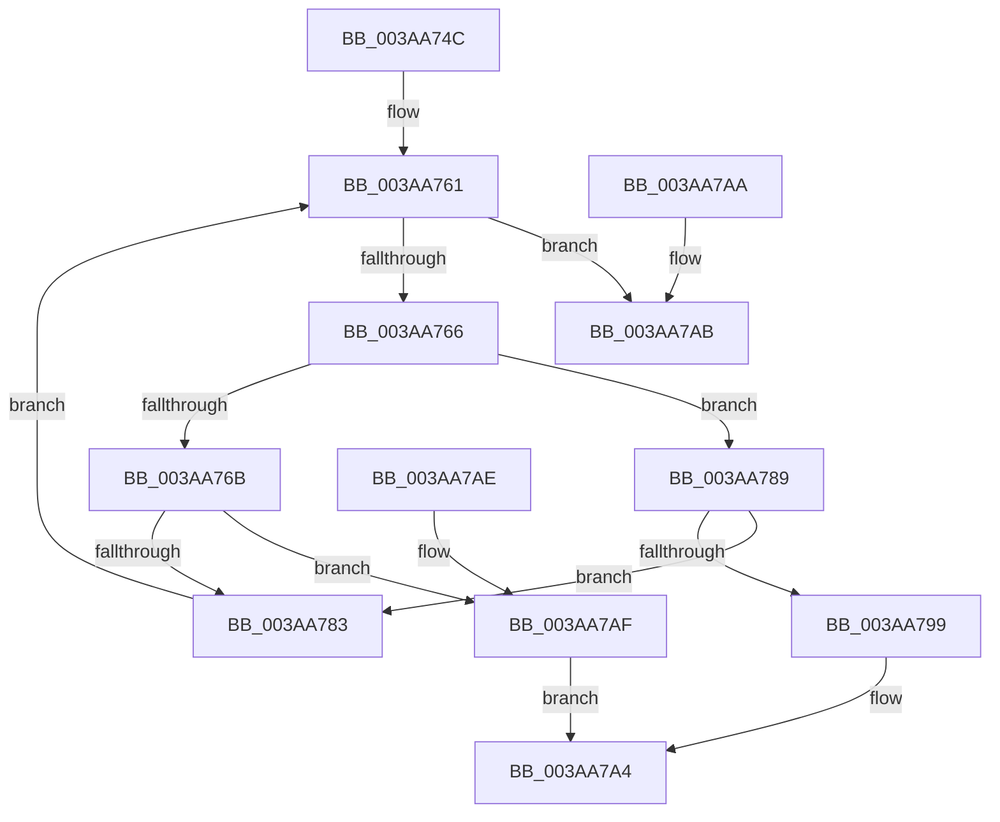

# B_TREE&lt;_SM_PAGE_KEY,ST_STORE&lt;SM_TRAITS&gt;::_ST_PAGE_ENTRY,4096,NP_CONTEXT,B_TREE_KEY_COMPARATOR&lt;_SM_PAGE_KEY&gt; &gt;::BTreeFindSeperatorIndexEntry

- RVA: `0x003AA74C`–`0x003AA7BA` (길이 `110` bytes)
- VA: `0x00000001403AA74C`
- 실행 섹션: `.text`
- PDB 이름 있음: `예`; PDB Function 태그: `아니요`
- unwind 정보 RVA: `0x000DB714`
- 디코드: `37`개 명령, `110/110` bytes 표시
- 미해석 바이트: `0` (있으면 어셈블리에 `.byte`로 보존)

> 이 문서는 커널 이미지의 기계어와 PDB 기호를 분석해 생성했습니다. 4번과 5번은 함수 원형과 자료형을 바이너리 사용 방식에서 추정한 C 해석이며 원본 소스 복구 결과는 아닙니다.

## 1. Dependencies

- 직접 호출 지점: **0**; 고유 호출 대상: **0**
- 직접 호출자로 확인된 함수: **1**
- RIP 상대 이미지 참조: **0**

### Outgoing calls
- 직접 디코드된 call 명령이 없습니다.

### Direct callers
- [B_TREE&lt;_SM_PAGE_KEY,ST_STORE&lt;SM_TRAITS&gt;::_ST_PAGE_ENTRY,4096,NP_CONTEXT,B_TREE_KEY_COMPARATOR&lt;_SM_PAGE_KEY&gt; &gt;::BTreeFindLeafSiblingEx](B_TREE__SM_PAGE_KEY_ST_STORE_SM_TRAITS__ST_PAGE_ENTRY_4096_NP_CONTEXT_B_TREE_KEY_COMPARATOR__SM_PAGE_function_003AA60C.md) at `0x003AA635`

### Static image references
- 디코드된 RIP-relative 메모리 참조가 없습니다.

## 2. Other-region calls and transfers

- 다른 실행 섹션으로 향하는 call: **0**
- 별도 외부 분기/꼬리 이동을 확인하지 못했습니다.

## 3. Assembly (complete function range)

```asm
003AA74C  44 8B 49 18                     mov r9d, dword ptr [rcx + 0x18]
003AA750  44 8B DA                        mov r11d, edx
003AA753  4C 8B 11                        mov r10, qword ptr [rcx]
003AA756  49 83 E9 02                     sub r9, 2
003AA75A  49 C1 E1 04                     shl r9, 4
003AA75E  4D 03 CA                        add r9, r10
003AA761  4D 3B CA                        cmp r9, r10
003AA764  72 45                           jb 0x1403aa7ab
003AA766  45 85 DB                        test r11d, r11d
003AA769  74 1E                           je 0x1403aa789
003AA76B  49 8B 11                        mov rdx, qword ptr [r9]
003AA76E  8B 02                           mov eax, dword ptr [rdx]
003AA770  0F B7 C8                        movzx ecx, ax
003AA773  48 FF C1                        inc rcx
003AA776  48 C1 E1 04                     shl rcx, 4
003AA77A  48 03 CA                        add rcx, rdx
003AA77D  49 39 49 08                     cmp qword ptr [r9 + 8], rcx
003AA781  72 2C                           jb 0x1403aa7af
003AA783  49 83 E9 10                     sub r9, 0x10
003AA787  EB D8                           jmp 0x1403aa761
003AA789  49 8B 09                        mov rcx, qword ptr [r9]
003AA78C  49 8B 51 08                     mov rdx, qword ptr [r9 + 8]
003AA790  48 8D 41 10                     lea rax, [rcx + 0x10]
003AA794  48 3B D0                        cmp rdx, rax
003AA797  76 EA                           jbe 0x1403aa783
003AA799  48 8D 42 F0                     lea rax, [rdx - 0x10]
003AA79D  49 89 08                        mov qword ptr [r8], rcx
003AA7A0  49 89 40 08                     mov qword ptr [r8 + 8], rax
003AA7A4  B8 01 00 00 00                  mov eax, 1
003AA7A9  C3                              ret
003AA7AA  CC                              int3
003AA7AB  33 C0                           xor eax, eax
003AA7AD  C3                              ret
003AA7AE  CC                              int3
003AA7AF  41 0F 10 01                     movups xmm0, xmmword ptr [r9]
003AA7B3  F3 41 0F 7F 00                  movdqu xmmword ptr [r8], xmm0
003AA7B8  EB EA                           jmp 0x1403aa7a4
```

## 4. C-style interpretation (structured pseudocode)

```c
__int64 __fastcall B_TREE__SM_PAGE_KEY_ST_STORE_SM_TRAITS____ST_PAGE_ENTRY_4096_NP_CONTEXT_B_TREE_KEY_COMPARATOR__SM_PA(__int64 a1, int a2, __int64 a3)
{
    __int64 result;

    a4 = ((unsigned int)(*(unsigned int *)(a1 + 24))) - (2);
    a4 = (a4) << (4);
    a4 = (a4) + (*(unsigned __int64 *)(a1));
loc_003AA761:
    if (a4 < (*(unsigned __int64 *)(a1))) goto loc_003AA7AB;
    if ((unsigned int)((unsigned int)(a2)) == 0) goto loc_003AA789;
    a1 = ((unsigned __int16)((unsigned int)(*(unsigned int *)(*(unsigned __int64 *)(a4))))) + 1;
    a1 = (a1) << (4);
    a1 = (a1) + (*(unsigned __int64 *)(a4));
    if ((*(unsigned __int64 *)(a4 + 8)) < a1) goto loc_003AA7AF;
loc_003AA783:
    a4 = (a4) - (16);
    goto loc_003AA761;
loc_003AA789:
    if ((*(unsigned __int64 *)(a4 + 8)) <= (*(unsigned __int64 *)(a4) + 16)) goto loc_003AA783;
    *(unsigned __int64 *)(a3) = *(unsigned __int64 *)(a4);
    *(unsigned __int64 *)(a3 + 8) = *(unsigned __int64 *)(a4 + 8) - 16;
loc_003AA7A4:
    return 1;
loc_003AA7AB:
    result = 0;
    return result;
loc_003AA7AF:
    *(unsigned __int64 *)(a3) = v_xmm0;
    goto loc_003AA7A4;
}
```

## 5. (Beta) C Style

```c
int64_t B_TREE__SM_PAGE_KEY_ST_STORE_SM_TRAITS____ST_PAGE_ENTRY_4096_NP_CONTEXT_B_TREE_KEY_COMPARATOR__SM_PA(void *Arg1, int32_t Arg2, void *Arg3)
{
    uint8_t *arg1 = (uint8_t *)Arg1;
    uint8_t *arg3 = (uint8_t *)Arg3;

    int64_t result;

    a4 = ((uint32_t)(*(uint32_t *)(arg1 + 0x18))) - (2);
    a4 = (a4) << (4);
    a4 = (a4) + (*(uint64_t *)(arg1));
loc_003AA761:
    if (a4 < (*(uint64_t *)(arg1))) goto loc_003AA7AB;
    if ((uint32_t)((uint32_t)(Arg2)) == 0) goto loc_003AA789;
    Arg1 = ((uint16_t)((uint32_t)(*(uint32_t *)(*(uint64_t *)(a4))))) + 1;
    Arg1 = (Arg1) << (4);
    Arg1 = (Arg1) + (*(uint64_t *)(a4));
    if ((*(uint64_t *)(a4 + 0x8)) < Arg1) goto loc_003AA7AF;
loc_003AA783:
    a4 = (a4) - (16);
    goto loc_003AA761;
loc_003AA789:
    if ((*(uint64_t *)(a4 + 0x8)) <= (*(uint64_t *)(a4) + 16)) goto loc_003AA783;
    *(uint64_t *)(arg3) = *(uint64_t *)(a4);
    *(uint64_t *)(arg3 + 0x8) = *(uint64_t *)(a4 + 0x8) - 16;
loc_003AA7A4:
    return 1;
loc_003AA7AB:
    result = 0;
    return result;
loc_003AA7AF:
    *(uint64_t *)(arg3) = v_xmm0;
    goto loc_003AA7A4;
}
```

### 관측된 메모리 오프셋

구조체 형식이 확인되지 않은 접근은 인자 기준의 오프셋으로만 기록했습니다.

| 기준 인자 | 오프셋 표현 | 폭 (bit) | 접근 |
|---|---:|---:|---|
| `Arg1` | `+ 0x0` | `64` | `R` |
| `Arg1` | `+ 0x18` | `32` | `R` |
| `Arg3` | `+ 0x0` | `64` | `W` |
| `Arg3` | `+ 0x0` | `128` | `W` |
| `Arg3` | `+ 0x8` | `64` | `W` |

## 6. Execution-region graph

[열기: 2D/3D 그래프와 함수 탐색 컨트롤 패널](../../../control-panel.html?section=text&rva=0x003AA74C&view=graph)

- 2D 그래프는 위에서 아래로 흐르고, 3D 그래프는 빈 공간을 드래그해 회전합니다. Shift+드래그는 이동, 휠은 확대·축소, 함수 노드 선택은 대상 보고서 이동입니다.

### Static fallback


