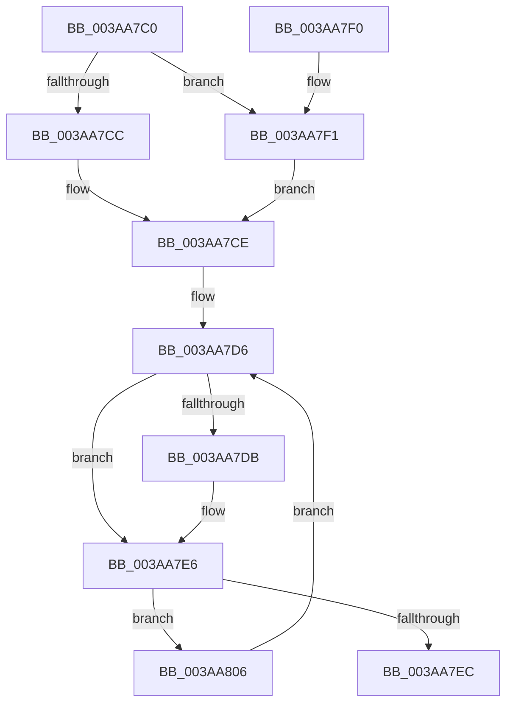

# B_TREE&lt;_SM_PAGE_KEY,ST_STORE&lt;SM_TRAITS&gt;::_ST_PAGE_ENTRY,4096,NP_CONTEXT,B_TREE_KEY_COMPARATOR&lt;_SM_PAGE_KEY&gt; &gt;::BTreeDescendToSibling

- RVA: `0x003AA7C0`–`0x003AA813` (길이 `83` bytes)
- VA: `0x00000001403AA7C0`
- 실행 섹션: `.text`
- PDB 이름 있음: `예`; PDB Function 태그: `아니요`
- unwind 정보 RVA: `0x000DB714`
- 디코드: `28`개 명령, `83/83` bytes 표시
- 미해석 바이트: `0` (있으면 어셈블리에 `.byte`로 보존)

> 이 문서는 커널 이미지의 기계어와 PDB 기호를 분석해 생성했습니다. 4번과 5번은 함수 원형과 자료형을 바이너리 사용 방식에서 추정한 C 해석이며 원본 소스 복구 결과는 아닙니다.

## 1. Dependencies

- 직접 호출 지점: **0**; 고유 호출 대상: **0**
- 직접 호출자로 확인된 함수: **1**
- RIP 상대 이미지 참조: **0**

### Outgoing calls
- 직접 디코드된 call 명령이 없습니다.

### Direct callers
- [B_TREE&lt;_SM_PAGE_KEY,ST_STORE&lt;SM_TRAITS&gt;::_ST_PAGE_ENTRY,4096,NP_CONTEXT,B_TREE_KEY_COMPARATOR&lt;_SM_PAGE_KEY&gt; &gt;::BTreeFindLeafSiblingEx](B_TREE__SM_PAGE_KEY_ST_STORE_SM_TRAITS__ST_PAGE_ENTRY_4096_NP_CONTEXT_B_TREE_KEY_COMPARATOR__SM_PAGE_function_003AA60C.md) at `0x003AA6E7`

### Static image references
- 디코드된 RIP-relative 메모리 참조가 없습니다.

## 2. Other-region calls and transfers

- 다른 실행 섹션으로 향하는 call: **0**
- 별도 외부 분기/꼬리 이동을 확인하지 못했습니다.

## 3. Assembly (complete function range)

```asm
003AA7C0  4C 8B 49 08                     mov r9, qword ptr [rcx + 8]
003AA7C4  48 8B 11                        mov rdx, qword ptr [rcx]
003AA7C7  4D 85 C0                        test r8, r8
003AA7CA  75 25                           jne 0x1403aa7f1
003AA7CC  33 C0                           xor eax, eax
003AA7CE  49 8D 49 08                     lea rcx, [r9 + 8]
003AA7D2  49 83 C1 10                     add r9, 0x10
003AA7D6  48 85 C0                        test rax, rax
003AA7D9  74 0B                           je 0x1403aa7e6
003AA7DB  48 89 10                        mov qword ptr [rax], rdx
003AA7DE  4C 89 48 08                     mov qword ptr [rax + 8], r9
003AA7E2  48 83 C0 10                     add rax, 0x10
003AA7E6  80 7A 02 02                     cmp byte ptr [rdx + 2], 2
003AA7EA  75 1A                           jne 0x1403aa806
003AA7EC  48 8B C1                        mov rax, rcx
003AA7EF  C3                              ret
003AA7F0  CC                              int3
003AA7F1  0F B6 42 02                     movzx eax, byte ptr [rdx + 2]
003AA7F5  41 8B 48 18                     mov ecx, dword ptr [r8 + 0x18]
003AA7F9  2B C8                           sub ecx, eax
003AA7FB  8B C1                           mov eax, ecx
003AA7FD  48 C1 E0 04                     shl rax, 4
003AA801  49 03 00                        add rax, qword ptr [r8]
003AA804  EB C8                           jmp 0x1403aa7ce
003AA806  48 8B 11                        mov rdx, qword ptr [rcx]
003AA809  48 8D 4A 08                     lea rcx, [rdx + 8]
003AA80D  4C 8D 4A 10                     lea r9, [rdx + 0x10]
003AA811  EB C3                           jmp 0x1403aa7d6
```

## 4. C-style interpretation (structured pseudocode)

```c
__int64 __fastcall B_TREE__SM_PAGE_KEY_ST_STORE_SM_TRAITS____ST_PAGE_ENTRY_4096_NP_CONTEXT_B_TREE_KEY_COMPARATOR__SM_PA(__int64 a1, __int64 a2, __int64 a3)
{
    __int64 result;

    if (a3 != 0) goto loc_003AA7F1;
    result = 0;
loc_003AA7CE:
    a4 = (*(unsigned __int64 *)(a1 + 8)) + (16);
loc_003AA7D6:
    if (0 != 0) {
        *(unsigned __int64 *)(result) = *(unsigned __int64 *)(a1);
        *(unsigned __int64 *)(result + 8) = a4;
        result = (result) + (16);
    }
    if ((*(unsigned __int8 *)(*(unsigned __int64 *)(a1) + 2)) != 2) goto loc_003AA806;
    return *(unsigned __int64 *)(a1 + 8) + 8;
loc_003AA7F1:
    a1 = (unsigned int)(((unsigned int)(*(unsigned int *)(a3 + 24))) - ((unsigned int)(*(unsigned __int8 *)(*(unsigned __int64 *)(a1) + 2))));
    result = ((unsigned int)((unsigned int)(a1))) << (4);
    result = (result) + (*(unsigned __int64 *)(a3));
    goto loc_003AA7CE;
loc_003AA806:
    goto loc_003AA7D6;
}
```

## 5. (Beta) C Style

```c
int64_t B_TREE__SM_PAGE_KEY_ST_STORE_SM_TRAITS____ST_PAGE_ENTRY_4096_NP_CONTEXT_B_TREE_KEY_COMPARATOR__SM_PA(void *Arg1, int64_t Arg2, int64_t Arg3)
{
    uint8_t *arg1 = (uint8_t *)Arg1;

    int64_t result;

    if (Arg3 != 0) goto loc_003AA7F1;
    result = 0;
loc_003AA7CE:
    a4 = (*(uint64_t *)(arg1 + 0x8)) + (16);
loc_003AA7D6:
    if (0 != 0) {
        *(uint64_t *)(result) = *(uint64_t *)(arg1);
        *(uint64_t *)(result + 0x8) = a4;
        result = (result) + (16);
    }
    if ((*(uint8_t *)(*(uint64_t *)(arg1) + 0x2)) != 2) goto loc_003AA806;
    return *(uint64_t *)(arg1 + 0x8) + 8;
loc_003AA7F1:
    Arg1 = (uint32_t)(((uint32_t)(*(uint32_t *)(Arg3 + 0x18))) - ((uint32_t)(*(uint8_t *)(*(uint64_t *)(arg1) + 0x2))));
    result = ((uint32_t)((uint32_t)(Arg1))) << (4);
    result = (result) + (*(uint64_t *)(Arg3));
    goto loc_003AA7CE;
loc_003AA806:
    goto loc_003AA7D6;
}
```

### 관측된 메모리 오프셋

구조체 형식이 확인되지 않은 접근은 인자 기준의 오프셋으로만 기록했습니다.

| 기준 인자 | 오프셋 표현 | 폭 (bit) | 접근 |
|---|---:|---:|---|
| `Arg1` | `+ 0x0` | `64` | `R` |
| `Arg1` | `+ 0x8` | `64` | `R` |

## 6. Execution-region graph

[열기: 2D/3D 그래프와 함수 탐색 컨트롤 패널](../../../control-panel.html?section=text&rva=0x003AA7C0&view=graph)

- 2D 그래프는 위에서 아래로 흐르고, 3D 그래프는 빈 공간을 드래그해 회전합니다. Shift+드래그는 이동, 휠은 확대·축소, 함수 노드 선택은 대상 보고서 이동입니다.

### Static fallback


