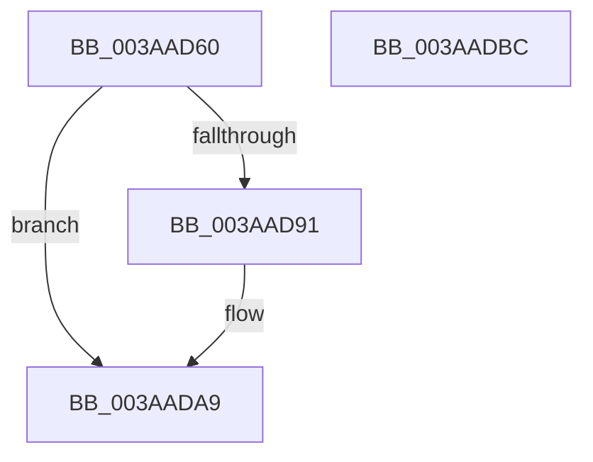

# B_TREE&lt;_SM_PAGE_KEY,ST_STORE&lt;SM_TRAITS&gt;::_ST_PAGE_ENTRY,4096,NP_CONTEXT,B_TREE_KEY_COMPARATOR&lt;_SM_PAGE_KEY&gt; &gt;::BTreeNewNode

- RVA: `0x003AAD60`–`0x003AADBD` (길이 `93` bytes)
- VA: `0x00000001403AAD60`
- 실행 섹션: `.text`
- PDB 이름 있음: `예`; PDB Function 태그: `아니요`
- unwind 정보 RVA: `0x00060BC4`
- 디코드: `28`개 명령, `93/93` bytes 표시
- 미해석 바이트: `0` (있으면 어셈블리에 `.byte`로 보존)

> 이 문서는 커널 이미지의 기계어와 PDB 기호를 분석해 생성했습니다. 4번과 5번은 함수 원형과 자료형을 바이너리 사용 방식에서 추정한 C 해석이며 원본 소스 복구 결과는 아닙니다.

## 1. Dependencies

- 직접 호출 지점: **2**; 고유 호출 대상: **2**
- 직접 호출자로 확인된 함수: **5**
- RIP 상대 이미지 참조: **0**

### Outgoing calls
- `0x003AAD84` → [NP_CONTEXT::NpNodeAllocate](NP_CONTEXT_NpNodeAllocate_function_003ABEEC.md) (function, `0x003ABEEC`)
- `0x003AAD9C` → [memset](../6C/memset_function_006C6C40.md) (function, `0x006C6C40`)

### Direct callers
- [B_TREE&lt;unsigned long,ST_STORE&lt;SM_TRAITS&gt;::_ST_REGION_ENTRY,4096,NP_CONTEXT,ST_STORE&lt;SM_TRAITS&gt;::ST_REGION_ENTRY_COMPARATOR&gt;::BTreeSplitChild](B_TREE_unsigned_long_ST_STORE_SM_TRAITS__ST_REGION_ENTRY_4096_NP_CONTEXT_ST_STORE_SM_TRAITS_ST_REGIO_function_003AAAA4.md) at `0x003AAAE6`
- [B_TREE&lt;unsigned long,ST_STORE&lt;SM_TRAITS&gt;::_ST_REGION_ENTRY,4096,NP_CONTEXT,ST_STORE&lt;SM_TRAITS&gt;::ST_REGION_ENTRY_COMPARATOR&gt;::BTreeSplitChild](B_TREE_unsigned_long_ST_STORE_SM_TRAITS__ST_REGION_ENTRY_4096_NP_CONTEXT_ST_STORE_SM_TRAITS_ST_REGIO_function_003AAAA4.md) at `0x003AAC57`
- [B_TREE&lt;_SM_PAGE_KEY,ST_STORE&lt;SM_TRAITS&gt;::_ST_PAGE_ENTRY,4096,NP_CONTEXT,B_TREE_KEY_COMPARATOR&lt;_SM_PAGE_KEY&gt; &gt;::BTreeSplitChild](B_TREE__SM_PAGE_KEY_ST_STORE_SM_TRAITS__ST_PAGE_ENTRY_4096_NP_CONTEXT_B_TREE_KEY_COMPARATOR__SM_PAGE_function_003AAF50.md) at `0x003AAF92`
- [B_TREE&lt;_SM_PAGE_KEY,ST_STORE&lt;SM_TRAITS&gt;::_ST_PAGE_ENTRY,4096,NP_CONTEXT,B_TREE_KEY_COMPARATOR&lt;_SM_PAGE_KEY&gt; &gt;::BTreeSplitChild](B_TREE__SM_PAGE_KEY_ST_STORE_SM_TRAITS__ST_PAGE_ENTRY_4096_NP_CONTEXT_B_TREE_KEY_COMPARATOR__SM_PAGE_function_003AAF50.md) at `0x003AB0ED`
- [sub_003AB9E8](Unknown_function_003AB9E8.md) at `0x003AB9F3`
- [sub_003AE7C7](Unknown_function_003AE7C7.md) at `0x003AE7D2`
- [B_TREE&lt;unsigned long,ST_STORE&lt;SM_TRAITS&gt;::_ST_HASH_ENTRY,4096,NP_CONTEXT,ST_STORE&lt;SM_TRAITS&gt;::ST_HASH_ENTRY_COMPARATOR&gt;::BTreeSplitChild](B_TREE_unsigned_long_ST_STORE_SM_TRAITS__ST_HASH_ENTRY_4096_NP_CONTEXT_ST_STORE_SM_TRAITS_ST_HASH_EN_function_003AF610.md) at `0x003AF652`
- [B_TREE&lt;unsigned long,ST_STORE&lt;SM_TRAITS&gt;::_ST_HASH_ENTRY,4096,NP_CONTEXT,ST_STORE&lt;SM_TRAITS&gt;::ST_HASH_ENTRY_COMPARATOR&gt;::BTreeSplitChild](B_TREE_unsigned_long_ST_STORE_SM_TRAITS__ST_HASH_ENTRY_4096_NP_CONTEXT_ST_STORE_SM_TRAITS_ST_HASH_EN_function_003AF610.md) at `0x003AF7C3`

### Static image references
- 디코드된 RIP-relative 메모리 참조가 없습니다.

## 2. Other-region calls and transfers

- 다른 실행 섹션으로 향하는 call: **0**
- 별도 외부 분기/꼬리 이동을 확인하지 못했습니다.

## 3. Assembly (complete function range)

```asm
003AAD60  48 89 5C 24 08                  mov qword ptr [rsp + 8], rbx
003AAD65  48 89 74 24 10                  mov qword ptr [rsp + 0x10], rsi
003AAD6A  57                              push rdi
003AAD6B  48 83 EC 20                     sub rsp, 0x20
003AAD6F  48 8D 41 10                     lea rax, [rcx + 0x10]
003AAD73  41 8B F0                        mov esi, r8d
003AAD76  48 F7 D9                        neg rcx
003AAD79  44 8B C2                        mov r8d, edx
003AAD7C  8B FA                           mov edi, edx
003AAD7E  48 1B C9                        sbb rcx, rcx
003AAD81  48 23 C8                        and rcx, rax
003AAD84  E8 63 11 00 00                  call 0x1403abeec
003AAD89  48 8B D8                        mov rbx, rax
003AAD8C  48 85 C0                        test rax, rax
003AAD8F  74 18                           je 0x1403aada9
003AAD91  33 D2                           xor edx, edx
003AAD93  41 B8 00 10 00 00               mov r8d, 0x1000
003AAD99  48 8B C8                        mov rcx, rax
003AAD9C  E8 9F BE 31 00                  call 0x1406c6c40
003AADA1  40 88 73 02                     mov byte ptr [rbx + 2], sil
003AADA5  40 88 7B 03                     mov byte ptr [rbx + 3], dil
003AADA9  48 8B 74 24 38                  mov rsi, qword ptr [rsp + 0x38]
003AADAE  48 8B C3                        mov rax, rbx
003AADB1  48 8B 5C 24 30                  mov rbx, qword ptr [rsp + 0x30]
003AADB6  48 83 C4 20                     add rsp, 0x20
003AADBA  5F                              pop rdi
003AADBB  C3                              ret
003AADBC  CC                              int3
```

## 4. C-style interpretation (structured pseudocode)

```c
__int64 __fastcall B_TREE__SM_PAGE_KEY_ST_STORE_SM_TRAITS____ST_PAGE_ENTRY_4096_NP_CONTEXT_B_TREE_KEY_COMPARATOR__SM_PA(__int64 a1, int a2, int a3)
{
    __int64 result;
    __int64 v_rsp;
    unsigned __int64 v_stack_p10;
    unsigned __int64 v_stack_p8;

    v_stack_p8 = v_rbx;
    v_stack_p10 = v_rsi;
    v_rsp = (v_rsp) - (32);
    a1 = -(a1);
    a1 = (a1) & (a1 + 16);
    result = NP_CONTEXT__NpNodeAllocate(a1, a2, (unsigned int)(a2), a4);
    if (result != 0) {
        a2 = 0;
        a3 = 0x1000ULL;
        a1 = result;
        result = memset(a1, a2, a3, a4);
        *(unsigned __int8 *)(result + 2) = (unsigned __int8)((unsigned int)(a3));
        *(unsigned __int8 *)(result + 3) = (unsigned __int8)((unsigned int)(a2));
    }
    v_rsp = (v_rsp) + (32);
    return result;
}
```

## 5. (Beta) C Style

```c
int64_t B_TREE__SM_PAGE_KEY_ST_STORE_SM_TRAITS____ST_PAGE_ENTRY_4096_NP_CONTEXT_B_TREE_KEY_COMPARATOR__SM_PA(void *Arg1, int32_t Arg2, int32_t Arg3)
{
    uint8_t *arg1 = (uint8_t *)Arg1;

    int64_t result;
    int64_t local_rsp;
    uint64_t v_stack_p10;
    uint64_t v_stack_p8;

    v_stack_p8 = local_rbx;
    v_stack_p10 = local_rsi;
    local_rsp = (local_rsp) - (32);
    Arg1 = -(Arg1);
    Arg1 = (Arg1) & (Arg1 + 16);
    result = NP_CONTEXT__NpNodeAllocate(Arg1, Arg2, (uint32_t)(Arg2), a4);
    if (result != 0) {
        Arg2 = 0;
        Arg3 = 0x1000ULL;
        Arg1 = result;
        result = memset(Arg1, Arg2, Arg3, a4);
        *(uint8_t *)(result + 0x2) = (uint8_t)((uint32_t)(Arg3));
        *(uint8_t *)(result + 0x3) = (uint8_t)((uint32_t)(Arg2));
    }
    local_rsp = (local_rsp) + (32);
    return result;
}
```

### 관측된 메모리 오프셋

구조체 형식이 확인되지 않은 접근은 인자 기준의 오프셋으로만 기록했습니다.

| 기준 인자 | 오프셋 표현 | 폭 (bit) | 접근 |
|---|---:|---:|---|
| `Arg1` | `+ 0x10` | `64` | `R` |

## 6. Execution-region graph

[열기: 2D/3D 그래프와 함수 탐색 컨트롤 패널](../../../control-panel.html?section=text&rva=0x003AAD60&view=graph)

- 2D 그래프는 위에서 아래로 흐르고, 3D 그래프는 빈 공간을 드래그해 회전합니다. Shift+드래그는 이동, 휠은 확대·축소, 함수 노드 선택은 대상 보고서 이동입니다.

### Static fallback


