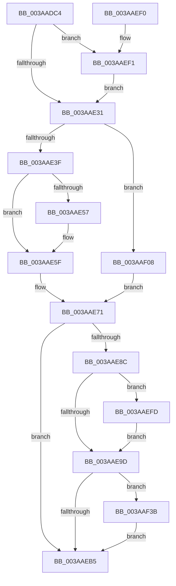

# B_TREE&lt;_SM_PAGE_KEY,ST_STORE&lt;SM_TRAITS&gt;::_ST_PAGE_ENTRY,4096,NP_CONTEXT,B_TREE_KEY_COMPARATOR&lt;_SM_PAGE_KEY&gt; &gt;::BTreeMergeNodes

- RVA: `0x003AADC4`–`0x003AAF49` (길이 `389` bytes)
- VA: `0x00000001403AADC4`
- 실행 섹션: `.text`
- PDB 이름 있음: `예`; PDB Function 태그: `아니요`
- unwind 정보 RVA: `0x0008B848`
- 디코드: `114`개 명령, `389/389` bytes 표시
- 미해석 바이트: `0` (있으면 어셈블리에 `.byte`로 보존)

> 이 문서는 커널 이미지의 기계어와 PDB 기호를 분석해 생성했습니다. 4번과 5번은 함수 원형과 자료형을 바이너리 사용 방식에서 추정한 C 해석이며 원본 소스 복구 결과는 아닙니다.

## 1. Dependencies

- 직접 호출 지점: **5**; 고유 호출 대상: **5**
- 직접 호출자로 확인된 함수: **1**
- RIP 상대 이미지 참조: **0**

### Outgoing calls
- `0x003AAE75` → [memcpy](../6C/memcpy_function_006C6840.md) (function, `0x006C6840`)
- `0x003AAEBB` → [B_TREE<_SM_PAGE_KEY,ST_STORE<SM_TRAITS>::_ST_PAGE_ENTRY,4096,NP_CONTEXT,B_TREE_KEY_COMPARATOR<_SM_PAGE_KEY> >::BTreeDeleteNode](B_TREE__SM_PAGE_KEY_ST_STORE_SM_TRAITS__ST_PAGE_ENTRY_4096_NP_CONTEXT_B_TREE_KEY_COMPARATOR__SM_PAGE_function_003AA598.md) (function, `0x003AA598`)
- `0x003AAECA` → [B_TREE<_SM_PAGE_KEY,ST_STORE<SM_TRAITS>::_ST_PAGE_ENTRY,4096,NP_CONTEXT,B_TREE_KEY_COMPARATOR<_SM_PAGE_KEY> >::BTreeDeleteEx](B_TREE__SM_PAGE_KEY_ST_STORE_SM_TRAITS__ST_PAGE_ENTRY_4096_NP_CONTEXT_B_TREE_KEY_COMPARATOR__SM_PAGE_function_003AB210.md) (function, `0x003AB210`)
- `0x003AAF01` → [NP_CONTEXT::NpLeafDerefInternal](NP_CONTEXT_NpLeafDerefInternal_function_003A9A70.md) (function, `0x003A9A70`)
- `0x003AAF3F` → [NP_CONTEXT::NpLeafRemoveInternal](../60/NP_CONTEXT_NpLeafRemoveInternal_function_0060BF04.md) (function, `0x0060BF04`)

### Direct callers
- [sub_003AB3AF](Unknown_function_003AB3AF.md) at `0x003AB3B8`

### Static image references
- 디코드된 RIP-relative 메모리 참조가 없습니다.

## 2. Other-region calls and transfers

- 다른 실행 섹션으로 향하는 call: **0**
- 별도 외부 분기/꼬리 이동을 확인하지 못했습니다.

## 3. Assembly (complete function range)

```asm
003AADC4  48 89 5C 24 08                  mov qword ptr [rsp + 8], rbx
003AADC9  48 89 6C 24 10                  mov qword ptr [rsp + 0x10], rbp
003AADCE  48 89 74 24 18                  mov qword ptr [rsp + 0x18], rsi
003AADD3  57                              push rdi
003AADD4  41 54                           push r12
003AADD6  41 55                           push r13
003AADD8  41 56                           push r14
003AADDA  41 57                           push r15
003AADDC  48 83 EC 20                     sub rsp, 0x20
003AADE0  44 8B 4A 18                     mov r9d, dword ptr [rdx + 0x18]
003AADE4  48 8B D9                        mov rbx, rcx
003AADE7  41 FF C9                        dec r9d
003AADEA  4C 8B F2                        mov r14, rdx
003AADED  49 C1 E1 04                     shl r9, 4
003AADF1  49 8B F0                        mov rsi, r8
003AADF4  4C 03 0A                        add r9, qword ptr [rdx]
003AADF7  49 8B C8                        mov rcx, r8
003AADFA  49 8B D0                        mov rdx, r8
003AADFD  41 BC 10 00 00 00               mov r12d, 0x10
003AAE03  83 E2 01                        and edx, 1
003AAE06  49 8B 01                        mov rax, qword ptr [r9]
003AAE09  4D 8B 79 F8                     mov r15, qword ptr [r9 - 8]
003AAE0D  48 0F 45 F0                     cmovne rsi, rax
003AAE11  48 83 E1 FE                     and rcx, 0xfffffffffffffffe
003AAE15  48 85 D2                        test rdx, rdx
003AAE18  48 8B F9                        mov rdi, rcx
003AAE1B  48 0F 44 F8                     cmove rdi, rax
003AAE1F  49 0F 44 C8                     cmove rcx, r8
003AAE23  8B 07                           mov eax, dword ptr [rdi]
003AAE25  0F B7 E8                        movzx ebp, ax
003AAE28  48 3B F9                        cmp rdi, rcx
003AAE2B  0F 84 C0 00 00 00               je 0x1403aaef1
003AAE31  41 83 CD FF                     or r13d, 0xffffffff
003AAE35  80 7F 03 00                     cmp byte ptr [rdi + 3], 0
003AAE39  0F 84 C9 00 00 00               je 0x1403aaf08
003AAE3F  48 8B C3                        mov rax, rbx
003AAE42  48 8D 4B 10                     lea rcx, [rbx + 0x10]
003AAE46  48 F7 D8                        neg rax
003AAE49  48 1B C0                        sbb rax, rax
003AAE4C  48 23 C1                        and rax, rcx
003AAE4F  48 8B 00                        mov rax, qword ptr [rax]
003AAE52  44 39 28                        cmp dword ptr [rax], r13d
003AAE55  75 08                           jne 0x1403aae5f
003AAE57  48 8B 46 08                     mov rax, qword ptr [rsi + 8]
003AAE5B  48 89 47 08                     mov qword ptr [rdi + 8], rax
003AAE5F  8B 06                           mov eax, dword ptr [rsi]
003AAE61  44 0F B7 C0                     movzx r8d, ax
003AAE65  48 8D 47 10                     lea rax, [rdi + 0x10]
003AAE69  48 8D 0C E8                     lea rcx, [rax + rbp*8]
003AAE6D  49 C1 E0 03                     shl r8, 3
003AAE71  48 8D 56 10                     lea rdx, [rsi + 0x10]
003AAE75  E8 C6 B9 31 00                  call 0x1406c6840
003AAE7A  66 03 2E                        add bp, word ptr [rsi]
003AAE7D  48 8B C3                        mov rax, rbx
003AAE80  4C 03 E0                        add r12, rax
003AAE83  66 89 2F                        mov word ptr [rdi], bp
003AAE86  80 7F 03 00                     cmp byte ptr [rdi + 3], 0
003AAE8A  74 29                           je 0x1403aaeb5
003AAE8C  48 F7 D8                        neg rax
003AAE8F  48 1B C9                        sbb rcx, rcx
003AAE92  49 23 CC                        and rcx, r12
003AAE95  48 8B 01                        mov rax, qword ptr [rcx]
003AAE98  44 39 28                        cmp dword ptr [rax], r13d
003AAE9B  75 60                           jne 0x1403aaefd
003AAE9D  48 8B C3                        mov rax, rbx
003AAEA0  48 F7 D8                        neg rax
003AAEA3  48 1B C9                        sbb rcx, rcx
003AAEA6  49 23 CC                        and rcx, r12
003AAEA9  48 8B 01                        mov rax, qword ptr [rcx]
003AAEAC  44 39 28                        cmp dword ptr [rax], r13d
003AAEAF  0F 85 86 00 00 00               jne 0x1403aaf3b
003AAEB5  48 8B D6                        mov rdx, rsi
003AAEB8  48 8B CB                        mov rcx, rbx
003AAEBB  E8 D8 F6 FF FF                  call 0x1403aa598
003AAEC0  45 01 6E 18                     add dword ptr [r14 + 0x18], r13d
003AAEC4  49 8B D6                        mov rdx, r14
003AAEC7  48 8B CB                        mov rcx, rbx
003AAECA  E8 41 03 00 00                  call 0x1403ab210
003AAECF  41 FF 46 18                     inc dword ptr [r14 + 0x18]
003AAED3  48 8B 5C 24 50                  mov rbx, qword ptr [rsp + 0x50]
003AAED8  48 8B 6C 24 58                  mov rbp, qword ptr [rsp + 0x58]
003AAEDD  48 8B 74 24 60                  mov rsi, qword ptr [rsp + 0x60]
003AAEE2  48 83 C4 20                     add rsp, 0x20
003AAEE6  41 5F                           pop r15
003AAEE8  41 5E                           pop r14
003AAEEA  41 5D                           pop r13
003AAEEC  41 5C                           pop r12
003AAEEE  5F                              pop rdi
003AAEEF  C3                              ret
003AAEF0  CC                              int3
003AAEF1  4D 2B FC                        sub r15, r12
003AAEF4  4D 89 79 F8                     mov qword ptr [r9 - 8], r15
003AAEF8  E9 34 FF FF FF                  jmp 0x1403aae31
003AAEFD  49 8D 57 08                     lea rdx, [r15 + 8]
003AAF01  E8 6A EB FF FF                  call 0x1403a9a70
003AAF06  EB 95                           jmp 0x1403aae9d
003AAF08  41 8B 07                        mov eax, dword ptr [r15]
003AAF0B  48 8B CD                        mov rcx, rbp
003AAF0E  48 03 C9                        add rcx, rcx
003AAF11  FF C5                           inc ebp
003AAF13  89 44 CF 10                     mov dword ptr [rdi + rcx*8 + 0x10], eax
003AAF17  48 8B 46 08                     mov rax, qword ptr [rsi + 8]
003AAF1B  48 89 44 CF 18                  mov qword ptr [rdi + rcx*8 + 0x18], rax
003AAF20  8B 06                           mov eax, dword ptr [rsi]
003AAF22  8B CD                           mov ecx, ebp
003AAF24  48 FF C1                        inc rcx
003AAF27  44 0F B7 C0                     movzx r8d, ax
003AAF2B  49 C1 E0 04                     shl r8, 4
003AAF2F  48 C1 E1 04                     shl rcx, 4
003AAF33  48 03 CF                        add rcx, rdi
003AAF36  E9 36 FF FF FF                  jmp 0x1403aae71
003AAF3B  49 8D 57 08                     lea rdx, [r15 + 8]
003AAF3F  E8 C0 0F 26 00                  call 0x14060bf04
003AAF44  E9 6C FF FF FF                  jmp 0x1403aaeb5
```

## 4. C-style interpretation (structured pseudocode)

```c
__int64 __fastcall B_TREE__SM_PAGE_KEY_ST_STORE_SM_TRAITS____ST_PAGE_ENTRY_4096_NP_CONTEXT_B_TREE_KEY_COMPARATOR__SM_PA(__int64 a1, __int64 a2, __int64 a3)
{
    __int64 result;
    __int64 v_r12;
    __int64 v_r13;
    __int64 v_r15;
    __int64 v_rbp;
    __int64 v_rsp;
    unsigned __int64 v_stack_p10;
    unsigned __int64 v_stack_p18;
    unsigned __int64 v_stack_p8;

    v_stack_p8 = v_rbx;
    v_stack_p10 = v_rbp;
    v_stack_p18 = v_rsi;
    v_rsp = (v_rsp) - (32);
    a4 = (unsigned int)(((unsigned int)(*(unsigned int *)(a2 + 24))) - 1);
    a4 = (a4) << (4);
    a4 = (a4) + (*(unsigned __int64 *)(a2));
    a2 = (unsigned int)((a3) & (1));
    if (condition_is_not_equal) { a3 = *(unsigned __int64 *)(a4); }
    a1 = (a3) & (-2);
    if (a2 == 0) {
        a1 = *(unsigned __int64 *)(a4);
        a1 = a3;
    }
    if (a1 == a1) goto loc_003AAEF1;
loc_003AAE31:
    v_r13 = (unsigned int)((v_r13) | (0xFFFFFFFFULL));
    if ((*(unsigned __int8 *)(a1 + 3)) == 0) goto loc_003AAF08;
    result = -(a1);
    result = (result) & (a1 + 16);
    result = *(unsigned __int64 *)(result);
    if ((*(unsigned int *)(*(unsigned __int64 *)(result))) == ((unsigned int)(v_r13))) {
        result = *(unsigned __int64 *)(a3 + 8);
        *(unsigned __int64 *)(a1 + 8) = result;
    }
    a3 = ((unsigned __int16)((unsigned int)(*(unsigned int *)(a3)))) << (3);
loc_003AAE71:
    result = memcpy(a1 + 16 + (unsigned __int16)((unsigned int)(*(unsigned int *)(a1))) * 8, a3 + 16, a3, a4);
    v_rbp = (unsigned __int16)(((unsigned __int16)((unsigned int)(*(unsigned int *)(a1)))) + (*(unsigned __int16 *)(a3)));
    v_r12 = (16) + (a1);
    *(unsigned __int16 *)(a1) = (unsigned __int16)(v_rbp);
    if ((*(unsigned __int8 *)(a1 + 3)) == 0) goto loc_003AAEB5;
    result = -(a1);
    a1 = (a1 + 16 + (unsigned __int16)((unsigned int)(*(unsigned int *)(a1))) * 8) & (v_r12);
    if ((*(unsigned int *)(*(unsigned __int64 *)(a1))) != ((unsigned int)(v_r13))) goto loc_003AAEFD;
loc_003AAE9D:
    result = -(a1);
    a1 = (a1) & (v_r12);
    if ((*(unsigned int *)(*(unsigned __int64 *)(a1))) != ((unsigned int)(v_r13))) goto loc_003AAF3B;
loc_003AAEB5:
    result = B_TREE__SM_PAGE_KEY_ST_STORE_SM_TRAITS____ST_PAGE_ENTRY_4096_NP_CONTEXT_B_TREE_KEY_COMPARATOR__SM_PA(a1, a3, a3, a4);
    result = B_TREE__SM_PAGE_KEY_ST_STORE_SM_TRAITS____ST_PAGE_ENTRY_4096_NP_CONTEXT_B_TREE_KEY_COMPARATOR__SM_PA(a1, a2, a3, a4);
    v_rsp = (v_rsp) + (32);
    return result;
loc_003AAEF1:
    v_r15 = (*(unsigned __int64 *)(a4 - 8)) - (v_r12);
    *(unsigned __int64 *)(a4 - 8) = v_r15;
    goto loc_003AAE31;
loc_003AAEFD:
    result = NP_CONTEXT__NpLeafDerefInternal(a1, v_r15 + 8, a3, a4);
    goto loc_003AAE9D;
loc_003AAF08:
    a1 = (v_stack_p10) + (v_stack_p10);
    v_rbp = (unsigned int)((v_stack_p10) + 1);
    *(unsigned int *)(a1 + a1 * 8 + 16) = (unsigned int)((unsigned int)(*(unsigned int *)(v_r15)));
    *(unsigned __int64 *)(a1 + a1 * 8 + 24) = *(unsigned __int64 *)(v_stack_p18 + 8);
    a1 = ((unsigned int)((unsigned int)(v_rbp))) + 1;
    a3 = ((unsigned __int16)((unsigned int)(*(unsigned int *)(v_stack_p18)))) << (4);
    a1 = (a1) << (4);
    a1 = (a1) + (a1);
    goto loc_003AAE71;
loc_003AAF3B:
    result = NP_CONTEXT__NpLeafRemoveInternal(a1, v_r15 + 8, a3, a4);
    goto loc_003AAEB5;
}
```

## 5. (Beta) C Style

```c
int64_t B_TREE__SM_PAGE_KEY_ST_STORE_SM_TRAITS____ST_PAGE_ENTRY_4096_NP_CONTEXT_B_TREE_KEY_COMPARATOR__SM_PA(void *Arg1, void *Arg2, int64_t Arg3)
{
    uint8_t *arg1 = (uint8_t *)Arg1;
    uint8_t *arg2 = (uint8_t *)Arg2;

    int64_t result;
    int64_t local_r12;
    int64_t local_r13;
    int64_t local_r15;
    int64_t local_rbp;
    int64_t local_rsp;
    uint64_t v_stack_p10;
    uint64_t v_stack_p18;
    uint64_t v_stack_p8;

    v_stack_p8 = local_rbx;
    v_stack_p10 = local_rbp;
    v_stack_p18 = local_rsi;
    local_rsp = (local_rsp) - (32);
    a4 = (uint32_t)(((uint32_t)(*(uint32_t *)(arg2 + 0x18))) - 1);
    a4 = (a4) << (4);
    a4 = (a4) + (*(uint64_t *)(arg2));
    Arg2 = (uint32_t)((Arg3) & (1));
    if (condition_is_not_equal) { Arg3 = *(uint64_t *)(a4); }
    Arg1 = (Arg3) & (-2);
    if (Arg2 == NULL) {
        Arg1 = *(uint64_t *)(a4);
        Arg1 = Arg3;
    }
    if (Arg1 == Arg1) goto loc_003AAEF1;
loc_003AAE31:
    local_r13 = (uint32_t)((local_r13) | (0xFFFFFFFFULL));
    if ((*(uint8_t *)(arg1 + 0x3)) == 0) goto loc_003AAF08;
    result = -(Arg1);
    result = (result) & (Arg1 + 16);
    result = *(uint64_t *)(result);
    if ((*(uint32_t *)(*(uint64_t *)(result))) == ((uint32_t)(local_r13))) {
        result = *(uint64_t *)(Arg3 + 0x8);
        *(uint64_t *)(arg1 + 0x8) = result;
    }
    Arg3 = ((uint16_t)((uint32_t)(*(uint32_t *)(Arg3)))) << (3);
loc_003AAE71:
    result = memcpy(Arg1 + 16 + (uint16_t)((uint32_t)(*(uint32_t *)(arg1))) * 8, Arg3 + 16, Arg3, a4);
    local_rbp = (uint16_t)(((uint16_t)((uint32_t)(*(uint32_t *)(arg1)))) + (*(uint16_t *)(Arg3)));
    local_r12 = (16) + (Arg1);
    *(uint16_t *)(arg1) = (uint16_t)(local_rbp);
    if ((*(uint8_t *)(arg1 + 0x3)) == 0) goto loc_003AAEB5;
    result = -(Arg1);
    Arg1 = (Arg1 + 16 + (uint16_t)((uint32_t)(*(uint32_t *)(arg1))) * 8) & (local_r12);
    if ((*(uint32_t *)(*(uint64_t *)(arg1))) != ((uint32_t)(local_r13))) goto loc_003AAEFD;
loc_003AAE9D:
    result = -(Arg1);
    Arg1 = (Arg1) & (local_r12);
    if ((*(uint32_t *)(*(uint64_t *)(arg1))) != ((uint32_t)(local_r13))) goto loc_003AAF3B;
loc_003AAEB5:
    result = B_TREE__SM_PAGE_KEY_ST_STORE_SM_TRAITS____ST_PAGE_ENTRY_4096_NP_CONTEXT_B_TREE_KEY_COMPARATOR__SM_PA(Arg1, Arg3, Arg3, a4);
    result = B_TREE__SM_PAGE_KEY_ST_STORE_SM_TRAITS____ST_PAGE_ENTRY_4096_NP_CONTEXT_B_TREE_KEY_COMPARATOR__SM_PA(Arg1, Arg2, Arg3, a4);
    local_rsp = (local_rsp) + (32);
    return result;
loc_003AAEF1:
    local_r15 = (*(uint64_t *)(a4 - 0x8)) - (local_r12);
    *(uint64_t *)(a4 - 0x8) = local_r15;
    goto loc_003AAE31;
loc_003AAEFD:
    result = NP_CONTEXT__NpLeafDerefInternal(Arg1, local_r15 + 8, Arg3, a4);
    goto loc_003AAE9D;
loc_003AAF08:
    Arg1 = (v_stack_p10) + (v_stack_p10);
    local_rbp = (uint32_t)((v_stack_p10) + 1);
    *(uint32_t *)(arg1 + arg1 * 8 + 0x10) = (uint32_t)((uint32_t)(*(uint32_t *)(local_r15)));
    *(uint64_t *)(arg1 + arg1 * 8 + 0x18) = *(uint64_t *)(v_stack_p18 + 0x8);
    Arg1 = ((uint32_t)((uint32_t)(local_rbp))) + 1;
    Arg3 = ((uint16_t)((uint32_t)(*(uint32_t *)(v_stack_p18)))) << (4);
    Arg1 = (Arg1) << (4);
    Arg1 = (Arg1) + (Arg1);
    goto loc_003AAE71;
loc_003AAF3B:
    result = NP_CONTEXT__NpLeafRemoveInternal(Arg1, local_r15 + 8, Arg3, a4);
    goto loc_003AAEB5;
}
```

### 관측된 메모리 오프셋

구조체 형식이 확인되지 않은 접근은 인자 기준의 오프셋으로만 기록했습니다.

| 기준 인자 | 오프셋 표현 | 폭 (bit) | 접근 |
|---|---:|---:|---|
| `Arg1` | `+ 0x10` | `64` | `R` |
| `Arg2` | `+ 0x0` | `64` | `R` |
| `Arg2` | `+ 0x18` | `32` | `R` |
| `Arg2` | `+ 0x18` | `32` | `R/W` |

## 6. Execution-region graph

[열기: 2D/3D 그래프와 함수 탐색 컨트롤 패널](../../../control-panel.html?section=text&rva=0x003AADC4&view=graph)

- 2D 그래프는 위에서 아래로 흐르고, 3D 그래프는 빈 공간을 드래그해 회전합니다. Shift+드래그는 이동, 휠은 확대·축소, 함수 노드 선택은 대상 보고서 이동입니다.

### Static fallback


