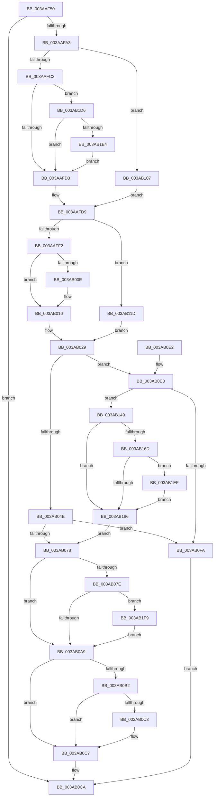

# B_TREE&lt;_SM_PAGE_KEY,ST_STORE&lt;SM_TRAITS&gt;::_ST_PAGE_ENTRY,4096,NP_CONTEXT,B_TREE_KEY_COMPARATOR&lt;_SM_PAGE_KEY&gt; &gt;::BTreeSplitChild

- RVA: `0x003AAF50`–`0x003AB206` (길이 `694` bytes)
- VA: `0x00000001403AAF50`
- 실행 섹션: `.text`
- PDB 이름 있음: `예`; PDB Function 태그: `아니요`
- unwind 정보 RVA: `0x0008B868`
- 디코드: `188`개 명령, `694/694` bytes 표시
- 미해석 바이트: `0` (있으면 어셈블리에 `.byte`로 보존)

> 이 문서는 커널 이미지의 기계어와 PDB 기호를 분석해 생성했습니다. 4번과 5번은 함수 원형과 자료형을 바이너리 사용 방식에서 추정한 C 해석이며 원본 소스 복구 결과는 아닙니다.

## 1. Dependencies

- 직접 호출 지점: **9**; 고유 호출 대상: **5**
- 직접 호출자로 확인된 함수: **1**
- RIP 상대 이미지 참조: **0**

### Outgoing calls
- `0x003AAF92` → [B_TREE<_SM_PAGE_KEY,ST_STORE<SM_TRAITS>::_ST_PAGE_ENTRY,4096,NP_CONTEXT,B_TREE_KEY_COMPARATOR<_SM_PAGE_KEY> >::BTreeNewNode](B_TREE__SM_PAGE_KEY_ST_STORE_SM_TRAITS__ST_PAGE_ENTRY_4096_NP_CONTEXT_B_TREE_KEY_COMPARATOR__SM_PAGE_function_003AAD60.md) (function, `0x003AAD60`)
- `0x003AB024` → [memcpy](../6C/memcpy_function_006C6840.md) (function, `0x006C6840`)
- `0x003AB05B` → [B_TREE<_SM_PAGE_KEY,ST_STORE<SM_TRAITS>::_ST_PAGE_ENTRY,4096,NP_CONTEXT,B_TREE_KEY_COMPARATOR<_SM_PAGE_KEY> >::BTreeInsertEx](B_TREE__SM_PAGE_KEY_ST_STORE_SM_TRAITS__ST_PAGE_ENTRY_4096_NP_CONTEXT_B_TREE_KEY_COMPARATOR__SM_PAGE_function_003AB810.md) (function, `0x003AB810`)
- `0x003AB0ED` → [B_TREE<_SM_PAGE_KEY,ST_STORE<SM_TRAITS>::_ST_PAGE_ENTRY,4096,NP_CONTEXT,B_TREE_KEY_COMPARATOR<_SM_PAGE_KEY> >::BTreeNewNode](B_TREE__SM_PAGE_KEY_ST_STORE_SM_TRAITS__ST_PAGE_ENTRY_4096_NP_CONTEXT_B_TREE_KEY_COMPARATOR__SM_PAGE_function_003AAD60.md) (function, `0x003AAD60`)
- `0x003AB100` → [B_TREE<_SM_PAGE_KEY,ST_STORE<SM_TRAITS>::_ST_PAGE_ENTRY,4096,NP_CONTEXT,B_TREE_KEY_COMPARATOR<_SM_PAGE_KEY> >::BTreeDeleteNode](B_TREE__SM_PAGE_KEY_ST_STORE_SM_TRAITS__ST_PAGE_ENTRY_4096_NP_CONTEXT_B_TREE_KEY_COMPARATOR__SM_PAGE_function_003AA598.md) (function, `0x003AA598`)
- `0x003AB137` → [memcpy](../6C/memcpy_function_006C6840.md) (function, `0x006C6840`)
- `0x003AB1A1` → [memcpy](../6C/memcpy_function_006C6840.md) (function, `0x006C6840`)
- `0x003AB1F2` → [NP_CONTEXT::NpGetResidentLeaf](../60/NP_CONTEXT_NpGetResidentLeaf_function_0060BED0.md) (function, `0x0060BED0`)
- `0x003AB1FC` → [NP_CONTEXT::NpGetResidentLeaf](../60/NP_CONTEXT_NpGetResidentLeaf_function_0060BED0.md) (function, `0x0060BED0`)

### Direct callers
- [sub_003ABA1D](Unknown_function_003ABA1D.md) at `0x003ABA28`

### Static image references
- 디코드된 RIP-relative 메모리 참조가 없습니다.

## 2. Other-region calls and transfers

- 다른 실행 섹션으로 향하는 call: **0**
- 별도 외부 분기/꼬리 이동을 확인하지 못했습니다.

## 3. Assembly (complete function range)

```asm
003AAF50  48 89 5C 24 08                  mov qword ptr [rsp + 8], rbx
003AAF55  55                              push rbp
003AAF56  56                              push rsi
003AAF57  57                              push rdi
003AAF58  41 54                           push r12
003AAF5A  41 55                           push r13
003AAF5C  41 56                           push r14
003AAF5E  41 57                           push r15
003AAF60  48 83 EC 30                     sub rsp, 0x30
003AAF64  44 8B 7A 18                     mov r15d, dword ptr [rdx + 0x18]
003AAF68  4C 8B E2                        mov r12, rdx
003AAF6B  33 FF                           xor edi, edi
003AAF6D  48 8B F1                        mov rsi, rcx
003AAF70  44 8D 6F 01                     lea r13d, [rdi + 1]
003AAF74  45 2B FD                        sub r15d, r13d
003AAF77  49 C1 E7 04                     shl r15, 4
003AAF7B  4C 03 3A                        add r15, qword ptr [rdx]
003AAF7E  4C 89 BC 24 80 00 00 00         mov qword ptr [rsp + 0x80], r15
003AAF86  49 8B 1F                        mov rbx, qword ptr [r15]
003AAF89  44 0F B6 43 02                  movzx r8d, byte ptr [rbx + 2]
003AAF8E  0F B6 53 03                     movzx edx, byte ptr [rbx + 3]
003AAF92  E8 C9 FD FF FF                  call 0x1403aad60
003AAF97  4C 8B F0                        mov r14, rax
003AAF9A  48 85 C0                        test rax, rax
003AAF9D  0F 84 27 01 00 00               je 0x1403ab0ca
003AAFA3  89 7C 24 24                     mov dword ptr [rsp + 0x24], edi
003AAFA7  48 89 44 24 28                  mov qword ptr [rsp + 0x28], rax
003AAFAC  8B 03                           mov eax, dword ptr [rbx]
003AAFAE  8B E8                           mov ebp, eax
003AAFB0  D1 ED                           shr ebp, 1
003AAFB2  81 E5 FF 7F 00 00               and ebp, 0x7fff
003AAFB8  40 38 7B 03                     cmp byte ptr [rbx + 3], dil
003AAFBC  0F 84 45 01 00 00               je 0x1403ab107
003AAFC2  4C 8D 4B 10                     lea r9, [rbx + 0x10]
003AAFC6  4D 8D 0C E9                     lea r9, [r9 + rbp*8]
003AAFCA  41 84 C5                        test r13b, al
003AAFCD  0F 85 03 02 00 00               jne 0x1403ab1d6
003AAFD3  41 8B 01                        mov eax, dword ptr [r9]
003AAFD6  4C 8B FF                        mov r15, rdi
003AAFD9  89 44 24 20                     mov dword ptr [rsp + 0x20], eax
003AAFDD  8B 03                           mov eax, dword ptr [rbx]
003AAFDF  0F B7 D0                        movzx edx, ax
003AAFE2  2B D5                           sub edx, ebp
003AAFE4  89 54 24 78                     mov dword ptr [rsp + 0x78], edx
003AAFE8  40 38 7B 03                     cmp byte ptr [rbx + 3], dil
003AAFEC  0F 84 2B 01 00 00               je 0x1403ab11d
003AAFF2  48 8B C6                        mov rax, rsi
003AAFF5  4C 8D 46 10                     lea r8, [rsi + 0x10]
003AAFF9  48 F7 D8                        neg rax
003AAFFC  48 1B C9                        sbb rcx, rcx
003AAFFF  41 83 CD FF                     or r13d, 0xffffffff
003AB003  49 23 C8                        and rcx, r8
003AB006  48 8B 01                        mov rax, qword ptr [rcx]
003AB009  44 39 28                        cmp dword ptr [rax], r13d
003AB00C  75 08                           jne 0x1403ab016
003AB00E  48 8B 43 08                     mov rax, qword ptr [rbx + 8]
003AB012  49 89 46 08                     mov qword ptr [r14 + 8], rax
003AB016  44 8B C2                        mov r8d, edx
003AB019  49 8D 4E 10                     lea rcx, [r14 + 0x10]
003AB01D  49 C1 E0 03                     shl r8, 3
003AB021  49 8B D1                        mov rdx, r9
003AB024  E8 17 B8 31 00                  call 0x1406c6840
003AB029  B8 10 00 00 00                  mov eax, 0x10
003AB02E  48 8B CE                        mov rcx, rsi
003AB031  4C 8D 3C 01                     lea r15, [rcx + rax]
003AB035  8B 44 24 78                     mov eax, dword ptr [rsp + 0x78]
003AB039  66 41 89 06                     mov word ptr [r14], ax
003AB03D  4C 89 BC 24 88 00 00 00         mov qword ptr [rsp + 0x88], r15
003AB045  48 39 1E                        cmp qword ptr [rsi], rbx
003AB048  0F 84 95 00 00 00               je 0x1403ab0e3
003AB04E  45 01 6C 24 18                  add dword ptr [r12 + 0x18], r13d
003AB053  4C 8D 44 24 20                  lea r8, [rsp + 0x20]
003AB058  49 8B D4                        mov rdx, r12
003AB05B  E8 B0 07 00 00                  call 0x1403ab810
003AB060  41 B9 01 00 00 00               mov r9d, 1
003AB066  45 01 4C 24 18                  add dword ptr [r12 + 0x18], r9d
003AB06B  41 8B 4C 24 18                  mov ecx, dword ptr [r12 + 0x18]
003AB070  85 C0                           test eax, eax
003AB072  0F 88 82 00 00 00               js 0x1403ab0fa
003AB078  40 38 7B 03                     cmp byte ptr [rbx + 3], dil
003AB07C  74 2B                           je 0x1403ab0a9
003AB07E  49 8B 04 24                     mov rax, qword ptr [r12]
003AB082  83 C1 FE                        add ecx, -2
003AB085  48 03 C9                        add rcx, rcx
003AB088  48 8B 54 C8 08                  mov rdx, qword ptr [rax + rcx*8 + 8]
003AB08D  48 8B C6                        mov rax, rsi
003AB090  48 83 C2 08                     add rdx, 8
003AB094  48 F7 D8                        neg rax
003AB097  48 1B C0                        sbb rax, rax
003AB09A  49 23 C7                        and rax, r15
003AB09D  48 8B 00                        mov rax, qword ptr [rax]
003AB0A0  44 39 28                        cmp dword ptr [rax], r13d
003AB0A3  0F 85 50 01 00 00               jne 0x1403ab1f9
003AB0A9  66 89 2B                        mov word ptr [rbx], bp
003AB0AC  40 38 7B 03                     cmp byte ptr [rbx + 3], dil
003AB0B0  74 15                           je 0x1403ab0c7
003AB0B2  48 F7 DE                        neg rsi
003AB0B5  48 1B C0                        sbb rax, rax
003AB0B8  49 23 C7                        and rax, r15
003AB0BB  48 8B 00                        mov rax, qword ptr [rax]
003AB0BE  44 39 28                        cmp dword ptr [rax], r13d
003AB0C1  75 04                           jne 0x1403ab0c7
003AB0C3  4C 89 73 08                     mov qword ptr [rbx + 8], r14
003AB0C7  49 8B FE                        mov rdi, r14
003AB0CA  48 8B 5C 24 70                  mov rbx, qword ptr [rsp + 0x70]
003AB0CF  48 8B C7                        mov rax, rdi
003AB0D2  48 83 C4 30                     add rsp, 0x30
003AB0D6  41 5F                           pop r15
003AB0D8  41 5E                           pop r14
003AB0DA  41 5D                           pop r13
003AB0DC  41 5C                           pop r12
003AB0DE  5F                              pop rdi
003AB0DF  5E                              pop rsi
003AB0E0  5D                              pop rbp
003AB0E1  C3                              ret
003AB0E2  CC                              int3
003AB0E3  44 0F B6 43 02                  movzx r8d, byte ptr [rbx + 2]
003AB0E8  33 D2                           xor edx, edx
003AB0EA  41 FF C0                        inc r8d
003AB0ED  E8 6E FC FF FF                  call 0x1403aad60
003AB0F2  4C 8B F8                        mov r15, rax
003AB0F5  48 85 C0                        test rax, rax
003AB0F8  75 4F                           jne 0x1403ab149
003AB0FA  49 8B D6                        mov rdx, r14
003AB0FD  48 8B CE                        mov rcx, rsi
003AB100  E8 93 F4 FF FF                  call 0x1403aa598
003AB105  EB C3                           jmp 0x1403ab0ca
003AB107  4C 8D 7D 01                     lea r15, [rbp + 1]
003AB10B  4C 8B CF                        mov r9, rdi
003AB10E  49 C1 E7 04                     shl r15, 4
003AB112  4C 03 FB                        add r15, rbx
003AB115  41 8B 07                        mov eax, dword ptr [r15]
003AB118  E9 BC FE FF FF                  jmp 0x1403aafd9
003AB11D  41 83 CD FF                     or r13d, 0xffffffff
003AB121  49 8D 4E 10                     lea rcx, [r14 + 0x10]
003AB125  41 03 D5                        add edx, r13d
003AB128  44 8B C2                        mov r8d, edx
003AB12B  89 54 24 78                     mov dword ptr [rsp + 0x78], edx
003AB12F  49 8D 57 10                     lea rdx, [r15 + 0x10]
003AB133  49 C1 E0 04                     shl r8, 4
003AB137  E8 04 B7 31 00                  call 0x1406c6840
003AB13C  49 8B 47 08                     mov rax, qword ptr [r15 + 8]
003AB140  49 89 46 08                     mov qword ptr [r14 + 8], rax
003AB144  E9 E0 FE FF FF                  jmp 0x1403ab029
003AB149  48 8D 50 08                     lea rdx, [rax + 8]
003AB14D  41 B8 01 00 00 00               mov r8d, 1
003AB153  48 89 1A                        mov qword ptr [rdx], rbx
003AB156  0F 10 44 24 20                  movups xmm0, xmmword ptr [rsp + 0x20]
003AB15B  F3 0F 7F 40 10                  movdqu xmmword ptr [rax + 0x10], xmm0
003AB160  66 44 89 00                     mov word ptr [rax], r8w
003AB164  4C 89 3E                        mov qword ptr [rsi], r15
003AB167  40 38 7B 03                     cmp byte ptr [rbx + 3], dil
003AB16B  74 19                           je 0x1403ab186
003AB16D  48 8B C6                        mov rax, rsi
003AB170  48 F7 D8                        neg rax
003AB173  48 1B C0                        sbb rax, rax
003AB176  48 23 84 24 88 00 00 00         and rax, qword ptr [rsp + 0x88]
003AB17E  48 8B 00                        mov rax, qword ptr [rax]
003AB181  44 39 28                        cmp dword ptr [rax], r13d
003AB184  75 69                           jne 0x1403ab1ef
003AB186  41 8B 44 24 1C                  mov eax, dword ptr [r12 + 0x1c]
003AB18B  48 8B 94 24 80 00 00 00         mov rdx, qword ptr [rsp + 0x80]
003AB193  41 2B C0                        sub eax, r8d
003AB196  44 8B C0                        mov r8d, eax
003AB199  49 C1 E0 04                     shl r8, 4
003AB19D  48 8D 4A 10                     lea rcx, [rdx + 0x10]
003AB1A1  E8 9A B6 31 00                  call 0x1406c6840
003AB1A6  48 8B 84 24 80 00 00 00         mov rax, qword ptr [rsp + 0x80]
003AB1AE  49 8D 4F 10                     lea rcx, [r15 + 0x10]
003AB1B2  41 B9 01 00 00 00               mov r9d, 1
003AB1B8  4C 89 38                        mov qword ptr [rax], r15
003AB1BB  4C 8B BC 24 88 00 00 00         mov r15, qword ptr [rsp + 0x88]
003AB1C3  48 89 48 08                     mov qword ptr [rax + 8], rcx
003AB1C7  45 01 4C 24 18                  add dword ptr [r12 + 0x18], r9d
003AB1CC  41 8B 4C 24 18                  mov ecx, dword ptr [r12 + 0x18]
003AB1D1  E9 A2 FE FF FF                  jmp 0x1403ab078
003AB1D6  49 8D 41 08                     lea rax, [r9 + 8]
003AB1DA  49 3B 47 08                     cmp rax, qword ptr [r15 + 8]
003AB1DE  0F 83 EF FD FF FF               jae 0x1403aafd3
003AB1E4  4C 8B C8                        mov r9, rax
003AB1E7  41 03 ED                        add ebp, r13d
003AB1EA  E9 E4 FD FF FF                  jmp 0x1403aafd3
003AB1EF  44 09 02                        or dword ptr [rdx], r8d
003AB1F2  E8 D9 0C 26 00                  call 0x14060bed0
003AB1F7  EB 8D                           jmp 0x1403ab186
003AB1F9  44 09 0A                        or dword ptr [rdx], r9d
003AB1FC  E8 CF 0C 26 00                  call 0x14060bed0
003AB201  E9 A3 FE FF FF                  jmp 0x1403ab0a9
```

## 4. C-style interpretation (structured pseudocode)

```c
__int64 __fastcall B_TREE__SM_PAGE_KEY_ST_STORE_SM_TRAITS____ST_PAGE_ENTRY_4096_NP_CONTEXT_B_TREE_KEY_COMPARATOR__SM_PA(__int64 a1, __int64 a2)
{
    __int64 result;
    __int64 v_r13;
    __int64 v_r15;
    __int64 v_rbp;
    __int64 v_rdi;
    __int64 v_rsi;
    __int64 v_rsp;
    unsigned __int64 v_stack_m40;
    unsigned int v_stack_m44;
    unsigned int v_stack_m48;
    unsigned int v_stack_p10;
    unsigned __int64 v_stack_p18;
    unsigned __int64 v_stack_p20;
    unsigned int v_stack_p78;
    unsigned __int64 v_stack_p8;
    unsigned __int64 v_stack_p80;
    unsigned __int64 v_stack_p88;

    v_stack_p8 = v_rbx;
    v_rsp = (v_rsp) - (48);
    v_rdi = 0;
    v_r15 = (unsigned int)(((unsigned int)(*(unsigned int *)(a2 + 24))) - ((unsigned int)(v_rdi + 1)));
    v_r15 = (v_r15) << (4);
    v_r15 = (v_r15) + (*(unsigned __int64 *)(a2));
    v_stack_p18 = v_r15;
    result = B_TREE__SM_PAGE_KEY_ST_STORE_SM_TRAITS____ST_PAGE_ENTRY_4096_NP_CONTEXT_B_TREE_KEY_COMPARATOR__SM_PA(a1, *(unsigned __int8 *)(*(unsigned __int64 *)(v_r15) + 3), *(unsigned __int8 *)(*(unsigned __int64 *)(v_r15) + 2), a4);
    if (result == 0) goto loc_003AB0CA;
    v_stack_m44 = 0;
    v_stack_m40 = result;
    v_rbp = (unsigned int)(((unsigned int)((unsigned int)((unsigned int)(*(unsigned int *)(*(unsigned __int64 *)(v_r15)))))) >> (1));
    v_rbp = (unsigned int)((v_rbp) & (0x7FFFULL));
    if ((*(unsigned __int8 *)(*(unsigned __int64 *)(v_r15) + 3)) == 0) goto loc_003AB107;
    if ((((unsigned __int8)(v_rdi + 1)) & ((unsigned __int8)((unsigned int)(*(unsigned int *)(*(unsigned __int64 *)(v_r15)))))) != 0) goto loc_003AB1D6;
loc_003AAFD3:
loc_003AAFD9:
    v_stack_m48 = (unsigned int)((unsigned int)(*(unsigned int *)(*(unsigned __int64 *)(v_r15) + 16 + v_rbp * 8)));
    a2 = (unsigned int)(((unsigned __int16)((unsigned int)(*(unsigned int *)(*(unsigned __int64 *)(v_r15))))) - ((unsigned int)(v_rbp)));
    v_stack_p10 = (unsigned int)(a2);
    if ((*(unsigned __int8 *)(*(unsigned __int64 *)(v_r15) + 3)) == 0) goto loc_003AB11D;
    result = -(a1);
    v_r13 = (unsigned int)((v_rdi + 1) | (0xFFFFFFFFULL));
    a1 = (a1) & (a1 + 16);
    result = *(unsigned __int64 *)(a1);
    if ((*(unsigned int *)(*(unsigned __int64 *)(a1))) == ((unsigned int)(v_r13))) {
        result = *(unsigned __int64 *)(*(unsigned __int64 *)(v_r15) + 8);
        *(unsigned __int64 *)(result + 8) = result;
    }
    a3 = ((unsigned int)((unsigned int)(a2))) << (3);
    result = memcpy(result + 16, *(unsigned __int64 *)(v_r15) + 16 + v_rbp * 8, a3, *(unsigned __int64 *)(v_r15) + 16 + v_rbp * 8);
loc_003AB029:
    *(unsigned __int16 *)(result) = (unsigned __int16)((unsigned int)(v_stack_p10));
    v_stack_p20 = a1 + 16 * 1;
    if ((*(unsigned __int64 *)(a1)) == (*(unsigned __int64 *)(v_r15))) goto loc_003AB0E3;
    result = B_TREE__SM_PAGE_KEY_ST_STORE_SM_TRAITS____ST_PAGE_ENTRY_4096_NP_CONTEXT_B_TREE_KEY_COMPARATOR__SM_PA(a1, a2, v_stack_m48, *(unsigned __int64 *)(v_r15) + 16 + v_rbp * 8);
    if (sign_flag) goto loc_003AB0FA;
loc_003AB078:
    if ((*(unsigned __int8 *)(*(unsigned __int64 *)(v_r15) + 3)) == 0) goto loc_003AB0A9;
    a1 = (unsigned int)(((unsigned int)(*(unsigned int *)(a2 + 24))) + (-2));
    a1 = (a1) + (a1);
    a2 = (*(unsigned __int64 *)(*(unsigned __int64 *)(a2) + a1 * 8 + 8)) + (8);
    result = -(a1);
    result = (result) & (a1 + 16 * 1);
    if ((*(unsigned int *)(*(unsigned __int64 *)(result))) != ((unsigned int)(v_r13))) goto loc_003AB1F9;
loc_003AB0A9:
    *(unsigned __int16 *)(*(unsigned __int64 *)(v_r15)) = (unsigned __int16)(v_rbp);
    if ((*(unsigned __int8 *)(*(unsigned __int64 *)(v_r15) + 3)) == 0) goto loc_003AB0C7;
    v_rsi = -(a1);
    result = (*(unsigned __int64 *)(result)) & (a1 + 16 * 1);
    if ((*(unsigned int *)(*(unsigned __int64 *)(result))) == ((unsigned int)(v_r13))) {
        *(unsigned __int64 *)(*(unsigned __int64 *)(v_r15) + 8) = result;
    }
loc_003AB0CA:
    v_rsp = (v_rsp) + (48);
    return result;
loc_003AB0E3:
    a2 = 0;
    a3 = (unsigned int)((*(unsigned __int8 *)(v_stack_p8 + 2)) + 1);
    result = B_TREE__SM_PAGE_KEY_ST_STORE_SM_TRAITS____ST_PAGE_ENTRY_4096_NP_CONTEXT_B_TREE_KEY_COMPARATOR__SM_PA(a1, a2, a3, 1);
    if (result != 0) goto loc_003AB149;
loc_003AB0FA:
    result = B_TREE__SM_PAGE_KEY_ST_STORE_SM_TRAITS____ST_PAGE_ENTRY_4096_NP_CONTEXT_B_TREE_KEY_COMPARATOR__SM_PA(v_rsi, result, a3, 1);
    goto loc_003AB0CA;
loc_003AB107:
    v_r15 = (v_rbp + 1) << (4);
    v_r15 = (v_r15) + (v_stack_p8);
    goto loc_003AAFD9;
loc_003AB11D:
    v_r13 = (unsigned int)((v_r13) | (0xFFFFFFFFULL));
    a2 = (unsigned int)((result) + ((unsigned int)(v_r13)));
    v_stack_p78 = (unsigned int)(a2);
    a3 = ((unsigned int)((unsigned int)(a2))) << (4);
    result = memcpy(result + 16, v_r15 + 16, a3, result);
    *(unsigned __int64 *)(result + 8) = *(unsigned __int64 *)(v_r15 + 8);
    goto loc_003AB029;
loc_003AB149:
    *(unsigned __int64 *)(*(unsigned __int64 *)(v_r15 + 8) + 8) = v_stack_p8;
    *(unsigned __int64 *)(*(unsigned __int64 *)(v_r15 + 8) + 16) = v_xmm0;
    *(unsigned __int16 *)(*(unsigned __int64 *)(v_r15 + 8)) = 1;
    *(unsigned __int64 *)(v_rsi) = v_r15;
    if ((*(unsigned __int8 *)(v_stack_p8 + 3)) == ((unsigned __int8)(result))) goto loc_003AB186;
    result = -(v_rsi);
    result = (result) & (v_stack_p88);
    if ((*(unsigned int *)(*(unsigned __int64 *)(result))) != ((unsigned int)(v_r13))) goto loc_003AB1EF;
loc_003AB186:
    result = (unsigned int)(((unsigned int)(*(unsigned int *)(a2 + 28))) - (1));
    a3 = ((unsigned int)((unsigned int)(result))) << (4);
    result = memcpy(v_stack_p80 + 16, v_stack_p80, a3, result);
    *(unsigned __int64 *)(v_stack_p80) = v_r15;
    *(unsigned __int64 *)(v_stack_p80 + 8) = v_r15 + 16;
    goto loc_003AB078;
loc_003AB1D6:
    if ((1 + 8) >= (*(unsigned __int64 *)(v_stack_p88 + 8))) goto loc_003AAFD3;
    v_rbp = (unsigned int)((v_rbp) + ((unsigned int)(v_r13)));
    goto loc_003AAFD3;
loc_003AB1EF:
    result = NP_CONTEXT__NpGetResidentLeaf((unsigned int)(*(unsigned int *)(a2 + 24)), v_stack_p80, a3, 1 + 8);
    goto loc_003AB186;
loc_003AB1F9:
    result = NP_CONTEXT__NpGetResidentLeaf((unsigned int)(*(unsigned int *)(a2 + 24)), v_stack_p80, a3, 1 + 8);
    goto loc_003AB0A9;
}
```

## 5. (Beta) C Style

```c
int64_t B_TREE__SM_PAGE_KEY_ST_STORE_SM_TRAITS____ST_PAGE_ENTRY_4096_NP_CONTEXT_B_TREE_KEY_COMPARATOR__SM_PA(void *Arg1, void *Arg2)
{
    uint8_t *arg1 = (uint8_t *)Arg1;
    uint8_t *arg2 = (uint8_t *)Arg2;

    int64_t result;
    int64_t local_r13;
    int64_t local_r15;
    int64_t local_rbp;
    int64_t local_rdi;
    int64_t local_rsi;
    int64_t local_rsp;
    uint64_t v_stack_m40;
    uint32_t v_stack_m44;
    uint32_t v_stack_m48;
    uint32_t v_stack_p10;
    uint64_t v_stack_p18;
    uint64_t v_stack_p20;
    uint32_t v_stack_p78;
    uint64_t v_stack_p8;
    uint64_t v_stack_p80;
    uint64_t v_stack_p88;

    v_stack_p8 = local_rbx;
    local_rsp = (local_rsp) - (48);
    local_rdi = 0;
    local_r15 = (uint32_t)(((uint32_t)(*(uint32_t *)(arg2 + 0x18))) - ((uint32_t)(local_rdi + 1)));
    local_r15 = (local_r15) << (4);
    local_r15 = (local_r15) + (*(uint64_t *)(arg2));
    v_stack_p18 = local_r15;
    result = B_TREE__SM_PAGE_KEY_ST_STORE_SM_TRAITS____ST_PAGE_ENTRY_4096_NP_CONTEXT_B_TREE_KEY_COMPARATOR__SM_PA(Arg1, *(uint8_t *)(*(uint64_t *)(local_r15) + 0x3), *(uint8_t *)(*(uint64_t *)(local_r15) + 0x2), a4);
    if (result == 0) goto loc_003AB0CA;
    v_stack_m44 = 0;
    v_stack_m40 = result;
    local_rbp = (uint32_t)(((uint32_t)((uint32_t)((uint32_t)(*(uint32_t *)(*(uint64_t *)(local_r15)))))) >> (1));
    local_rbp = (uint32_t)((local_rbp) & (0x7FFFULL));
    if ((*(uint8_t *)(*(uint64_t *)(local_r15) + 0x3)) == 0) goto loc_003AB107;
    if ((((uint8_t)(local_rdi + 1)) & ((uint8_t)((uint32_t)(*(uint32_t *)(*(uint64_t *)(local_r15)))))) != 0) goto loc_003AB1D6;
loc_003AAFD3:
loc_003AAFD9:
    v_stack_m48 = (uint32_t)((uint32_t)(*(uint32_t *)(*(uint64_t *)(local_r15) + 0x10 + local_rbp * 8)));
    Arg2 = (uint32_t)(((uint16_t)((uint32_t)(*(uint32_t *)(*(uint64_t *)(local_r15))))) - ((uint32_t)(local_rbp)));
    v_stack_p10 = (uint32_t)(Arg2);
    if ((*(uint8_t *)(*(uint64_t *)(local_r15) + 0x3)) == 0) goto loc_003AB11D;
    result = -(Arg1);
    local_r13 = (uint32_t)((local_rdi + 1) | (0xFFFFFFFFULL));
    Arg1 = (Arg1) & (Arg1 + 16);
    result = *(uint64_t *)(arg1);
    if ((*(uint32_t *)(*(uint64_t *)(arg1))) == ((uint32_t)(local_r13))) {
        result = *(uint64_t *)(*(uint64_t *)(local_r15) + 0x8);
        *(uint64_t *)(result + 0x8) = result;
    }
    a3 = ((uint32_t)((uint32_t)(Arg2))) << (3);
    result = memcpy(result + 16, *(uint64_t *)(local_r15) + 16 + local_rbp * 8, a3, *(uint64_t *)(local_r15) + 16 + local_rbp * 8);
loc_003AB029:
    *(uint16_t *)(result) = (uint16_t)((uint32_t)(v_stack_p10));
    v_stack_p20 = Arg1 + 16 * 1;
    if ((*(uint64_t *)(arg1)) == (*(uint64_t *)(local_r15))) goto loc_003AB0E3;
    result = B_TREE__SM_PAGE_KEY_ST_STORE_SM_TRAITS____ST_PAGE_ENTRY_4096_NP_CONTEXT_B_TREE_KEY_COMPARATOR__SM_PA(Arg1, Arg2, v_stack_m48, *(uint64_t *)(local_r15) + 16 + local_rbp * 8);
    if (sign_flag) goto loc_003AB0FA;
loc_003AB078:
    if ((*(uint8_t *)(*(uint64_t *)(local_r15) + 0x3)) == 0) goto loc_003AB0A9;
    Arg1 = (uint32_t)(((uint32_t)(*(uint32_t *)(arg2 + 0x18))) + (-2));
    Arg1 = (Arg1) + (Arg1);
    Arg2 = (*(uint64_t *)(*(uint64_t *)(arg2) + arg1 * 8 + 0x8)) + (8);
    result = -(Arg1);
    result = (result) & (Arg1 + 16 * 1);
    if ((*(uint32_t *)(*(uint64_t *)(result))) != ((uint32_t)(local_r13))) goto loc_003AB1F9;
loc_003AB0A9:
    *(uint16_t *)(*(uint64_t *)(local_r15)) = (uint16_t)(local_rbp);
    if ((*(uint8_t *)(*(uint64_t *)(local_r15) + 0x3)) == 0) goto loc_003AB0C7;
    local_rsi = -(Arg1);
    result = (*(uint64_t *)(result)) & (Arg1 + 16 * 1);
    if ((*(uint32_t *)(*(uint64_t *)(result))) == ((uint32_t)(local_r13))) {
        *(uint64_t *)(*(uint64_t *)(local_r15) + 0x8) = result;
    }
loc_003AB0CA:
    local_rsp = (local_rsp) + (48);
    return result;
loc_003AB0E3:
    Arg2 = 0;
    a3 = (uint32_t)((*(uint8_t *)(v_stack_p8 + 0x2)) + 1);
    result = B_TREE__SM_PAGE_KEY_ST_STORE_SM_TRAITS____ST_PAGE_ENTRY_4096_NP_CONTEXT_B_TREE_KEY_COMPARATOR__SM_PA(Arg1, Arg2, a3, 1);
    if (result != 0) goto loc_003AB149;
loc_003AB0FA:
    result = B_TREE__SM_PAGE_KEY_ST_STORE_SM_TRAITS____ST_PAGE_ENTRY_4096_NP_CONTEXT_B_TREE_KEY_COMPARATOR__SM_PA(local_rsi, result, a3, 1);
    goto loc_003AB0CA;
loc_003AB107:
    local_r15 = (local_rbp + 1) << (4);
    local_r15 = (local_r15) + (v_stack_p8);
    goto loc_003AAFD9;
loc_003AB11D:
    local_r13 = (uint32_t)((local_r13) | (0xFFFFFFFFULL));
    Arg2 = (uint32_t)((result) + ((uint32_t)(local_r13)));
    v_stack_p78 = (uint32_t)(Arg2);
    a3 = ((uint32_t)((uint32_t)(Arg2))) << (4);
    result = memcpy(result + 16, local_r15 + 16, a3, result);
    *(uint64_t *)(result + 0x8) = *(uint64_t *)(local_r15 + 0x8);
    goto loc_003AB029;
loc_003AB149:
    *(uint64_t *)(*(uint64_t *)(local_r15 + 0x8) + 0x8) = v_stack_p8;
    *(uint64_t *)(*(uint64_t *)(local_r15 + 0x8) + 0x10) = v_xmm0;
    *(uint16_t *)(*(uint64_t *)(local_r15 + 0x8)) = 1;
    *(uint64_t *)(local_rsi) = local_r15;
    if ((*(uint8_t *)(v_stack_p8 + 0x3)) == ((uint8_t)(result))) goto loc_003AB186;
    result = -(local_rsi);
    result = (result) & (v_stack_p88);
    if ((*(uint32_t *)(*(uint64_t *)(result))) != ((uint32_t)(local_r13))) goto loc_003AB1EF;
loc_003AB186:
    result = (uint32_t)(((uint32_t)(*(uint32_t *)(arg2 + 0x1C))) - (1));
    a3 = ((uint32_t)((uint32_t)(result))) << (4);
    result = memcpy(v_stack_p80 + 16, v_stack_p80, a3, result);
    *(uint64_t *)(v_stack_p80) = local_r15;
    *(uint64_t *)(v_stack_p80 + 0x8) = local_r15 + 16;
    goto loc_003AB078;
loc_003AB1D6:
    if ((1 + 8) >= (*(uint64_t *)(v_stack_p88 + 0x8))) goto loc_003AAFD3;
    local_rbp = (uint32_t)((local_rbp) + ((uint32_t)(local_r13)));
    goto loc_003AAFD3;
loc_003AB1EF:
    result = NP_CONTEXT__NpGetResidentLeaf((uint32_t)(*(uint32_t *)(arg2 + 0x18)), v_stack_p80, a3, 1 + 8);
    goto loc_003AB186;
loc_003AB1F9:
    result = NP_CONTEXT__NpGetResidentLeaf((uint32_t)(*(uint32_t *)(arg2 + 0x18)), v_stack_p80, a3, 1 + 8);
    goto loc_003AB0A9;
}
```

### 관측된 메모리 오프셋

구조체 형식이 확인되지 않은 접근은 인자 기준의 오프셋으로만 기록했습니다.

| 기준 인자 | 오프셋 표현 | 폭 (bit) | 접근 |
|---|---:|---:|---|
| `Arg1` | `+ 0x0` | `64` | `R` |
| `Arg1` | `+ 0x0` | `64` | `W` |
| `Arg1` | `+ 0x0 + rax*1` | `64` | `R` |
| `Arg1` | `+ 0x10` | `64` | `R` |
| `Arg2` | `+ 0x0` | `64` | `R` |
| `Arg2` | `+ 0x18` | `32` | `R` |
| `Arg2` | `+ 0x18` | `32` | `R/W` |
| `Arg2` | `+ 0x1C` | `32` | `R` |

## 6. Execution-region graph

[열기: 2D/3D 그래프와 함수 탐색 컨트롤 패널](../../../control-panel.html?section=text&rva=0x003AAF50&view=graph)

- 2D 그래프는 위에서 아래로 흐르고, 3D 그래프는 빈 공간을 드래그해 회전합니다. Shift+드래그는 이동, 휠은 확대·축소, 함수 노드 선택은 대상 보고서 이동입니다.

### Static fallback


