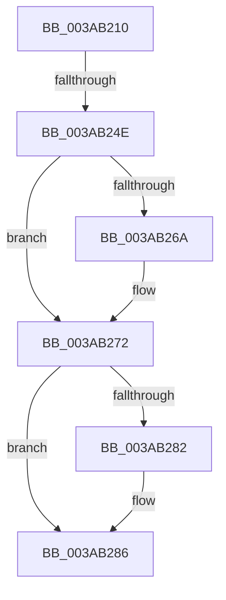

# B_TREE&lt;_SM_PAGE_KEY,ST_STORE&lt;SM_TRAITS&gt;::_ST_PAGE_ENTRY,4096,NP_CONTEXT,B_TREE_KEY_COMPARATOR&lt;_SM_PAGE_KEY&gt; &gt;::BTreeDeleteEx

- RVA: `0x003AB210`–`0x003AB294` (길이 `132` bytes)
- VA: `0x00000001403AB210`
- 실행 섹션: `.text`
- PDB 이름 있음: `예`; PDB Function 태그: `예`
- unwind 정보 RVA: `0x0008B884`
- 디코드: `38`개 명령, `132/132` bytes 표시
- 미해석 바이트: `0` (있으면 어셈블리에 `.byte`로 보존)

> 이 문서는 커널 이미지의 기계어와 PDB 기호를 분석해 생성했습니다. 4번과 5번은 함수 원형과 자료형을 바이너리 사용 방식에서 추정한 C 해석이며 원본 소스 복구 결과는 아닙니다.

## 1. Dependencies

- 직접 호출 지점: **1**; 고유 호출 대상: **1**
- 직접 호출자로 확인된 함수: **2**
- RIP 상대 이미지 참조: **0**

### Outgoing calls
- `0x003AB26D` → [memcpy](../6C/memcpy_function_006C6840.md) (function, `0x006C6840`)

### Direct callers
- [ST_STORE&lt;SM_TRAITS&gt;::StDmPageRemove](../20/ST_STORE_SM_TRAITS_StDmPageRemove_function_002049A0.md) at `0x00204C45`
- [B_TREE&lt;_SM_PAGE_KEY,ST_STORE&lt;SM_TRAITS&gt;::_ST_PAGE_ENTRY,4096,NP_CONTEXT,B_TREE_KEY_COMPARATOR&lt;_SM_PAGE_KEY&gt; &gt;::BTreeMergeNodes](B_TREE__SM_PAGE_KEY_ST_STORE_SM_TRAITS__ST_PAGE_ENTRY_4096_NP_CONTEXT_B_TREE_KEY_COMPARATOR__SM_PAGE_function_003AADC4.md) at `0x003AAECA`

### Static image references
- 디코드된 RIP-relative 메모리 참조가 없습니다.

## 2. Other-region calls and transfers

- 다른 실행 섹션으로 향하는 call: **0**
- call이 아닌 외부 분기/꼬리 이동: **2**
  - `0x003AB248` → [sub_003AB39D](Unknown_function_003AB39D.md) (`tail-transfer`)
  - `0x003AB28E` → [sub_003AB384](Unknown_function_003AB384.md) (`tail-transfer`)

## 3. Assembly (complete function range)

```asm
003AB210  48 89 5C 24 10                  mov qword ptr [rsp + 0x10], rbx
003AB215  48 89 6C 24 18                  mov qword ptr [rsp + 0x18], rbp
003AB21A  56                              push rsi
003AB21B  57                              push rdi
003AB21C  41 54                           push r12
003AB21E  41 56                           push r14
003AB220  41 57                           push r15
003AB222  48 83 EC 20                     sub rsp, 0x20
003AB226  8B 72 18                        mov esi, dword ptr [rdx + 0x18]
003AB229  4C 8B F1                        mov r14, rcx
003AB22C  FF CE                           dec esi
003AB22E  4C 8B FA                        mov r15, rdx
003AB231  48 C1 E6 04                     shl rsi, 4
003AB235  48 03 32                        add rsi, qword ptr [rdx]
003AB238  48 8B 1E                        mov rbx, qword ptr [rsi]
003AB23B  48 8B 4E 08                     mov rcx, qword ptr [rsi + 8]
003AB23F  80 7B 03 00                     cmp byte ptr [rbx + 3], 0
003AB243  8B 03                           mov eax, dword ptr [rbx]
003AB245  0F B7 F8                        movzx edi, ax
003AB248  0F 84 4F 01 00 00               je 0x1403ab39d
003AB24E  48 8D 3C FD 08 00 00 00         lea rdi, [rdi*8 + 8]
003AB256  BD FF 00 00 00                  mov ebp, 0xff
003AB25B  48 8D 51 08                     lea rdx, [rcx + 8]
003AB25F  48 2B F9                        sub rdi, rcx
003AB262  48 03 FB                        add rdi, rbx
003AB265  48 85 FF                        test rdi, rdi
003AB268  74 08                           je 0x1403ab272
003AB26A  4C 8B C7                        mov r8, rdi
003AB26D  E8 CE B5 31 00                  call 0x1406c6840
003AB272  41 BC FF FF 00 00               mov r12d, 0xffff
003AB278  66 44 01 23                     add word ptr [rbx], r12w
003AB27C  80 7B 03 00                     cmp byte ptr [rbx + 3], 0
003AB280  74 04                           je 0x1403ab286
003AB282  49 FF 4E 08                     dec qword ptr [r14 + 8]
003AB286  8B 03                           mov eax, dword ptr [rbx]
003AB288  0F B7 C8                        movzx ecx, ax
003AB28B  49 39 1E                        cmp qword ptr [r14], rbx
003AB28E  0F 84 F0 00 00 00               je 0x1403ab384
```

## 4. C-style interpretation (structured pseudocode)

```c
__int64 __fastcall B_TREE__SM_PAGE_KEY_ST_STORE_SM_TRAITS____ST_PAGE_ENTRY_4096_NP_CONTEXT_B_TREE_KEY_COMPARATOR__SM_PA(__int64 a1, __int64 a2)
{
    __int64 result;
    __int64 v_rdi;
    __int64 v_rsi;
    __int64 v_rsp;
    unsigned __int64 v_stack_p10;
    unsigned __int64 v_stack_p18;

    v_stack_p10 = v_rbx;
    v_stack_p18 = v_rbp;
    v_rsp = (v_rsp) - (32);
    v_rsi = (unsigned int)(((unsigned int)(*(unsigned int *)(a2 + 24))) - 1);
    v_rsi = (v_rsi) << (4);
    v_rsi = (v_rsi) + (*(unsigned __int64 *)(a2));
    v_rdi = ((unsigned __int16)((unsigned int)(*(unsigned int *)(*(unsigned __int64 *)(v_rsi)))) * 8 + 8) - (*(unsigned __int64 *)(v_rsi + 8));
    v_rdi = (v_rdi) + (*(unsigned __int64 *)(v_rsi));
    result = (unsigned int)(*(unsigned int *)(*(unsigned __int64 *)(v_rsi)));
    if (v_rdi != 0) {
        a3 = v_rdi;
        result = memcpy(*(unsigned __int64 *)(v_rsi + 8), *(unsigned __int64 *)(v_rsi + 8) + 8, a3, a4);
    }
    if ((*(unsigned __int8 *)(*(unsigned __int64 *)(v_rsi) + 3)) != 0) {
    }
}
```

## 5. (Beta) C Style

```c
int64_t B_TREE__SM_PAGE_KEY_ST_STORE_SM_TRAITS____ST_PAGE_ENTRY_4096_NP_CONTEXT_B_TREE_KEY_COMPARATOR__SM_PA(void *Arg1, void *Arg2)
{
    uint8_t *arg1 = (uint8_t *)Arg1;
    uint8_t *arg2 = (uint8_t *)Arg2;

    int64_t result;
    int64_t local_rdi;
    int64_t local_rsi;
    int64_t local_rsp;
    uint64_t v_stack_p10;
    uint64_t v_stack_p18;

    v_stack_p10 = local_rbx;
    v_stack_p18 = local_rbp;
    local_rsp = (local_rsp) - (32);
    local_rsi = (uint32_t)(((uint32_t)(*(uint32_t *)(arg2 + 0x18))) - 1);
    local_rsi = (local_rsi) << (4);
    local_rsi = (local_rsi) + (*(uint64_t *)(arg2));
    local_rdi = ((uint16_t)((uint32_t)(*(uint32_t *)(*(uint64_t *)(local_rsi)))) * 8 + 8) - (*(uint64_t *)(local_rsi + 0x8));
    local_rdi = (local_rdi) + (*(uint64_t *)(local_rsi));
    result = (uint32_t)(*(uint32_t *)(*(uint64_t *)(local_rsi)));
    if (local_rdi != 0) {
        a3 = local_rdi;
        result = memcpy(*(uint64_t *)(local_rsi + 0x8), *(uint64_t *)(local_rsi + 0x8) + 8, a3, a4);
    }
    if ((*(uint8_t *)(*(uint64_t *)(local_rsi) + 0x3)) != 0) {
    }
}
```

### 관측된 메모리 오프셋

구조체 형식이 확인되지 않은 접근은 인자 기준의 오프셋으로만 기록했습니다.

| 기준 인자 | 오프셋 표현 | 폭 (bit) | 접근 |
|---|---:|---:|---|
| `Arg1` | `+ 0x0` | `64` | `R` |
| `Arg1` | `+ 0x8` | `64` | `R/W` |
| `Arg2` | `+ 0x0` | `64` | `R` |
| `Arg2` | `+ 0x18` | `32` | `R` |

## 6. Execution-region graph

[열기: 2D/3D 그래프와 함수 탐색 컨트롤 패널](../../../control-panel.html?section=text&rva=0x003AB210&view=graph)

- 2D 그래프는 위에서 아래로 흐르고, 3D 그래프는 빈 공간을 드래그해 회전합니다. Shift+드래그는 이동, 휠은 확대·축소, 함수 노드 선택은 대상 보고서 이동입니다.

### Static fallback


