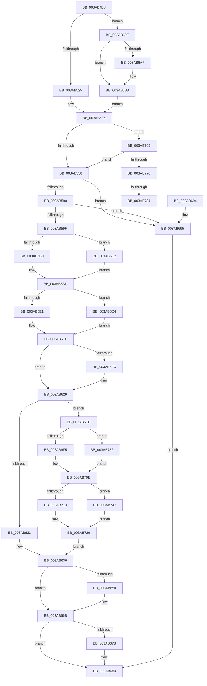

# B_TREE&lt;_SM_PAGE_KEY,ST_STORE&lt;SM_TRAITS&gt;::_ST_PAGE_ENTRY,4096,NP_CONTEXT,B_TREE_KEY_COMPARATOR&lt;_SM_PAGE_KEY&gt; &gt;::BTreeRedistribute

- RVA: `0x003AB4B8`–`0x003AB78C` (길이 `724` bytes)
- VA: `0x00000001403AB4B8`
- 실행 섹션: `.text`
- PDB 이름 있음: `예`; PDB Function 태그: `예`
- unwind 정보 RVA: `0x0008B978`
- 디코드: `206`개 명령, `724/724` bytes 표시
- 미해석 바이트: `0` (있으면 어셈블리에 `.byte`로 보존)

> 이 문서는 커널 이미지의 기계어와 PDB 기호를 분석해 생성했습니다. 4번과 5번은 함수 원형과 자료형을 바이너리 사용 방식에서 추정한 C 해석이며 원본 소스 복구 결과는 아닙니다.

## 1. Dependencies

- 직접 호출 지점: **3**; 고유 호출 대상: **1**
- 직접 호출자로 확인된 함수: **2**
- RIP 상대 이미지 참조: **0**

### Outgoing calls
- `0x003AB612` → [memcpy](../6C/memcpy_function_006C6840.md) (function, `0x006C6840`)
- `0x003AB640` → [memcpy](../6C/memcpy_function_006C6840.md) (function, `0x006C6840`)
- `0x003AB666` → [memcpy](../6C/memcpy_function_006C6840.md) (function, `0x006C6840`)

### Direct callers
- [sub_003AB2CC](Unknown_function_003AB2CC.md) at `0x003AB30B`
- [sub_003AB904](Unknown_function_003AB904.md) at `0x003AB932`

### Static image references
- 디코드된 RIP-relative 메모리 참조가 없습니다.

## 2. Other-region calls and transfers

- 다른 실행 섹션으로 향하는 call: **0**
- call이 아닌 외부 분기/꼬리 이동: **2**
  - `0x003AB77E` → [sub_006E6D20](../6E/Unknown_function_006E6D20.md) (`tail-transfer`)
  - `0x003AB787` → [sub_006E6D20 + 0xB](../6E/Unknown_function_006E6D20.md) (`tail-transfer`)

## 3. Assembly (complete function range)

```asm
003AB4B8  40 53                           push rbx
003AB4BA  55                              push rbp
003AB4BB  56                              push rsi
003AB4BC  57                              push rdi
003AB4BD  41 54                           push r12
003AB4BF  41 55                           push r13
003AB4C1  41 56                           push r14
003AB4C3  41 57                           push r15
003AB4C5  48 83 EC 28                     sub rsp, 0x28
003AB4C9  44 8B 42 18                     mov r8d, dword ptr [rdx + 0x18]
003AB4CD  4C 8B D9                        mov r11, rcx
003AB4D0  48 83 64 24 78 00               and qword ptr [rsp + 0x78], 0
003AB4D6  41 BC 01 00 00 00               mov r12d, 1
003AB4DC  48 83 64 24 70 00               and qword ptr [rsp + 0x70], 0
003AB4E2  45 2B C4                        sub r8d, r12d
003AB4E5  49 C1 E0 04                     shl r8, 4
003AB4E9  4C 03 02                        add r8, qword ptr [rdx]
003AB4EC  45 8D 7C 24 0F                  lea r15d, [r12 + 0xf]
003AB4F1  4D 8B 50 F0                     mov r10, qword ptr [r8 - 0x10]
003AB4F5  49 8B 10                        mov rdx, qword ptr [r8]
003AB4F8  4D 8B 70 F8                     mov r14, qword ptr [r8 - 8]
003AB4FC  8A 42 03                        mov al, byte ptr [rdx + 3]
003AB4FF  F6 D8                           neg al
003AB501  B8 FF 00 00 00                  mov eax, 0xff
003AB506  1B FF                           sbb edi, edi
003AB508  23 F8                           and edi, eax
003AB50A  03 F8                           add edi, eax
003AB50C  41 8B 02                        mov eax, dword ptr [r10]
003AB50F  0F B7 C8                        movzx ecx, ax
003AB512  49 03 CC                        add rcx, r12
003AB515  48 C1 E1 04                     shl rcx, 4
003AB519  49 03 CA                        add rcx, r10
003AB51C  4C 3B F1                        cmp r14, rcx
003AB51F  0F 84 7A 01 00 00               je 0x1403ab69f
003AB525  48 89 54 24 78                  mov qword ptr [rsp + 0x78], rdx
003AB52A  4D 8D 4E 08                     lea r9, [r14 + 8]
003AB52E  48 8D 5C 24 70                  lea rbx, [rsp + 0x70]
003AB533  45 33 E4                        xor r12d, r12d
003AB536  49 8D 53 10                     lea rdx, [r11 + 0x10]
003AB53A  49 8B C3                        mov rax, r11
003AB53D  48 F7 D8                        neg rax
003AB540  4D 8D 43 10                     lea r8, [r11 + 0x10]
003AB544  48 1B C9                        sbb rcx, rcx
003AB547  48 23 CA                        and rcx, rdx
003AB54A  83 CA FF                        or edx, 0xffffffff
003AB54D  48 8B 01                        mov rax, qword ptr [rcx]
003AB550  39 10                           cmp dword ptr [rax], edx
003AB552  0F 85 0D 02 00 00               jne 0x1403ab765
003AB558  49 8B 01                        mov rax, qword ptr [r9]
003AB55B  48 89 03                        mov qword ptr [rbx], rax
003AB55E  4C 8B 4C 24 78                  mov r9, qword ptr [rsp + 0x78]
003AB563  4C 0B E0                        or r12, rax
003AB566  B8 FF FF 00 00                  mov eax, 0xffff
003AB56B  4C 89 A4 24 80 00 00 00         mov qword ptr [rsp + 0x80], r12
003AB573  4C 8B 64 24 70                  mov r12, qword ptr [rsp + 0x70]
003AB578  41 8B 11                        mov edx, dword ptr [r9]
003AB57B  23 D0                           and edx, eax
003AB57D  45 8B 04 24                     mov r8d, dword ptr [r12]
003AB581  44 23 C0                        and r8d, eax
003AB584  42 8D 0C 02                     lea ecx, [rdx + r8]
003AB588  3B CF                           cmp ecx, edi
003AB58A  0F 82 05 01 00 00               jb 0x1403ab695
003AB590  8D 04 7D FF FF FF FF            lea eax, [rdi*2 - 1]
003AB597  3B C8                           cmp ecx, eax
003AB599  0F 83 F6 00 00 00               jae 0x1403ab695
003AB59F  D1 E9                           shr ecx, 1
003AB5A1  4D 8B D1                        mov r10, r9
003AB5A4  49 8B E9                        mov rbp, r9
003AB5A7  41 3B D0                        cmp edx, r8d
003AB5AA  0F 87 12 01 00 00               ja 0x1403ab6c2
003AB5B0  8B F9                           mov edi, ecx
003AB5B2  49 8B DC                        mov rbx, r12
003AB5B5  2B FA                           sub edi, edx
003AB5B7  49 8B F1                        mov rsi, r9
003AB5BA  44 8B DA                        mov r11d, edx
003AB5BD  44 3B C2                        cmp r8d, edx
003AB5C0  44 89 5C 24 70                  mov dword ptr [rsp + 0x70], r11d
003AB5C5  45 8B EB                        mov r13d, r11d
003AB5C8  1B C0                           sbb eax, eax
003AB5CA  23 C1                           and eax, ecx
003AB5CC  80 7B 03 00                     cmp byte ptr [rbx + 3], 0
003AB5D0  44 8B C0                        mov r8d, eax
003AB5D3  4C 89 84 24 88 00 00 00         mov qword ptr [rsp + 0x88], r8
003AB5DB  0F 84 F3 00 00 00               je 0x1403ab6d4
003AB5E1  41 BF 08 00 00 00               mov r15d, 8
003AB5E7  48 8D 2C C3                     lea rbp, [rbx + rax*8]
003AB5EB  4E 8D 2C EE                     lea r13, [rsi + r13*8]
003AB5EF  49 83 C5 10                     add r13, 0x10
003AB5F3  48 83 C5 10                     add rbp, 0x10
003AB5F7  49 3B DA                        cmp rbx, r10
003AB5FA  75 2D                           jne 0x1403ab629
003AB5FC  8B 06                           mov eax, dword ptr [rsi]
003AB5FE  8B CF                           mov ecx, edi
003AB600  41 0F AF CF                     imul ecx, r15d
003AB604  49 8B D5                        mov rdx, r13
003AB607  44 0F B7 C0                     movzx r8d, ax
003AB60B  45 0F AF C7                     imul r8d, r15d
003AB60F  49 03 CD                        add rcx, r13
003AB612  E8 29 B2 31 00                  call 0x1406c6840
003AB617  4C 8B 4C 24 78                  mov r9, qword ptr [rsp + 0x78]
003AB61C  44 8B 5C 24 70                  mov r11d, dword ptr [rsp + 0x70]
003AB621  4C 8B 84 24 88 00 00 00         mov r8, qword ptr [rsp + 0x88]
003AB629  80 7B 03 00                     cmp byte ptr [rbx + 3], 0
003AB62D  0F 84 BA 00 00 00               je 0x1403ab6ed
003AB633  44 8B C7                        mov r8d, edi
003AB636  45 0F AF C7                     imul r8d, r15d
003AB63A  48 8B D5                        mov rdx, rbp
003AB63D  49 8B CD                        mov rcx, r13
003AB640  E8 FB B1 31 00                  call 0x1406c6840
003AB645  66 01 3E                        add word ptr [rsi], di
003AB648  66 29 3B                        sub word ptr [rbx], di
003AB64B  49 3B DC                        cmp rbx, r12
003AB64E  75 1B                           jne 0x1403ab66b
003AB650  8B 03                           mov eax, dword ptr [rbx]
003AB652  48 8B CD                        mov rcx, rbp
003AB655  41 0F AF FF                     imul edi, r15d
003AB659  44 0F B7 C0                     movzx r8d, ax
003AB65D  45 0F AF C7                     imul r8d, r15d
003AB661  8B D7                           mov edx, edi
003AB663  48 03 D5                        add rdx, rbp
003AB666  E8 D5 B1 31 00                  call 0x1406c6840
003AB66B  41 80 7C 24 03 00               cmp byte ptr [r12 + 3], 0
003AB671  48 8B 84 24 80 00 00 00         mov rax, qword ptr [rsp + 0x80]
003AB679  74 08                           je 0x1403ab683
003AB67B  41 8B 4C 24 10                  mov ecx, dword ptr [r12 + 0x10]
003AB680  41 89 0E                        mov dword ptr [r14], ecx
003AB683  48 83 C4 28                     add rsp, 0x28
003AB687  41 5F                           pop r15
003AB689  41 5E                           pop r14
003AB68B  41 5D                           pop r13
003AB68D  41 5C                           pop r12
003AB68F  5F                              pop rdi
003AB690  5E                              pop rsi
003AB691  5D                              pop rbp
003AB692  5B                              pop rbx
003AB693  C3                              ret
003AB694  CC                              int3
003AB695  48 8B 84 24 80 00 00 00         mov rax, qword ptr [rsp + 0x80]
003AB69D  EB E4                           jmp 0x1403ab683
003AB69F  4D 2B F7                        sub r14, r15
003AB6A2  49 8D 42 10                     lea rax, [r10 + 0x10]
003AB6A6  4D 8D 4E F8                     lea r9, [r14 - 8]
003AB6AA  4C 3B F0                        cmp r14, rax
003AB6AD  77 04                           ja 0x1403ab6b3
003AB6AF  4D 8D 4A 08                     lea r9, [r10 + 8]
003AB6B3  48 8D 5C 24 78                  lea rbx, [rsp + 0x78]
003AB6B8  48 89 54 24 70                  mov qword ptr [rsp + 0x70], rdx
003AB6BD  E9 74 FE FF FF                  jmp 0x1403ab536
003AB6C2  45 33 DB                        xor r11d, r11d
003AB6C5  8B FA                           mov edi, edx
003AB6C7  2B F9                           sub edi, ecx
003AB6C9  49 8B D9                        mov rbx, r9
003AB6CC  49 8B F4                        mov rsi, r12
003AB6CF  E9 E9 FE FF FF                  jmp 0x1403ab5bd
003AB6D4  4C 8B D5                        mov r10, rbp
003AB6D7  49 C1 E5 04                     shl r13, 4
003AB6DB  49 8B E8                        mov rbp, r8
003AB6DE  48 C1 E5 04                     shl rbp, 4
003AB6E2  48 03 EB                        add rbp, rbx
003AB6E5  4C 03 EE                        add r13, rsi
003AB6E8  E9 02 FF FF FF                  jmp 0x1403ab5ef
003AB6ED  41 8B 16                        mov edx, dword ptr [r14]
003AB6F0  49 3B D9                        cmp rbx, r9
003AB6F3  74 3D                           je 0x1403ab732
003AB6F5  41 8B CB                        mov ecx, r11d
003AB6F8  48 03 C9                        add rcx, rcx
003AB6FB  89 54 CE 10                     mov dword ptr [rsi + rcx*8 + 0x10], edx
003AB6FF  48 8B 43 08                     mov rax, qword ptr [rbx + 8]
003AB703  48 89 44 CE 18                  mov qword ptr [rsi + rcx*8 + 0x18], rax
003AB708  41 8B C7                        mov eax, r15d
003AB70B  4C 03 E8                        add r13, rax
003AB70E  49 3B D9                        cmp rbx, r9
003AB711  74 34                           je 0x1403ab747
003AB713  8D 57 FF                        lea edx, [rdi - 1]
003AB716  48 03 D2                        add rdx, rdx
003AB719  8B 44 D3 10                     mov eax, dword ptr [rbx + rdx*8 + 0x10]
003AB71D  41 89 06                        mov dword ptr [r14], eax
003AB720  48 8B 44 D3 18                  mov rax, qword ptr [rbx + rdx*8 + 0x18]
003AB725  48 89 43 08                     mov qword ptr [rbx + 8], rax
003AB729  44 8D 47 FF                     lea r8d, [rdi - 1]
003AB72D  E9 04 FF FF FF                  jmp 0x1403ab636
003AB732  8D 4F FF                        lea ecx, [rdi - 1]
003AB735  48 03 C9                        add rcx, rcx
003AB738  89 54 CE 10                     mov dword ptr [rsi + rcx*8 + 0x10], edx
003AB73C  48 8B 46 08                     mov rax, qword ptr [rsi + 8]
003AB740  48 89 44 CE 18                  mov qword ptr [rsi + rcx*8 + 0x18], rax
003AB745  EB C7                           jmp 0x1403ab70e
003AB747  41 8B C8                        mov ecx, r8d
003AB74A  48 03 C9                        add rcx, rcx
003AB74D  8B 44 CB 10                     mov eax, dword ptr [rbx + rcx*8 + 0x10]
003AB751  41 89 06                        mov dword ptr [r14], eax
003AB754  48 8B 44 CB 18                  mov rax, qword ptr [rbx + rcx*8 + 0x18]
003AB759  48 89 46 08                     mov qword ptr [rsi + 8], rax
003AB75D  41 8B C7                        mov eax, r15d
003AB760  48 03 E8                        add rbp, rax
003AB763  EB C4                           jmp 0x1403ab729
003AB765  41 80 7A 02 02                  cmp byte ptr [r10 + 2], 2
003AB76A  0F 85 E8 FD FF FF               jne 0x1403ab558
003AB770  49 F7 DB                        neg r11
003AB773  48 1B C9                        sbb rcx, rcx
003AB776  49 23 C8                        and rcx, r8
003AB779  48 8B 01                        mov rax, qword ptr [rcx]
003AB77C  39 10                           cmp dword ptr [rax], edx
003AB77E  0F 85 9C B5 33 00               jne 0x1406e6d20
003AB784  49 8B 01                        mov rax, qword ptr [r9]
003AB787  E9 9F B5 33 00                  jmp 0x1406e6d2b
```

## 4. C-style interpretation (structured pseudocode)

```c
__int64 __fastcall B_TREE__SM_PAGE_KEY_ST_STORE_SM_TRAITS____ST_PAGE_ENTRY_4096_NP_CONTEXT_B_TREE_KEY_COMPARATOR__SM_PA(__int64 a1, __int64 a2)
{
    __int64 result;
    __int64 v_r11;
    __int64 v_r12;
    __int64 v_r13;
    __int64 v_r14;
    __int64 v_rbp;
    __int64 v_rdi;
    __int64 v_rsp;
    unsigned __int64 v_stack_p10;
    unsigned __int64 v_stack_p18;
    unsigned __int64 v_stack_p20;
    unsigned __int64 v_stack_p70;
    unsigned __int64 v_stack_p78;
    unsigned __int64 v_stack_p8;
    unsigned __int64 v_stack_p80;

    v_rsp = (v_rsp) - (40);
    a3 = (unsigned int)(((unsigned int)(*(unsigned int *)(a2 + 24))) - (1));
    a3 = (a3) << (4);
    a3 = (a3) + (*(unsigned __int64 *)(a2));
    result = (unsigned __int8)(-(*(unsigned __int8 *)(*(unsigned __int64 *)(a3) + 3)));
    v_rdi = (unsigned int)((v_rdi) & (255));
    v_rdi = (unsigned int)((v_rdi) + (255));
    a1 = ((unsigned __int16)((unsigned int)(*(unsigned int *)(*(unsigned __int64 *)(a3 - 16))))) + (1);
    a1 = (a1) << (4);
    a1 = (a1) + (*(unsigned __int64 *)(a3 - 16));
    if ((*(unsigned __int64 *)(a3 - 8)) == a1) goto loc_003AB69F;
    v_stack_p10 = *(unsigned __int64 *)(a3);
    v_r12 = 0;
loc_003AB536:
    result = -(a1);
    a1 = (a1) & (a1 + 16);
    a2 = (unsigned int)((a1 + 16) | (0xFFFFFFFFULL));
    if ((*(unsigned int *)(*(unsigned __int64 *)(a1))) != ((unsigned int)(a2))) goto loc_003AB765;
loc_003AB558:
    *(unsigned __int64 *)(v_stack_p8) = *(unsigned __int64 *)(*(unsigned __int64 *)(a3 - 8) + 8);
    v_r12 = (v_r12) | (*(unsigned __int64 *)(*(unsigned __int64 *)(a3 - 8) + 8));
    v_stack_p18 = v_r12;
    a2 = (unsigned int)(((unsigned int)(*(unsigned int *)(v_stack_p10))) & ((unsigned int)((unsigned int)(0xFFFFULL))));
    a3 = (unsigned int)(((unsigned int)(*(unsigned int *)(v_stack_p8))) & ((unsigned int)((unsigned int)(0xFFFFULL))));
    if (((unsigned int)(a2 + a3 * 1)) < ((unsigned int)(v_rdi))) goto loc_003AB695;
    if (((unsigned int)(a2 + a3 * 1)) >= ((unsigned int)(v_rdi * 2 - 1))) goto loc_003AB695;
    a1 = (unsigned int)((a2 + a3 * 1) >> (1));
    if (((unsigned int)(a2)) > ((unsigned int)(a3))) goto loc_003AB6C2;
    v_rdi = (unsigned int)(((unsigned int)((unsigned int)(a1))) - ((unsigned int)(a2)));
loc_003AB5BD:
    v_stack_p8 = (unsigned int)((unsigned int)((unsigned int)(a2)));
    result = (unsigned int)((v_rdi * 2 - 1) & ((unsigned int)(a1)));
    v_stack_p20 = (unsigned int)((unsigned int)(result));
    if ((*(unsigned __int8 *)(v_stack_p8 + 3)) == 0) goto loc_003AB6D4;
loc_003AB5EF:
    v_r13 = (v_stack_p10 + (unsigned int)((unsigned int)((unsigned int)((unsigned int)(a2)))) * 8) + (16);
    v_rbp = (v_stack_p8 + result * 8) + (16);
    v_r11 = (unsigned int)((unsigned int)(a2));
    if (v_stack_p8 == v_stack_p10) {
        result = *(unsigned int *)(v_stack_p10);
        a1 = (unsigned int)(v_rdi);
        a1 = (unsigned int)((a1) * (8));
        a2 = v_r13;
        a3 = (unsigned __int16)(result);
        a3 = (unsigned int)((a3) * (8));
        a1 = (a1) + (v_r13);
        result = memcpy(a1, a2, a3, v_stack_p10);
        a4 = v_stack_p10;
        v_r11 = v_stack_p8;
        a3 = v_stack_p20;
    }
    if ((*(unsigned __int8 *)(v_stack_p8 + 3)) == 0) goto loc_003AB6ED;
loc_003AB636:
    a3 = (unsigned int)(((unsigned int)((unsigned int)(v_rdi))) * (8));
    result = memcpy(v_r13, v_rbp, a3, a4);
    if (v_stack_p8 == v_stack_p8) {
        result = *(unsigned int *)(v_stack_p8);
        a1 = v_rbp;
        v_rdi = (unsigned int)((v_rdi) * (8));
        a3 = (unsigned __int16)(result);
        a3 = (unsigned int)((a3) * (8));
        a2 = (unsigned int)(v_rdi);
        a2 = (a2) + (v_rbp);
        result = memcpy(a1, a2, a3, a4);
    }
    if ((*(unsigned __int8 *)(v_stack_p8 + 3)) != 0) {
        a1 = *(unsigned int *)(v_stack_p8 + 16);
        *(unsigned int *)(*(unsigned __int64 *)(a3 - 8)) = (unsigned int)(a1);
    }
    v_rsp = (v_rsp) + (40);
    return v_stack_p18;
loc_003AB695:
    goto loc_003AB683;
loc_003AB69F:
    v_r14 = (*(unsigned __int64 *)(a3 - 8)) - (8);
    if (v_r14 <= (v_stack_p10 + 16)) {
        a4 = v_stack_p10 + 8;
    }
    v_stack_p70 = a2;
    goto loc_003AB536;
loc_003AB6C2:
    v_r11 = 0;
    v_rdi = (unsigned int)(((unsigned int)((unsigned int)(a2))) - ((unsigned int)(a1)));
    goto loc_003AB5BD;
loc_003AB6D4:
    v_r13 = (v_r13) << (4);
    v_rbp = (a3) << (4);
    v_rbp = (v_rbp) + (a4);
    v_r13 = (v_r13) + (v_stack_p8);
    goto loc_003AB5EF;
loc_003AB6ED:
    if (a4 == a4) goto loc_003AB732;
    a1 = (0) + (0);
    *(unsigned int *)(v_stack_p8 + a1 * 8 + 16) = (unsigned int)((unsigned int)(*(unsigned int *)(v_r14)));
    *(unsigned __int64 *)(v_stack_p8 + a1 * 8 + 24) = *(unsigned __int64 *)(a4 + 8);
    v_r13 = (v_r13) + (8);
loc_003AB70E:
    if (a4 == a4) goto loc_003AB747;
    a2 = (v_rdi - 1) + (v_rdi - 1);
    *(unsigned int *)(v_r14) = (unsigned int)((unsigned int)(*(unsigned int *)(a4 + a2 * 8 + 16)));
    *(unsigned __int64 *)(a4 + 8) = *(unsigned __int64 *)(a4 + a2 * 8 + 24);
loc_003AB729:
    goto loc_003AB636;
loc_003AB732:
    a1 = (v_rdi - 1) + (v_rdi - 1);
    *(unsigned int *)(v_stack_p8 + a1 * 8 + 16) = (unsigned int)(a2);
    *(unsigned __int64 *)(v_stack_p8 + a1 * 8 + 24) = *(unsigned __int64 *)(v_stack_p8 + 8);
    goto loc_003AB70E;
loc_003AB747:
    a1 = ((unsigned int)((unsigned int)(v_rdi - 1))) + ((unsigned int)((unsigned int)(v_rdi - 1)));
    *(unsigned int *)(v_r14) = (unsigned int)((unsigned int)(*(unsigned int *)(a4 + a1 * 8 + 16)));
    *(unsigned __int64 *)(v_stack_p8 + 8) = *(unsigned __int64 *)(a4 + a1 * 8 + 24);
    v_rbp = (v_rbp) + (8);
    goto loc_003AB729;
loc_003AB765:
    if ((*(unsigned __int8 *)(v_rbp + 2)) != 2) goto loc_003AB558;
    v_r11 = -(v_r11);
    a1 = (a1) & (v_rdi - 1);
}
```

## 5. (Beta) C Style

```c
int64_t B_TREE__SM_PAGE_KEY_ST_STORE_SM_TRAITS____ST_PAGE_ENTRY_4096_NP_CONTEXT_B_TREE_KEY_COMPARATOR__SM_PA(void *Arg1, void *Arg2)
{
    uint8_t *arg1 = (uint8_t *)Arg1;
    uint8_t *arg2 = (uint8_t *)Arg2;

    int64_t result;
    int64_t local_r11;
    int64_t local_r12;
    int64_t local_r13;
    int64_t local_r14;
    int64_t local_rbp;
    int64_t local_rdi;
    int64_t local_rsp;
    uint64_t v_stack_p10;
    uint64_t v_stack_p18;
    uint64_t v_stack_p20;
    uint64_t v_stack_p70;
    uint64_t v_stack_p78;
    uint64_t v_stack_p8;
    uint64_t v_stack_p80;

    local_rsp = (local_rsp) - (40);
    a3 = (uint32_t)(((uint32_t)(*(uint32_t *)(arg2 + 0x18))) - (1));
    a3 = (a3) << (4);
    a3 = (a3) + (*(uint64_t *)(arg2));
    result = (uint8_t)(-(*(uint8_t *)(*(uint64_t *)(a3) + 0x3)));
    local_rdi = (uint32_t)((local_rdi) & (255));
    local_rdi = (uint32_t)((local_rdi) + (255));
    Arg1 = ((uint16_t)((uint32_t)(*(uint32_t *)(*(uint64_t *)(a3 - 0x10))))) + (1);
    Arg1 = (Arg1) << (4);
    Arg1 = (Arg1) + (*(uint64_t *)(a3 - 0x10));
    if ((*(uint64_t *)(a3 - 0x8)) == Arg1) goto loc_003AB69F;
    v_stack_p10 = *(uint64_t *)(a3);
    local_r12 = 0;
loc_003AB536:
    result = -(Arg1);
    Arg1 = (Arg1) & (Arg1 + 16);
    Arg2 = (uint32_t)((Arg1 + 16) | (0xFFFFFFFFULL));
    if ((*(uint32_t *)(*(uint64_t *)(arg1))) != ((uint32_t)(Arg2))) goto loc_003AB765;
loc_003AB558:
    *(uint64_t *)(v_stack_p8) = *(uint64_t *)(*(uint64_t *)(a3 - 0x8) + 0x8);
    local_r12 = (local_r12) | (*(uint64_t *)(*(uint64_t *)(a3 - 0x8) + 0x8));
    v_stack_p18 = local_r12;
    Arg2 = (uint32_t)(((uint32_t)(*(uint32_t *)(v_stack_p10))) & ((uint32_t)((uint32_t)(0xFFFFULL))));
    a3 = (uint32_t)(((uint32_t)(*(uint32_t *)(v_stack_p8))) & ((uint32_t)((uint32_t)(0xFFFFULL))));
    if (((uint32_t)(Arg2 + a3 * 1)) < ((uint32_t)(local_rdi))) goto loc_003AB695;
    if (((uint32_t)(Arg2 + a3 * 1)) >= ((uint32_t)(local_rdi * 2 - 1))) goto loc_003AB695;
    Arg1 = (uint32_t)((Arg2 + a3 * 1) >> (1));
    if (((uint32_t)(Arg2)) > ((uint32_t)(a3))) goto loc_003AB6C2;
    local_rdi = (uint32_t)(((uint32_t)((uint32_t)(Arg1))) - ((uint32_t)(Arg2)));
loc_003AB5BD:
    v_stack_p8 = (uint32_t)((uint32_t)((uint32_t)(Arg2)));
    result = (uint32_t)((local_rdi * 2 - 1) & ((uint32_t)(Arg1)));
    v_stack_p20 = (uint32_t)((uint32_t)(result));
    if ((*(uint8_t *)(v_stack_p8 + 0x3)) == 0) goto loc_003AB6D4;
loc_003AB5EF:
    local_r13 = (v_stack_p10 + (uint32_t)((uint32_t)((uint32_t)((uint32_t)(Arg2)))) * 8) + (16);
    local_rbp = (v_stack_p8 + result * 8) + (16);
    local_r11 = (uint32_t)((uint32_t)(Arg2));
    if (v_stack_p8 == v_stack_p10) {
        result = *(uint32_t *)(v_stack_p10);
        Arg1 = (uint32_t)(local_rdi);
        Arg1 = (uint32_t)((Arg1) * (8));
        Arg2 = local_r13;
        a3 = (uint16_t)(result);
        a3 = (uint32_t)((a3) * (8));
        Arg1 = (Arg1) + (local_r13);
        result = memcpy(Arg1, Arg2, a3, v_stack_p10);
        a4 = v_stack_p10;
        local_r11 = v_stack_p8;
        a3 = v_stack_p20;
    }
    if ((*(uint8_t *)(v_stack_p8 + 0x3)) == 0) goto loc_003AB6ED;
loc_003AB636:
    a3 = (uint32_t)(((uint32_t)((uint32_t)(local_rdi))) * (8));
    result = memcpy(local_r13, local_rbp, a3, a4);
    if (v_stack_p8 == v_stack_p8) {
        result = *(uint32_t *)(v_stack_p8);
        Arg1 = local_rbp;
        local_rdi = (uint32_t)((local_rdi) * (8));
        a3 = (uint16_t)(result);
        a3 = (uint32_t)((a3) * (8));
        Arg2 = (uint32_t)(local_rdi);
        Arg2 = (Arg2) + (local_rbp);
        result = memcpy(Arg1, Arg2, a3, a4);
    }
    if ((*(uint8_t *)(v_stack_p8 + 0x3)) != 0) {
        Arg1 = *(uint32_t *)(v_stack_p8 + 0x10);
        *(uint32_t *)(*(uint64_t *)(a3 - 0x8)) = (uint32_t)(Arg1);
    }
    local_rsp = (local_rsp) + (40);
    return v_stack_p18;
loc_003AB695:
    goto loc_003AB683;
loc_003AB69F:
    local_r14 = (*(uint64_t *)(a3 - 0x8)) - (8);
    if (local_r14 <= (v_stack_p10 + 16)) {
        a4 = v_stack_p10 + 8;
    }
    v_stack_p70 = Arg2;
    goto loc_003AB536;
loc_003AB6C2:
    local_r11 = 0;
    local_rdi = (uint32_t)(((uint32_t)((uint32_t)(Arg2))) - ((uint32_t)(Arg1)));
    goto loc_003AB5BD;
loc_003AB6D4:
    local_r13 = (local_r13) << (4);
    local_rbp = (a3) << (4);
    local_rbp = (local_rbp) + (a4);
    local_r13 = (local_r13) + (v_stack_p8);
    goto loc_003AB5EF;
loc_003AB6ED:
    if (a4 == a4) goto loc_003AB732;
    Arg1 = (0) + (0);
    *(uint32_t *)(v_stack_p8 + arg1 * 8 + 0x10) = (uint32_t)((uint32_t)(*(uint32_t *)(local_r14)));
    *(uint64_t *)(v_stack_p8 + arg1 * 8 + 0x18) = *(uint64_t *)(a4 + 0x8);
    local_r13 = (local_r13) + (8);
loc_003AB70E:
    if (a4 == a4) goto loc_003AB747;
    Arg2 = (local_rdi - 1) + (local_rdi - 1);
    *(uint32_t *)(local_r14) = (uint32_t)((uint32_t)(*(uint32_t *)(a4 + arg2 * 8 + 0x10)));
    *(uint64_t *)(a4 + 0x8) = *(uint64_t *)(a4 + arg2 * 8 + 0x18);
loc_003AB729:
    goto loc_003AB636;
loc_003AB732:
    Arg1 = (local_rdi - 1) + (local_rdi - 1);
    *(uint32_t *)(v_stack_p8 + arg1 * 8 + 0x10) = (uint32_t)(Arg2);
    *(uint64_t *)(v_stack_p8 + arg1 * 8 + 0x18) = *(uint64_t *)(v_stack_p8 + 0x8);
    goto loc_003AB70E;
loc_003AB747:
    Arg1 = ((uint32_t)((uint32_t)(local_rdi - 1))) + ((uint32_t)((uint32_t)(local_rdi - 1)));
    *(uint32_t *)(local_r14) = (uint32_t)((uint32_t)(*(uint32_t *)(a4 + arg1 * 8 + 0x10)));
    *(uint64_t *)(v_stack_p8 + 0x8) = *(uint64_t *)(a4 + arg1 * 8 + 0x18);
    local_rbp = (local_rbp) + (8);
    goto loc_003AB729;
loc_003AB765:
    if ((*(uint8_t *)(local_rbp + 0x2)) != 2) goto loc_003AB558;
    local_r11 = -(local_r11);
    Arg1 = (Arg1) & (local_rdi - 1);
}
```

### 관측된 메모리 오프셋

구조체 형식이 확인되지 않은 접근은 인자 기준의 오프셋으로만 기록했습니다.

| 기준 인자 | 오프셋 표현 | 폭 (bit) | 접근 |
|---|---:|---:|---|
| `Arg1` | `+ 0x10` | `64` | `R` |
| `Arg2` | `+ 0x0` | `64` | `R` |
| `Arg2` | `+ 0x18` | `32` | `R` |

## 6. Execution-region graph

[열기: 2D/3D 그래프와 함수 탐색 컨트롤 패널](../../../control-panel.html?section=text&rva=0x003AB4B8&view=graph)

- 2D 그래프는 위에서 아래로 흐르고, 3D 그래프는 빈 공간을 드래그해 회전합니다. Shift+드래그는 이동, 휠은 확대·축소, 함수 노드 선택은 대상 보고서 이동입니다.

### Static fallback


