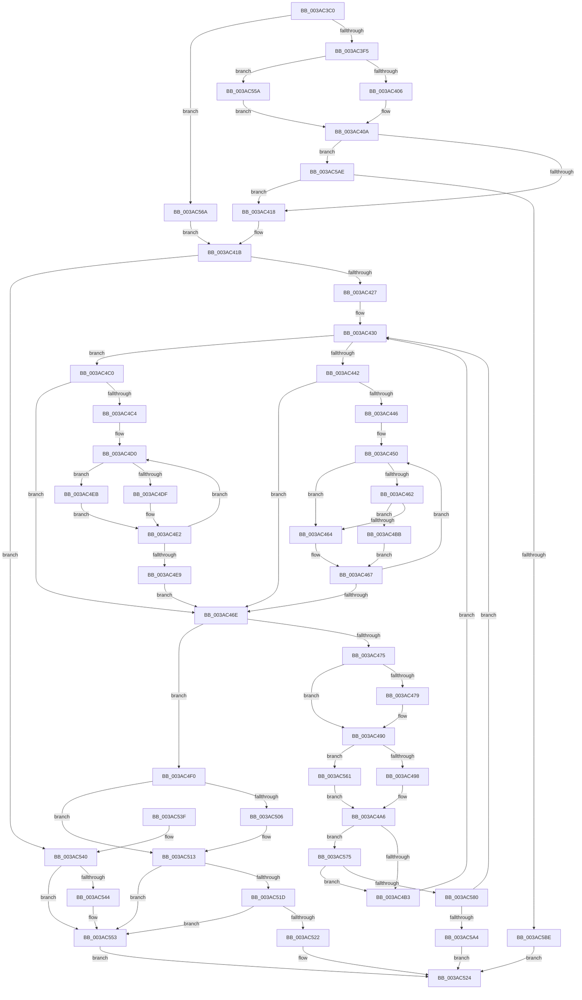

# B_TREE&lt;_SM_PAGE_KEY,ST_STORE&lt;SM_TRAITS&gt;::_ST_PAGE_ENTRY,4096,NP_CONTEXT,B_TREE_KEY_COMPARATOR&lt;_SM_PAGE_KEY&gt; &gt;::BTreeSearchKey

- RVA: `0x003AC3C0`–`0x003AC5C8` (길이 `520` bytes)
- VA: `0x00000001403AC3C0`
- 실행 섹션: `.text`
- PDB 이름 있음: `예`; PDB Function 태그: `아니요`
- unwind 정보 RVA: `0x0008BB0C`
- 디코드: `144`개 명령, `520/520` bytes 표시
- 미해석 바이트: `0` (있으면 어셈블리에 `.byte`로 보존)

> 이 문서는 커널 이미지의 기계어와 PDB 기호를 분석해 생성했습니다. 4번과 5번은 함수 원형과 자료형을 바이너리 사용 방식에서 추정한 C 해석이며 원본 소스 복구 결과는 아닙니다.

## 1. Dependencies

- 직접 호출 지점: **3**; 고유 호출 대상: **3**
- 직접 호출자로 확인된 함수: **9**
- RIP 상대 이미지 참조: **0**

### Outgoing calls
- `0x003AC3E5` → [B_TREE<_SM_PAGE_KEY,ST_STORE<SM_TRAITS>::_ST_PAGE_ENTRY,4096,NP_CONTEXT,B_TREE_KEY_COMPARATOR<_SM_PAGE_KEY> >::BTreeSearchResultDeref](B_TREE__SM_PAGE_KEY_ST_STORE_SM_TRAITS__ST_PAGE_ENTRY_4096_NP_CONTEXT_B_TREE_KEY_COMPARATOR__SM_PAGE_function_003AC5D0.md) (function, `0x003AC5D0`)
- `0x003AC593` → [NP_CONTEXT::NpLeafRefInternal](NP_CONTEXT_NpLeafRefInternal_function_003AA340.md) (function, `0x003AA340`)
- `0x003AC5B1` → [SmArrayGrow](SmArrayGrow_function_003AC6C8.md) (function, `0x003AC6C8`)

### Direct callers
- [ST_STORE&lt;SM_TRAITS&gt;::StDmPageRemove](../20/ST_STORE_SM_TRAITS_StDmPageRemove_function_002049A0.md) at `0x00204A48`
- [ST_STORE&lt;SM_TRAITS&gt;::StDmPageRemove](../20/ST_STORE_SM_TRAITS_StDmPageRemove_function_002049A0.md) at `0x00204BDF`
- [ST_STORE&lt;SM_TRAITS&gt;::StDmPageRemove](../20/ST_STORE_SM_TRAITS_StDmPageRemove_function_002049A0.md) at `0x00204E30`
- [ST_STORE&lt;SM_TRAITS&gt;::StDmPageRemove](../20/ST_STORE_SM_TRAITS_StDmPageRemove_function_002049A0.md) at `0x00204F54`
- [B_TREE&lt;_SM_PAGE_KEY,ST_STORE&lt;SM_TRAITS&gt;::_ST_PAGE_ENTRY,4096,NP_CONTEXT,B_TREE_KEY_COMPARATOR&lt;_SM_PAGE_KEY&gt; &gt;::BTreeFindLeafSibling](../41/B_TREE__SM_PAGE_KEY_ST_STORE_SM_TRAITS__ST_PAGE_ENTRY_4096_NP_CONTEXT_B_TREE_KEY_COMPARATOR__SM_PAGE_function_00410EF0.md) at `0x00410F88`
- [sub_004EBF65](../4E/Unknown_function_004EBF65.md) at `0x004EBFA1`
- [ST_STORE&lt;SM_TRAITS&gt;::StDmHandleDecompressionFailure](../60/ST_STORE_SM_TRAITS_StDmHandleDecompressionFailure_function_0060DA74.md) at `0x0060DB27`
- [ST_STORE&lt;SM_TRAITS&gt;::StNpLeafPageOut](../60/ST_STORE_SM_TRAITS_StNpLeafPageOut_function_0060E6C0.md) at `0x0060E726`
- [sub_006E6D3C](../6E/Unknown_function_006E6D3C.md) at `0x006E6D8E`
- [sub_006ED096](../6E/Unknown_function_006ED096.md) at `0x006ED0A3`
- [sub_006ED0C0](../6E/Unknown_function_006ED0C0.md) at `0x006ED112`
- [sub_006EEC06](../6E/Unknown_function_006EEC06.md) at `0x006EEC67`

### Static image references
- 디코드된 RIP-relative 메모리 참조가 없습니다.

## 2. Other-region calls and transfers

- 다른 실행 섹션으로 향하는 call: **0**
- 별도 외부 분기/꼬리 이동을 확인하지 못했습니다.

## 3. Assembly (complete function range)

```asm
003AC3C0  48 89 5C 24 08                  mov qword ptr [rsp + 8], rbx
003AC3C5  48 89 6C 24 10                  mov qword ptr [rsp + 0x10], rbp
003AC3CA  48 89 74 24 18                  mov qword ptr [rsp + 0x18], rsi
003AC3CF  48 89 7C 24 20                  mov qword ptr [rsp + 0x20], rdi
003AC3D4  41 56                           push r14
003AC3D6  48 83 EC 20                     sub rsp, 0x20
003AC3DA  8B DA                           mov ebx, edx
003AC3DC  4D 8B F0                        mov r14, r8
003AC3DF  49 8B D0                        mov rdx, r8
003AC3E2  48 8B F1                        mov rsi, rcx
003AC3E5  E8 E6 01 00 00                  call 0x1403ac5d0
003AC3EA  41 83 7E 18 FF                  cmp dword ptr [r14 + 0x18], -1
003AC3EF  0F 84 75 01 00 00               je 0x1403ac56a
003AC3F5  48 8B 06                        mov rax, qword ptr [rsi]
003AC3F8  BD 01 00 00 00                  mov ebp, 1
003AC3FD  48 85 C0                        test rax, rax
003AC400  0F 84 54 01 00 00               je 0x1403ac55a
003AC406  0F B6 48 02                     movzx ecx, byte ptr [rax + 2]
003AC40A  41 39 4E 1C                     cmp dword ptr [r14 + 0x1c], ecx
003AC40E  4D 8D 46 1C                     lea r8, [r14 + 0x1c]
003AC412  0F 82 96 01 00 00               jb 0x1403ac5ae
003AC418  49 8B 3E                        mov rdi, qword ptr [r14]
003AC41B  4C 8B 16                        mov r10, qword ptr [rsi]
003AC41E  4D 85 D2                        test r10, r10
003AC421  0F 84 19 01 00 00               je 0x1403ac540
003AC427  66 0F 1F 84 00 00 00 00 00      nop word ptr [rax + rax]
003AC430  41 8B 0A                        mov ecx, dword ptr [r10]
003AC433  BA FF FF FF FF                  mov edx, 0xffffffff
003AC438  0F B7 C1                        movzx eax, cx
003AC43B  C1 E9 18                        shr ecx, 0x18
003AC43E  84 C9                           test cl, cl
003AC440  75 7E                           jne 0x1403ac4c0
003AC442  85 C0                           test eax, eax
003AC444  74 28                           je 0x1403ac46e
003AC446  66 66 0F 1F 84 00 00 00 00 00   nop word ptr [rax + rax]
003AC450  8D 0C 10                        lea ecx, [rax + rdx]
003AC453  D1 E9                           shr ecx, 1
003AC455  44 8B C9                        mov r9d, ecx
003AC458  48 03 C9                        add rcx, rcx
003AC45B  41 39 5C CA 10                  cmp dword ptr [r10 + rcx*8 + 0x10], ebx
003AC460  72 02                           jb 0x1403ac464
003AC462  75 57                           jne 0x1403ac4bb
003AC464  41 8B D1                        mov edx, r9d
003AC467  8D 4A 01                        lea ecx, [rdx + 1]
003AC46A  3B C8                           cmp ecx, eax
003AC46C  75 E2                           jne 0x1403ac450
003AC46E  41 80 7A 03 00                  cmp byte ptr [r10 + 3], 0
003AC473  75 7B                           jne 0x1403ac4f0
003AC475  85 ED                           test ebp, ebp
003AC477  74 17                           je 0x1403ac490
003AC479  8B C8                           mov ecx, eax
003AC47B  48 FF C1                        inc rcx
003AC47E  4C 89 17                        mov qword ptr [rdi], r10
003AC481  48 C1 E1 04                     shl rcx, 4
003AC485  49 03 CA                        add rcx, r10
003AC488  48 89 4F 08                     mov qword ptr [rdi + 8], rcx
003AC48C  48 83 C7 10                     add rdi, 0x10
003AC490  85 C0                           test eax, eax
003AC492  0F 84 C9 00 00 00               je 0x1403ac561
003AC498  8D 48 FF                        lea ecx, [rax - 1]
003AC49B  48 C1 E1 04                     shl rcx, 4
003AC49F  48 83 C1 18                     add rcx, 0x18
003AC4A3  49 03 CA                        add rcx, r10
003AC4A6  48 8B 46 10                     mov rax, qword ptr [rsi + 0x10]
003AC4AA  83 38 FF                        cmp dword ptr [rax], -1
003AC4AD  0F 85 C2 00 00 00               jne 0x1403ac575
003AC4B3  4C 8B 11                        mov r10, qword ptr [rcx]
003AC4B6  E9 75 FF FF FF                  jmp 0x1403ac430
003AC4BB  41 8B C1                        mov eax, r9d
003AC4BE  EB A7                           jmp 0x1403ac467
003AC4C0  85 C0                           test eax, eax
003AC4C2  74 AA                           je 0x1403ac46e
003AC4C4  0F 1F 40 00                     nop dword ptr [rax]
003AC4C8  0F 1F 84 00 00 00 00 00         nop dword ptr [rax + rax]
003AC4D0  8D 0C 10                        lea ecx, [rax + rdx]
003AC4D3  D1 E9                           shr ecx, 1
003AC4D5  44 8B C1                        mov r8d, ecx
003AC4D8  41 39 5C CA 10                  cmp dword ptr [r10 + rcx*8 + 0x10], ebx
003AC4DD  72 0C                           jb 0x1403ac4eb
003AC4DF  41 8B C0                        mov eax, r8d
003AC4E2  8D 4A 01                        lea ecx, [rdx + 1]
003AC4E5  3B C8                           cmp ecx, eax
003AC4E7  75 E7                           jne 0x1403ac4d0
003AC4E9  EB 83                           jmp 0x1403ac46e
003AC4EB  41 8B D0                        mov edx, r8d
003AC4EE  EB F2                           jmp 0x1403ac4e2
003AC4F0  44 8B C0                        mov r8d, eax
003AC4F3  49 83 C0 02                     add r8, 2
003AC4F7  4C 89 17                        mov qword ptr [rdi], r10
003AC4FA  4F 8D 04 C2                     lea r8, [r10 + r8*8]
003AC4FE  4C 89 47 08                     mov qword ptr [rdi + 8], r8
003AC502  85 ED                           test ebp, ebp
003AC504  74 0D                           je 0x1403ac513
003AC506  49 2B 3E                        sub rdi, qword ptr [r14]
003AC509  48 C1 FF 04                     sar rdi, 4
003AC50D  FF C7                           inc edi
003AC50F  41 89 7E 18                     mov dword ptr [r14 + 0x18], edi
003AC513  41 8B 0A                        mov ecx, dword ptr [r10]
003AC516  0F B7 D1                        movzx edx, cx
003AC519  3B C2                           cmp eax, edx
003AC51B  73 36                           jae 0x1403ac553
003AC51D  41 39 18                        cmp dword ptr [r8], ebx
003AC520  75 31                           jne 0x1403ac553
003AC522  33 C0                           xor eax, eax
003AC524  48 8B 5C 24 30                  mov rbx, qword ptr [rsp + 0x30]
003AC529  48 8B 6C 24 38                  mov rbp, qword ptr [rsp + 0x38]
003AC52E  48 8B 74 24 40                  mov rsi, qword ptr [rsp + 0x40]
003AC533  48 8B 7C 24 48                  mov rdi, qword ptr [rsp + 0x48]
003AC538  48 83 C4 20                     add rsp, 0x20
003AC53C  41 5E                           pop r14
003AC53E  C3                              ret
003AC53F  CC                              int3
003AC540  85 ED                           test ebp, ebp
003AC542  75 0F                           jne 0x1403ac553
003AC544  48 C7 07 00 00 00 00            mov qword ptr [rdi], 0
003AC54B  48 C7 47 08 00 00 00 00         mov qword ptr [rdi + 8], 0
003AC553  B8 25 02 00 C0                  mov eax, 0xc0000225
003AC558  EB CA                           jmp 0x1403ac524
003AC55A  33 C9                           xor ecx, ecx
003AC55C  E9 A9 FE FF FF                  jmp 0x1403ac40a
003AC561  49 8D 4A 08                     lea rcx, [r10 + 8]
003AC565  E9 3C FF FF FF                  jmp 0x1403ac4a6
003AC56A  33 ED                           xor ebp, ebp
003AC56C  49 8D 7E 08                     lea rdi, [r14 + 8]
003AC570  E9 A6 FE FF FF                  jmp 0x1403ac41b
003AC575  41 80 7A 02 02                  cmp byte ptr [r10 + 2], 2
003AC57A  0F 85 33 FF FF FF               jne 0x1403ac4b3
003AC580  45 0F B6 46 20                  movzx r8d, byte ptr [r14 + 0x20]
003AC585  48 8B D1                        mov rdx, rcx
003AC588  41 83 E0 01                     and r8d, 1
003AC58C  48 8D 4E 10                     lea rcx, [rsi + 0x10]
003AC590  45 03 C0                        add r8d, r8d
003AC593  E8 A8 DD FF FF                  call 0x1403aa340
003AC598  4C 8B D0                        mov r10, rax
003AC59B  48 85 C0                        test rax, rax
003AC59E  0F 85 8C FE FF FF               jne 0x1403ac430
003AC5A4  B8 06 00 00 C0                  mov eax, 0xc0000006
003AC5A9  E9 76 FF FF FF                  jmp 0x1403ac524
003AC5AE  4D 8B CE                        mov r9, r14
003AC5B1  E8 12 01 00 00                  call 0x1403ac6c8
003AC5B6  85 C0                           test eax, eax
003AC5B8  0F 85 5A FE FF FF               jne 0x1403ac418
003AC5BE  B8 9A 00 00 C0                  mov eax, 0xc000009a
003AC5C3  E9 5C FF FF FF                  jmp 0x1403ac524
```

## 4. C-style interpretation (structured pseudocode)

```c
__int64 __fastcall B_TREE__SM_PAGE_KEY_ST_STORE_SM_TRAITS____ST_PAGE_ENTRY_4096_NP_CONTEXT_B_TREE_KEY_COMPARATOR__SM_PA(__int64 a1, int a2, __int64 a3)
{
    __int64 result;
    __int64 v_rbp;
    __int64 v_rdi;
    __int64 v_rsp;
    unsigned __int64 v_stack_p10;
    unsigned __int64 v_stack_p18;
    unsigned __int64 v_stack_p20;
    unsigned __int64 v_stack_p8;

    v_stack_p8 = v_rbx;
    v_stack_p10 = v_rbp;
    v_stack_p18 = v_rsi;
    v_stack_p20 = v_rdi;
    v_rsp = (v_rsp) - (32);
    result = B_TREE__SM_PAGE_KEY_ST_STORE_SM_TRAITS____ST_PAGE_ENTRY_4096_NP_CONTEXT_B_TREE_KEY_COMPARATOR__SM_PA(a1, a3, a3, a4);
    if ((*(unsigned int *)(a3 + 24)) == -1) goto loc_003AC56A;
    if (*(unsigned __int64 *)(a1) == 0) goto loc_003AC55A;
loc_003AC40A:
    if ((*(unsigned int *)(a3 + 28)) < ((unsigned int)(*(unsigned __int8 *)(*(unsigned __int64 *)(a1) + 2)))) goto loc_003AC5AE;
loc_003AC418:
loc_003AC41B:
    if (*(unsigned __int64 *)(a1) == 0) goto loc_003AC540;
loc_003AC430:
    a1 = (unsigned int)(((unsigned int)(*(unsigned int *)(*(unsigned __int64 *)(a1)))) >> (24));
    if ((unsigned __int8)(a1) != 0) goto loc_003AC4C0;
    if ((unsigned int)((unsigned __int16)((unsigned int)(*(unsigned int *)(*(unsigned __int64 *)(a1))))) == 0) goto loc_003AC46E;
loc_003AC450:
    a1 = (unsigned int)(((unsigned __int16)((unsigned int)(*(unsigned int *)(*(unsigned __int64 *)(a1)))) + (unsigned int)(0xFFFFFFFFULL) * 1) >> (1));
    a1 = (a1) + (a1);
    if ((*(unsigned int *)(*(unsigned __int64 *)(a1) + a1 * 8 + 16)) < ((unsigned int)((unsigned int)(a2)))) goto loc_003AC464;
    if ((*(unsigned int *)(*(unsigned __int64 *)(a1) + a1 * 8 + 16)) != ((unsigned int)((unsigned int)(a2)))) goto loc_003AC4BB;
loc_003AC464:
loc_003AC467:
    if (((unsigned int)((unsigned int)((unsigned int)((unsigned int)((unsigned int)(a1)))) + 1)) != ((unsigned int)((unsigned __int16)((unsigned int)(*(unsigned int *)(*(unsigned __int64 *)(a1))))))) goto loc_003AC450;
loc_003AC46E:
    if ((*(unsigned __int8 *)(*(unsigned __int64 *)(a1) + 3)) != 0) goto loc_003AC4F0;
    v_rdi = *(unsigned __int64 *)(a3);
    if (1 != 0) {
        a1 = (unsigned int)((unsigned __int16)((unsigned int)(*(unsigned int *)(*(unsigned __int64 *)(a1)))));
        a1 = (a1) + 1;
        *(unsigned __int64 *)(*(unsigned __int64 *)(a3)) = *(unsigned __int64 *)(a1);
        a1 = (a1) << (4);
        a1 = (a1) + (*(unsigned __int64 *)(a1));
        *(unsigned __int64 *)(*(unsigned __int64 *)(a3) + 8) = a1;
        v_rdi = (*(unsigned __int64 *)(a3)) + (16);
    }
    if ((unsigned int)((unsigned __int16)((unsigned int)(*(unsigned int *)(*(unsigned __int64 *)(a1))))) == 0) goto loc_003AC561;
    a1 = ((unsigned __int16)((unsigned int)(*(unsigned int *)(*(unsigned __int64 *)(a1)))) - 1) << (4);
    a1 = (a1) + (24);
    a1 = (a1) + (*(unsigned __int64 *)(a1));
loc_003AC4A6:
    if ((*(unsigned int *)(*(unsigned __int64 *)(a1 + 16))) != -1) goto loc_003AC575;
loc_003AC4B3:
    goto loc_003AC430;
loc_003AC4BB:
    goto loc_003AC467;
loc_003AC4C0:
    if ((unsigned int)((unsigned int)((unsigned int)((unsigned int)((unsigned int)(a1))))) == 0) goto loc_003AC46E;
loc_003AC4D0:
    a1 = (unsigned int)(((unsigned int)((unsigned int)((unsigned int)((unsigned int)(a1)))) + (unsigned int)((unsigned int)((unsigned int)((unsigned int)(a1)))) * 1) >> (1));
    if ((*(unsigned int *)(*(unsigned __int64 *)(a1) + a1 * 8 + 16)) < ((unsigned int)((unsigned int)(a2)))) goto loc_003AC4EB;
loc_003AC4E2:
    if (((unsigned int)((unsigned int)((unsigned int)((unsigned int)((unsigned int)(a1)))) + 1)) != ((unsigned int)((unsigned int)((unsigned int)((unsigned int)((unsigned int)(a1))))))) goto loc_003AC4D0;
    goto loc_003AC46E;
loc_003AC4EB:
    goto loc_003AC4E2;
loc_003AC4F0:
    a3 = ((unsigned int)((unsigned int)((unsigned int)((unsigned int)((unsigned int)((unsigned int)(a1))))))) + (2);
    *(unsigned __int64 *)(v_rdi) = *(unsigned __int64 *)(a1);
    *(unsigned __int64 *)(v_rdi + 8) = *(unsigned __int64 *)(a1) + a3 * 8;
    if (1 != 0) {
        v_rdi = (v_rdi) - (*(unsigned __int64 *)(a3));
        v_rdi = (v_rdi) >> (4);
        v_rdi = (unsigned int)((v_rdi) + 1);
        *(unsigned int *)(a3 + 24) = (unsigned int)(v_rdi);
    }
    if (((unsigned int)((unsigned int)((unsigned int)((unsigned int)((unsigned int)(a1)))))) >= ((unsigned int)((unsigned __int16)((unsigned int)(*(unsigned int *)(*(unsigned __int64 *)(a1))))))) goto loc_003AC553;
    if ((*(unsigned int *)(*(unsigned __int64 *)(a1) + a3 * 8)) != ((unsigned int)((unsigned int)(a2)))) goto loc_003AC553;
    result = 0;
loc_003AC524:
    v_rsp = (v_rsp) + (32);
    return result;
loc_003AC540:
    if ((unsigned int)(v_stack_p10) == 0) {
        *(unsigned __int64 *)(v_stack_p20) = 0;
        *(unsigned __int64 *)(v_stack_p20 + 8) = 0;
    }
    goto loc_003AC524;
loc_003AC55A:
    a1 = 0;
    goto loc_003AC40A;
loc_003AC561:
    goto loc_003AC4A6;
loc_003AC56A:
    v_rbp = 0;
    goto loc_003AC41B;
loc_003AC575:
    if ((*(unsigned __int8 *)(*(unsigned __int64 *)(a1) + 2)) != 2) goto loc_003AC4B3;
    a3 = (unsigned int)((*(unsigned __int8 *)(a3 + 32)) & (1));
    a3 = (unsigned int)((a3) + ((unsigned int)(a3)));
    result = NP_CONTEXT__NpLeafRefInternal(v_stack_p18 + 16, *(unsigned __int64 *)(a1) + 8, a3, (unsigned int)((unsigned int)(a1)));
    if (result != 0) goto loc_003AC430;
    goto loc_003AC524;
loc_003AC5AE:
    result = SmArrayGrow(v_stack_p18 + 16, *(unsigned __int64 *)(a1) + 8, a3, a3);
    if ((unsigned int)(result) != 0) goto loc_003AC418;
    goto loc_003AC524;
}
```

## 5. (Beta) C Style

```c
int64_t B_TREE__SM_PAGE_KEY_ST_STORE_SM_TRAITS____ST_PAGE_ENTRY_4096_NP_CONTEXT_B_TREE_KEY_COMPARATOR__SM_PA(void *Arg1, int32_t Arg2, void *Arg3)
{
    uint8_t *arg1 = (uint8_t *)Arg1;
    uint8_t *arg3 = (uint8_t *)Arg3;

    int64_t result;
    int64_t local_rbp;
    int64_t local_rdi;
    int64_t local_rsp;
    uint64_t v_stack_p10;
    uint64_t v_stack_p18;
    uint64_t v_stack_p20;
    uint64_t v_stack_p8;

    v_stack_p8 = local_rbx;
    v_stack_p10 = local_rbp;
    v_stack_p18 = local_rsi;
    v_stack_p20 = local_rdi;
    local_rsp = (local_rsp) - (32);
    result = B_TREE__SM_PAGE_KEY_ST_STORE_SM_TRAITS____ST_PAGE_ENTRY_4096_NP_CONTEXT_B_TREE_KEY_COMPARATOR__SM_PA(Arg1, Arg3, Arg3, a4);
    if ((*(uint32_t *)(arg3 + 0x18)) == -1) goto loc_003AC56A;
    if (*(uint64_t *)(arg1) == 0) goto loc_003AC55A;
loc_003AC40A:
    if ((*(uint32_t *)(arg3 + 0x1C)) < ((uint32_t)(*(uint8_t *)(*(uint64_t *)(arg1) + 0x2)))) goto loc_003AC5AE;
loc_003AC418:
loc_003AC41B:
    if (*(uint64_t *)(arg1) == 0) goto loc_003AC540;
loc_003AC430:
    Arg1 = (uint32_t)(((uint32_t)(*(uint32_t *)(*(uint64_t *)(arg1)))) >> (24));
    if ((uint8_t)(Arg1) != 0) goto loc_003AC4C0;
    if ((uint32_t)((uint16_t)((uint32_t)(*(uint32_t *)(*(uint64_t *)(arg1))))) == 0) goto loc_003AC46E;
loc_003AC450:
    Arg1 = (uint32_t)(((uint16_t)((uint32_t)(*(uint32_t *)(*(uint64_t *)(arg1)))) + (uint32_t)(0xFFFFFFFFULL) * 1) >> (1));
    Arg1 = (Arg1) + (Arg1);
    if ((*(uint32_t *)(*(uint64_t *)(arg1) + arg1 * 8 + 0x10)) < ((uint32_t)((uint32_t)(Arg2)))) goto loc_003AC464;
    if ((*(uint32_t *)(*(uint64_t *)(arg1) + arg1 * 8 + 0x10)) != ((uint32_t)((uint32_t)(Arg2)))) goto loc_003AC4BB;
loc_003AC464:
loc_003AC467:
    if (((uint32_t)((uint32_t)((uint32_t)((uint32_t)((uint32_t)(Arg1)))) + 1)) != ((uint32_t)((uint16_t)((uint32_t)(*(uint32_t *)(*(uint64_t *)(arg1))))))) goto loc_003AC450;
loc_003AC46E:
    if ((*(uint8_t *)(*(uint64_t *)(arg1) + 0x3)) != 0) goto loc_003AC4F0;
    local_rdi = *(uint64_t *)(arg3);
    if (1 != 0) {
        Arg1 = (uint32_t)((uint16_t)((uint32_t)(*(uint32_t *)(*(uint64_t *)(arg1)))));
        Arg1 = (Arg1) + 1;
        *(uint64_t *)(*(uint64_t *)(arg3)) = *(uint64_t *)(arg1);
        Arg1 = (Arg1) << (4);
        Arg1 = (Arg1) + (*(uint64_t *)(arg1));
        *(void **)(*(uint64_t *)(arg3) + 0x8) = Arg1;
        local_rdi = (*(uint64_t *)(arg3)) + (16);
    }
    if ((uint32_t)((uint16_t)((uint32_t)(*(uint32_t *)(*(uint64_t *)(arg1))))) == 0) goto loc_003AC561;
    Arg1 = ((uint16_t)((uint32_t)(*(uint32_t *)(*(uint64_t *)(arg1)))) - 1) << (4);
    Arg1 = (Arg1) + (24);
    Arg1 = (Arg1) + (*(uint64_t *)(arg1));
loc_003AC4A6:
    if ((*(uint32_t *)(*(uint64_t *)(arg1 + 0x10))) != -1) goto loc_003AC575;
loc_003AC4B3:
    goto loc_003AC430;
loc_003AC4BB:
    goto loc_003AC467;
loc_003AC4C0:
    if ((uint32_t)((uint32_t)((uint32_t)((uint32_t)((uint32_t)(Arg1))))) == 0) goto loc_003AC46E;
loc_003AC4D0:
    Arg1 = (uint32_t)(((uint32_t)((uint32_t)((uint32_t)((uint32_t)(Arg1)))) + (uint32_t)((uint32_t)((uint32_t)((uint32_t)(Arg1)))) * 1) >> (1));
    if ((*(uint32_t *)(*(uint64_t *)(arg1) + arg1 * 8 + 0x10)) < ((uint32_t)((uint32_t)(Arg2)))) goto loc_003AC4EB;
loc_003AC4E2:
    if (((uint32_t)((uint32_t)((uint32_t)((uint32_t)((uint32_t)(Arg1)))) + 1)) != ((uint32_t)((uint32_t)((uint32_t)((uint32_t)((uint32_t)(Arg1))))))) goto loc_003AC4D0;
    goto loc_003AC46E;
loc_003AC4EB:
    goto loc_003AC4E2;
loc_003AC4F0:
    Arg3 = ((uint32_t)((uint32_t)((uint32_t)((uint32_t)((uint32_t)((uint32_t)(Arg1))))))) + (2);
    *(uint64_t *)(local_rdi) = *(uint64_t *)(arg1);
    *(uint64_t *)(local_rdi + 0x8) = *(uint64_t *)(arg1) + Arg3 * 8;
    if (1 != 0) {
        local_rdi = (local_rdi) - (*(uint64_t *)(arg3));
        local_rdi = (local_rdi) >> (4);
        local_rdi = (uint32_t)((local_rdi) + 1);
        *(uint32_t *)(arg3 + 0x18) = (uint32_t)(local_rdi);
    }
    if (((uint32_t)((uint32_t)((uint32_t)((uint32_t)((uint32_t)(Arg1)))))) >= ((uint32_t)((uint16_t)((uint32_t)(*(uint32_t *)(*(uint64_t *)(arg1))))))) goto loc_003AC553;
    if ((*(uint32_t *)(*(uint64_t *)(arg1) + arg3 * 8)) != ((uint32_t)((uint32_t)(Arg2)))) goto loc_003AC553;
    result = 0;
loc_003AC524:
    local_rsp = (local_rsp) + (32);
    return result;
loc_003AC540:
    if ((uint32_t)(v_stack_p10) == 0) {
        *(uint64_t *)(v_stack_p20) = 0;
        *(uint64_t *)(v_stack_p20 + 0x8) = 0;
    }
    goto loc_003AC524;
loc_003AC55A:
    Arg1 = 0;
    goto loc_003AC40A;
loc_003AC561:
    goto loc_003AC4A6;
loc_003AC56A:
    local_rbp = 0;
    goto loc_003AC41B;
loc_003AC575:
    if ((*(uint8_t *)(*(uint64_t *)(arg1) + 0x2)) != 2) goto loc_003AC4B3;
    Arg3 = (uint32_t)((*(uint8_t *)(arg3 + 0x20)) & (1));
    Arg3 = (uint32_t)((Arg3) + ((uint32_t)(Arg3)));
    result = NP_CONTEXT__NpLeafRefInternal(v_stack_p18 + 16, *(uint64_t *)(arg1) + 8, Arg3, (uint32_t)((uint32_t)(Arg1)));
    if (result != 0) goto loc_003AC430;
    goto loc_003AC524;
loc_003AC5AE:
    result = SmArrayGrow(v_stack_p18 + 16, *(uint64_t *)(arg1) + 8, Arg3, Arg3);
    if ((uint32_t)(result) != 0) goto loc_003AC418;
    goto loc_003AC524;
}
```

### 관측된 메모리 오프셋

구조체 형식이 확인되지 않은 접근은 인자 기준의 오프셋으로만 기록했습니다.

| 기준 인자 | 오프셋 표현 | 폭 (bit) | 접근 |
|---|---:|---:|---|
| `Arg1` | `+ 0x0` | `64` | `R` |
| `Arg1` | `+ 0x10` | `64` | `R` |
| `Arg3` | `+ 0x0` | `64` | `R` |
| `Arg3` | `+ 0x8` | `64` | `R` |
| `Arg3` | `+ 0x18` | `32` | `R` |
| `Arg3` | `+ 0x18` | `32` | `W` |
| `Arg3` | `+ 0x1C` | `32` | `R` |
| `Arg3` | `+ 0x1C` | `64` | `R` |
| `Arg3` | `+ 0x20` | `8` | `R` |

## 6. Execution-region graph

[열기: 2D/3D 그래프와 함수 탐색 컨트롤 패널](../../../control-panel.html?section=text&rva=0x003AC3C0&view=graph)

- 2D 그래프는 위에서 아래로 흐르고, 3D 그래프는 빈 공간을 드래그해 회전합니다. Shift+드래그는 이동, 휠은 확대·축소, 함수 노드 선택은 대상 보고서 이동입니다.

### Static fallback


