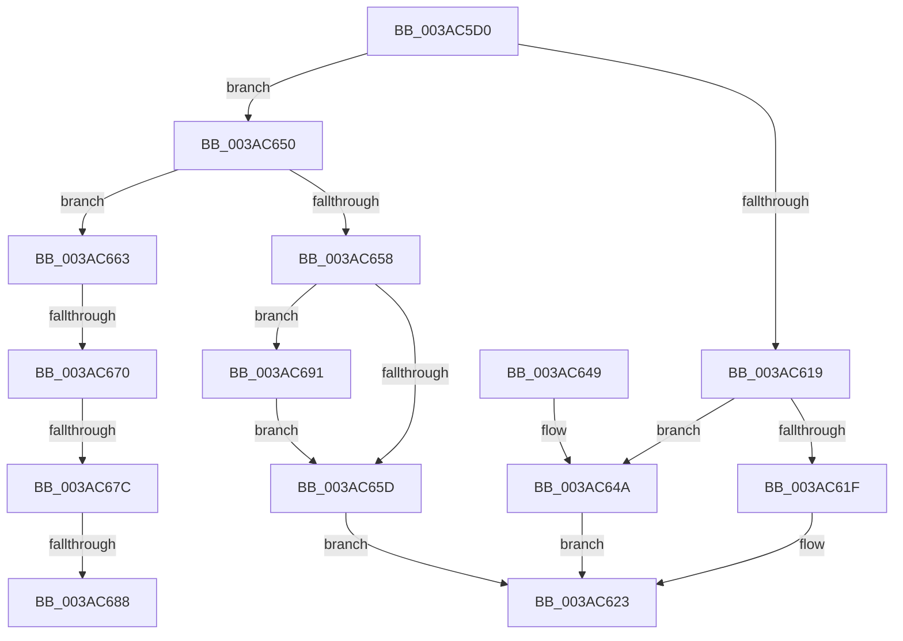

# B_TREE&lt;_SM_PAGE_KEY,ST_STORE&lt;SM_TRAITS&gt;::_ST_PAGE_ENTRY,4096,NP_CONTEXT,B_TREE_KEY_COMPARATOR&lt;_SM_PAGE_KEY&gt; &gt;::BTreeSearchResultDeref

- RVA: `0x003AC5D0`–`0x003AC6BF` (길이 `239` bytes)
- VA: `0x00000001403AC5D0`
- 실행 섹션: `.text`
- PDB 이름 있음: `예`; PDB Function 태그: `예`
- unwind 정보 RVA: `0x0008BB28`
- 디코드: `70`개 명령, `239/239` bytes 표시
- 미해석 바이트: `0` (있으면 어셈블리에 `.byte`로 보존)

> 이 문서는 커널 이미지의 기계어와 PDB 기호를 분석해 생성했습니다. 4번과 5번은 함수 원형과 자료형을 바이너리 사용 방식에서 추정한 C 해석이며 원본 소스 복구 결과는 아닙니다.

## 1. Dependencies

- 직접 호출 지점: **2**; 고유 호출 대상: **2**
- 직접 호출자로 확인된 함수: **13**
- RIP 상대 이미지 참조: **1**

### Outgoing calls
- `0x003AC62A` → [_security_check_cookie](../6A/_security_check_cookie_function_006AC640.md) (function, `0x006AC640`)
- `0x003AC6B8` → [NP_CONTEXT::NpLeafDerefInternal](NP_CONTEXT_NpLeafDerefInternal_function_003A9A70.md) (function, `0x003A9A70`)

### Direct callers
- [ST_STORE&lt;SM_TRAITS&gt;::StDmPageRemove](../20/ST_STORE_SM_TRAITS_StDmPageRemove_function_002049A0.md) at `0x00204A14`
- [ST_STORE&lt;SM_TRAITS&gt;::StDmPageRemove](../20/ST_STORE_SM_TRAITS_StDmPageRemove_function_002049A0.md) at `0x00204BB7`
- [ST_STORE&lt;SM_TRAITS&gt;::StDmPageRemove](../20/ST_STORE_SM_TRAITS_StDmPageRemove_function_002049A0.md) at `0x00204F6F`
- [SMKM_STORE&lt;SM_TRAITS&gt;::SmStDirectReadCallout](../2F/SMKM_STORE_SM_TRAITS_SmStDirectReadCallout_function_002FA3E0.md) at `0x002FA41F`
- [ST_STORE&lt;SM_TRAITS&gt;::StReleaseReadContext](ST_STORE_SM_TRAITS_StReleaseReadContext_function_003ABF84.md) at `0x003ABF9F`
- [ST_STORE&lt;SM_TRAITS&gt;::StDmpSinglePageLookup](ST_STORE_SM_TRAITS_StDmpSinglePageLookup_function_003ABFF0.md) at `0x003AC0C1`
- [ST_STORE&lt;SM_TRAITS&gt;::StDmpSinglePageLookup](ST_STORE_SM_TRAITS_StDmpSinglePageLookup_function_003ABFF0.md) at `0x003AC0D3`
- [B_TREE&lt;_SM_PAGE_KEY,ST_STORE&lt;SM_TRAITS&gt;::_ST_PAGE_ENTRY,4096,NP_CONTEXT,B_TREE_KEY_COMPARATOR&lt;_SM_PAGE_KEY&gt; &gt;::BTreeSearchKey](B_TREE__SM_PAGE_KEY_ST_STORE_SM_TRAITS__ST_PAGE_ENTRY_4096_NP_CONTEXT_B_TREE_KEY_COMPARATOR__SM_PAGE_function_003AC3C0.md) at `0x003AC3E5`
- [B_TREE&lt;_SM_PAGE_KEY,ST_STORE&lt;SM_TRAITS&gt;::_ST_PAGE_ENTRY,4096,NP_CONTEXT,B_TREE_KEY_COMPARATOR&lt;_SM_PAGE_KEY&gt; &gt;::BTreeSearchResultCleanup](B_TREE__SM_PAGE_KEY_ST_STORE_SM_TRAITS__ST_PAGE_ENTRY_4096_NP_CONTEXT_B_TREE_KEY_COMPARATOR__SM_PAGE_function_003AFC70.md) at `0x003AFC80`
- [sub_00410D15](../41/Unknown_function_00410D15.md) at `0x00410D2D`
- [ST_STORE&lt;SM_TRAITS&gt;::StDmpSinglePageInsert](../4E/ST_STORE_SM_TRAITS_StDmpSinglePageInsert_function_004EBDF0.md) at `0x004EBE14`
- [ST_STORE&lt;SM_TRAITS&gt;::StDmGetStatsBitmap](../60/ST_STORE_SM_TRAITS_StDmGetStatsBitmap_function_0060D838.md) at `0x0060D879`
- [ST_STORE&lt;SM_TRAITS&gt;::StNpLeafPageOut](../60/ST_STORE_SM_TRAITS_StNpLeafPageOut_function_0060E6C0.md) at `0x0060E6F4`
- [sub_006E6D3C](../6E/Unknown_function_006E6D3C.md) at `0x006E6DA9`
- [sub_006ED0C0](../6E/Unknown_function_006ED0C0.md) at `0x006ED12D`
- [sub_006EEC06](../6E/Unknown_function_006EEC06.md) at `0x006EEC82`

### Static image references
- `0x003AC5EF` → RVA `0x00E0A740` (`.data`; read)

## 2. Other-region calls and transfers

- 다른 실행 섹션으로 향하는 call: **0**
- call이 아닌 외부 분기/꼬리 이동: **4**
  - `0x003AC66A` → [sub_006E6D3C + 0x95](../6E/Unknown_function_006E6D3C.md) (`tail-transfer`)
  - `0x003AC676` → [sub_006E6D3C + 0x95](../6E/Unknown_function_006E6D3C.md) (`tail-transfer`)
  - `0x003AC682` → [sub_006E6D3C](../6E/Unknown_function_006E6D3C.md) (`tail-transfer`)
  - `0x003AC68C` → [sub_006E6D3C](../6E/Unknown_function_006E6D3C.md) (`tail-transfer`)

## 3. Assembly (complete function range)

```asm
003AC5D0  40 55                           push rbp
003AC5D2  41 56                           push r14
003AC5D4  41 57                           push r15
003AC5D6  48 83 EC 50                     sub rsp, 0x50
003AC5DA  48 8D 6C 24 20                  lea rbp, [rsp + 0x20]
003AC5DF  48 89 5D 50                     mov qword ptr [rbp + 0x50], rbx
003AC5E3  48 89 75 58                     mov qword ptr [rbp + 0x58], rsi
003AC5E7  48 89 7D 60                     mov qword ptr [rbp + 0x60], rdi
003AC5EB  4C 89 65 68                     mov qword ptr [rbp + 0x68], r12
003AC5EF  48 8B 05 4A E1 A5 00            mov rax, qword ptr [rip + 0xa5e14a]
003AC5F6  48 33 C5                        xor rax, rbp
003AC5F9  48 89 45 28                     mov qword ptr [rbp + 0x28], rax
003AC5FD  45 33 E4                        xor r12d, r12d
003AC600  48 8D 59 10                     lea rbx, [rcx + 0x10]
003AC604  48 85 C9                        test rcx, rcx
003AC607  4C 8B F2                        mov r14, rdx
003AC60A  4C 8B F9                        mov r15, rcx
003AC60D  49 0F 44 DC                     cmove rbx, r12
003AC611  48 8B 03                        mov rax, qword ptr [rbx]
003AC614  83 38 FF                        cmp dword ptr [rax], -1
003AC617  75 37                           jne 0x1403ac650
003AC619  83 7A 18 FF                     cmp dword ptr [rdx + 0x18], -1
003AC61D  74 2B                           je 0x1403ac64a
003AC61F  44 89 62 18                     mov dword ptr [rdx + 0x18], r12d
003AC623  48 8B 4D 28                     mov rcx, qword ptr [rbp + 0x28]
003AC627  48 33 CD                        xor rcx, rbp
003AC62A  E8 11 00 30 00                  call 0x1406ac640
003AC62F  48 8B 5D 50                     mov rbx, qword ptr [rbp + 0x50]
003AC633  48 8B 75 58                     mov rsi, qword ptr [rbp + 0x58]
003AC637  48 8B 7D 60                     mov rdi, qword ptr [rbp + 0x60]
003AC63B  4C 8B 65 68                     mov r12, qword ptr [rbp + 0x68]
003AC63F  48 8D 65 30                     lea rsp, [rbp + 0x30]
003AC643  41 5F                           pop r15
003AC645  41 5E                           pop r14
003AC647  5D                              pop rbp
003AC648  C3                              ret
003AC649  CC                              int3
003AC64A  4C 89 62 08                     mov qword ptr [rdx + 8], r12
003AC64E  EB D3                           jmp 0x1403ac623
003AC650  8B 42 18                        mov eax, dword ptr [rdx + 0x18]
003AC653  83 F8 FF                        cmp eax, -1
003AC656  74 0B                           je 0x1403ac663
003AC658  83 F8 01                        cmp eax, 1
003AC65B  77 34                           ja 0x1403ac691
003AC65D  45 89 66 18                     mov dword ptr [r14 + 0x18], r12d
003AC661  EB C0                           jmp 0x1403ac623
003AC663  48 8B 52 08                     mov rdx, qword ptr [rdx + 8]
003AC667  48 85 D2                        test rdx, rdx
003AC66A  0F 84 61 A7 33 00               je 0x1406e6dd1
003AC670  48 8B 01                        mov rax, qword ptr [rcx]
003AC673  48 3B D0                        cmp rdx, rax
003AC676  0F 84 55 A7 33 00               je 0x1406e6dd1
003AC67C  41 8B F4                        mov esi, r12d
003AC67F  48 85 C0                        test rax, rax
003AC682  0F 84 B4 A6 33 00               je 0x1406e6d3c
003AC688  0F B6 70 02                     movzx esi, byte ptr [rax + 2]
003AC68C  E9 AB A6 33 00                  jmp 0x1406e6d3c
003AC691  83 C0 FE                        add eax, -2
003AC694  48 C1 E0 04                     shl rax, 4
003AC698  48 03 02                        add rax, qword ptr [rdx]
003AC69B  4C 8B 40 08                     mov r8, qword ptr [rax + 8]
003AC69F  48 8B 00                        mov rax, qword ptr [rax]
003AC6A2  49 8D 50 F8                     lea rdx, [r8 - 8]
003AC6A6  48 8D 48 10                     lea rcx, [rax + 0x10]
003AC6AA  48 83 C0 08                     add rax, 8
003AC6AE  4C 3B C1                        cmp r8, rcx
003AC6B1  48 8B CB                        mov rcx, rbx
003AC6B4  48 0F 46 D0                     cmovbe rdx, rax
003AC6B8  E8 B3 D3 FF FF                  call 0x1403a9a70
003AC6BD  EB 9E                           jmp 0x1403ac65d
```

## 4. C-style interpretation (structured pseudocode)

```c
__int64 __fastcall B_TREE__SM_PAGE_KEY_ST_STORE_SM_TRAITS____ST_PAGE_ENTRY_4096_NP_CONTEXT_B_TREE_KEY_COMPARATOR__SM_PA(__int64 a1, __int64 a2)
{
    __int64 result;
    __int64 v_r12;
    __int64 v_rbx;
    __int64 v_rsp;
    unsigned __int64 v_stack_m18;
    unsigned __int64 v_stack_m20;
    unsigned __int64 v_stack_m48;
    unsigned __int64 v_stack_p10;
    unsigned __int64 v_stack_p18;
    unsigned __int64 v_stack_p20;
    unsigned __int64 v_stack_p8;

    v_rsp = (v_rsp) - (80);
    v_stack_p8 = v_rbx;
    v_stack_p10 = v_rsi;
    v_stack_p18 = v_rdi;
    v_stack_p20 = v_r12;
    result = (*(unsigned __int64 *)(v_rip + 10871114)) ^ (v_stack_m48);
    v_stack_m20 = result;
    v_r12 = 0;
    v_rbx = a1 + 16;
    if (a1 == 0) { v_rbx = 0; }
    if ((*(unsigned int *)(*(unsigned __int64 *)(v_rbx))) != -1) goto loc_003AC650;
    if ((*(unsigned int *)(a2 + 24)) == -1) goto loc_003AC64A;
    *(unsigned int *)(a2 + 24) = 0;
loc_003AC623:
    a1 = (v_stack_m20) ^ (v_stack_m48);
    result = _security_check_cookie(a1, a2, a3, a4);
    return result;
loc_003AC64A:
    *(unsigned __int64 *)(a2 + 8) = v_stack_p20;
    goto loc_003AC623;
loc_003AC650:
    if (((unsigned int)((unsigned int)(*(unsigned int *)(a2 + 24)))) == -1) goto loc_003AC663;
    if (((unsigned int)((unsigned int)(*(unsigned int *)(a2 + 24)))) > 1) goto loc_003AC691;
loc_003AC65D:
    *(unsigned int *)(a2 + 24) = (unsigned int)(v_stack_p20);
    goto loc_003AC623;
loc_003AC663:
loc_003AC691:
    result = (unsigned int)((*(unsigned __int64 *)(a1)) + (-2));
    result = (result) << (4);
    result = (result) + (*(unsigned __int64 *)(*(unsigned __int64 *)(a2 + 8)));
    result = (*(unsigned __int64 *)(result)) + (8);
    a2 = *(unsigned __int64 *)(result + 8) - 8;
    if ((*(unsigned __int64 *)(result + 8)) <= (*(unsigned __int64 *)(result) + 16)) { a2 = result; }
    result = NP_CONTEXT__NpLeafDerefInternal(v_stack_p8, a2, *(unsigned __int64 *)(result + 8), a4);
    goto loc_003AC65D;
}
```

## 5. (Beta) C Style

```c
int64_t B_TREE__SM_PAGE_KEY_ST_STORE_SM_TRAITS____ST_PAGE_ENTRY_4096_NP_CONTEXT_B_TREE_KEY_COMPARATOR__SM_PA(void *Arg1, void *Arg2)
{
    uint8_t *arg1 = (uint8_t *)Arg1;
    uint8_t *arg2 = (uint8_t *)Arg2;

    int64_t result;
    int64_t local_r12;
    int64_t local_rbx;
    int64_t local_rsp;
    uint64_t v_stack_m18;
    uint64_t v_stack_m20;
    uint64_t v_stack_m48;
    uint64_t v_stack_p10;
    uint64_t v_stack_p18;
    uint64_t v_stack_p20;
    uint64_t v_stack_p8;

    local_rsp = (local_rsp) - (80);
    v_stack_p8 = local_rbx;
    v_stack_p10 = local_rsi;
    v_stack_p18 = local_rdi;
    v_stack_p20 = local_r12;
    result = (*(uint64_t *)(v_rip + 0xA5E14A)) ^ (v_stack_m48);
    v_stack_m20 = result;
    local_r12 = 0;
    local_rbx = Arg1 + 16;
    if (Arg1 == NULL) { local_rbx = 0; }
    if ((*(uint32_t *)(*(uint64_t *)(local_rbx))) != -1) goto loc_003AC650;
    if ((*(uint32_t *)(arg2 + 0x18)) == -1) goto loc_003AC64A;
    *(uint32_t *)(arg2 + 0x18) = 0;
loc_003AC623:
    Arg1 = (v_stack_m20) ^ (v_stack_m48);
    result = _security_check_cookie(Arg1, Arg2, a3, a4);
    return result;
loc_003AC64A:
    *(uint64_t *)(arg2 + 0x8) = v_stack_p20;
    goto loc_003AC623;
loc_003AC650:
    if (((uint32_t)((uint32_t)(*(uint32_t *)(arg2 + 0x18)))) == -1) goto loc_003AC663;
    if (((uint32_t)((uint32_t)(*(uint32_t *)(arg2 + 0x18)))) > 1) goto loc_003AC691;
loc_003AC65D:
    *(uint32_t *)(arg2 + 0x18) = (uint32_t)(v_stack_p20);
    goto loc_003AC623;
loc_003AC663:
loc_003AC691:
    result = (uint32_t)((*(uint64_t *)(arg1)) + (-2));
    result = (result) << (4);
    result = (result) + (*(uint64_t *)(*(uint64_t *)(arg2 + 0x8)));
    result = (*(uint64_t *)(result)) + (8);
    Arg2 = *(uint64_t *)(result + 0x8) - 8;
    if ((*(uint64_t *)(result + 0x8)) <= (*(uint64_t *)(result) + 16)) { Arg2 = result; }
    result = NP_CONTEXT__NpLeafDerefInternal(v_stack_p8, Arg2, *(uint64_t *)(result + 0x8), a4);
    goto loc_003AC65D;
}
```

### 관측된 메모리 오프셋

구조체 형식이 확인되지 않은 접근은 인자 기준의 오프셋으로만 기록했습니다.

| 기준 인자 | 오프셋 표현 | 폭 (bit) | 접근 |
|---|---:|---:|---|
| `Arg1` | `+ 0x10` | `64` | `R` |
| `Arg2` | `+ 0x0` | `64` | `R` |
| `Arg2` | `+ 0x8` | `64` | `R` |
| `Arg2` | `+ 0x8` | `64` | `W` |
| `Arg2` | `+ 0x18` | `32` | `R` |
| `Arg2` | `+ 0x18` | `32` | `W` |

## 6. Execution-region graph

[열기: 2D/3D 그래프와 함수 탐색 컨트롤 패널](../../../control-panel.html?section=text&rva=0x003AC5D0&view=graph)

- 2D 그래프는 위에서 아래로 흐르고, 3D 그래프는 빈 공간을 드래그해 회전합니다. Shift+드래그는 이동, 휠은 확대·축소, 함수 노드 선택은 대상 보고서 이동입니다.

### Static fallback


