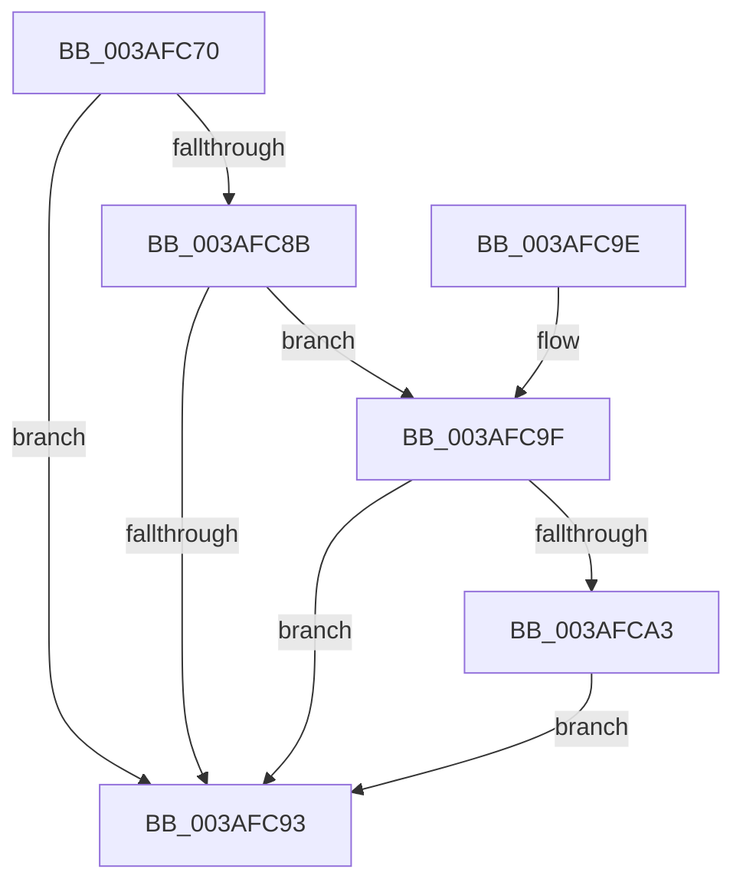

# B_TREE&lt;_SM_PAGE_KEY,ST_STORE&lt;SM_TRAITS&gt;::_ST_PAGE_ENTRY,4096,NP_CONTEXT,B_TREE_KEY_COMPARATOR&lt;_SM_PAGE_KEY&gt; &gt;::BTreeSearchResultCleanup

- RVA: `0x003AFC70`–`0x003AFCAC` (길이 `60` bytes)
- VA: `0x00000001403AFC70`
- 실행 섹션: `.text`
- PDB 이름 있음: `예`; PDB Function 태그: `아니요`
- unwind 정보 RVA: `0x00076818`
- 디코드: `21`개 명령, `60/60` bytes 표시
- 미해석 바이트: `0` (있으면 어셈블리에 `.byte`로 보존)

> 이 문서는 커널 이미지의 기계어와 PDB 기호를 분석해 생성했습니다. 4번과 5번은 함수 원형과 자료형을 바이너리 사용 방식에서 추정한 C 해석이며 원본 소스 복구 결과는 아닙니다.

## 1. Dependencies

- 직접 호출 지점: **2**; 고유 호출 대상: **2**
- 직접 호출자로 확인된 함수: **2**
- RIP 상대 이미지 참조: **0**

### Outgoing calls
- `0x003AFC80` → [B_TREE<_SM_PAGE_KEY,ST_STORE<SM_TRAITS>::_ST_PAGE_ENTRY,4096,NP_CONTEXT,B_TREE_KEY_COMPARATOR<_SM_PAGE_KEY> >::BTreeSearchResultDeref](B_TREE__SM_PAGE_KEY_ST_STORE_SM_TRAITS__ST_PAGE_ENTRY_4096_NP_CONTEXT_B_TREE_KEY_COMPARATOR__SM_PAGE_function_003AC5D0.md) (function, `0x003AC5D0`)
- `0x003AFCA5` → [ExFreePoolWithTag](../../poolcode/B8/ExFreePoolWithTag_function_00B82870.md) (function, `0x00B82870`)

### Direct callers
- [ST_STORE&lt;SM_TRAITS&gt;::StDmCleanup](ST_STORE_SM_TRAITS_StDmCleanup_function_003AF8D4.md) at `0x003AF93D`
- [ST_STORE&lt;SM_TRAITS&gt;::StDmHandleDecompressionFailure](../60/ST_STORE_SM_TRAITS_StDmHandleDecompressionFailure_function_0060DA74.md) at `0x0060DB6D`

### Static image references
- 디코드된 RIP-relative 메모리 참조가 없습니다.

## 2. Other-region calls and transfers

- 다른 실행 섹션으로 향하는 call: **1**
  - `0x003AFCA5` → [ExFreePoolWithTag](../../poolcode/B8/ExFreePoolWithTag_function_00B82870.md) (`.text` → `POOLCODE`)
- 별도 외부 분기/꼬리 이동을 확인하지 못했습니다.

## 3. Assembly (complete function range)

```asm
003AFC70  48 89 5C 24 08                  mov qword ptr [rsp + 8], rbx
003AFC75  57                              push rdi
003AFC76  48 83 EC 20                     sub rsp, 0x20
003AFC7A  41 8B F8                        mov edi, r8d
003AFC7D  48 8B DA                        mov rbx, rdx
003AFC80  E8 4B C9 FF FF                  call 0x1403ac5d0
003AFC85  83 7B 18 FF                     cmp dword ptr [rbx + 0x18], -1
003AFC89  74 08                           je 0x1403afc93
003AFC8B  48 8B 0B                        mov rcx, qword ptr [rbx]
003AFC8E  48 85 C9                        test rcx, rcx
003AFC91  75 0C                           jne 0x1403afc9f
003AFC93  48 8B 5C 24 30                  mov rbx, qword ptr [rsp + 0x30]
003AFC98  48 83 C4 20                     add rsp, 0x20
003AFC9C  5F                              pop rdi
003AFC9D  C3                              ret
003AFC9E  CC                              int3
003AFC9F  85 FF                           test edi, edi
003AFCA1  75 F0                           jne 0x1403afc93
003AFCA3  33 D2                           xor edx, edx
003AFCA5  E8 C6 2B 7D 00                  call 0x140b82870
003AFCAA  EB E7                           jmp 0x1403afc93
```

## 4. C-style interpretation (structured pseudocode)

```c
__int64 __fastcall B_TREE__SM_PAGE_KEY_ST_STORE_SM_TRAITS____ST_PAGE_ENTRY_4096_NP_CONTEXT_B_TREE_KEY_COMPARATOR__SM_PA(__int64 a1, __int64 a2, int a3)
{
    __int64 result;
    __int64 v_rsp;
    unsigned __int64 v_stack_p8;

    v_stack_p8 = v_rbx;
    v_rsp = (v_rsp) - (32);
    result = B_TREE__SM_PAGE_KEY_ST_STORE_SM_TRAITS____ST_PAGE_ENTRY_4096_NP_CONTEXT_B_TREE_KEY_COMPARATOR__SM_PA(a1, a2, a3, a4);
    if ((*(unsigned int *)(a2 + 24)) == -1) goto loc_003AFC93;
    if (*(unsigned __int64 *)(a2) != 0) goto loc_003AFC9F;
loc_003AFC93:
    v_rsp = (v_rsp) + (32);
    return result;
loc_003AFC9F:
    if ((unsigned int)((unsigned int)(a3)) != 0) goto loc_003AFC93;
    a2 = 0;
    result = ExFreePoolWithTag(*(unsigned __int64 *)(a2), a2, a3, a4);
    goto loc_003AFC93;
}
```

## 5. (Beta) C Style

```c
int64_t B_TREE__SM_PAGE_KEY_ST_STORE_SM_TRAITS____ST_PAGE_ENTRY_4096_NP_CONTEXT_B_TREE_KEY_COMPARATOR__SM_PA(int64_t Arg1, void *Arg2, int32_t Arg3)
{
    uint8_t *arg2 = (uint8_t *)Arg2;

    int64_t result;
    int64_t local_rsp;
    uint64_t v_stack_p8;

    v_stack_p8 = local_rbx;
    local_rsp = (local_rsp) - (32);
    result = B_TREE__SM_PAGE_KEY_ST_STORE_SM_TRAITS____ST_PAGE_ENTRY_4096_NP_CONTEXT_B_TREE_KEY_COMPARATOR__SM_PA(Arg1, Arg2, Arg3, a4);
    if ((*(uint32_t *)(arg2 + 0x18)) == -1) goto loc_003AFC93;
    if (*(uint64_t *)(arg2) != 0) goto loc_003AFC9F;
loc_003AFC93:
    local_rsp = (local_rsp) + (32);
    return result;
loc_003AFC9F:
    if ((uint32_t)((uint32_t)(Arg3)) != 0) goto loc_003AFC93;
    Arg2 = 0;
    result = ExFreePoolWithTag(*(uint64_t *)(arg2), Arg2, Arg3, a4);
    goto loc_003AFC93;
}
```

### 관측된 메모리 오프셋

구조체 형식이 확인되지 않은 접근은 인자 기준의 오프셋으로만 기록했습니다.

| 기준 인자 | 오프셋 표현 | 폭 (bit) | 접근 |
|---|---:|---:|---|
| `Arg2` | `+ 0x0` | `64` | `R` |
| `Arg2` | `+ 0x18` | `32` | `R` |

## 6. Execution-region graph

[열기: 2D/3D 그래프와 함수 탐색 컨트롤 패널](../../../control-panel.html?section=text&rva=0x003AFC70&view=graph)

- 2D 그래프는 위에서 아래로 흐르고, 3D 그래프는 빈 공간을 드래그해 회전합니다. Shift+드래그는 이동, 휠은 확대·축소, 함수 노드 선택은 대상 보고서 이동입니다.

### Static fallback


