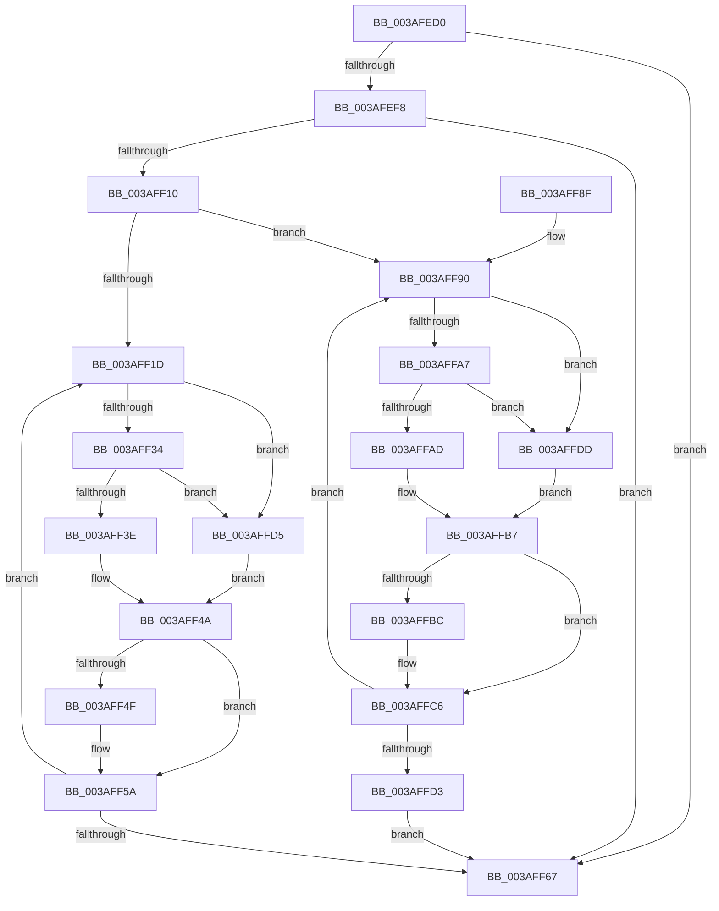

# B_TREE&lt;_SM_PAGE_KEY,ST_STORE&lt;SM_TRAITS&gt;::_ST_PAGE_ENTRY,4096,NP_CONTEXT,B_TREE_KEY_COMPARATOR&lt;_SM_PAGE_KEY&gt; &gt;::BTreeNodeFree

- RVA: `0x003AFED0`–`0x003AFFE2` (길이 `274` bytes)
- VA: `0x00000001403AFED0`
- 실행 섹션: `.text`
- PDB 이름 있음: `예`; PDB Function 태그: `아니요`
- unwind 정보 RVA: `0x0008C1B8`
- 디코드: `84`개 명령, `274/274` bytes 표시
- 미해석 바이트: `0` (있으면 어셈블리에 `.byte`로 보존)

> 이 문서는 커널 이미지의 기계어와 PDB 기호를 분석해 생성했습니다. 4번과 5번은 함수 원형과 자료형을 바이너리 사용 방식에서 추정한 C 해석이며 원본 소스 복구 결과는 아닙니다.

## 1. Dependencies

- 직접 호출 지점: **5**; 고유 호출 대상: **3**
- 직접 호출자로 확인된 함수: **2**
- RIP 상대 이미지 참조: **0**

### Outgoing calls
- `0x003AFF45` → [NP_CONTEXT::NpLeafRemoveInternal](../60/NP_CONTEXT_NpLeafRemoveInternal_function_0060BF04.md) (function, `0x0060BF04`)
- `0x003AFF55` → [B_TREE<_SM_PAGE_KEY,ST_STORE<SM_TRAITS>::_ST_PAGE_ENTRY,4096,NP_CONTEXT,B_TREE_KEY_COMPARATOR<_SM_PAGE_KEY> >::BTreeNodeFree](B_TREE__SM_PAGE_KEY_ST_STORE_SM_TRAITS__ST_PAGE_ENTRY_4096_NP_CONTEXT_B_TREE_KEY_COMPARATOR__SM_PAGE_function_003AFED0.md) (function, `0x003AFED0`)
- `0x003AFF6D` → [B_TREE<_SM_PAGE_KEY,ST_STORE<SM_TRAITS>::_ST_PAGE_ENTRY,4096,NP_CONTEXT,B_TREE_KEY_COMPARATOR<_SM_PAGE_KEY> >::BTreeDeleteNode](B_TREE__SM_PAGE_KEY_ST_STORE_SM_TRAITS__ST_PAGE_ENTRY_4096_NP_CONTEXT_B_TREE_KEY_COMPARATOR__SM_PAGE_function_003AA598.md) (function, `0x003AA598`)
- `0x003AFFB2` → [NP_CONTEXT::NpLeafRemoveInternal](../60/NP_CONTEXT_NpLeafRemoveInternal_function_0060BF04.md) (function, `0x0060BF04`)
- `0x003AFFC1` → [B_TREE<_SM_PAGE_KEY,ST_STORE<SM_TRAITS>::_ST_PAGE_ENTRY,4096,NP_CONTEXT,B_TREE_KEY_COMPARATOR<_SM_PAGE_KEY> >::BTreeNodeFree](B_TREE__SM_PAGE_KEY_ST_STORE_SM_TRAITS__ST_PAGE_ENTRY_4096_NP_CONTEXT_B_TREE_KEY_COMPARATOR__SM_PAGE_function_003AFED0.md) (function, `0x003AFED0`)

### Direct callers
- [ST_STORE&lt;SM_TRAITS&gt;::StDmCleanup](ST_STORE_SM_TRAITS_StDmCleanup_function_003AF8D4.md) at `0x003AF94D`
- [ST_STORE&lt;SM_TRAITS&gt;::StDmCleanup](ST_STORE_SM_TRAITS_StDmCleanup_function_003AF8D4.md) at `0x003AF970`
- [B_TREE&lt;_SM_PAGE_KEY,ST_STORE&lt;SM_TRAITS&gt;::_ST_PAGE_ENTRY,4096,NP_CONTEXT,B_TREE_KEY_COMPARATOR&lt;_SM_PAGE_KEY&gt; &gt;::BTreeNodeFree](B_TREE__SM_PAGE_KEY_ST_STORE_SM_TRAITS__ST_PAGE_ENTRY_4096_NP_CONTEXT_B_TREE_KEY_COMPARATOR__SM_PAGE_function_003AFED0.md) at `0x003AFF55`
- [B_TREE&lt;_SM_PAGE_KEY,ST_STORE&lt;SM_TRAITS&gt;::_ST_PAGE_ENTRY,4096,NP_CONTEXT,B_TREE_KEY_COMPARATOR&lt;_SM_PAGE_KEY&gt; &gt;::BTreeNodeFree](B_TREE__SM_PAGE_KEY_ST_STORE_SM_TRAITS__ST_PAGE_ENTRY_4096_NP_CONTEXT_B_TREE_KEY_COMPARATOR__SM_PAGE_function_003AFED0.md) at `0x003AFFC1`

### Static image references
- 디코드된 RIP-relative 메모리 참조가 없습니다.

## 2. Other-region calls and transfers

- 다른 실행 섹션으로 향하는 call: **0**
- 별도 외부 분기/꼬리 이동을 확인하지 못했습니다.

## 3. Assembly (complete function range)

```asm
003AFED0  48 89 5C 24 08                  mov qword ptr [rsp + 8], rbx
003AFED5  48 89 6C 24 10                  mov qword ptr [rsp + 0x10], rbp
003AFEDA  48 89 74 24 18                  mov qword ptr [rsp + 0x18], rsi
003AFEDF  57                              push rdi
003AFEE0  41 54                           push r12
003AFEE2  41 55                           push r13
003AFEE4  41 56                           push r14
003AFEE6  41 57                           push r15
003AFEE8  48 83 EC 20                     sub rsp, 0x20
003AFEEC  80 7A 03 00                     cmp byte ptr [rdx + 3], 0
003AFEF0  48 8B DA                        mov rbx, rdx
003AFEF3  48 8B E9                        mov rbp, rcx
003AFEF6  75 6F                           jne 0x1403aff67
003AFEF8  8B 02                           mov eax, dword ptr [rdx]
003AFEFA  4C 8D 7A 10                     lea r15, [rdx + 0x10]
003AFEFE  0F B7 F8                        movzx edi, ax
003AFF01  49 8B F7                        mov rsi, r15
003AFF04  48 C1 E7 04                     shl rdi, 4
003AFF08  49 03 FF                        add rdi, r15
003AFF0B  4C 3B FF                        cmp r15, rdi
003AFF0E  77 57                           ja 0x1403aff67
003AFF10  4C 8D 6A 08                     lea r13, [rdx + 8]
003AFF14  4D 8D 77 F8                     lea r14, [r15 - 8]
003AFF18  48 85 C9                        test rcx, rcx
003AFF1B  74 73                           je 0x1403aff90
003AFF1D  48 8B 45 10                     mov rax, qword ptr [rbp + 0x10]
003AFF21  49 3B F7                        cmp rsi, r15
003AFF24  49 8B CE                        mov rcx, r14
003AFF27  49 0F 46 CD                     cmovbe rcx, r13
003AFF2B  83 38 FF                        cmp dword ptr [rax], -1
003AFF2E  0F 84 A1 00 00 00               je 0x1403affd5
003AFF34  80 7B 02 02                     cmp byte ptr [rbx + 2], 2
003AFF38  0F 85 97 00 00 00               jne 0x1403affd5
003AFF3E  48 8B D1                        mov rdx, rcx
003AFF41  48 8D 4D 10                     lea rcx, [rbp + 0x10]
003AFF45  E8 BA BF 25 00                  call 0x14060bf04
003AFF4A  48 85 C0                        test rax, rax
003AFF4D  74 0B                           je 0x1403aff5a
003AFF4F  48 8B D0                        mov rdx, rax
003AFF52  48 8B CD                        mov rcx, rbp
003AFF55  E8 76 FF FF FF                  call 0x1403afed0
003AFF5A  48 83 C6 10                     add rsi, 0x10
003AFF5E  49 83 C6 10                     add r14, 0x10
003AFF62  48 3B F7                        cmp rsi, rdi
003AFF65  76 B6                           jbe 0x1403aff1d
003AFF67  48 8B D3                        mov rdx, rbx
003AFF6A  48 8B CD                        mov rcx, rbp
003AFF6D  E8 26 A6 FF FF                  call 0x1403aa598
003AFF72  48 8B 5C 24 50                  mov rbx, qword ptr [rsp + 0x50]
003AFF77  48 8B 6C 24 58                  mov rbp, qword ptr [rsp + 0x58]
003AFF7C  48 8B 74 24 60                  mov rsi, qword ptr [rsp + 0x60]
003AFF81  48 83 C4 20                     add rsp, 0x20
003AFF85  41 5F                           pop r15
003AFF87  41 5E                           pop r14
003AFF89  41 5D                           pop r13
003AFF8B  41 5C                           pop r12
003AFF8D  5F                              pop rdi
003AFF8E  C3                              ret
003AFF8F  CC                              int3
003AFF90  48 8B 04 25 00 00 00 00         mov rax, qword ptr [0]
003AFF98  49 3B F7                        cmp rsi, r15
003AFF9B  49 8B CE                        mov rcx, r14
003AFF9E  49 0F 46 CD                     cmovbe rcx, r13
003AFFA2  83 38 FF                        cmp dword ptr [rax], -1
003AFFA5  74 36                           je 0x1403affdd
003AFFA7  80 7B 02 02                     cmp byte ptr [rbx + 2], 2
003AFFAB  75 30                           jne 0x1403affdd
003AFFAD  48 8B D1                        mov rdx, rcx
003AFFB0  33 C9                           xor ecx, ecx
003AFFB2  E8 4D BF 25 00                  call 0x14060bf04
003AFFB7  48 85 C0                        test rax, rax
003AFFBA  74 0A                           je 0x1403affc6
003AFFBC  48 8B D0                        mov rdx, rax
003AFFBF  33 C9                           xor ecx, ecx
003AFFC1  E8 0A FF FF FF                  call 0x1403afed0
003AFFC6  48 83 C6 10                     add rsi, 0x10
003AFFCA  49 83 C6 10                     add r14, 0x10
003AFFCE  48 3B F7                        cmp rsi, rdi
003AFFD1  76 BD                           jbe 0x1403aff90
003AFFD3  EB 92                           jmp 0x1403aff67
003AFFD5  48 8B 01                        mov rax, qword ptr [rcx]
003AFFD8  E9 6D FF FF FF                  jmp 0x1403aff4a
003AFFDD  48 8B 01                        mov rax, qword ptr [rcx]
003AFFE0  EB D5                           jmp 0x1403affb7
```

## 4. C-style interpretation (structured pseudocode)

```c
__int64 __fastcall B_TREE__SM_PAGE_KEY_ST_STORE_SM_TRAITS____ST_PAGE_ENTRY_4096_NP_CONTEXT_B_TREE_KEY_COMPARATOR__SM_PA(__int64 a1, __int64 a2)
{
    __int64 result;
    __int64 v_r14;
    __int64 v_rdi;
    __int64 v_rsi;
    __int64 v_rsp;
    unsigned __int64 v_stack_p10;
    unsigned __int64 v_stack_p18;
    unsigned __int64 v_stack_p8;

    v_stack_p8 = v_rbx;
    v_stack_p10 = v_rbp;
    v_stack_p18 = v_rsi;
    v_rsp = (v_rsp) - (32);
    if ((*(unsigned __int8 *)(a2 + 3)) != 0) goto loc_003AFF67;
    v_rdi = ((unsigned __int16)((unsigned int)(*(unsigned int *)(a2)))) << (4);
    v_rdi = (v_rdi) + (a2 + 16);
    if ((a2 + 16) > v_rdi) goto loc_003AFF67;
    if (a1 == 0) goto loc_003AFF90;
loc_003AFF1D:
    a1 = a2 + 16 - 8;
    if ((a2 + 16) <= (a2 + 16)) { a1 = a2 + 8; }
    if ((*(unsigned int *)(*(unsigned __int64 *)(a1 + 16))) == -1) goto loc_003AFFD5;
    if ((*(unsigned __int8 *)(a2 + 2)) != 2) goto loc_003AFFD5;
    result = NP_CONTEXT__NpLeafRemoveInternal(a1 + 16, a1, a3, a4);
loc_003AFF4A:
    if (result != 0) {
        a2 = result;
        a1 = a1;
        result = B_TREE__SM_PAGE_KEY_ST_STORE_SM_TRAITS____ST_PAGE_ENTRY_4096_NP_CONTEXT_B_TREE_KEY_COMPARATOR__SM_PA(a1, a2, a3, a4);
    }
    v_rsi = (a2 + 16) + (16);
    v_r14 = (a2 + 16 - 8) + (16);
    if (v_rsi <= v_rdi) goto loc_003AFF1D;
loc_003AFF67:
    result = B_TREE__SM_PAGE_KEY_ST_STORE_SM_TRAITS____ST_PAGE_ENTRY_4096_NP_CONTEXT_B_TREE_KEY_COMPARATOR__SM_PA(a1, a2, a3, a4);
    v_rsp = (v_rsp) + (32);
    return result;
loc_003AFF90:
    a1 = v_r14;
    if (v_stack_p18 <= (a2 + 16)) { a1 = a2 + 8; }
    if ((*(unsigned int *)(*(unsigned __int64 *)(0))) == -1) goto loc_003AFFDD;
    if ((*(unsigned __int8 *)(v_stack_p8 + 2)) != 2) goto loc_003AFFDD;
    a1 = 0;
    result = NP_CONTEXT__NpLeafRemoveInternal(a1, a1, a3, a4);
loc_003AFFB7:
    if (result != 0) {
        a2 = result;
        a1 = 0;
        result = B_TREE__SM_PAGE_KEY_ST_STORE_SM_TRAITS____ST_PAGE_ENTRY_4096_NP_CONTEXT_B_TREE_KEY_COMPARATOR__SM_PA(a1, a2, a3, a4);
    }
    v_rsi = (v_stack_p18) + (16);
    v_r14 = (v_r14) + (16);
    if (v_rsi <= v_rdi) goto loc_003AFF90;
    goto loc_003AFF67;
loc_003AFFD5:
    goto loc_003AFF4A;
loc_003AFFDD:
    goto loc_003AFFB7;
}
```

## 5. (Beta) C Style

```c
int64_t B_TREE__SM_PAGE_KEY_ST_STORE_SM_TRAITS____ST_PAGE_ENTRY_4096_NP_CONTEXT_B_TREE_KEY_COMPARATOR__SM_PA(void *Arg1, void *Arg2)
{
    uint8_t *arg1 = (uint8_t *)Arg1;
    uint8_t *arg2 = (uint8_t *)Arg2;

    int64_t result;
    int64_t local_r14;
    int64_t local_rdi;
    int64_t local_rsi;
    int64_t local_rsp;
    uint64_t v_stack_p10;
    uint64_t v_stack_p18;
    uint64_t v_stack_p8;

    v_stack_p8 = local_rbx;
    v_stack_p10 = local_rbp;
    v_stack_p18 = local_rsi;
    local_rsp = (local_rsp) - (32);
    if ((*(uint8_t *)(arg2 + 0x3)) != 0) goto loc_003AFF67;
    local_rdi = ((uint16_t)((uint32_t)(*(uint32_t *)(arg2)))) << (4);
    local_rdi = (local_rdi) + (Arg2 + 16);
    if ((Arg2 + 16) > local_rdi) goto loc_003AFF67;
    if (Arg1 == NULL) goto loc_003AFF90;
loc_003AFF1D:
    Arg1 = Arg2 + 16 - 8;
    if ((Arg2 + 16) <= (Arg2 + 16)) { Arg1 = Arg2 + 8; }
    if ((*(uint32_t *)(*(uint64_t *)(arg1 + 0x10))) == -1) goto loc_003AFFD5;
    if ((*(uint8_t *)(arg2 + 0x2)) != 2) goto loc_003AFFD5;
    result = NP_CONTEXT__NpLeafRemoveInternal(Arg1 + 16, Arg1, a3, a4);
loc_003AFF4A:
    if (result != 0) {
        Arg2 = result;
        Arg1 = Arg1;
        result = B_TREE__SM_PAGE_KEY_ST_STORE_SM_TRAITS____ST_PAGE_ENTRY_4096_NP_CONTEXT_B_TREE_KEY_COMPARATOR__SM_PA(Arg1, Arg2, a3, a4);
    }
    local_rsi = (Arg2 + 16) + (16);
    local_r14 = (Arg2 + 16 - 8) + (16);
    if (local_rsi <= local_rdi) goto loc_003AFF1D;
loc_003AFF67:
    result = B_TREE__SM_PAGE_KEY_ST_STORE_SM_TRAITS____ST_PAGE_ENTRY_4096_NP_CONTEXT_B_TREE_KEY_COMPARATOR__SM_PA(Arg1, Arg2, a3, a4);
    local_rsp = (local_rsp) + (32);
    return result;
loc_003AFF90:
    Arg1 = local_r14;
    if (v_stack_p18 <= (Arg2 + 16)) { Arg1 = Arg2 + 8; }
    if ((*(uint32_t *)(*(uint64_t *)(0))) == -1) goto loc_003AFFDD;
    if ((*(uint8_t *)(v_stack_p8 + 0x2)) != 2) goto loc_003AFFDD;
    Arg1 = 0;
    result = NP_CONTEXT__NpLeafRemoveInternal(Arg1, Arg1, a3, a4);
loc_003AFFB7:
    if (result != 0) {
        Arg2 = result;
        Arg1 = 0;
        result = B_TREE__SM_PAGE_KEY_ST_STORE_SM_TRAITS____ST_PAGE_ENTRY_4096_NP_CONTEXT_B_TREE_KEY_COMPARATOR__SM_PA(Arg1, Arg2, a3, a4);
    }
    local_rsi = (v_stack_p18) + (16);
    local_r14 = (local_r14) + (16);
    if (local_rsi <= local_rdi) goto loc_003AFF90;
    goto loc_003AFF67;
loc_003AFFD5:
    goto loc_003AFF4A;
loc_003AFFDD:
    goto loc_003AFFB7;
}
```

### 관측된 메모리 오프셋

구조체 형식이 확인되지 않은 접근은 인자 기준의 오프셋으로만 기록했습니다.

| 기준 인자 | 오프셋 표현 | 폭 (bit) | 접근 |
|---|---:|---:|---|
| `Arg1` | `+ 0x10` | `64` | `R` |
| `Arg2` | `+ 0x0` | `32` | `R` |
| `Arg2` | `+ 0x2` | `8` | `R` |
| `Arg2` | `+ 0x3` | `8` | `R` |
| `Arg2` | `+ 0x8` | `64` | `R` |
| `Arg2` | `+ 0x10` | `64` | `R` |

## 6. Execution-region graph

[열기: 2D/3D 그래프와 함수 탐색 컨트롤 패널](../../../control-panel.html?section=text&rva=0x003AFED0&view=graph)

- 2D 그래프는 위에서 아래로 흐르고, 3D 그래프는 빈 공간을 드래그해 회전합니다. Shift+드래그는 이동, 휠은 확대·축소, 함수 노드 선택은 대상 보고서 이동입니다.

### Static fallback


