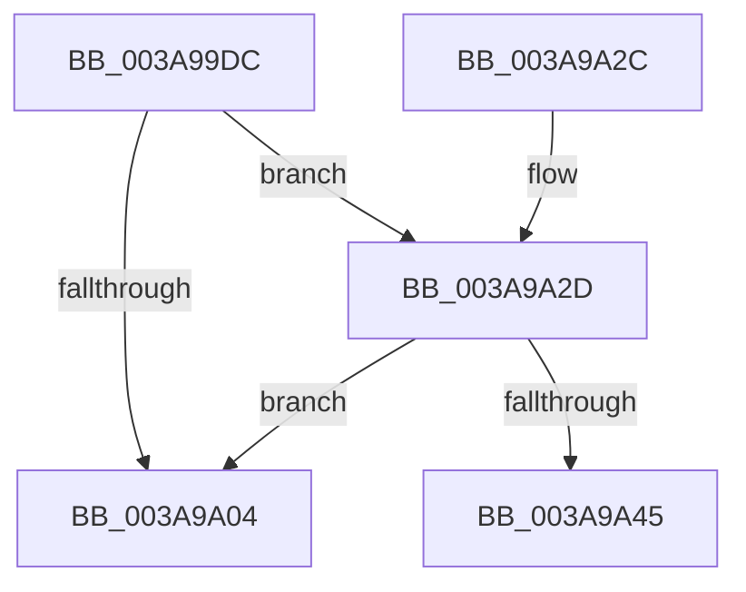

# B_TREE&lt;unsigned long,ST_STORE&lt;SM_TRAITS&gt;::_ST_HASH_ENTRY,4096,NP_CONTEXT,ST_STORE&lt;SM_TRAITS&gt;::ST_HASH_ENTRY_COMPARATOR&gt;::BTreeNodeFree

- RVA: `0x003A99DC`–`0x003A9A67` (길이 `139` bytes)
- VA: `0x00000001403A99DC`
- 실행 섹션: `.text`
- PDB 이름 있음: `예`; PDB Function 태그: `예`
- unwind 정보 RVA: `0x0008B6A4`
- 디코드: `44`개 명령, `139/139` bytes 표시
- 미해석 바이트: `0` (있으면 어셈블리에 `.byte`로 보존)

> 이 문서는 커널 이미지의 기계어와 PDB 기호를 분석해 생성했습니다. 4번과 5번은 함수 원형과 자료형을 바이너리 사용 방식에서 추정한 C 해석이며 원본 소스 복구 결과는 아닙니다.

## 1. Dependencies

- 직접 호출 지점: **1**; 고유 호출 대상: **1**
- 직접 호출자로 확인된 함수: **2**
- RIP 상대 이미지 참조: **0**

### Outgoing calls
- `0x003A9A0A` → [B_TREE<_SM_PAGE_KEY,ST_STORE<SM_TRAITS>::_ST_PAGE_ENTRY,4096,NP_CONTEXT,B_TREE_KEY_COMPARATOR<_SM_PAGE_KEY> >::BTreeDeleteNode](B_TREE__SM_PAGE_KEY_ST_STORE_SM_TRAITS__ST_PAGE_ENTRY_4096_NP_CONTEXT_B_TREE_KEY_COMPARATOR__SM_PAGE_function_003AA598.md) (function, `0x003AA598`)

### Direct callers
- [ST_STORE&lt;SM_TRAITS&gt;::StDmCleanup](ST_STORE_SM_TRAITS_StDmCleanup_function_003AF8D4.md) at `0x003AFB41`
- [sub_006E6BDC](../6E/Unknown_function_006E6BDC.md) at `0x006E6C61`

### Static image references
- 디코드된 RIP-relative 메모리 참조가 없습니다.

## 2. Other-region calls and transfers

- 다른 실행 섹션으로 향하는 call: **0**
- call이 아닌 외부 분기/꼬리 이동: **1**
  - `0x003A9A62` → [sub_006E6BDC](../6E/Unknown_function_006E6BDC.md) (`tail-transfer`)

## 3. Assembly (complete function range)

```asm
003A99DC  48 89 5C 24 08                  mov qword ptr [rsp + 8], rbx
003A99E1  48 89 6C 24 18                  mov qword ptr [rsp + 0x18], rbp
003A99E6  48 89 74 24 20                  mov qword ptr [rsp + 0x20], rsi
003A99EB  57                              push rdi
003A99EC  41 54                           push r12
003A99EE  41 55                           push r13
003A99F0  41 56                           push r14
003A99F2  41 57                           push r15
003A99F4  48 83 EC 20                     sub rsp, 0x20
003A99F8  80 7A 03 00                     cmp byte ptr [rdx + 3], 0
003A99FC  48 8B DA                        mov rbx, rdx
003A99FF  4C 8B F1                        mov r14, rcx
003A9A02  74 29                           je 0x1403a9a2d
003A9A04  48 8B D3                        mov rdx, rbx
003A9A07  49 8B CE                        mov rcx, r14
003A9A0A  E8 89 0B 00 00                  call 0x1403aa598
003A9A0F  48 8B 5C 24 50                  mov rbx, qword ptr [rsp + 0x50]
003A9A14  48 8B 6C 24 60                  mov rbp, qword ptr [rsp + 0x60]
003A9A19  48 8B 74 24 68                  mov rsi, qword ptr [rsp + 0x68]
003A9A1E  48 83 C4 20                     add rsp, 0x20
003A9A22  41 5F                           pop r15
003A9A24  41 5E                           pop r14
003A9A26  41 5D                           pop r13
003A9A28  41 5C                           pop r12
003A9A2A  5F                              pop rdi
003A9A2B  C3                              ret
003A9A2C  CC                              int3
003A9A2D  8B 03                           mov eax, dword ptr [rbx]
003A9A2F  48 83 C2 10                     add rdx, 0x10
003A9A33  0F B7 F0                        movzx esi, ax
003A9A36  48 8B FA                        mov rdi, rdx
003A9A39  48 C1 E6 04                     shl rsi, 4
003A9A3D  48 03 F2                        add rsi, rdx
003A9A40  48 3B D6                        cmp rdx, rsi
003A9A43  77 BF                           ja 0x1403a9a04
003A9A45  48 83 C1 10                     add rcx, 0x10
003A9A49  4C 8D 7A F8                     lea r15, [rdx - 8]
003A9A4D  49 8B C6                        mov rax, r14
003A9A50  4C 89 7C 24 58                  mov qword ptr [rsp + 0x58], r15
003A9A55  48 F7 D8                        neg rax
003A9A58  4C 8D 43 08                     lea r8, [rbx + 8]
003A9A5C  4D 1B E4                        sbb r12, r12
003A9A5F  4C 23 E1                        and r12, rcx
003A9A62  E9 75 D1 33 00                  jmp 0x1406e6bdc
```

## 4. C-style interpretation (structured pseudocode)

```c
__int64 __fastcall B_TREE_unsigned_long_ST_STORE_SM_TRAITS____ST_HASH_ENTRY_4096_NP_CONTEXT_ST_STORE_SM_TRAITS___ST_HAS(__int64 a1, __int64 a2)
{
    __int64 result;
    __int64 v_r12;
    __int64 v_rsi;
    __int64 v_rsp;
    unsigned __int64 v_stack_p18;
    unsigned __int64 v_stack_p20;
    unsigned __int64 v_stack_p58;
    unsigned __int64 v_stack_p8;

    v_stack_p8 = v_rbx;
    v_stack_p18 = v_rbp;
    v_stack_p20 = v_rsi;
    v_rsp = (v_rsp) - (32);
    if ((*(unsigned __int8 *)(a2 + 3)) == 0) goto loc_003A9A2D;
loc_003A9A04:
    result = B_TREE__SM_PAGE_KEY_ST_STORE_SM_TRAITS____ST_PAGE_ENTRY_4096_NP_CONTEXT_B_TREE_KEY_COMPARATOR__SM_PA(a1, a2, a3, a4);
    v_rsp = (v_rsp) + (32);
    return result;
loc_003A9A2D:
    a2 = (a2) + (16);
    v_rsi = ((unsigned __int16)((unsigned int)(*(unsigned int *)(v_stack_p8)))) << (4);
    v_rsi = (v_rsi) + (a2);
    if (a2 > v_rsi) goto loc_003A9A04;
    a1 = (a1) + (16);
    v_stack_p58 = a2 - 8;
    result = -(a1);
    v_r12 = (v_r12) & (a1);
}
```

## 5. (Beta) C Style

```c
int64_t B_TREE_unsigned_long_ST_STORE_SM_TRAITS____ST_HASH_ENTRY_4096_NP_CONTEXT_ST_STORE_SM_TRAITS___ST_HAS(int64_t Arg1, void *Arg2)
{
    uint8_t *arg2 = (uint8_t *)Arg2;

    int64_t result;
    int64_t local_r12;
    int64_t local_rsi;
    int64_t local_rsp;
    uint64_t v_stack_p18;
    uint64_t v_stack_p20;
    uint64_t v_stack_p58;
    uint64_t v_stack_p8;

    v_stack_p8 = local_rbx;
    v_stack_p18 = local_rbp;
    v_stack_p20 = local_rsi;
    local_rsp = (local_rsp) - (32);
    if ((*(uint8_t *)(arg2 + 0x3)) == 0) goto loc_003A9A2D;
loc_003A9A04:
    result = B_TREE__SM_PAGE_KEY_ST_STORE_SM_TRAITS____ST_PAGE_ENTRY_4096_NP_CONTEXT_B_TREE_KEY_COMPARATOR__SM_PA(Arg1, Arg2, a3, a4);
    local_rsp = (local_rsp) + (32);
    return result;
loc_003A9A2D:
    Arg2 = (Arg2) + (16);
    local_rsi = ((uint16_t)((uint32_t)(*(uint32_t *)(v_stack_p8)))) << (4);
    local_rsi = (local_rsi) + (Arg2);
    if (Arg2 > local_rsi) goto loc_003A9A04;
    Arg1 = (Arg1) + (16);
    v_stack_p58 = Arg2 - 8;
    result = -(Arg1);
    local_r12 = (local_r12) & (Arg1);
}
```

### 관측된 메모리 오프셋

구조체 형식이 확인되지 않은 접근은 인자 기준의 오프셋으로만 기록했습니다.

| 기준 인자 | 오프셋 표현 | 폭 (bit) | 접근 |
|---|---:|---:|---|
| `Arg2` | `+ 0x0` | `32` | `R` |
| `Arg2` | `+ 0x3` | `8` | `R` |
| `Arg2` | `+ 0x8` | `64` | `R` |

## 6. Execution-region graph

[열기: 2D/3D 그래프와 함수 탐색 컨트롤 패널](../../../control-panel.html?section=text&rva=0x003A99DC&view=graph)

- 2D 그래프는 위에서 아래로 흐르고, 3D 그래프는 빈 공간을 드래그해 회전합니다. Shift+드래그는 이동, 휠은 확대·축소, 함수 노드 선택은 대상 보고서 이동입니다.

### Static fallback


