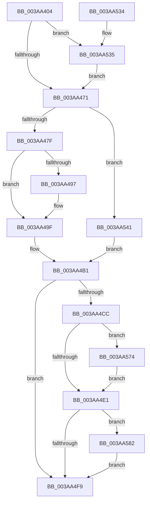

# B_TREE&lt;unsigned long,ST_STORE&lt;SM_TRAITS&gt;::_ST_HASH_ENTRY,4096,NP_CONTEXT,ST_STORE&lt;SM_TRAITS&gt;::ST_HASH_ENTRY_COMPARATOR&gt;::BTreeMergeNodes

- RVA: `0x003AA404`–`0x003AA590` (길이 `396` bytes)
- VA: `0x00000001403AA404`
- 실행 섹션: `.text`
- PDB 이름 있음: `예`; PDB Function 태그: `아니요`
- unwind 정보 RVA: `0x0008B7A4`
- 디코드: `114`개 명령, `396/396` bytes 표시
- 미해석 바이트: `0` (있으면 어셈블리에 `.byte`로 보존)

> 이 문서는 커널 이미지의 기계어와 PDB 기호를 분석해 생성했습니다. 4번과 5번은 함수 원형과 자료형을 바이너리 사용 방식에서 추정한 C 해석이며 원본 소스 복구 결과는 아닙니다.

## 1. Dependencies

- 직접 호출 지점: **5**; 고유 호출 대상: **5**
- 직접 호출자로 확인된 함수: **1**
- RIP 상대 이미지 참조: **0**

### Outgoing calls
- `0x003AA4B5` → [memcpy](../6C/memcpy_function_006C6840.md) (function, `0x006C6840`)
- `0x003AA4FF` → [B_TREE<_SM_PAGE_KEY,ST_STORE<SM_TRAITS>::_ST_PAGE_ENTRY,4096,NP_CONTEXT,B_TREE_KEY_COMPARATOR<_SM_PAGE_KEY> >::BTreeDeleteNode](B_TREE__SM_PAGE_KEY_ST_STORE_SM_TRAITS__ST_PAGE_ENTRY_4096_NP_CONTEXT_B_TREE_KEY_COMPARATOR__SM_PAGE_function_003AA598.md) (function, `0x003AA598`)
- `0x003AA50E` → [B_TREE<unsigned long,ST_STORE<SM_TRAITS>::_ST_HASH_ENTRY,4096,NP_CONTEXT,ST_STORE<SM_TRAITS>::ST_HASH_ENTRY_COMPARATOR>::BTreeDeleteEx](B_TREE_unsigned_long_ST_STORE_SM_TRAITS__ST_HASH_ENTRY_4096_NP_CONTEXT_ST_STORE_SM_TRAITS_ST_HASH_EN_function_003AE410.md) (function, `0x003AE410`)
- `0x003AA578` → [NP_CONTEXT::NpLeafDerefInternal](NP_CONTEXT_NpLeafDerefInternal_function_003A9A70.md) (function, `0x003A9A70`)
- `0x003AA586` → [NP_CONTEXT::NpLeafRemoveInternal](../60/NP_CONTEXT_NpLeafRemoveInternal_function_0060BF04.md) (function, `0x0060BF04`)

### Direct callers
- [sub_003AE4E1](Unknown_function_003AE4E1.md) at `0x003AE5B9`

### Static image references
- 디코드된 RIP-relative 메모리 참조가 없습니다.

## 2. Other-region calls and transfers

- 다른 실행 섹션으로 향하는 call: **0**
- 별도 외부 분기/꼬리 이동을 확인하지 못했습니다.

## 3. Assembly (complete function range)

```asm
003AA404  48 89 5C 24 08                  mov qword ptr [rsp + 8], rbx
003AA409  48 89 6C 24 10                  mov qword ptr [rsp + 0x10], rbp
003AA40E  48 89 74 24 18                  mov qword ptr [rsp + 0x18], rsi
003AA413  57                              push rdi
003AA414  41 54                           push r12
003AA416  41 55                           push r13
003AA418  41 56                           push r14
003AA41A  41 57                           push r15
003AA41C  48 83 EC 20                     sub rsp, 0x20
003AA420  44 8B 4A 18                     mov r9d, dword ptr [rdx + 0x18]
003AA424  48 8B D9                        mov rbx, rcx
003AA427  41 FF C9                        dec r9d
003AA42A  4C 8B F2                        mov r14, rdx
003AA42D  49 C1 E1 04                     shl r9, 4
003AA431  49 8B F0                        mov rsi, r8
003AA434  4C 03 0A                        add r9, qword ptr [rdx]
003AA437  49 8B C8                        mov rcx, r8
003AA43A  49 8B D0                        mov rdx, r8
003AA43D  41 BC 10 00 00 00               mov r12d, 0x10
003AA443  83 E2 01                        and edx, 1
003AA446  49 8B 01                        mov rax, qword ptr [r9]
003AA449  4D 8B 79 F8                     mov r15, qword ptr [r9 - 8]
003AA44D  48 0F 45 F0                     cmovne rsi, rax
003AA451  48 83 E1 FE                     and rcx, 0xfffffffffffffffe
003AA455  48 85 D2                        test rdx, rdx
003AA458  48 8B F9                        mov rdi, rcx
003AA45B  48 0F 44 F8                     cmove rdi, rax
003AA45F  49 0F 44 C8                     cmove rcx, r8
003AA463  8B 07                           mov eax, dword ptr [rdi]
003AA465  0F B7 E8                        movzx ebp, ax
003AA468  48 3B F9                        cmp rdi, rcx
003AA46B  0F 84 C4 00 00 00               je 0x1403aa535
003AA471  41 83 CD FF                     or r13d, 0xffffffff
003AA475  80 7F 03 00                     cmp byte ptr [rdi + 3], 0
003AA479  0F 84 C2 00 00 00               je 0x1403aa541
003AA47F  48 8B C3                        mov rax, rbx
003AA482  48 8D 4B 10                     lea rcx, [rbx + 0x10]
003AA486  48 F7 D8                        neg rax
003AA489  48 1B C0                        sbb rax, rax
003AA48C  48 23 C1                        and rax, rcx
003AA48F  48 8B 00                        mov rax, qword ptr [rax]
003AA492  44 39 28                        cmp dword ptr [rax], r13d
003AA495  75 08                           jne 0x1403aa49f
003AA497  48 8B 46 08                     mov rax, qword ptr [rsi + 8]
003AA49B  48 89 47 08                     mov qword ptr [rdi + 8], rax
003AA49F  8B 06                           mov eax, dword ptr [rsi]
003AA4A1  44 0F B7 C0                     movzx r8d, ax
003AA4A5  48 8D 47 10                     lea rax, [rdi + 0x10]
003AA4A9  48 8D 0C A8                     lea rcx, [rax + rbp*4]
003AA4AD  49 C1 E0 02                     shl r8, 2
003AA4B1  48 8D 56 10                     lea rdx, [rsi + 0x10]
003AA4B5  E8 86 C3 31 00                  call 0x1406c6840
003AA4BA  66 03 2E                        add bp, word ptr [rsi]
003AA4BD  48 8B C3                        mov rax, rbx
003AA4C0  4C 03 E0                        add r12, rax
003AA4C3  66 89 2F                        mov word ptr [rdi], bp
003AA4C6  80 7F 03 00                     cmp byte ptr [rdi + 3], 0
003AA4CA  74 2D                           je 0x1403aa4f9
003AA4CC  48 F7 D8                        neg rax
003AA4CF  48 1B C9                        sbb rcx, rcx
003AA4D2  49 23 CC                        and rcx, r12
003AA4D5  48 8B 01                        mov rax, qword ptr [rcx]
003AA4D8  44 39 28                        cmp dword ptr [rax], r13d
003AA4DB  0F 85 93 00 00 00               jne 0x1403aa574
003AA4E1  48 8B C3                        mov rax, rbx
003AA4E4  48 F7 D8                        neg rax
003AA4E7  48 1B C9                        sbb rcx, rcx
003AA4EA  49 23 CC                        and rcx, r12
003AA4ED  48 8B 01                        mov rax, qword ptr [rcx]
003AA4F0  44 39 28                        cmp dword ptr [rax], r13d
003AA4F3  0F 85 89 00 00 00               jne 0x1403aa582
003AA4F9  48 8B D6                        mov rdx, rsi
003AA4FC  48 8B CB                        mov rcx, rbx
003AA4FF  E8 94 00 00 00                  call 0x1403aa598
003AA504  45 01 6E 18                     add dword ptr [r14 + 0x18], r13d
003AA508  49 8B D6                        mov rdx, r14
003AA50B  48 8B CB                        mov rcx, rbx
003AA50E  E8 FD 3E 00 00                  call 0x1403ae410
003AA513  41 FF 46 18                     inc dword ptr [r14 + 0x18]
003AA517  48 8B 5C 24 50                  mov rbx, qword ptr [rsp + 0x50]
003AA51C  48 8B 6C 24 58                  mov rbp, qword ptr [rsp + 0x58]
003AA521  48 8B 74 24 60                  mov rsi, qword ptr [rsp + 0x60]
003AA526  48 83 C4 20                     add rsp, 0x20
003AA52A  41 5F                           pop r15
003AA52C  41 5E                           pop r14
003AA52E  41 5D                           pop r13
003AA530  41 5C                           pop r12
003AA532  5F                              pop rdi
003AA533  C3                              ret
003AA534  CC                              int3
003AA535  4D 2B FC                        sub r15, r12
003AA538  4D 89 79 F8                     mov qword ptr [r9 - 8], r15
003AA53C  E9 30 FF FF FF                  jmp 0x1403aa471
003AA541  41 8B 07                        mov eax, dword ptr [r15]
003AA544  48 8B CD                        mov rcx, rbp
003AA547  48 03 C9                        add rcx, rcx
003AA54A  FF C5                           inc ebp
003AA54C  89 44 CF 10                     mov dword ptr [rdi + rcx*8 + 0x10], eax
003AA550  48 8B 46 08                     mov rax, qword ptr [rsi + 8]
003AA554  48 89 44 CF 18                  mov qword ptr [rdi + rcx*8 + 0x18], rax
003AA559  8B 06                           mov eax, dword ptr [rsi]
003AA55B  8B CD                           mov ecx, ebp
003AA55D  48 FF C1                        inc rcx
003AA560  44 0F B7 C0                     movzx r8d, ax
003AA564  49 C1 E0 04                     shl r8, 4
003AA568  48 C1 E1 04                     shl rcx, 4
003AA56C  48 03 CF                        add rcx, rdi
003AA56F  E9 3D FF FF FF                  jmp 0x1403aa4b1
003AA574  49 8D 57 08                     lea rdx, [r15 + 8]
003AA578  E8 F3 F4 FF FF                  call 0x1403a9a70
003AA57D  E9 5F FF FF FF                  jmp 0x1403aa4e1
003AA582  49 8D 57 08                     lea rdx, [r15 + 8]
003AA586  E8 79 19 26 00                  call 0x14060bf04
003AA58B  E9 69 FF FF FF                  jmp 0x1403aa4f9
```

## 4. C-style interpretation (structured pseudocode)

```c
__int64 __fastcall B_TREE_unsigned_long_ST_STORE_SM_TRAITS____ST_HASH_ENTRY_4096_NP_CONTEXT_ST_STORE_SM_TRAITS___ST_HAS(__int64 a1, __int64 a2, __int64 a3)
{
    __int64 result;
    __int64 v_r12;
    __int64 v_r13;
    __int64 v_r15;
    __int64 v_rbp;
    __int64 v_rsp;
    unsigned __int64 v_stack_p10;
    unsigned __int64 v_stack_p18;
    unsigned __int64 v_stack_p8;

    v_stack_p8 = v_rbx;
    v_stack_p10 = v_rbp;
    v_stack_p18 = v_rsi;
    v_rsp = (v_rsp) - (32);
    a4 = (unsigned int)(((unsigned int)(*(unsigned int *)(a2 + 24))) - 1);
    a4 = (a4) << (4);
    a4 = (a4) + (*(unsigned __int64 *)(a2));
    a2 = (unsigned int)((a3) & (1));
    if (condition_is_not_equal) { a3 = *(unsigned __int64 *)(a4); }
    a1 = (a3) & (-2);
    if (a2 == 0) {
        a1 = *(unsigned __int64 *)(a4);
        a1 = a3;
    }
    if (a1 == a1) goto loc_003AA535;
loc_003AA471:
    v_r13 = (unsigned int)((v_r13) | (0xFFFFFFFFULL));
    if ((*(unsigned __int8 *)(a1 + 3)) == 0) goto loc_003AA541;
    result = -(a1);
    result = (result) & (a1 + 16);
    result = *(unsigned __int64 *)(result);
    if ((*(unsigned int *)(*(unsigned __int64 *)(result))) == ((unsigned int)(v_r13))) {
        result = *(unsigned __int64 *)(a3 + 8);
        *(unsigned __int64 *)(a1 + 8) = result;
    }
    a3 = ((unsigned __int16)((unsigned int)(*(unsigned int *)(a3)))) << (2);
loc_003AA4B1:
    result = memcpy(a1 + 16 + (unsigned __int16)((unsigned int)(*(unsigned int *)(a1))) * 4, a3 + 16, a3, a4);
    v_rbp = (unsigned __int16)(((unsigned __int16)((unsigned int)(*(unsigned int *)(a1)))) + (*(unsigned __int16 *)(a3)));
    v_r12 = (16) + (a1);
    *(unsigned __int16 *)(a1) = (unsigned __int16)(v_rbp);
    if ((*(unsigned __int8 *)(a1 + 3)) == 0) goto loc_003AA4F9;
    result = -(a1);
    a1 = (a1 + 16 + (unsigned __int16)((unsigned int)(*(unsigned int *)(a1))) * 4) & (v_r12);
    if ((*(unsigned int *)(*(unsigned __int64 *)(a1))) != ((unsigned int)(v_r13))) goto loc_003AA574;
loc_003AA4E1:
    result = -(a1);
    a1 = (a1) & (v_r12);
    if ((*(unsigned int *)(*(unsigned __int64 *)(a1))) != ((unsigned int)(v_r13))) goto loc_003AA582;
loc_003AA4F9:
    result = B_TREE__SM_PAGE_KEY_ST_STORE_SM_TRAITS____ST_PAGE_ENTRY_4096_NP_CONTEXT_B_TREE_KEY_COMPARATOR__SM_PA(a1, a3, a3, a4);
    result = B_TREE_unsigned_long_ST_STORE_SM_TRAITS____ST_HASH_ENTRY_4096_NP_CONTEXT_ST_STORE_SM_TRAITS___ST_HAS(a1, a2, a3, a4);
    v_rsp = (v_rsp) + (32);
    return result;
loc_003AA535:
    v_r15 = (*(unsigned __int64 *)(a4 - 8)) - (v_r12);
    *(unsigned __int64 *)(a4 - 8) = v_r15;
    goto loc_003AA471;
loc_003AA541:
    a1 = (v_stack_p10) + (v_stack_p10);
    v_rbp = (unsigned int)((v_stack_p10) + 1);
    *(unsigned int *)(a1 + a1 * 8 + 16) = (unsigned int)((unsigned int)(*(unsigned int *)(v_r15)));
    *(unsigned __int64 *)(a1 + a1 * 8 + 24) = *(unsigned __int64 *)(v_stack_p18 + 8);
    a1 = ((unsigned int)((unsigned int)(v_rbp))) + 1;
    a3 = ((unsigned __int16)((unsigned int)(*(unsigned int *)(v_stack_p18)))) << (4);
    a1 = (a1) << (4);
    a1 = (a1) + (a1);
    goto loc_003AA4B1;
loc_003AA574:
    result = NP_CONTEXT__NpLeafDerefInternal(a1, v_r15 + 8, a3, a4);
    goto loc_003AA4E1;
loc_003AA582:
    result = NP_CONTEXT__NpLeafRemoveInternal(a1, v_r15 + 8, a3, a4);
    goto loc_003AA4F9;
}
```

## 5. (Beta) C Style

```c
int64_t B_TREE_unsigned_long_ST_STORE_SM_TRAITS____ST_HASH_ENTRY_4096_NP_CONTEXT_ST_STORE_SM_TRAITS___ST_HAS(void *Arg1, void *Arg2, int64_t Arg3)
{
    uint8_t *arg1 = (uint8_t *)Arg1;
    uint8_t *arg2 = (uint8_t *)Arg2;

    int64_t result;
    int64_t local_r12;
    int64_t local_r13;
    int64_t local_r15;
    int64_t local_rbp;
    int64_t local_rsp;
    uint64_t v_stack_p10;
    uint64_t v_stack_p18;
    uint64_t v_stack_p8;

    v_stack_p8 = local_rbx;
    v_stack_p10 = local_rbp;
    v_stack_p18 = local_rsi;
    local_rsp = (local_rsp) - (32);
    a4 = (uint32_t)(((uint32_t)(*(uint32_t *)(arg2 + 0x18))) - 1);
    a4 = (a4) << (4);
    a4 = (a4) + (*(uint64_t *)(arg2));
    Arg2 = (uint32_t)((Arg3) & (1));
    if (condition_is_not_equal) { Arg3 = *(uint64_t *)(a4); }
    Arg1 = (Arg3) & (-2);
    if (Arg2 == NULL) {
        Arg1 = *(uint64_t *)(a4);
        Arg1 = Arg3;
    }
    if (Arg1 == Arg1) goto loc_003AA535;
loc_003AA471:
    local_r13 = (uint32_t)((local_r13) | (0xFFFFFFFFULL));
    if ((*(uint8_t *)(arg1 + 0x3)) == 0) goto loc_003AA541;
    result = -(Arg1);
    result = (result) & (Arg1 + 16);
    result = *(uint64_t *)(result);
    if ((*(uint32_t *)(*(uint64_t *)(result))) == ((uint32_t)(local_r13))) {
        result = *(uint64_t *)(Arg3 + 0x8);
        *(uint64_t *)(arg1 + 0x8) = result;
    }
    Arg3 = ((uint16_t)((uint32_t)(*(uint32_t *)(Arg3)))) << (2);
loc_003AA4B1:
    result = memcpy(Arg1 + 16 + (uint16_t)((uint32_t)(*(uint32_t *)(arg1))) * 4, Arg3 + 16, Arg3, a4);
    local_rbp = (uint16_t)(((uint16_t)((uint32_t)(*(uint32_t *)(arg1)))) + (*(uint16_t *)(Arg3)));
    local_r12 = (16) + (Arg1);
    *(uint16_t *)(arg1) = (uint16_t)(local_rbp);
    if ((*(uint8_t *)(arg1 + 0x3)) == 0) goto loc_003AA4F9;
    result = -(Arg1);
    Arg1 = (Arg1 + 16 + (uint16_t)((uint32_t)(*(uint32_t *)(arg1))) * 4) & (local_r12);
    if ((*(uint32_t *)(*(uint64_t *)(arg1))) != ((uint32_t)(local_r13))) goto loc_003AA574;
loc_003AA4E1:
    result = -(Arg1);
    Arg1 = (Arg1) & (local_r12);
    if ((*(uint32_t *)(*(uint64_t *)(arg1))) != ((uint32_t)(local_r13))) goto loc_003AA582;
loc_003AA4F9:
    result = B_TREE__SM_PAGE_KEY_ST_STORE_SM_TRAITS____ST_PAGE_ENTRY_4096_NP_CONTEXT_B_TREE_KEY_COMPARATOR__SM_PA(Arg1, Arg3, Arg3, a4);
    result = B_TREE_unsigned_long_ST_STORE_SM_TRAITS____ST_HASH_ENTRY_4096_NP_CONTEXT_ST_STORE_SM_TRAITS___ST_HAS(Arg1, Arg2, Arg3, a4);
    local_rsp = (local_rsp) + (32);
    return result;
loc_003AA535:
    local_r15 = (*(uint64_t *)(a4 - 0x8)) - (local_r12);
    *(uint64_t *)(a4 - 0x8) = local_r15;
    goto loc_003AA471;
loc_003AA541:
    Arg1 = (v_stack_p10) + (v_stack_p10);
    local_rbp = (uint32_t)((v_stack_p10) + 1);
    *(uint32_t *)(arg1 + arg1 * 8 + 0x10) = (uint32_t)((uint32_t)(*(uint32_t *)(local_r15)));
    *(uint64_t *)(arg1 + arg1 * 8 + 0x18) = *(uint64_t *)(v_stack_p18 + 0x8);
    Arg1 = ((uint32_t)((uint32_t)(local_rbp))) + 1;
    Arg3 = ((uint16_t)((uint32_t)(*(uint32_t *)(v_stack_p18)))) << (4);
    Arg1 = (Arg1) << (4);
    Arg1 = (Arg1) + (Arg1);
    goto loc_003AA4B1;
loc_003AA574:
    result = NP_CONTEXT__NpLeafDerefInternal(Arg1, local_r15 + 8, Arg3, a4);
    goto loc_003AA4E1;
loc_003AA582:
    result = NP_CONTEXT__NpLeafRemoveInternal(Arg1, local_r15 + 8, Arg3, a4);
    goto loc_003AA4F9;
}
```

### 관측된 메모리 오프셋

구조체 형식이 확인되지 않은 접근은 인자 기준의 오프셋으로만 기록했습니다.

| 기준 인자 | 오프셋 표현 | 폭 (bit) | 접근 |
|---|---:|---:|---|
| `Arg1` | `+ 0x10` | `64` | `R` |
| `Arg2` | `+ 0x0` | `64` | `R` |
| `Arg2` | `+ 0x18` | `32` | `R` |
| `Arg2` | `+ 0x18` | `32` | `R/W` |

## 6. Execution-region graph

[열기: 2D/3D 그래프와 함수 탐색 컨트롤 패널](../../../control-panel.html?section=text&rva=0x003AA404&view=graph)

- 2D 그래프는 위에서 아래로 흐르고, 3D 그래프는 빈 공간을 드래그해 회전합니다. Shift+드래그는 이동, 휠은 확대·축소, 함수 노드 선택은 대상 보고서 이동입니다.

### Static fallback


