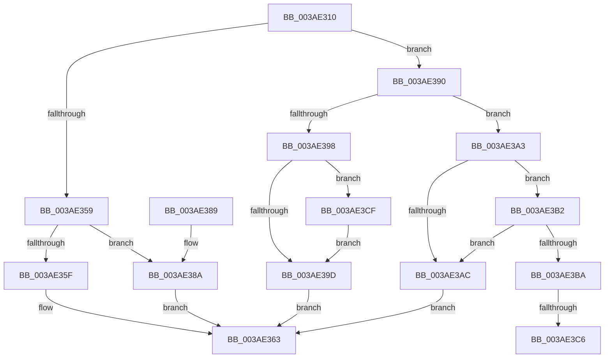

# B_TREE&lt;unsigned long,ST_STORE&lt;SM_TRAITS&gt;::_ST_HASH_ENTRY,4096,NP_CONTEXT,ST_STORE&lt;SM_TRAITS&gt;::ST_HASH_ENTRY_COMPARATOR&gt;::BTreeSearchResultDeref

- RVA: `0x003AE310`–`0x003AE3FD` (길이 `237` bytes)
- VA: `0x00000001403AE310`
- 실행 섹션: `.text`
- PDB 이름 있음: `예`; PDB Function 태그: `예`
- unwind 정보 RVA: `0x0008BECC`
- 디코드: `72`개 명령, `237/237` bytes 표시
- 미해석 바이트: `0` (있으면 어셈블리에 `.byte`로 보존)

> 이 문서는 커널 이미지의 기계어와 PDB 기호를 분석해 생성했습니다. 4번과 5번은 함수 원형과 자료형을 바이너리 사용 방식에서 추정한 C 해석이며 원본 소스 복구 결과는 아닙니다.

## 1. Dependencies

- 직접 호출 지점: **2**; 고유 호출 대상: **2**
- 직접 호출자로 확인된 함수: **8**
- RIP 상대 이미지 참조: **1**

### Outgoing calls
- `0x003AE36A` → [_security_check_cookie](../6A/_security_check_cookie_function_006AC640.md) (function, `0x006AC640`)
- `0x003AE3F6` → [NP_CONTEXT::NpLeafDerefInternal](NP_CONTEXT_NpLeafDerefInternal_function_003A9A70.md) (function, `0x003A9A70`)

### Direct callers
- [sub_003AD47D](Unknown_function_003AD47D.md) at `0x003AD49B`
- [sub_003AD4D0](Unknown_function_003AD4D0.md) at `0x003AD4DB`
- [B_TREE&lt;unsigned long,ST_STORE&lt;SM_TRAITS&gt;::_ST_HASH_ENTRY,4096,NP_CONTEXT,ST_STORE&lt;SM_TRAITS&gt;::ST_HASH_ENTRY_COMPARATOR&gt;::BTreeSearchKey](B_TREE_unsigned_long_ST_STORE_SM_TRAITS__ST_HASH_ENTRY_4096_NP_CONTEXT_ST_STORE_SM_TRAITS_ST_HASH_EN_function_003ADDB0.md) at `0x003ADDD9`
- [ST_STORE&lt;SM_TRAITS&gt;::StDmCleanup](ST_STORE_SM_TRAITS_StDmCleanup_function_003AF8D4.md) at `0x003AF989`
- [ST_STORE&lt;SM_TRAITS&gt;::StDmCombineBufferAddEntry](../4E/ST_STORE_SM_TRAITS_StDmCombineBufferAddEntry_function_004EB420.md) at `0x004EB594`
- [ST_STORE&lt;SM_TRAITS&gt;::StDmCombineBufferAddEntry](../4E/ST_STORE_SM_TRAITS_StDmCombineBufferAddEntry_function_004EB420.md) at `0x004EB948`
- [ST_STORE&lt;SM_TRAITS&gt;::StDmpSinglePageInsert](../4E/ST_STORE_SM_TRAITS_StDmpSinglePageInsert_function_004EBDF0.md) at `0x004EBE4D`
- [sub_006E6E64](../6E/Unknown_function_006E6E64.md) at `0x006E6ED1`
- [sub_006EF588](../6E/Unknown_function_006EF588.md) at `0x006EF604`

### Static image references
- `0x003AE32F` → RVA `0x00E0A740` (`.data`; read)

## 2. Other-region calls and transfers

- 다른 실행 섹션으로 향하는 call: **0**
- call이 아닌 외부 분기/꼬리 이동: **2**
  - `0x003AE3C0` → [sub_006E6E64](../6E/Unknown_function_006E6E64.md) (`tail-transfer`)
  - `0x003AE3CA` → [sub_006E6E64](../6E/Unknown_function_006E6E64.md) (`tail-transfer`)

## 3. Assembly (complete function range)

```asm
003AE310  40 55                           push rbp
003AE312  41 56                           push r14
003AE314  41 57                           push r15
003AE316  48 83 EC 50                     sub rsp, 0x50
003AE31A  48 8D 6C 24 20                  lea rbp, [rsp + 0x20]
003AE31F  48 89 5D 50                     mov qword ptr [rbp + 0x50], rbx
003AE323  48 89 75 58                     mov qword ptr [rbp + 0x58], rsi
003AE327  48 89 7D 60                     mov qword ptr [rbp + 0x60], rdi
003AE32B  4C 89 65 68                     mov qword ptr [rbp + 0x68], r12
003AE32F  48 8B 05 0A C4 A5 00            mov rax, qword ptr [rip + 0xa5c40a]
003AE336  48 33 C5                        xor rax, rbp
003AE339  48 89 45 28                     mov qword ptr [rbp + 0x28], rax
003AE33D  45 33 E4                        xor r12d, r12d
003AE340  48 8D 59 10                     lea rbx, [rcx + 0x10]
003AE344  48 85 C9                        test rcx, rcx
003AE347  4C 8B F2                        mov r14, rdx
003AE34A  4C 8B F9                        mov r15, rcx
003AE34D  49 0F 44 DC                     cmove rbx, r12
003AE351  48 8B 03                        mov rax, qword ptr [rbx]
003AE354  83 38 FF                        cmp dword ptr [rax], -1
003AE357  75 37                           jne 0x1403ae390
003AE359  83 7A 18 FF                     cmp dword ptr [rdx + 0x18], -1
003AE35D  74 2B                           je 0x1403ae38a
003AE35F  44 89 62 18                     mov dword ptr [rdx + 0x18], r12d
003AE363  48 8B 4D 28                     mov rcx, qword ptr [rbp + 0x28]
003AE367  48 33 CD                        xor rcx, rbp
003AE36A  E8 D1 E2 2F 00                  call 0x1406ac640
003AE36F  48 8B 5D 50                     mov rbx, qword ptr [rbp + 0x50]
003AE373  48 8B 75 58                     mov rsi, qword ptr [rbp + 0x58]
003AE377  48 8B 7D 60                     mov rdi, qword ptr [rbp + 0x60]
003AE37B  4C 8B 65 68                     mov r12, qword ptr [rbp + 0x68]
003AE37F  48 8D 65 30                     lea rsp, [rbp + 0x30]
003AE383  41 5F                           pop r15
003AE385  41 5E                           pop r14
003AE387  5D                              pop rbp
003AE388  C3                              ret
003AE389  CC                              int3
003AE38A  4C 89 62 08                     mov qword ptr [rdx + 8], r12
003AE38E  EB D3                           jmp 0x1403ae363
003AE390  8B 42 18                        mov eax, dword ptr [rdx + 0x18]
003AE393  83 F8 FF                        cmp eax, -1
003AE396  74 0B                           je 0x1403ae3a3
003AE398  83 F8 01                        cmp eax, 1
003AE39B  77 32                           ja 0x1403ae3cf
003AE39D  45 89 66 18                     mov dword ptr [r14 + 0x18], r12d
003AE3A1  EB C0                           jmp 0x1403ae363
003AE3A3  48 8B 52 08                     mov rdx, qword ptr [rdx + 8]
003AE3A7  48 85 D2                        test rdx, rdx
003AE3AA  75 06                           jne 0x1403ae3b2
003AE3AC  4D 89 66 08                     mov qword ptr [r14 + 8], r12
003AE3B0  EB B1                           jmp 0x1403ae363
003AE3B2  48 8B 01                        mov rax, qword ptr [rcx]
003AE3B5  48 3B D0                        cmp rdx, rax
003AE3B8  74 F2                           je 0x1403ae3ac
003AE3BA  41 8B F4                        mov esi, r12d
003AE3BD  48 85 C0                        test rax, rax
003AE3C0  0F 84 9E 8A 33 00               je 0x1406e6e64
003AE3C6  0F B6 70 02                     movzx esi, byte ptr [rax + 2]
003AE3CA  E9 95 8A 33 00                  jmp 0x1406e6e64
003AE3CF  83 C0 FE                        add eax, -2
003AE3D2  48 C1 E0 04                     shl rax, 4
003AE3D6  48 03 02                        add rax, qword ptr [rdx]
003AE3D9  4C 8B 40 08                     mov r8, qword ptr [rax + 8]
003AE3DD  48 8B 00                        mov rax, qword ptr [rax]
003AE3E0  49 8D 50 F8                     lea rdx, [r8 - 8]
003AE3E4  48 8D 48 10                     lea rcx, [rax + 0x10]
003AE3E8  48 83 C0 08                     add rax, 8
003AE3EC  4C 3B C1                        cmp r8, rcx
003AE3EF  48 8B CB                        mov rcx, rbx
003AE3F2  48 0F 46 D0                     cmovbe rdx, rax
003AE3F6  E8 75 B6 FF FF                  call 0x1403a9a70
003AE3FB  EB A0                           jmp 0x1403ae39d
```

## 4. C-style interpretation (structured pseudocode)

```c
__int64 __fastcall B_TREE_unsigned_long_ST_STORE_SM_TRAITS____ST_HASH_ENTRY_4096_NP_CONTEXT_ST_STORE_SM_TRAITS___ST_HAS(__int64 a1, __int64 a2)
{
    __int64 result;
    __int64 v_r12;
    __int64 v_rbx;
    __int64 v_rsp;
    unsigned __int64 v_stack_m18;
    unsigned __int64 v_stack_m20;
    unsigned __int64 v_stack_m48;
    unsigned __int64 v_stack_p10;
    unsigned __int64 v_stack_p18;
    unsigned __int64 v_stack_p20;
    unsigned __int64 v_stack_p8;

    v_rsp = (v_rsp) - (80);
    v_stack_p8 = v_rbx;
    v_stack_p10 = v_rsi;
    v_stack_p18 = v_rdi;
    v_stack_p20 = v_r12;
    result = (*(unsigned __int64 *)(v_rip + 10863626)) ^ (v_stack_m48);
    v_stack_m20 = result;
    v_r12 = 0;
    v_rbx = a1 + 16;
    if (a1 == 0) { v_rbx = 0; }
    if ((*(unsigned int *)(*(unsigned __int64 *)(v_rbx))) != -1) goto loc_003AE390;
    if ((*(unsigned int *)(a2 + 24)) == -1) goto loc_003AE38A;
    *(unsigned int *)(a2 + 24) = 0;
loc_003AE363:
    a1 = (v_stack_m20) ^ (v_stack_m48);
    result = _security_check_cookie(a1, a2, a3, a4);
    return result;
loc_003AE38A:
    *(unsigned __int64 *)(a2 + 8) = v_stack_p20;
    goto loc_003AE363;
loc_003AE390:
    if (((unsigned int)((unsigned int)(*(unsigned int *)(a2 + 24)))) == -1) goto loc_003AE3A3;
    if (((unsigned int)((unsigned int)(*(unsigned int *)(a2 + 24)))) > 1) goto loc_003AE3CF;
loc_003AE39D:
    *(unsigned int *)(a2 + 24) = (unsigned int)(v_stack_p20);
    goto loc_003AE363;
loc_003AE3A3:
    if (*(unsigned __int64 *)(a2 + 8) != 0) goto loc_003AE3B2;
loc_003AE3AC:
    *(unsigned __int64 *)(a2 + 8) = v_stack_p20;
    goto loc_003AE363;
loc_003AE3B2:
    if ((*(unsigned __int64 *)(a2 + 8)) == (*(unsigned __int64 *)(a1))) goto loc_003AE3AC;
loc_003AE3CF:
    result = (unsigned int)((*(unsigned __int64 *)(a1)) + (-2));
    result = (result) << (4);
    result = (result) + (*(unsigned __int64 *)(*(unsigned __int64 *)(a2 + 8)));
    result = (*(unsigned __int64 *)(result)) + (8);
    a2 = *(unsigned __int64 *)(result + 8) - 8;
    if ((*(unsigned __int64 *)(result + 8)) <= (*(unsigned __int64 *)(result) + 16)) { a2 = result; }
    result = NP_CONTEXT__NpLeafDerefInternal(v_stack_p8, a2, *(unsigned __int64 *)(result + 8), a4);
    goto loc_003AE39D;
}
```

## 5. (Beta) C Style

```c
int64_t B_TREE_unsigned_long_ST_STORE_SM_TRAITS____ST_HASH_ENTRY_4096_NP_CONTEXT_ST_STORE_SM_TRAITS___ST_HAS(void *Arg1, void *Arg2)
{
    uint8_t *arg1 = (uint8_t *)Arg1;
    uint8_t *arg2 = (uint8_t *)Arg2;

    int64_t result;
    int64_t local_r12;
    int64_t local_rbx;
    int64_t local_rsp;
    uint64_t v_stack_m18;
    uint64_t v_stack_m20;
    uint64_t v_stack_m48;
    uint64_t v_stack_p10;
    uint64_t v_stack_p18;
    uint64_t v_stack_p20;
    uint64_t v_stack_p8;

    local_rsp = (local_rsp) - (80);
    v_stack_p8 = local_rbx;
    v_stack_p10 = local_rsi;
    v_stack_p18 = local_rdi;
    v_stack_p20 = local_r12;
    result = (*(uint64_t *)(v_rip + 0xA5C40A)) ^ (v_stack_m48);
    v_stack_m20 = result;
    local_r12 = 0;
    local_rbx = Arg1 + 16;
    if (Arg1 == NULL) { local_rbx = 0; }
    if ((*(uint32_t *)(*(uint64_t *)(local_rbx))) != -1) goto loc_003AE390;
    if ((*(uint32_t *)(arg2 + 0x18)) == -1) goto loc_003AE38A;
    *(uint32_t *)(arg2 + 0x18) = 0;
loc_003AE363:
    Arg1 = (v_stack_m20) ^ (v_stack_m48);
    result = _security_check_cookie(Arg1, Arg2, a3, a4);
    return result;
loc_003AE38A:
    *(uint64_t *)(arg2 + 0x8) = v_stack_p20;
    goto loc_003AE363;
loc_003AE390:
    if (((uint32_t)((uint32_t)(*(uint32_t *)(arg2 + 0x18)))) == -1) goto loc_003AE3A3;
    if (((uint32_t)((uint32_t)(*(uint32_t *)(arg2 + 0x18)))) > 1) goto loc_003AE3CF;
loc_003AE39D:
    *(uint32_t *)(arg2 + 0x18) = (uint32_t)(v_stack_p20);
    goto loc_003AE363;
loc_003AE3A3:
    if (*(uint64_t *)(arg2 + 0x8) != 0) goto loc_003AE3B2;
loc_003AE3AC:
    *(uint64_t *)(arg2 + 0x8) = v_stack_p20;
    goto loc_003AE363;
loc_003AE3B2:
    if ((*(uint64_t *)(arg2 + 0x8)) == (*(uint64_t *)(arg1))) goto loc_003AE3AC;
loc_003AE3CF:
    result = (uint32_t)((*(uint64_t *)(arg1)) + (-2));
    result = (result) << (4);
    result = (result) + (*(uint64_t *)(*(uint64_t *)(arg2 + 0x8)));
    result = (*(uint64_t *)(result)) + (8);
    Arg2 = *(uint64_t *)(result + 0x8) - 8;
    if ((*(uint64_t *)(result + 0x8)) <= (*(uint64_t *)(result) + 16)) { Arg2 = result; }
    result = NP_CONTEXT__NpLeafDerefInternal(v_stack_p8, Arg2, *(uint64_t *)(result + 0x8), a4);
    goto loc_003AE39D;
}
```

### 관측된 메모리 오프셋

구조체 형식이 확인되지 않은 접근은 인자 기준의 오프셋으로만 기록했습니다.

| 기준 인자 | 오프셋 표현 | 폭 (bit) | 접근 |
|---|---:|---:|---|
| `Arg1` | `+ 0x10` | `64` | `R` |
| `Arg2` | `+ 0x0` | `64` | `R` |
| `Arg2` | `+ 0x8` | `64` | `R` |
| `Arg2` | `+ 0x8` | `64` | `W` |
| `Arg2` | `+ 0x18` | `32` | `R` |
| `Arg2` | `+ 0x18` | `32` | `W` |

## 6. Execution-region graph

[열기: 2D/3D 그래프와 함수 탐색 컨트롤 패널](../../../control-panel.html?section=text&rva=0x003AE310&view=graph)

- 2D 그래프는 위에서 아래로 흐르고, 3D 그래프는 빈 공간을 드래그해 회전합니다. Shift+드래그는 이동, 휠은 확대·축소, 함수 노드 선택은 대상 보고서 이동입니다.

### Static fallback


