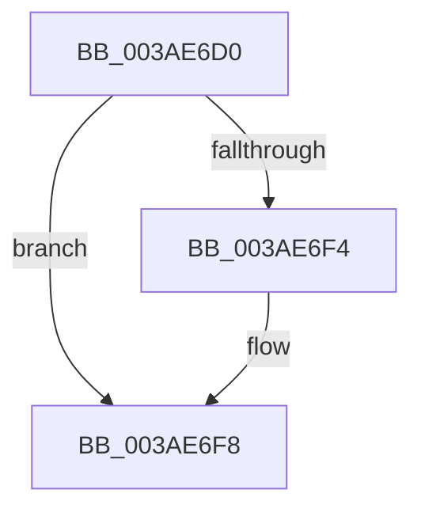

# B_TREE&lt;unsigned long,ST_STORE&lt;SM_TRAITS&gt;::_ST_HASH_ENTRY,4096,NP_CONTEXT,ST_STORE&lt;SM_TRAITS&gt;::ST_HASH_ENTRY_COMPARATOR&gt;::BTreeInsertEx

- RVA: `0x003AE6D0`–`0x003AE708` (길이 `56` bytes)
- VA: `0x00000001403AE6D0`
- 실행 섹션: `.text`
- PDB 이름 있음: `예`; PDB Function 태그: `아니요`
- unwind 정보 RVA: `0x0008BFD8`
- 디코드: `19`개 명령, `56/56` bytes 표시
- 미해석 바이트: `0` (있으면 어셈블리에 `.byte`로 보존)

> 이 문서는 커널 이미지의 기계어와 PDB 기호를 분석해 생성했습니다. 4번과 5번은 함수 원형과 자료형을 바이너리 사용 방식에서 추정한 C 해석이며 원본 소스 복구 결과는 아닙니다.

## 1. Dependencies

- 직접 호출 지점: **0**; 고유 호출 대상: **0**
- 직접 호출자로 확인된 함수: **2**
- RIP 상대 이미지 참조: **0**

### Outgoing calls
- 직접 디코드된 call 명령이 없습니다.

### Direct callers
- [B_TREE&lt;unsigned long,ST_STORE&lt;SM_TRAITS&gt;::_ST_HASH_ENTRY,4096,NP_CONTEXT,ST_STORE&lt;SM_TRAITS&gt;::ST_HASH_ENTRY_COMPARATOR&gt;::BTreeSplitChild](B_TREE_unsigned_long_ST_STORE_SM_TRAITS__ST_HASH_ENTRY_4096_NP_CONTEXT_ST_STORE_SM_TRAITS_ST_HASH_EN_function_003AF610.md) at `0x003AF715`
- [sub_004EBF65](../4E/Unknown_function_004EBF65.md) at `0x004EBF74`

### Static image references
- 디코드된 RIP-relative 메모리 참조가 없습니다.

## 2. Other-region calls and transfers

- 다른 실행 섹션으로 향하는 call: **0**
- call이 아닌 외부 분기/꼬리 이동: **1**
  - `0x003AE702` → [sub_003AE796 + 0xE](Unknown_function_003AE796.md) (`tail-transfer`)

## 3. Assembly (complete function range)

```asm
003AE6D0  40 53                           push rbx
003AE6D2  56                              push rsi
003AE6D3  41 55                           push r13
003AE6D5  41 56                           push r14
003AE6D7  41 57                           push r15
003AE6D9  48 83 EC 20                     sub rsp, 0x20
003AE6DD  48 8B 01                        mov rax, qword ptr [rcx]
003AE6E0  45 33 ED                        xor r13d, r13d
003AE6E3  4C 8B F1                        mov r14, rcx
003AE6E6  4D 8B F8                        mov r15, r8
003AE6E9  48 8B F2                        mov rsi, rdx
003AE6EC  41 8B CD                        mov ecx, r13d
003AE6EF  48 85 C0                        test rax, rax
003AE6F2  74 04                           je 0x1403ae6f8
003AE6F4  0F B6 48 02                     movzx ecx, byte ptr [rax + 2]
003AE6F8  4C 8D 42 1C                     lea r8, [rdx + 0x1c]
003AE6FC  8B 5A 18                        mov ebx, dword ptr [rdx + 0x18]
003AE6FF  41 39 08                        cmp dword ptr [r8], ecx
003AE702  0F 86 9C 00 00 00               jbe 0x1403ae7a4
```

## 4. C-style interpretation (structured pseudocode)

```c
__int64 __fastcall B_TREE_unsigned_long_ST_STORE_SM_TRAITS____ST_HASH_ENTRY_4096_NP_CONTEXT_ST_STORE_SM_TRAITS___ST_HAS(__int64 a1, __int64 a2, __int64 a3)
{
    __int64 v_r13;
    __int64 v_rsp;

    v_rsp = (v_rsp) - (32);
    v_r13 = 0;
    if (*(unsigned __int64 *)(a1) != 0) {
        a1 = *(unsigned __int8 *)(*(unsigned __int64 *)(a1) + 2);
    }
}
```

## 5. (Beta) C Style

```c
int64_t B_TREE_unsigned_long_ST_STORE_SM_TRAITS____ST_HASH_ENTRY_4096_NP_CONTEXT_ST_STORE_SM_TRAITS___ST_HAS(void *Arg1, void *Arg2, int64_t Arg3)
{
    uint8_t *arg1 = (uint8_t *)Arg1;
    uint8_t *arg2 = (uint8_t *)Arg2;

    int64_t local_r13;
    int64_t local_rsp;

    local_rsp = (local_rsp) - (32);
    local_r13 = 0;
    if (*(uint64_t *)(arg1) != 0) {
        Arg1 = *(uint8_t *)(*(uint64_t *)(arg1) + 0x2);
    }
}
```

### 관측된 메모리 오프셋

구조체 형식이 확인되지 않은 접근은 인자 기준의 오프셋으로만 기록했습니다.

| 기준 인자 | 오프셋 표현 | 폭 (bit) | 접근 |
|---|---:|---:|---|
| `Arg1` | `+ 0x0` | `64` | `R` |
| `Arg2` | `+ 0x0` | `32` | `R` |
| `Arg2` | `+ 0x18` | `32` | `R` |
| `Arg2` | `+ 0x1C` | `64` | `R` |

## 6. Execution-region graph

[열기: 2D/3D 그래프와 함수 탐색 컨트롤 패널](../../../control-panel.html?section=text&rva=0x003AE6D0&view=graph)

- 2D 그래프는 위에서 아래로 흐르고, 3D 그래프는 빈 공간을 드래그해 회전합니다. Shift+드래그는 이동, 휠은 확대·축소, 함수 노드 선택은 대상 보고서 이동입니다.

### Static fallback


