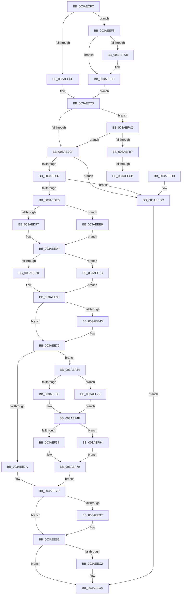

# B_TREE&lt;unsigned long,ST_STORE&lt;SM_TRAITS&gt;::_ST_HASH_ENTRY,4096,NP_CONTEXT,ST_STORE&lt;SM_TRAITS&gt;::ST_HASH_ENTRY_COMPARATOR&gt;::BTreeRedistribute

- RVA: `0x003AECFC`–`0x003AEFD3` (길이 `727` bytes)
- VA: `0x00000001403AECFC`
- 실행 섹션: `.text`
- PDB 이름 있음: `예`; PDB Function 태그: `예`
- unwind 정보 RVA: `0x0008B978`
- 디코드: `205`개 명령, `727/727` bytes 표시
- 미해석 바이트: `0` (있으면 어셈블리에 `.byte`로 보존)

> 이 문서는 커널 이미지의 기계어와 PDB 기호를 분석해 생성했습니다. 4번과 5번은 함수 원형과 자료형을 바이너리 사용 방식에서 추정한 C 해석이며 원본 소스 복구 결과는 아닙니다.

## 1. Dependencies

- 직접 호출 지점: **3**; 고유 호출 대상: **1**
- 직접 호출자로 확인된 함수: **2**
- RIP 상대 이미지 참조: **0**

### Outgoing calls
- `0x003AEE59` → [memcpy](../6C/memcpy_function_006C6840.md) (function, `0x006C6840`)
- `0x003AEE87` → [memcpy](../6C/memcpy_function_006C6840.md) (function, `0x006C6840`)
- `0x003AEEAD` → [memcpy](../6C/memcpy_function_006C6840.md) (function, `0x006C6840`)

### Direct callers
- [sub_003AE4E1](Unknown_function_003AE4E1.md) at `0x003AE4E7`
- [sub_003AE7FC](Unknown_function_003AE7FC.md) at `0x003AE82A`

### Static image references
- 디코드된 RIP-relative 메모리 참조가 없습니다.

## 2. Other-region calls and transfers

- 다른 실행 섹션으로 향하는 call: **0**
- call이 아닌 외부 분기/꼬리 이동: **2**
  - `0x003AEFC5` → [sub_006E6FB6](../6E/Unknown_function_006E6FB6.md) (`tail-transfer`)
  - `0x003AEFCE` → [sub_006E6FB6 + 0xB](../6E/Unknown_function_006E6FB6.md) (`tail-transfer`)

## 3. Assembly (complete function range)

```asm
003AECFC  40 53                           push rbx
003AECFE  55                              push rbp
003AECFF  56                              push rsi
003AED00  57                              push rdi
003AED01  41 54                           push r12
003AED03  41 55                           push r13
003AED05  41 56                           push r14
003AED07  41 57                           push r15
003AED09  48 83 EC 28                     sub rsp, 0x28
003AED0D  44 8B 42 18                     mov r8d, dword ptr [rdx + 0x18]
003AED11  4C 8B D9                        mov r11, rcx
003AED14  48 83 64 24 78 00               and qword ptr [rsp + 0x78], 0
003AED1A  41 BC 01 00 00 00               mov r12d, 1
003AED20  48 83 64 24 70 00               and qword ptr [rsp + 0x70], 0
003AED26  45 2B C4                        sub r8d, r12d
003AED29  49 C1 E0 04                     shl r8, 4
003AED2D  4C 03 02                        add r8, qword ptr [rdx]
003AED30  45 8D 7C 24 0F                  lea r15d, [r12 + 0xf]
003AED35  4D 8B 50 F0                     mov r10, qword ptr [r8 - 0x10]
003AED39  49 8B 10                        mov rdx, qword ptr [r8]
003AED3C  4D 8B 70 F8                     mov r14, qword ptr [r8 - 8]
003AED40  8A 42 03                        mov al, byte ptr [rdx + 3]
003AED43  F6 D8                           neg al
003AED45  41 8B 02                        mov eax, dword ptr [r10]
003AED48  1B FF                           sbb edi, edi
003AED4A  0F B7 C8                        movzx ecx, ax
003AED4D  49 03 CC                        add rcx, r12
003AED50  81 E7 FD 02 00 00               and edi, 0x2fd
003AED56  48 C1 E1 04                     shl rcx, 4
003AED5A  81 C7 FF 00 00 00               add edi, 0xff
003AED60  49 03 CA                        add rcx, r10
003AED63  4C 3B F1                        cmp r14, rcx
003AED66  0F 84 8C 01 00 00               je 0x1403aeef8
003AED6C  48 89 54 24 78                  mov qword ptr [rsp + 0x78], rdx
003AED71  4D 8D 4E 08                     lea r9, [r14 + 8]
003AED75  48 8D 5C 24 70                  lea rbx, [rsp + 0x70]
003AED7A  45 33 E4                        xor r12d, r12d
003AED7D  49 8D 53 10                     lea rdx, [r11 + 0x10]
003AED81  49 8B C3                        mov rax, r11
003AED84  48 F7 D8                        neg rax
003AED87  4D 8D 43 10                     lea r8, [r11 + 0x10]
003AED8B  48 1B C9                        sbb rcx, rcx
003AED8E  48 23 CA                        and rcx, rdx
003AED91  83 CA FF                        or edx, 0xffffffff
003AED94  48 8B 01                        mov rax, qword ptr [rcx]
003AED97  39 10                           cmp dword ptr [rax], edx
003AED99  0F 85 0D 02 00 00               jne 0x1403aefac
003AED9F  49 8B 01                        mov rax, qword ptr [r9]
003AEDA2  48 89 03                        mov qword ptr [rbx], rax
003AEDA5  4C 8B 4C 24 78                  mov r9, qword ptr [rsp + 0x78]
003AEDAA  4C 0B E0                        or r12, rax
003AEDAD  B8 FF FF 00 00                  mov eax, 0xffff
003AEDB2  4C 89 A4 24 80 00 00 00         mov qword ptr [rsp + 0x80], r12
003AEDBA  4C 8B 64 24 70                  mov r12, qword ptr [rsp + 0x70]
003AEDBF  41 8B 11                        mov edx, dword ptr [r9]
003AEDC2  23 D0                           and edx, eax
003AEDC4  45 8B 04 24                     mov r8d, dword ptr [r12]
003AEDC8  44 23 C0                        and r8d, eax
003AEDCB  42 8D 0C 02                     lea ecx, [rdx + r8]
003AEDCF  3B CF                           cmp ecx, edi
003AEDD1  0F 82 05 01 00 00               jb 0x1403aeedc
003AEDD7  8D 04 7D FF FF FF FF            lea eax, [rdi*2 - 1]
003AEDDE  3B C8                           cmp ecx, eax
003AEDE0  0F 83 F6 00 00 00               jae 0x1403aeedc
003AEDE6  D1 E9                           shr ecx, 1
003AEDE8  4D 8B D1                        mov r10, r9
003AEDEB  49 8B E9                        mov rbp, r9
003AEDEE  41 3B D0                        cmp edx, r8d
003AEDF1  0F 87 EF 00 00 00               ja 0x1403aeee6
003AEDF7  8B F9                           mov edi, ecx
003AEDF9  49 8B DC                        mov rbx, r12
003AEDFC  2B FA                           sub edi, edx
003AEDFE  49 8B F1                        mov rsi, r9
003AEE01  44 8B DA                        mov r11d, edx
003AEE04  44 3B C2                        cmp r8d, edx
003AEE07  44 89 5C 24 70                  mov dword ptr [rsp + 0x70], r11d
003AEE0C  45 8B EB                        mov r13d, r11d
003AEE0F  1B C0                           sbb eax, eax
003AEE11  23 C1                           and eax, ecx
003AEE13  80 7B 03 00                     cmp byte ptr [rbx + 3], 0
003AEE17  44 8B C0                        mov r8d, eax
003AEE1A  4C 89 84 24 88 00 00 00         mov qword ptr [rsp + 0x88], r8
003AEE22  0F 84 F3 00 00 00               je 0x1403aef1b
003AEE28  41 BF 04 00 00 00               mov r15d, 4
003AEE2E  48 8D 2C 83                     lea rbp, [rbx + rax*4]
003AEE32  4E 8D 2C AE                     lea r13, [rsi + r13*4]
003AEE36  49 83 C5 10                     add r13, 0x10
003AEE3A  48 83 C5 10                     add rbp, 0x10
003AEE3E  49 3B DA                        cmp rbx, r10
003AEE41  75 2D                           jne 0x1403aee70
003AEE43  8B 06                           mov eax, dword ptr [rsi]
003AEE45  8B CF                           mov ecx, edi
003AEE47  41 0F AF CF                     imul ecx, r15d
003AEE4B  49 8B D5                        mov rdx, r13
003AEE4E  44 0F B7 C0                     movzx r8d, ax
003AEE52  45 0F AF C7                     imul r8d, r15d
003AEE56  49 03 CD                        add rcx, r13
003AEE59  E8 E2 79 31 00                  call 0x1406c6840
003AEE5E  4C 8B 4C 24 78                  mov r9, qword ptr [rsp + 0x78]
003AEE63  44 8B 5C 24 70                  mov r11d, dword ptr [rsp + 0x70]
003AEE68  4C 8B 84 24 88 00 00 00         mov r8, qword ptr [rsp + 0x88]
003AEE70  80 7B 03 00                     cmp byte ptr [rbx + 3], 0
003AEE74  0F 84 BA 00 00 00               je 0x1403aef34
003AEE7A  44 8B C7                        mov r8d, edi
003AEE7D  45 0F AF C7                     imul r8d, r15d
003AEE81  48 8B D5                        mov rdx, rbp
003AEE84  49 8B CD                        mov rcx, r13
003AEE87  E8 B4 79 31 00                  call 0x1406c6840
003AEE8C  66 01 3E                        add word ptr [rsi], di
003AEE8F  66 29 3B                        sub word ptr [rbx], di
003AEE92  49 3B DC                        cmp rbx, r12
003AEE95  75 1B                           jne 0x1403aeeb2
003AEE97  8B 03                           mov eax, dword ptr [rbx]
003AEE99  48 8B CD                        mov rcx, rbp
003AEE9C  41 0F AF FF                     imul edi, r15d
003AEEA0  44 0F B7 C0                     movzx r8d, ax
003AEEA4  45 0F AF C7                     imul r8d, r15d
003AEEA8  8B D7                           mov edx, edi
003AEEAA  48 03 D5                        add rdx, rbp
003AEEAD  E8 8E 79 31 00                  call 0x1406c6840
003AEEB2  41 80 7C 24 03 00               cmp byte ptr [r12 + 3], 0
003AEEB8  48 8B 84 24 80 00 00 00         mov rax, qword ptr [rsp + 0x80]
003AEEC0  74 08                           je 0x1403aeeca
003AEEC2  41 8B 4C 24 10                  mov ecx, dword ptr [r12 + 0x10]
003AEEC7  41 89 0E                        mov dword ptr [r14], ecx
003AEECA  48 83 C4 28                     add rsp, 0x28
003AEECE  41 5F                           pop r15
003AEED0  41 5E                           pop r14
003AEED2  41 5D                           pop r13
003AEED4  41 5C                           pop r12
003AEED6  5F                              pop rdi
003AEED7  5E                              pop rsi
003AEED8  5D                              pop rbp
003AEED9  5B                              pop rbx
003AEEDA  C3                              ret
003AEEDB  CC                              int3
003AEEDC  48 8B 84 24 80 00 00 00         mov rax, qword ptr [rsp + 0x80]
003AEEE4  EB E4                           jmp 0x1403aeeca
003AEEE6  45 33 DB                        xor r11d, r11d
003AEEE9  8B FA                           mov edi, edx
003AEEEB  2B F9                           sub edi, ecx
003AEEED  49 8B D9                        mov rbx, r9
003AEEF0  49 8B F4                        mov rsi, r12
003AEEF3  E9 0C FF FF FF                  jmp 0x1403aee04
003AEEF8  4D 2B F7                        sub r14, r15
003AEEFB  49 8D 42 10                     lea rax, [r10 + 0x10]
003AEEFF  4D 8D 4E F8                     lea r9, [r14 - 8]
003AEF03  4C 3B F0                        cmp r14, rax
003AEF06  77 04                           ja 0x1403aef0c
003AEF08  4D 8D 4A 08                     lea r9, [r10 + 8]
003AEF0C  48 8D 5C 24 78                  lea rbx, [rsp + 0x78]
003AEF11  48 89 54 24 70                  mov qword ptr [rsp + 0x70], rdx
003AEF16  E9 62 FE FF FF                  jmp 0x1403aed7d
003AEF1B  4C 8B D5                        mov r10, rbp
003AEF1E  49 C1 E5 04                     shl r13, 4
003AEF22  49 8B E8                        mov rbp, r8
003AEF25  48 C1 E5 04                     shl rbp, 4
003AEF29  48 03 EB                        add rbp, rbx
003AEF2C  4C 03 EE                        add r13, rsi
003AEF2F  E9 02 FF FF FF                  jmp 0x1403aee36
003AEF34  41 8B 16                        mov edx, dword ptr [r14]
003AEF37  49 3B D9                        cmp rbx, r9
003AEF3A  75 3D                           jne 0x1403aef79
003AEF3C  8D 4F FF                        lea ecx, [rdi - 1]
003AEF3F  48 03 C9                        add rcx, rcx
003AEF42  89 54 CE 10                     mov dword ptr [rsi + rcx*8 + 0x10], edx
003AEF46  48 8B 46 08                     mov rax, qword ptr [rsi + 8]
003AEF4A  48 89 44 CE 18                  mov qword ptr [rsi + rcx*8 + 0x18], rax
003AEF4F  49 3B D9                        cmp rbx, r9
003AEF52  75 40                           jne 0x1403aef94
003AEF54  41 8B C8                        mov ecx, r8d
003AEF57  48 03 C9                        add rcx, rcx
003AEF5A  8B 44 CB 10                     mov eax, dword ptr [rbx + rcx*8 + 0x10]
003AEF5E  41 89 06                        mov dword ptr [r14], eax
003AEF61  48 8B 44 CB 18                  mov rax, qword ptr [rbx + rcx*8 + 0x18]
003AEF66  48 89 46 08                     mov qword ptr [rsi + 8], rax
003AEF6A  41 8B C7                        mov eax, r15d
003AEF6D  48 03 E8                        add rbp, rax
003AEF70  44 8D 47 FF                     lea r8d, [rdi - 1]
003AEF74  E9 04 FF FF FF                  jmp 0x1403aee7d
003AEF79  41 8B CB                        mov ecx, r11d
003AEF7C  48 03 C9                        add rcx, rcx
003AEF7F  89 54 CE 10                     mov dword ptr [rsi + rcx*8 + 0x10], edx
003AEF83  48 8B 43 08                     mov rax, qword ptr [rbx + 8]
003AEF87  48 89 44 CE 18                  mov qword ptr [rsi + rcx*8 + 0x18], rax
003AEF8C  41 8B C7                        mov eax, r15d
003AEF8F  4C 03 E8                        add r13, rax
003AEF92  EB BB                           jmp 0x1403aef4f
003AEF94  8D 57 FF                        lea edx, [rdi - 1]
003AEF97  48 03 D2                        add rdx, rdx
003AEF9A  8B 44 D3 10                     mov eax, dword ptr [rbx + rdx*8 + 0x10]
003AEF9E  41 89 06                        mov dword ptr [r14], eax
003AEFA1  48 8B 44 D3 18                  mov rax, qword ptr [rbx + rdx*8 + 0x18]
003AEFA6  48 89 43 08                     mov qword ptr [rbx + 8], rax
003AEFAA  EB C4                           jmp 0x1403aef70
003AEFAC  41 80 7A 02 02                  cmp byte ptr [r10 + 2], 2
003AEFB1  0F 85 E8 FD FF FF               jne 0x1403aed9f
003AEFB7  49 F7 DB                        neg r11
003AEFBA  48 1B C9                        sbb rcx, rcx
003AEFBD  49 23 C8                        and rcx, r8
003AEFC0  48 8B 01                        mov rax, qword ptr [rcx]
003AEFC3  39 10                           cmp dword ptr [rax], edx
003AEFC5  0F 85 EB 7F 33 00               jne 0x1406e6fb6
003AEFCB  49 8B 01                        mov rax, qword ptr [r9]
003AEFCE  E9 EE 7F 33 00                  jmp 0x1406e6fc1
```

## 4. C-style interpretation (structured pseudocode)

```c
__int64 __fastcall B_TREE_unsigned_long_ST_STORE_SM_TRAITS____ST_HASH_ENTRY_4096_NP_CONTEXT_ST_STORE_SM_TRAITS___ST_HAS(__int64 a1, __int64 a2)
{
    __int64 result;
    __int64 v_r11;
    __int64 v_r12;
    __int64 v_r13;
    __int64 v_r14;
    __int64 v_rbp;
    __int64 v_rdi;
    __int64 v_rsp;
    unsigned __int64 v_stack_p10;
    unsigned __int64 v_stack_p18;
    unsigned __int64 v_stack_p20;
    unsigned __int64 v_stack_p70;
    unsigned __int64 v_stack_p78;
    unsigned __int64 v_stack_p8;
    unsigned __int64 v_stack_p80;

    v_rsp = (v_rsp) - (40);
    a3 = (unsigned int)(((unsigned int)(*(unsigned int *)(a2 + 24))) - (1));
    a3 = (a3) << (4);
    a3 = (a3) + (*(unsigned __int64 *)(a2));
    result = (unsigned __int8)(-(*(unsigned __int8 *)(*(unsigned __int64 *)(a3) + 3)));
    a1 = ((unsigned __int16)((unsigned int)(*(unsigned int *)(*(unsigned __int64 *)(a3 - 16))))) + (1);
    v_rdi = (unsigned int)((v_rdi) & (765));
    a1 = (a1) << (4);
    v_rdi = (unsigned int)((v_rdi) + (255));
    a1 = (a1) + (*(unsigned __int64 *)(a3 - 16));
    if ((*(unsigned __int64 *)(a3 - 8)) == a1) goto loc_003AEEF8;
    v_stack_p10 = *(unsigned __int64 *)(a3);
    v_r12 = 0;
loc_003AED7D:
    result = -(a1);
    a1 = (a1) & (a1 + 16);
    a2 = (unsigned int)((a1 + 16) | (0xFFFFFFFFULL));
    if ((*(unsigned int *)(*(unsigned __int64 *)(a1))) != ((unsigned int)(a2))) goto loc_003AEFAC;
loc_003AED9F:
    *(unsigned __int64 *)(v_stack_p8) = *(unsigned __int64 *)(*(unsigned __int64 *)(a3 - 8) + 8);
    v_r12 = (v_r12) | (*(unsigned __int64 *)(*(unsigned __int64 *)(a3 - 8) + 8));
    v_stack_p18 = v_r12;
    a2 = (unsigned int)(((unsigned int)(*(unsigned int *)(v_stack_p10))) & ((unsigned int)((unsigned int)(0xFFFFULL))));
    a3 = (unsigned int)(((unsigned int)(*(unsigned int *)(v_stack_p8))) & ((unsigned int)((unsigned int)(0xFFFFULL))));
    if (((unsigned int)(a2 + a3 * 1)) < ((unsigned int)(v_rdi))) goto loc_003AEEDC;
    if (((unsigned int)(a2 + a3 * 1)) >= ((unsigned int)(v_rdi * 2 - 1))) goto loc_003AEEDC;
    a1 = (unsigned int)((a2 + a3 * 1) >> (1));
    if (((unsigned int)(a2)) > ((unsigned int)(a3))) goto loc_003AEEE6;
    v_rdi = (unsigned int)(((unsigned int)((unsigned int)(a1))) - ((unsigned int)(a2)));
loc_003AEE04:
    v_stack_p8 = (unsigned int)((unsigned int)((unsigned int)(a2)));
    result = (unsigned int)((v_rdi * 2 - 1) & ((unsigned int)(a1)));
    v_stack_p20 = (unsigned int)((unsigned int)(result));
    if ((*(unsigned __int8 *)(v_stack_p8 + 3)) == 0) goto loc_003AEF1B;
loc_003AEE36:
    v_r13 = (v_stack_p10 + (unsigned int)((unsigned int)((unsigned int)((unsigned int)(a2)))) * 4) + (16);
    v_rbp = (v_stack_p8 + result * 4) + (16);
    v_r11 = (unsigned int)((unsigned int)(a2));
    if (v_stack_p8 == v_stack_p10) {
        result = *(unsigned int *)(v_stack_p10);
        a1 = (unsigned int)(v_rdi);
        a1 = (unsigned int)((a1) * (4));
        a2 = v_r13;
        a3 = (unsigned __int16)(result);
        a3 = (unsigned int)((a3) * (4));
        a1 = (a1) + (v_r13);
        result = memcpy(a1, a2, a3, v_stack_p10);
        a4 = v_stack_p10;
        v_r11 = v_stack_p8;
        a3 = v_stack_p20;
    }
    if ((*(unsigned __int8 *)(v_stack_p8 + 3)) == 0) goto loc_003AEF34;
loc_003AEE7D:
    a3 = (unsigned int)(((unsigned int)((unsigned int)(v_rdi))) * (4));
    result = memcpy(v_r13, v_rbp, a3, a4);
    if (v_stack_p8 == v_stack_p8) {
        result = *(unsigned int *)(v_stack_p8);
        a1 = v_rbp;
        v_rdi = (unsigned int)((v_rdi) * (4));
        a3 = (unsigned __int16)(result);
        a3 = (unsigned int)((a3) * (4));
        a2 = (unsigned int)(v_rdi);
        a2 = (a2) + (v_rbp);
        result = memcpy(a1, a2, a3, a4);
    }
    if ((*(unsigned __int8 *)(v_stack_p8 + 3)) != 0) {
        a1 = *(unsigned int *)(v_stack_p8 + 16);
        *(unsigned int *)(*(unsigned __int64 *)(a3 - 8)) = (unsigned int)(a1);
    }
    v_rsp = (v_rsp) + (40);
    return v_stack_p18;
loc_003AEEDC:
    goto loc_003AEECA;
loc_003AEEE6:
    v_r11 = 0;
    v_rdi = (unsigned int)(((unsigned int)((unsigned int)(a2))) - ((unsigned int)(a1)));
    goto loc_003AEE04;
loc_003AEEF8:
    v_r14 = (*(unsigned __int64 *)(a3 - 8)) - (4);
    if (v_r14 <= (v_stack_p10 + 16)) {
        a4 = v_stack_p10 + 8;
    }
    v_stack_p70 = a2;
    goto loc_003AED7D;
loc_003AEF1B:
    v_r13 = (v_r13) << (4);
    v_rbp = (a3) << (4);
    v_rbp = (v_rbp) + (v_stack_p78);
    v_r13 = (v_r13) + (v_stack_p8);
    goto loc_003AEE36;
loc_003AEF34:
    if (v_stack_p78 != a4) goto loc_003AEF79;
    a1 = (v_rdi - 1) + (v_rdi - 1);
    *(unsigned int *)(v_stack_p8 + a1 * 8 + 16) = (unsigned int)((unsigned int)(*(unsigned int *)(v_r14)));
    *(unsigned __int64 *)(v_stack_p8 + a1 * 8 + 24) = *(unsigned __int64 *)(v_stack_p8 + 8);
loc_003AEF4F:
    if (v_stack_p78 != a4) goto loc_003AEF94;
    a1 = ((unsigned int)((unsigned int)(a3))) + ((unsigned int)((unsigned int)(a3)));
    *(unsigned int *)(v_r14) = (unsigned int)((unsigned int)(*(unsigned int *)(v_stack_p78 + a1 * 8 + 16)));
    *(unsigned __int64 *)(v_stack_p8 + 8) = *(unsigned __int64 *)(v_stack_p78 + a1 * 8 + 24);
    v_rbp = (v_rbp) + (4);
loc_003AEF70:
    goto loc_003AEE7D;
loc_003AEF79:
    a1 = (0) + (0);
    *(unsigned int *)(v_stack_p8 + a1 * 8 + 16) = (unsigned int)((unsigned int)(*(unsigned int *)(v_r14)));
    *(unsigned __int64 *)(v_stack_p8 + a1 * 8 + 24) = *(unsigned __int64 *)(v_stack_p78 + 8);
    v_r13 = (v_r13) + (4);
    goto loc_003AEF4F;
loc_003AEF94:
    a2 = (v_rdi - 1) + (v_rdi - 1);
    *(unsigned int *)(v_r14) = (unsigned int)((unsigned int)(*(unsigned int *)(v_stack_p78 + a2 * 8 + 16)));
    *(unsigned __int64 *)(v_stack_p78 + 8) = *(unsigned __int64 *)(v_stack_p78 + a2 * 8 + 24);
    goto loc_003AEF70;
loc_003AEFAC:
    if ((*(unsigned __int8 *)(v_rbp + 2)) != 2) goto loc_003AED9F;
    v_r11 = -(v_r11);
    a1 = (a1) & (v_rdi - 1);
}
```

## 5. (Beta) C Style

```c
int64_t B_TREE_unsigned_long_ST_STORE_SM_TRAITS____ST_HASH_ENTRY_4096_NP_CONTEXT_ST_STORE_SM_TRAITS___ST_HAS(void *Arg1, void *Arg2)
{
    uint8_t *arg1 = (uint8_t *)Arg1;
    uint8_t *arg2 = (uint8_t *)Arg2;

    int64_t result;
    int64_t local_r11;
    int64_t local_r12;
    int64_t local_r13;
    int64_t local_r14;
    int64_t local_rbp;
    int64_t local_rdi;
    int64_t local_rsp;
    uint64_t v_stack_p10;
    uint64_t v_stack_p18;
    uint64_t v_stack_p20;
    uint64_t v_stack_p70;
    uint64_t v_stack_p78;
    uint64_t v_stack_p8;
    uint64_t v_stack_p80;

    local_rsp = (local_rsp) - (40);
    a3 = (uint32_t)(((uint32_t)(*(uint32_t *)(arg2 + 0x18))) - (1));
    a3 = (a3) << (4);
    a3 = (a3) + (*(uint64_t *)(arg2));
    result = (uint8_t)(-(*(uint8_t *)(*(uint64_t *)(a3) + 0x3)));
    Arg1 = ((uint16_t)((uint32_t)(*(uint32_t *)(*(uint64_t *)(a3 - 0x10))))) + (1);
    local_rdi = (uint32_t)((local_rdi) & (765));
    Arg1 = (Arg1) << (4);
    local_rdi = (uint32_t)((local_rdi) + (255));
    Arg1 = (Arg1) + (*(uint64_t *)(a3 - 0x10));
    if ((*(uint64_t *)(a3 - 0x8)) == Arg1) goto loc_003AEEF8;
    v_stack_p10 = *(uint64_t *)(a3);
    local_r12 = 0;
loc_003AED7D:
    result = -(Arg1);
    Arg1 = (Arg1) & (Arg1 + 16);
    Arg2 = (uint32_t)((Arg1 + 16) | (0xFFFFFFFFULL));
    if ((*(uint32_t *)(*(uint64_t *)(arg1))) != ((uint32_t)(Arg2))) goto loc_003AEFAC;
loc_003AED9F:
    *(uint64_t *)(v_stack_p8) = *(uint64_t *)(*(uint64_t *)(a3 - 0x8) + 0x8);
    local_r12 = (local_r12) | (*(uint64_t *)(*(uint64_t *)(a3 - 0x8) + 0x8));
    v_stack_p18 = local_r12;
    Arg2 = (uint32_t)(((uint32_t)(*(uint32_t *)(v_stack_p10))) & ((uint32_t)((uint32_t)(0xFFFFULL))));
    a3 = (uint32_t)(((uint32_t)(*(uint32_t *)(v_stack_p8))) & ((uint32_t)((uint32_t)(0xFFFFULL))));
    if (((uint32_t)(Arg2 + a3 * 1)) < ((uint32_t)(local_rdi))) goto loc_003AEEDC;
    if (((uint32_t)(Arg2 + a3 * 1)) >= ((uint32_t)(local_rdi * 2 - 1))) goto loc_003AEEDC;
    Arg1 = (uint32_t)((Arg2 + a3 * 1) >> (1));
    if (((uint32_t)(Arg2)) > ((uint32_t)(a3))) goto loc_003AEEE6;
    local_rdi = (uint32_t)(((uint32_t)((uint32_t)(Arg1))) - ((uint32_t)(Arg2)));
loc_003AEE04:
    v_stack_p8 = (uint32_t)((uint32_t)((uint32_t)(Arg2)));
    result = (uint32_t)((local_rdi * 2 - 1) & ((uint32_t)(Arg1)));
    v_stack_p20 = (uint32_t)((uint32_t)(result));
    if ((*(uint8_t *)(v_stack_p8 + 0x3)) == 0) goto loc_003AEF1B;
loc_003AEE36:
    local_r13 = (v_stack_p10 + (uint32_t)((uint32_t)((uint32_t)((uint32_t)(Arg2)))) * 4) + (16);
    local_rbp = (v_stack_p8 + result * 4) + (16);
    local_r11 = (uint32_t)((uint32_t)(Arg2));
    if (v_stack_p8 == v_stack_p10) {
        result = *(uint32_t *)(v_stack_p10);
        Arg1 = (uint32_t)(local_rdi);
        Arg1 = (uint32_t)((Arg1) * (4));
        Arg2 = local_r13;
        a3 = (uint16_t)(result);
        a3 = (uint32_t)((a3) * (4));
        Arg1 = (Arg1) + (local_r13);
        result = memcpy(Arg1, Arg2, a3, v_stack_p10);
        a4 = v_stack_p10;
        local_r11 = v_stack_p8;
        a3 = v_stack_p20;
    }
    if ((*(uint8_t *)(v_stack_p8 + 0x3)) == 0) goto loc_003AEF34;
loc_003AEE7D:
    a3 = (uint32_t)(((uint32_t)((uint32_t)(local_rdi))) * (4));
    result = memcpy(local_r13, local_rbp, a3, a4);
    if (v_stack_p8 == v_stack_p8) {
        result = *(uint32_t *)(v_stack_p8);
        Arg1 = local_rbp;
        local_rdi = (uint32_t)((local_rdi) * (4));
        a3 = (uint16_t)(result);
        a3 = (uint32_t)((a3) * (4));
        Arg2 = (uint32_t)(local_rdi);
        Arg2 = (Arg2) + (local_rbp);
        result = memcpy(Arg1, Arg2, a3, a4);
    }
    if ((*(uint8_t *)(v_stack_p8 + 0x3)) != 0) {
        Arg1 = *(uint32_t *)(v_stack_p8 + 0x10);
        *(uint32_t *)(*(uint64_t *)(a3 - 0x8)) = (uint32_t)(Arg1);
    }
    local_rsp = (local_rsp) + (40);
    return v_stack_p18;
loc_003AEEDC:
    goto loc_003AEECA;
loc_003AEEE6:
    local_r11 = 0;
    local_rdi = (uint32_t)(((uint32_t)((uint32_t)(Arg2))) - ((uint32_t)(Arg1)));
    goto loc_003AEE04;
loc_003AEEF8:
    local_r14 = (*(uint64_t *)(a3 - 0x8)) - (4);
    if (local_r14 <= (v_stack_p10 + 16)) {
        a4 = v_stack_p10 + 8;
    }
    v_stack_p70 = Arg2;
    goto loc_003AED7D;
loc_003AEF1B:
    local_r13 = (local_r13) << (4);
    local_rbp = (a3) << (4);
    local_rbp = (local_rbp) + (v_stack_p78);
    local_r13 = (local_r13) + (v_stack_p8);
    goto loc_003AEE36;
loc_003AEF34:
    if (v_stack_p78 != a4) goto loc_003AEF79;
    Arg1 = (local_rdi - 1) + (local_rdi - 1);
    *(uint32_t *)(v_stack_p8 + arg1 * 8 + 0x10) = (uint32_t)((uint32_t)(*(uint32_t *)(local_r14)));
    *(uint64_t *)(v_stack_p8 + arg1 * 8 + 0x18) = *(uint64_t *)(v_stack_p8 + 0x8);
loc_003AEF4F:
    if (v_stack_p78 != a4) goto loc_003AEF94;
    Arg1 = ((uint32_t)((uint32_t)(a3))) + ((uint32_t)((uint32_t)(a3)));
    *(uint32_t *)(local_r14) = (uint32_t)((uint32_t)(*(uint32_t *)(v_stack_p78 + arg1 * 8 + 0x10)));
    *(uint64_t *)(v_stack_p8 + 0x8) = *(uint64_t *)(v_stack_p78 + arg1 * 8 + 0x18);
    local_rbp = (local_rbp) + (4);
loc_003AEF70:
    goto loc_003AEE7D;
loc_003AEF79:
    Arg1 = (0) + (0);
    *(uint32_t *)(v_stack_p8 + arg1 * 8 + 0x10) = (uint32_t)((uint32_t)(*(uint32_t *)(local_r14)));
    *(uint64_t *)(v_stack_p8 + arg1 * 8 + 0x18) = *(uint64_t *)(v_stack_p78 + 0x8);
    local_r13 = (local_r13) + (4);
    goto loc_003AEF4F;
loc_003AEF94:
    Arg2 = (local_rdi - 1) + (local_rdi - 1);
    *(uint32_t *)(local_r14) = (uint32_t)((uint32_t)(*(uint32_t *)(v_stack_p78 + arg2 * 8 + 0x10)));
    *(uint64_t *)(v_stack_p78 + 0x8) = *(uint64_t *)(v_stack_p78 + arg2 * 8 + 0x18);
    goto loc_003AEF70;
loc_003AEFAC:
    if ((*(uint8_t *)(local_rbp + 0x2)) != 2) goto loc_003AED9F;
    local_r11 = -(local_r11);
    Arg1 = (Arg1) & (local_rdi - 1);
}
```

### 관측된 메모리 오프셋

구조체 형식이 확인되지 않은 접근은 인자 기준의 오프셋으로만 기록했습니다.

| 기준 인자 | 오프셋 표현 | 폭 (bit) | 접근 |
|---|---:|---:|---|
| `Arg1` | `+ 0x10` | `64` | `R` |
| `Arg2` | `+ 0x0` | `64` | `R` |
| `Arg2` | `+ 0x18` | `32` | `R` |

## 6. Execution-region graph

[열기: 2D/3D 그래프와 함수 탐색 컨트롤 패널](../../../control-panel.html?section=text&rva=0x003AECFC&view=graph)

- 2D 그래프는 위에서 아래로 흐르고, 3D 그래프는 빈 공간을 드래그해 회전합니다. Shift+드래그는 이동, 휠은 확대·축소, 함수 노드 선택은 대상 보고서 이동입니다.

### Static fallback


