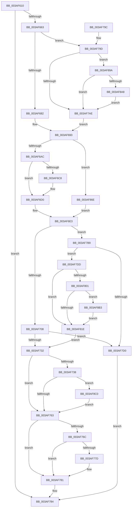

# B_TREE&lt;unsigned long,ST_STORE&lt;SM_TRAITS&gt;::_ST_HASH_ENTRY,4096,NP_CONTEXT,ST_STORE&lt;SM_TRAITS&gt;::ST_HASH_ENTRY_COMPARATOR&gt;::BTreeSplitChild

- RVA: `0x003AF610`–`0x003AF8CD` (길이 `701` bytes)
- VA: `0x00000001403AF610`
- 실행 섹션: `.text`
- PDB 이름 있음: `예`; PDB Function 태그: `아니요`
- unwind 정보 RVA: `0x0008C13C`
- 디코드: `188`개 명령, `701/701` bytes 표시
- 미해석 바이트: `0` (있으면 어셈블리에 `.byte`로 보존)

> 이 문서는 커널 이미지의 기계어와 PDB 기호를 분석해 생성했습니다. 4번과 5번은 함수 원형과 자료형을 바이너리 사용 방식에서 추정한 C 해석이며 원본 소스 복구 결과는 아닙니다.

## 1. Dependencies

- 직접 호출 지점: **9**; 고유 호출 대상: **5**
- 직접 호출자로 확인된 함수: **1**
- RIP 상대 이미지 참조: **0**

### Outgoing calls
- `0x003AF652` → [B_TREE<_SM_PAGE_KEY,ST_STORE<SM_TRAITS>::_ST_PAGE_ENTRY,4096,NP_CONTEXT,B_TREE_KEY_COMPARATOR<_SM_PAGE_KEY> >::BTreeNewNode](B_TREE__SM_PAGE_KEY_ST_STORE_SM_TRAITS__ST_PAGE_ENTRY_4096_NP_CONTEXT_B_TREE_KEY_COMPARATOR__SM_PAGE_function_003AAD60.md) (function, `0x003AAD60`)
- `0x003AF6DE` → [memcpy](../6C/memcpy_function_006C6840.md) (function, `0x006C6840`)
- `0x003AF715` → [B_TREE<unsigned long,ST_STORE<SM_TRAITS>::_ST_HASH_ENTRY,4096,NP_CONTEXT,ST_STORE<SM_TRAITS>::ST_HASH_ENTRY_COMPARATOR>::BTreeInsertEx](B_TREE_unsigned_long_ST_STORE_SM_TRAITS__ST_HASH_ENTRY_4096_NP_CONTEXT_ST_STORE_SM_TRAITS_ST_HASH_EN_function_003AE6D0.md) (function, `0x003AE6D0`)
- `0x003AF7C3` → [B_TREE<_SM_PAGE_KEY,ST_STORE<SM_TRAITS>::_ST_PAGE_ENTRY,4096,NP_CONTEXT,B_TREE_KEY_COMPARATOR<_SM_PAGE_KEY> >::BTreeNewNode](B_TREE__SM_PAGE_KEY_ST_STORE_SM_TRAITS__ST_PAGE_ENTRY_4096_NP_CONTEXT_B_TREE_KEY_COMPARATOR__SM_PAGE_function_003AAD60.md) (function, `0x003AAD60`)
- `0x003AF7D6` → [B_TREE<_SM_PAGE_KEY,ST_STORE<SM_TRAITS>::_ST_PAGE_ENTRY,4096,NP_CONTEXT,B_TREE_KEY_COMPARATOR<_SM_PAGE_KEY> >::BTreeDeleteNode](B_TREE__SM_PAGE_KEY_ST_STORE_SM_TRAITS__ST_PAGE_ENTRY_4096_NP_CONTEXT_B_TREE_KEY_COMPARATOR__SM_PAGE_function_003AA598.md) (function, `0x003AA598`)
- `0x003AF839` → [memcpy](../6C/memcpy_function_006C6840.md) (function, `0x006C6840`)
- `0x003AF888` → [memcpy](../6C/memcpy_function_006C6840.md) (function, `0x006C6840`)
- `0x003AF8B6` → [NP_CONTEXT::NpGetResidentLeaf](../60/NP_CONTEXT_NpGetResidentLeaf_function_0060BED0.md) (function, `0x0060BED0`)
- `0x003AF8C3` → [NP_CONTEXT::NpGetResidentLeaf](../60/NP_CONTEXT_NpGetResidentLeaf_function_0060BED0.md) (function, `0x0060BED0`)

### Direct callers
- [sub_003AE7FC](Unknown_function_003AE7FC.md) at `0x003AE8D1`

### Static image references
- 디코드된 RIP-relative 메모리 참조가 없습니다.

## 2. Other-region calls and transfers

- 다른 실행 섹션으로 향하는 call: **0**
- 별도 외부 분기/꼬리 이동을 확인하지 못했습니다.

## 3. Assembly (complete function range)

```asm
003AF610  48 89 5C 24 08                  mov qword ptr [rsp + 8], rbx
003AF615  55                              push rbp
003AF616  56                              push rsi
003AF617  57                              push rdi
003AF618  41 54                           push r12
003AF61A  41 55                           push r13
003AF61C  41 56                           push r14
003AF61E  41 57                           push r15
003AF620  48 83 EC 30                     sub rsp, 0x30
003AF624  44 8B 7A 18                     mov r15d, dword ptr [rdx + 0x18]
003AF628  4C 8B E2                        mov r12, rdx
003AF62B  33 FF                           xor edi, edi
003AF62D  48 8B F1                        mov rsi, rcx
003AF630  44 8D 6F 01                     lea r13d, [rdi + 1]
003AF634  45 2B FD                        sub r15d, r13d
003AF637  49 C1 E7 04                     shl r15, 4
003AF63B  4C 03 3A                        add r15, qword ptr [rdx]
003AF63E  4C 89 BC 24 80 00 00 00         mov qword ptr [rsp + 0x80], r15
003AF646  49 8B 1F                        mov rbx, qword ptr [r15]
003AF649  44 0F B6 43 02                  movzx r8d, byte ptr [rbx + 2]
003AF64E  0F B6 53 03                     movzx edx, byte ptr [rbx + 3]
003AF652  E8 09 B7 FF FF                  call 0x1403aad60
003AF657  4C 8B F0                        mov r14, rax
003AF65A  48 85 C0                        test rax, rax
003AF65D  0F 84 21 01 00 00               je 0x1403af784
003AF663  89 7C 24 24                     mov dword ptr [rsp + 0x24], edi
003AF667  48 89 44 24 28                  mov qword ptr [rsp + 0x28], rax
003AF66C  8B 03                           mov eax, dword ptr [rbx]
003AF66E  8B E8                           mov ebp, eax
003AF670  D1 ED                           shr ebp, 1
003AF672  81 E5 FF 7F 00 00               and ebp, 0x7fff
003AF678  40 38 7B 03                     cmp byte ptr [rbx + 3], dil
003AF67C  0F 85 1B 01 00 00               jne 0x1403af79d
003AF682  4C 8D 7D 01                     lea r15, [rbp + 1]
003AF686  44 8B CF                        mov r9d, edi
003AF689  49 C1 E7 04                     shl r15, 4
003AF68D  4C 03 FB                        add r15, rbx
003AF690  41 8B 07                        mov eax, dword ptr [r15]
003AF693  89 44 24 20                     mov dword ptr [rsp + 0x20], eax
003AF697  8B 03                           mov eax, dword ptr [rbx]
003AF699  0F B7 D0                        movzx edx, ax
003AF69C  2B D5                           sub edx, ebp
003AF69E  89 54 24 78                     mov dword ptr [rsp + 0x78], edx
003AF6A2  40 38 7B 03                     cmp byte ptr [rbx + 3], dil
003AF6A6  0F 84 C2 01 00 00               je 0x1403af86e
003AF6AC  48 8B C6                        mov rax, rsi
003AF6AF  4C 8D 46 10                     lea r8, [rsi + 0x10]
003AF6B3  48 F7 D8                        neg rax
003AF6B6  48 1B C9                        sbb rcx, rcx
003AF6B9  41 83 CD FF                     or r13d, 0xffffffff
003AF6BD  49 23 C8                        and rcx, r8
003AF6C0  48 8B 01                        mov rax, qword ptr [rcx]
003AF6C3  44 39 28                        cmp dword ptr [rax], r13d
003AF6C6  75 08                           jne 0x1403af6d0
003AF6C8  48 8B 43 08                     mov rax, qword ptr [rbx + 8]
003AF6CC  49 89 46 08                     mov qword ptr [r14 + 8], rax
003AF6D0  44 8B C2                        mov r8d, edx
003AF6D3  49 8D 4E 10                     lea rcx, [r14 + 0x10]
003AF6D7  49 C1 E0 02                     shl r8, 2
003AF6DB  49 8B D1                        mov rdx, r9
003AF6DE  E8 5D 71 31 00                  call 0x1406c6840
003AF6E3  B8 10 00 00 00                  mov eax, 0x10
003AF6E8  48 8B CE                        mov rcx, rsi
003AF6EB  4C 8D 3C 01                     lea r15, [rcx + rax]
003AF6EF  8B 44 24 78                     mov eax, dword ptr [rsp + 0x78]
003AF6F3  66 41 89 06                     mov word ptr [r14], ax
003AF6F7  4C 89 BC 24 88 00 00 00         mov qword ptr [rsp + 0x88], r15
003AF6FF  48 39 1E                        cmp qword ptr [rsi], rbx
003AF702  0F 84 B1 00 00 00               je 0x1403af7b9
003AF708  45 01 6C 24 18                  add dword ptr [r12 + 0x18], r13d
003AF70D  4C 8D 44 24 20                  lea r8, [rsp + 0x20]
003AF712  49 8B D4                        mov rdx, r12
003AF715  E8 B6 EF FF FF                  call 0x1403ae6d0
003AF71A  41 B9 01 00 00 00               mov r9d, 1
003AF720  45 01 4C 24 18                  add dword ptr [r12 + 0x18], r9d
003AF725  41 8B 4C 24 18                  mov ecx, dword ptr [r12 + 0x18]
003AF72A  85 C0                           test eax, eax
003AF72C  0F 88 9E 00 00 00               js 0x1403af7d0
003AF732  40 38 7B 03                     cmp byte ptr [rbx + 3], dil
003AF736  74 2B                           je 0x1403af763
003AF738  49 8B 04 24                     mov rax, qword ptr [r12]
003AF73C  83 C1 FE                        add ecx, -2
003AF73F  48 03 C9                        add rcx, rcx
003AF742  48 8B 54 C8 08                  mov rdx, qword ptr [rax + rcx*8 + 8]
003AF747  48 8B C6                        mov rax, rsi
003AF74A  48 83 C2 08                     add rdx, 8
003AF74E  48 F7 D8                        neg rax
003AF751  48 1B C0                        sbb rax, rax
003AF754  49 23 C7                        and rax, r15
003AF757  48 8B 00                        mov rax, qword ptr [rax]
003AF75A  44 39 28                        cmp dword ptr [rax], r13d
003AF75D  0F 85 5D 01 00 00               jne 0x1403af8c0
003AF763  66 89 2B                        mov word ptr [rbx], bp
003AF766  40 38 7B 03                     cmp byte ptr [rbx + 3], dil
003AF76A  74 15                           je 0x1403af781
003AF76C  48 F7 DE                        neg rsi
003AF76F  48 1B C0                        sbb rax, rax
003AF772  49 23 C7                        and rax, r15
003AF775  48 8B 00                        mov rax, qword ptr [rax]
003AF778  44 39 28                        cmp dword ptr [rax], r13d
003AF77B  75 04                           jne 0x1403af781
003AF77D  4C 89 73 08                     mov qword ptr [rbx + 8], r14
003AF781  49 8B FE                        mov rdi, r14
003AF784  48 8B 5C 24 70                  mov rbx, qword ptr [rsp + 0x70]
003AF789  48 8B C7                        mov rax, rdi
003AF78C  48 83 C4 30                     add rsp, 0x30
003AF790  41 5F                           pop r15
003AF792  41 5E                           pop r14
003AF794  41 5D                           pop r13
003AF796  41 5C                           pop r12
003AF798  5F                              pop rdi
003AF799  5E                              pop rsi
003AF79A  5D                              pop rbp
003AF79B  C3                              ret
003AF79C  CC                              int3
003AF79D  4C 8D 4B 10                     lea r9, [rbx + 0x10]
003AF7A1  4D 8D 0C A9                     lea r9, [r9 + rbp*4]
003AF7A5  41 84 C5                        test r13b, al
003AF7A8  0F 85 EC 00 00 00               jne 0x1403af89a
003AF7AE  41 8B 01                        mov eax, dword ptr [r9]
003AF7B1  4C 8B FF                        mov r15, rdi
003AF7B4  E9 DA FE FF FF                  jmp 0x1403af693
003AF7B9  44 0F B6 43 02                  movzx r8d, byte ptr [rbx + 2]
003AF7BE  33 D2                           xor edx, edx
003AF7C0  41 FF C0                        inc r8d
003AF7C3  E8 98 B5 FF FF                  call 0x1403aad60
003AF7C8  4C 8B F8                        mov r15, rax
003AF7CB  48 85 C0                        test rax, rax
003AF7CE  75 0D                           jne 0x1403af7dd
003AF7D0  49 8B D6                        mov rdx, r14
003AF7D3  48 8B CE                        mov rcx, rsi
003AF7D6  E8 BD AD FF FF                  call 0x1403aa598
003AF7DB  EB A7                           jmp 0x1403af784
003AF7DD  48 8D 50 08                     lea rdx, [rax + 8]
003AF7E1  41 B8 01 00 00 00               mov r8d, 1
003AF7E7  48 89 1A                        mov qword ptr [rdx], rbx
003AF7EA  0F 10 44 24 20                  movups xmm0, xmmword ptr [rsp + 0x20]
003AF7EF  F3 0F 7F 40 10                  movdqu xmmword ptr [rax + 0x10], xmm0
003AF7F4  66 44 89 00                     mov word ptr [rax], r8w
003AF7F8  4C 89 3E                        mov qword ptr [rsi], r15
003AF7FB  40 38 7B 03                     cmp byte ptr [rbx + 3], dil
003AF7FF  74 1D                           je 0x1403af81e
003AF801  48 8B C6                        mov rax, rsi
003AF804  48 F7 D8                        neg rax
003AF807  48 1B C0                        sbb rax, rax
003AF80A  48 23 84 24 88 00 00 00         and rax, qword ptr [rsp + 0x88]
003AF812  48 8B 00                        mov rax, qword ptr [rax]
003AF815  44 39 28                        cmp dword ptr [rax], r13d
003AF818  0F 85 95 00 00 00               jne 0x1403af8b3
003AF81E  41 8B 44 24 1C                  mov eax, dword ptr [r12 + 0x1c]
003AF823  48 8B 94 24 80 00 00 00         mov rdx, qword ptr [rsp + 0x80]
003AF82B  41 2B C0                        sub eax, r8d
003AF82E  44 8B C0                        mov r8d, eax
003AF831  49 C1 E0 04                     shl r8, 4
003AF835  48 8D 4A 10                     lea rcx, [rdx + 0x10]
003AF839  E8 02 70 31 00                  call 0x1406c6840
003AF83E  48 8B 84 24 80 00 00 00         mov rax, qword ptr [rsp + 0x80]
003AF846  49 8D 4F 10                     lea rcx, [r15 + 0x10]
003AF84A  41 B9 01 00 00 00               mov r9d, 1
003AF850  4C 89 38                        mov qword ptr [rax], r15
003AF853  4C 8B BC 24 88 00 00 00         mov r15, qword ptr [rsp + 0x88]
003AF85B  48 89 48 08                     mov qword ptr [rax + 8], rcx
003AF85F  45 01 4C 24 18                  add dword ptr [r12 + 0x18], r9d
003AF864  41 8B 4C 24 18                  mov ecx, dword ptr [r12 + 0x18]
003AF869  E9 C4 FE FF FF                  jmp 0x1403af732
003AF86E  41 83 CD FF                     or r13d, 0xffffffff
003AF872  49 8D 4E 10                     lea rcx, [r14 + 0x10]
003AF876  41 03 D5                        add edx, r13d
003AF879  44 8B C2                        mov r8d, edx
003AF87C  89 54 24 78                     mov dword ptr [rsp + 0x78], edx
003AF880  49 8D 57 10                     lea rdx, [r15 + 0x10]
003AF884  49 C1 E0 04                     shl r8, 4
003AF888  E8 B3 6F 31 00                  call 0x1406c6840
003AF88D  49 8B 47 08                     mov rax, qword ptr [r15 + 8]
003AF891  49 89 46 08                     mov qword ptr [r14 + 8], rax
003AF895  E9 49 FE FF FF                  jmp 0x1403af6e3
003AF89A  49 8D 41 04                     lea rax, [r9 + 4]
003AF89E  49 3B 47 08                     cmp rax, qword ptr [r15 + 8]
003AF8A2  0F 83 06 FF FF FF               jae 0x1403af7ae
003AF8A8  4C 8B C8                        mov r9, rax
003AF8AB  41 03 ED                        add ebp, r13d
003AF8AE  E9 FB FE FF FF                  jmp 0x1403af7ae
003AF8B3  44 09 02                        or dword ptr [rdx], r8d
003AF8B6  E8 15 C6 25 00                  call 0x14060bed0
003AF8BB  E9 5E FF FF FF                  jmp 0x1403af81e
003AF8C0  44 09 0A                        or dword ptr [rdx], r9d
003AF8C3  E8 08 C6 25 00                  call 0x14060bed0
003AF8C8  E9 96 FE FF FF                  jmp 0x1403af763
```

## 4. C-style interpretation (structured pseudocode)

```c
__int64 __fastcall B_TREE_unsigned_long_ST_STORE_SM_TRAITS____ST_HASH_ENTRY_4096_NP_CONTEXT_ST_STORE_SM_TRAITS___ST_HAS(__int64 a1, __int64 a2)
{
    __int64 result;
    __int64 v_r13;
    __int64 v_r15;
    __int64 v_rbp;
    __int64 v_rdi;
    __int64 v_rsi;
    __int64 v_rsp;
    unsigned __int64 v_stack_m40;
    unsigned int v_stack_m44;
    unsigned int v_stack_m48;
    unsigned int v_stack_p10;
    unsigned __int64 v_stack_p18;
    unsigned __int64 v_stack_p20;
    unsigned int v_stack_p78;
    unsigned __int64 v_stack_p8;
    unsigned __int64 v_stack_p80;
    unsigned __int64 v_stack_p88;

    v_stack_p8 = v_rbx;
    v_rsp = (v_rsp) - (48);
    v_rdi = 0;
    v_r15 = (unsigned int)(((unsigned int)(*(unsigned int *)(a2 + 24))) - ((unsigned int)(v_rdi + 1)));
    v_r15 = (v_r15) << (4);
    v_r15 = (v_r15) + (*(unsigned __int64 *)(a2));
    v_stack_p18 = v_r15;
    result = B_TREE__SM_PAGE_KEY_ST_STORE_SM_TRAITS____ST_PAGE_ENTRY_4096_NP_CONTEXT_B_TREE_KEY_COMPARATOR__SM_PA(a1, *(unsigned __int8 *)(*(unsigned __int64 *)(v_r15) + 3), *(unsigned __int8 *)(*(unsigned __int64 *)(v_r15) + 2), a4);
    if (result == 0) goto loc_003AF784;
    v_stack_m44 = 0;
    v_stack_m40 = result;
    v_rbp = (unsigned int)(((unsigned int)((unsigned int)((unsigned int)(*(unsigned int *)(*(unsigned __int64 *)(v_r15)))))) >> (1));
    v_rbp = (unsigned int)((v_rbp) & (0x7FFFULL));
    if ((*(unsigned __int8 *)(*(unsigned __int64 *)(v_r15) + 3)) != 0) goto loc_003AF79D;
    v_r15 = (v_rbp + 1) << (4);
    v_r15 = (v_r15) + (*(unsigned __int64 *)(v_r15));
loc_003AF693:
    v_stack_m48 = (unsigned int)((unsigned int)(*(unsigned int *)(v_r15)));
    a2 = (unsigned int)(((unsigned __int16)((unsigned int)(*(unsigned int *)(*(unsigned __int64 *)(v_r15))))) - ((unsigned int)(v_rbp)));
    v_stack_p10 = (unsigned int)(a2);
    if ((*(unsigned __int8 *)(*(unsigned __int64 *)(v_r15) + 3)) == 0) goto loc_003AF86E;
    result = -(a1);
    v_r13 = (unsigned int)((v_rdi + 1) | (0xFFFFFFFFULL));
    a1 = (a1) & (a1 + 16);
    result = *(unsigned __int64 *)(a1);
    if ((*(unsigned int *)(*(unsigned __int64 *)(a1))) == ((unsigned int)(v_r13))) {
        result = *(unsigned __int64 *)(*(unsigned __int64 *)(v_r15) + 8);
        *(unsigned __int64 *)(result + 8) = result;
    }
    a3 = ((unsigned int)((unsigned int)(a2))) << (2);
    result = memcpy(result + 16, 0, a3, 0);
loc_003AF6E3:
    *(unsigned __int16 *)(result) = (unsigned __int16)((unsigned int)(v_stack_p10));
    v_stack_p20 = a1 + 16 * 1;
    if ((*(unsigned __int64 *)(a1)) == (*(unsigned __int64 *)(v_r15))) goto loc_003AF7B9;
    result = B_TREE_unsigned_long_ST_STORE_SM_TRAITS____ST_HASH_ENTRY_4096_NP_CONTEXT_ST_STORE_SM_TRAITS___ST_HAS(a1, a2, v_stack_m48, 0);
    if (sign_flag) goto loc_003AF7D0;
loc_003AF732:
    if ((*(unsigned __int8 *)(*(unsigned __int64 *)(v_r15) + 3)) == 0) goto loc_003AF763;
    a1 = (unsigned int)(((unsigned int)(*(unsigned int *)(a2 + 24))) + (-2));
    a1 = (a1) + (a1);
    a2 = (*(unsigned __int64 *)(*(unsigned __int64 *)(a2) + a1 * 8 + 8)) + (8);
    result = -(a1);
    result = (result) & (a1 + 16 * 1);
    if ((*(unsigned int *)(*(unsigned __int64 *)(result))) != ((unsigned int)(v_r13))) goto loc_003AF8C0;
loc_003AF763:
    *(unsigned __int16 *)(*(unsigned __int64 *)(v_r15)) = (unsigned __int16)(v_rbp);
    if ((*(unsigned __int8 *)(*(unsigned __int64 *)(v_r15) + 3)) == 0) goto loc_003AF781;
    v_rsi = -(a1);
    result = (*(unsigned __int64 *)(result)) & (a1 + 16 * 1);
    if ((*(unsigned int *)(*(unsigned __int64 *)(result))) == ((unsigned int)(v_r13))) {
        *(unsigned __int64 *)(*(unsigned __int64 *)(v_r15) + 8) = result;
    }
loc_003AF784:
    v_rsp = (v_rsp) + (48);
    return result;
loc_003AF79D:
    if ((((unsigned __int8)(v_r13)) & ((unsigned __int8)(result))) != 0) goto loc_003AF89A;
loc_003AF7AE:
    goto loc_003AF693;
loc_003AF7B9:
    a2 = 0;
    a3 = (unsigned int)((*(unsigned __int8 *)(v_stack_p8 + 2)) + 1);
    result = B_TREE__SM_PAGE_KEY_ST_STORE_SM_TRAITS____ST_PAGE_ENTRY_4096_NP_CONTEXT_B_TREE_KEY_COMPARATOR__SM_PA(a1, a2, a3, v_stack_p8 + 16 + v_rbp * 4);
    if (result != 0) goto loc_003AF7DD;
loc_003AF7D0:
    result = B_TREE__SM_PAGE_KEY_ST_STORE_SM_TRAITS____ST_PAGE_ENTRY_4096_NP_CONTEXT_B_TREE_KEY_COMPARATOR__SM_PA(v_rsi, result, a3, v_stack_p8 + 16 + v_rbp * 4);
    goto loc_003AF784;
loc_003AF7DD:
    *(unsigned __int64 *)(result + 8) = v_stack_p8;
    *(unsigned __int64 *)(result + 16) = v_xmm0;
    *(unsigned __int16 *)(result) = 1;
    *(unsigned __int64 *)(v_rsi) = result;
    if ((*(unsigned __int8 *)(v_stack_p8 + 3)) == ((unsigned __int8)(result))) goto loc_003AF81E;
    result = -(v_rsi);
    result = (result) & (v_stack_p88);
    if ((*(unsigned int *)(*(unsigned __int64 *)(result))) != ((unsigned int)(v_r13))) goto loc_003AF8B3;
loc_003AF81E:
    result = (unsigned int)(((unsigned int)(*(unsigned int *)(a2 + 28))) - (1));
    a3 = ((unsigned int)((unsigned int)(result))) << (4);
    result = memcpy(v_stack_p80 + 16, v_stack_p80, a3, v_stack_p8 + 16 + v_rbp * 4);
    *(unsigned __int64 *)(v_stack_p80) = result;
    *(unsigned __int64 *)(v_stack_p80 + 8) = result + 16;
    goto loc_003AF732;
loc_003AF86E:
    v_r13 = (unsigned int)((v_r13) | (0xFFFFFFFFULL));
    a2 = (unsigned int)((v_stack_p80) + ((unsigned int)(v_r13)));
    v_stack_p78 = (unsigned int)(a2);
    a3 = ((unsigned int)((unsigned int)(a2))) << (4);
    result = memcpy(result + 16, v_stack_p88 + 16, a3, 1);
    *(unsigned __int64 *)(result + 8) = *(unsigned __int64 *)(v_stack_p88 + 8);
    goto loc_003AF6E3;
loc_003AF89A:
    if ((1 + 4) >= (*(unsigned __int64 *)(v_stack_p88 + 8))) goto loc_003AF7AE;
    v_rbp = (unsigned int)((v_rbp) + ((unsigned int)(v_r13)));
    goto loc_003AF7AE;
loc_003AF8B3:
    result = NP_CONTEXT__NpGetResidentLeaf(result + 16, v_stack_p88 + 16, a3, 1 + 4);
    goto loc_003AF81E;
loc_003AF8C0:
    result = NP_CONTEXT__NpGetResidentLeaf(result + 16, v_stack_p88 + 16, a3, 1 + 4);
    goto loc_003AF763;
}
```

## 5. (Beta) C Style

```c
int64_t B_TREE_unsigned_long_ST_STORE_SM_TRAITS____ST_HASH_ENTRY_4096_NP_CONTEXT_ST_STORE_SM_TRAITS___ST_HAS(void *Arg1, void *Arg2)
{
    uint8_t *arg1 = (uint8_t *)Arg1;
    uint8_t *arg2 = (uint8_t *)Arg2;

    int64_t result;
    int64_t local_r13;
    int64_t local_r15;
    int64_t local_rbp;
    int64_t local_rdi;
    int64_t local_rsi;
    int64_t local_rsp;
    uint64_t v_stack_m40;
    uint32_t v_stack_m44;
    uint32_t v_stack_m48;
    uint32_t v_stack_p10;
    uint64_t v_stack_p18;
    uint64_t v_stack_p20;
    uint32_t v_stack_p78;
    uint64_t v_stack_p8;
    uint64_t v_stack_p80;
    uint64_t v_stack_p88;

    v_stack_p8 = local_rbx;
    local_rsp = (local_rsp) - (48);
    local_rdi = 0;
    local_r15 = (uint32_t)(((uint32_t)(*(uint32_t *)(arg2 + 0x18))) - ((uint32_t)(local_rdi + 1)));
    local_r15 = (local_r15) << (4);
    local_r15 = (local_r15) + (*(uint64_t *)(arg2));
    v_stack_p18 = local_r15;
    result = B_TREE__SM_PAGE_KEY_ST_STORE_SM_TRAITS____ST_PAGE_ENTRY_4096_NP_CONTEXT_B_TREE_KEY_COMPARATOR__SM_PA(Arg1, *(uint8_t *)(*(uint64_t *)(local_r15) + 0x3), *(uint8_t *)(*(uint64_t *)(local_r15) + 0x2), a4);
    if (result == 0) goto loc_003AF784;
    v_stack_m44 = 0;
    v_stack_m40 = result;
    local_rbp = (uint32_t)(((uint32_t)((uint32_t)((uint32_t)(*(uint32_t *)(*(uint64_t *)(local_r15)))))) >> (1));
    local_rbp = (uint32_t)((local_rbp) & (0x7FFFULL));
    if ((*(uint8_t *)(*(uint64_t *)(local_r15) + 0x3)) != 0) goto loc_003AF79D;
    local_r15 = (local_rbp + 1) << (4);
    local_r15 = (local_r15) + (*(uint64_t *)(local_r15));
loc_003AF693:
    v_stack_m48 = (uint32_t)((uint32_t)(*(uint32_t *)(local_r15)));
    Arg2 = (uint32_t)(((uint16_t)((uint32_t)(*(uint32_t *)(*(uint64_t *)(local_r15))))) - ((uint32_t)(local_rbp)));
    v_stack_p10 = (uint32_t)(Arg2);
    if ((*(uint8_t *)(*(uint64_t *)(local_r15) + 0x3)) == 0) goto loc_003AF86E;
    result = -(Arg1);
    local_r13 = (uint32_t)((local_rdi + 1) | (0xFFFFFFFFULL));
    Arg1 = (Arg1) & (Arg1 + 16);
    result = *(uint64_t *)(arg1);
    if ((*(uint32_t *)(*(uint64_t *)(arg1))) == ((uint32_t)(local_r13))) {
        result = *(uint64_t *)(*(uint64_t *)(local_r15) + 0x8);
        *(uint64_t *)(result + 0x8) = result;
    }
    a3 = ((uint32_t)((uint32_t)(Arg2))) << (2);
    result = memcpy(result + 16, 0, a3, 0);
loc_003AF6E3:
    *(uint16_t *)(result) = (uint16_t)((uint32_t)(v_stack_p10));
    v_stack_p20 = Arg1 + 16 * 1;
    if ((*(uint64_t *)(arg1)) == (*(uint64_t *)(local_r15))) goto loc_003AF7B9;
    result = B_TREE_unsigned_long_ST_STORE_SM_TRAITS____ST_HASH_ENTRY_4096_NP_CONTEXT_ST_STORE_SM_TRAITS___ST_HAS(Arg1, Arg2, v_stack_m48, 0);
    if (sign_flag) goto loc_003AF7D0;
loc_003AF732:
    if ((*(uint8_t *)(*(uint64_t *)(local_r15) + 0x3)) == 0) goto loc_003AF763;
    Arg1 = (uint32_t)(((uint32_t)(*(uint32_t *)(arg2 + 0x18))) + (-2));
    Arg1 = (Arg1) + (Arg1);
    Arg2 = (*(uint64_t *)(*(uint64_t *)(arg2) + arg1 * 8 + 0x8)) + (8);
    result = -(Arg1);
    result = (result) & (Arg1 + 16 * 1);
    if ((*(uint32_t *)(*(uint64_t *)(result))) != ((uint32_t)(local_r13))) goto loc_003AF8C0;
loc_003AF763:
    *(uint16_t *)(*(uint64_t *)(local_r15)) = (uint16_t)(local_rbp);
    if ((*(uint8_t *)(*(uint64_t *)(local_r15) + 0x3)) == 0) goto loc_003AF781;
    local_rsi = -(Arg1);
    result = (*(uint64_t *)(result)) & (Arg1 + 16 * 1);
    if ((*(uint32_t *)(*(uint64_t *)(result))) == ((uint32_t)(local_r13))) {
        *(uint64_t *)(*(uint64_t *)(local_r15) + 0x8) = result;
    }
loc_003AF784:
    local_rsp = (local_rsp) + (48);
    return result;
loc_003AF79D:
    if ((((uint8_t)(local_r13)) & ((uint8_t)(result))) != 0) goto loc_003AF89A;
loc_003AF7AE:
    goto loc_003AF693;
loc_003AF7B9:
    Arg2 = 0;
    a3 = (uint32_t)((*(uint8_t *)(v_stack_p8 + 0x2)) + 1);
    result = B_TREE__SM_PAGE_KEY_ST_STORE_SM_TRAITS____ST_PAGE_ENTRY_4096_NP_CONTEXT_B_TREE_KEY_COMPARATOR__SM_PA(Arg1, Arg2, a3, v_stack_p8 + 16 + local_rbp * 4);
    if (result != 0) goto loc_003AF7DD;
loc_003AF7D0:
    result = B_TREE__SM_PAGE_KEY_ST_STORE_SM_TRAITS____ST_PAGE_ENTRY_4096_NP_CONTEXT_B_TREE_KEY_COMPARATOR__SM_PA(local_rsi, result, a3, v_stack_p8 + 16 + local_rbp * 4);
    goto loc_003AF784;
loc_003AF7DD:
    *(uint64_t *)(result + 0x8) = v_stack_p8;
    *(uint64_t *)(result + 0x10) = v_xmm0;
    *(uint16_t *)(result) = 1;
    *(uint64_t *)(local_rsi) = result;
    if ((*(uint8_t *)(v_stack_p8 + 0x3)) == ((uint8_t)(result))) goto loc_003AF81E;
    result = -(local_rsi);
    result = (result) & (v_stack_p88);
    if ((*(uint32_t *)(*(uint64_t *)(result))) != ((uint32_t)(local_r13))) goto loc_003AF8B3;
loc_003AF81E:
    result = (uint32_t)(((uint32_t)(*(uint32_t *)(arg2 + 0x1C))) - (1));
    a3 = ((uint32_t)((uint32_t)(result))) << (4);
    result = memcpy(v_stack_p80 + 16, v_stack_p80, a3, v_stack_p8 + 16 + local_rbp * 4);
    *(uint64_t *)(v_stack_p80) = result;
    *(uint64_t *)(v_stack_p80 + 0x8) = result + 16;
    goto loc_003AF732;
loc_003AF86E:
    local_r13 = (uint32_t)((local_r13) | (0xFFFFFFFFULL));
    Arg2 = (uint32_t)((v_stack_p80) + ((uint32_t)(local_r13)));
    v_stack_p78 = (uint32_t)(Arg2);
    a3 = ((uint32_t)((uint32_t)(Arg2))) << (4);
    result = memcpy(result + 16, v_stack_p88 + 16, a3, 1);
    *(uint64_t *)(result + 0x8) = *(uint64_t *)(v_stack_p88 + 0x8);
    goto loc_003AF6E3;
loc_003AF89A:
    if ((1 + 4) >= (*(uint64_t *)(v_stack_p88 + 0x8))) goto loc_003AF7AE;
    local_rbp = (uint32_t)((local_rbp) + ((uint32_t)(local_r13)));
    goto loc_003AF7AE;
loc_003AF8B3:
    result = NP_CONTEXT__NpGetResidentLeaf(result + 16, v_stack_p88 + 16, a3, 1 + 4);
    goto loc_003AF81E;
loc_003AF8C0:
    result = NP_CONTEXT__NpGetResidentLeaf(result + 16, v_stack_p88 + 16, a3, 1 + 4);
    goto loc_003AF763;
}
```

### 관측된 메모리 오프셋

구조체 형식이 확인되지 않은 접근은 인자 기준의 오프셋으로만 기록했습니다.

| 기준 인자 | 오프셋 표현 | 폭 (bit) | 접근 |
|---|---:|---:|---|
| `Arg1` | `+ 0x0` | `64` | `R` |
| `Arg1` | `+ 0x0` | `64` | `W` |
| `Arg1` | `+ 0x0 + rax*1` | `64` | `R` |
| `Arg1` | `+ 0x10` | `64` | `R` |
| `Arg2` | `+ 0x0` | `64` | `R` |
| `Arg2` | `+ 0x18` | `32` | `R` |
| `Arg2` | `+ 0x18` | `32` | `R/W` |
| `Arg2` | `+ 0x1C` | `32` | `R` |

## 6. Execution-region graph

[열기: 2D/3D 그래프와 함수 탐색 컨트롤 패널](../../../control-panel.html?section=text&rva=0x003AF610&view=graph)

- 2D 그래프는 위에서 아래로 흐르고, 3D 그래프는 빈 공간을 드래그해 회전합니다. Shift+드래그는 이동, 휠은 확대·축소, 함수 노드 선택은 대상 보고서 이동입니다.

### Static fallback


