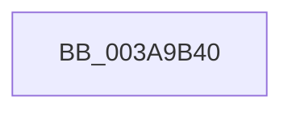

# B_TREE&lt;unsigned long,ST_STORE&lt;SM_TRAITS&gt;::_ST_REGION_ENTRY,4096,NP_CONTEXT,ST_STORE&lt;SM_TRAITS&gt;::ST_REGION_ENTRY_COMPARATOR&gt;::BTreeFindPreviousEntry

- RVA: `0x003A9B40`–`0x003A9B4E` (길이 `14` bytes)
- VA: `0x00000001403A9B40`
- 실행 섹션: `.text`
- PDB 이름 있음: `예`; PDB Function 태그: `아니요`
- unwind 정보 RVA: `0x0008B6D4`
- 디코드: `5`개 명령, `14/14` bytes 표시
- 미해석 바이트: `0` (있으면 어셈블리에 `.byte`로 보존)

> 이 문서는 커널 이미지의 기계어와 PDB 기호를 분석해 생성했습니다. 4번과 5번은 함수 원형과 자료형을 바이너리 사용 방식에서 추정한 C 해석이며 원본 소스 복구 결과는 아닙니다.

## 1. Dependencies

- 직접 호출 지점: **0**; 고유 호출 대상: **0**
- 직접 호출자로 확인된 함수: **3**
- RIP 상대 이미지 참조: **0**

### Outgoing calls
- 직접 디코드된 call 명령이 없습니다.

### Direct callers
- [ST_STORE&lt;SM_TRAITS&gt;::StDmCombineRegion](../3B/ST_STORE_SM_TRAITS_StDmCombineRegion_function_003B0E34.md) at `0x003B1018`
- [ST_STORE&lt;SM_TRAITS&gt;::StDmCombineBufferProcess](../4E/ST_STORE_SM_TRAITS_StDmCombineBufferProcess_function_004EB9AC.md) at `0x004EBB26`
- [ST_STORE&lt;SM_TRAITS&gt;::StDmRegionGetKeys](../60/ST_STORE_SM_TRAITS_StDmRegionGetKeys_function_0060E140.md) at `0x0060E253`

### Static image references
- 디코드된 RIP-relative 메모리 참조가 없습니다.

## 2. Other-region calls and transfers

- 다른 실행 섹션으로 향하는 call: **0**
- call이 아닌 외부 분기/꼬리 이동: **1**
  - `0x003A9B4C` → [sub_003A9B7A + 0x6](Unknown_function_003A9B7A.md) (`tail-transfer`)

## 3. Assembly (complete function range)

```asm
003A9B40  48 83 EC 28                     sub rsp, 0x28
003A9B44  8B 42 18                        mov eax, dword ptr [rdx + 0x18]
003A9B47  4C 8B C9                        mov r9, rcx
003A9B4A  85 C0                           test eax, eax
003A9B4C  74 32                           je 0x1403a9b80
```

## 4. C-style interpretation (structured pseudocode)

```c
__int64 __fastcall B_TREE_unsigned_long_ST_STORE_SM_TRAITS____ST_REGION_ENTRY_4096_NP_CONTEXT_ST_STORE_SM_TRAITS___ST_R(__int64 a1, __int64 a2)
{
    __int64 v_rsp;

    v_rsp = (v_rsp) - (40);
}
```

## 5. (Beta) C Style

```c
int64_t B_TREE_unsigned_long_ST_STORE_SM_TRAITS____ST_REGION_ENTRY_4096_NP_CONTEXT_ST_STORE_SM_TRAITS___ST_R(int64_t Arg1, void *Arg2)
{
    uint8_t *arg2 = (uint8_t *)Arg2;

    int64_t local_rsp;

    local_rsp = (local_rsp) - (40);
}
```

### 관측된 메모리 오프셋

구조체 형식이 확인되지 않은 접근은 인자 기준의 오프셋으로만 기록했습니다.

| 기준 인자 | 오프셋 표현 | 폭 (bit) | 접근 |
|---|---:|---:|---|
| `Arg2` | `+ 0x18` | `32` | `R` |

## 6. Execution-region graph

[열기: 2D/3D 그래프와 함수 탐색 컨트롤 패널](../../../control-panel.html?section=text&rva=0x003A9B40&view=graph)

- 2D 그래프는 위에서 아래로 흐르고, 3D 그래프는 빈 공간을 드래그해 회전합니다. Shift+드래그는 이동, 휠은 확대·축소, 함수 노드 선택은 대상 보고서 이동입니다.

### Static fallback


