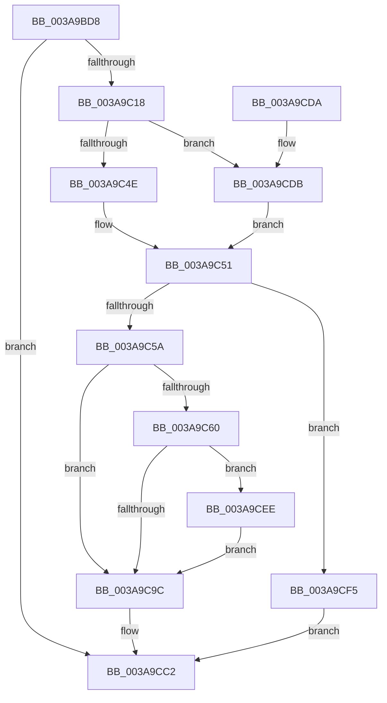

# B_TREE&lt;unsigned long,ST_STORE&lt;SM_TRAITS&gt;::_ST_REGION_ENTRY,4096,NP_CONTEXT,ST_STORE&lt;SM_TRAITS&gt;::ST_REGION_ENTRY_COMPARATOR&gt;::BTreeFindLeafSiblingEx

- RVA: `0x003A9BD8`–`0x003A9CFB` (길이 `291` bytes)
- VA: `0x00000001403A9BD8`
- 실행 섹션: `.text`
- PDB 이름 있음: `예`; PDB Function 태그: `아니요`
- unwind 정보 RVA: `0x0008B744`
- 디코드: `85`개 명령, `291/291` bytes 표시
- 미해석 바이트: `0` (있으면 어셈블리에 `.byte`로 보존)

> 이 문서는 커널 이미지의 기계어와 PDB 기호를 분석해 생성했습니다. 4번과 5번은 함수 원형과 자료형을 바이너리 사용 방식에서 추정한 C 해석이며 원본 소스 복구 결과는 아닙니다.

## 1. Dependencies

- 직접 호출 지점: **5**; 고유 호출 대상: **4**
- 직접 호출자로 확인된 함수: **2**
- RIP 상대 이미지 참조: **0**

### Outgoing calls
- `0x003A9C0B` → [B_TREE<unsigned long,ST_STORE<SM_TRAITS>::_ST_REGION_ENTRY,4096,NP_CONTEXT,ST_STORE<SM_TRAITS>::ST_REGION_ENTRY_COMPARATOR>::BTreeFindSeperatorIndexEntry](B_TREE_unsigned_long_ST_STORE_SM_TRAITS__ST_REGION_ENTRY_4096_NP_CONTEXT_ST_STORE_SM_TRAITS_ST_REGIO_function_003A9D04.md) (function, `0x003A9D04`)
- `0x003A9C22` → [B_TREE<unsigned long,ST_STORE<SM_TRAITS>::_ST_REGION_ENTRY,4096,NP_CONTEXT,ST_STORE<SM_TRAITS>::ST_REGION_ENTRY_COMPARATOR>::BTreeDescendToSibling](B_TREE_unsigned_long_ST_STORE_SM_TRAITS__ST_REGION_ENTRY_4096_NP_CONTEXT_ST_STORE_SM_TRAITS_ST_REGIO_function_003AA1C4.md) (function, `0x003AA1C4`)
- `0x003A9CA6` → [B_TREE<unsigned long,ST_STORE<SM_TRAITS>::_ST_REGION_ENTRY,4096,NP_CONTEXT,ST_STORE<SM_TRAITS>::ST_REGION_ENTRY_COMPARATOR>::BTreeDescendToSibling](B_TREE_unsigned_long_ST_STORE_SM_TRAITS__ST_REGION_ENTRY_4096_NP_CONTEXT_ST_STORE_SM_TRAITS_ST_REGIO_function_003AA1C4.md) (function, `0x003AA1C4`)
- `0x003A9CE1` → [NP_CONTEXT::NpLeafRefInternal](NP_CONTEXT_NpLeafRefInternal_function_003AA340.md) (function, `0x003AA340`)
- `0x003A9CEE` → [NP_CONTEXT::NpLeafDerefInternal](NP_CONTEXT_NpLeafDerefInternal_function_003A9A70.md) (function, `0x003A9A70`)

### Direct callers
- [sub_003A9B88](Unknown_function_003A9B88.md) at `0x003A9B95`
- [B_TREE&lt;unsigned long,ST_STORE&lt;SM_TRAITS&gt;::_ST_REGION_ENTRY,4096,NP_CONTEXT,ST_STORE&lt;SM_TRAITS&gt;::ST_REGION_ENTRY_COMPARATOR&gt;::BTreeFindLeafSibling](../45/B_TREE_unsigned_long_ST_STORE_SM_TRAITS__ST_REGION_ENTRY_4096_NP_CONTEXT_ST_STORE_SM_TRAITS_ST_REGIO_function_00450FB8.md) at `0x00451084`

### Static image references
- 디코드된 RIP-relative 메모리 참조가 없습니다.

## 2. Other-region calls and transfers

- 다른 실행 섹션으로 향하는 call: **0**
- 별도 외부 분기/꼬리 이동을 확인하지 못했습니다.

## 3. Assembly (complete function range)

```asm
003A9BD8  48 8B C4                        mov rax, rsp
003A9BDB  48 89 58 08                     mov qword ptr [rax + 8], rbx
003A9BDF  48 89 68 10                     mov qword ptr [rax + 0x10], rbp
003A9BE3  48 89 70 18                     mov qword ptr [rax + 0x18], rsi
003A9BE7  57                              push rdi
003A9BE8  48 83 EC 30                     sub rsp, 0x30
003A9BEC  48 8B FA                        mov rdi, rdx
003A9BEF  48 8B E9                        mov rbp, rcx
003A9BF2  41 8B D0                        mov edx, r8d
003A9BF5  0F 57 C0                        xorps xmm0, xmm0
003A9BF8  41 8B F0                        mov esi, r8d
003A9BFB  83 E2 01                        and edx, 1
003A9BFE  4C 8D 40 E8                     lea r8, [rax - 0x18]
003A9C02  48 8B CF                        mov rcx, rdi
003A9C05  0F 11 40 E8                     movups xmmword ptr [rax - 0x18], xmm0
003A9C09  33 DB                           xor ebx, ebx
003A9C0B  E8 F4 00 00 00                  call 0x1403a9d04
003A9C10  85 C0                           test eax, eax
003A9C12  0F 84 AA 00 00 00               je 0x1403a9cc2
003A9C18  45 33 C0                        xor r8d, r8d
003A9C1B  48 8D 4C 24 20                  lea rcx, [rsp + 0x20]
003A9C20  8B D6                           mov edx, esi
003A9C22  E8 9D 05 00 00                  call 0x1403aa1c4
003A9C27  44 8B 47 20                     mov r8d, dword ptr [rdi + 0x20]
003A9C2B  48 8D 55 10                     lea rdx, [rbp + 0x10]
003A9C2F  41 83 E0 01                     and r8d, 1
003A9C33  48 8B CD                        mov rcx, rbp
003A9C36  45 03 C0                        add r8d, r8d
003A9C39  48 F7 D9                        neg rcx
003A9C3C  4D 1B C9                        sbb r9, r9
003A9C3F  4C 23 CA                        and r9, rdx
003A9C42  49 8B 09                        mov rcx, qword ptr [r9]
003A9C45  83 39 FF                        cmp dword ptr [rcx], -1
003A9C48  0F 85 8D 00 00 00               jne 0x1403a9cdb
003A9C4E  48 8B 18                        mov rbx, qword ptr [rax]
003A9C51  48 85 DB                        test rbx, rbx
003A9C54  0F 84 9B 00 00 00               je 0x1403a9cf5
003A9C5A  40 F6 C6 02                     test sil, 2
003A9C5E  74 3C                           je 0x1403a9c9c
003A9C60  8B 47 18                        mov eax, dword ptr [rdi + 0x18]
003A9C63  83 E8 02                        sub eax, 2
003A9C66  48 C1 E0 04                     shl rax, 4
003A9C6A  48 03 07                        add rax, qword ptr [rdi]
003A9C6D  4C 8B 40 08                     mov r8, qword ptr [rax + 8]
003A9C71  48 8B 00                        mov rax, qword ptr [rax]
003A9C74  49 8D 50 F8                     lea rdx, [r8 - 8]
003A9C78  48 8D 48 10                     lea rcx, [rax + 0x10]
003A9C7C  48 83 C0 08                     add rax, 8
003A9C80  4C 3B C1                        cmp r8, rcx
003A9C83  48 0F 46 D0                     cmovbe rdx, rax
003A9C87  48 8D 45 10                     lea rax, [rbp + 0x10]
003A9C8B  48 F7 DD                        neg rbp
003A9C8E  48 1B C9                        sbb rcx, rcx
003A9C91  48 23 C8                        and rcx, rax
003A9C94  48 8B 01                        mov rax, qword ptr [rcx]
003A9C97  83 38 FF                        cmp dword ptr [rax], -1
003A9C9A  75 52                           jne 0x1403a9cee
003A9C9C  4C 8B C7                        mov r8, rdi
003A9C9F  48 8D 4C 24 20                  lea rcx, [rsp + 0x20]
003A9CA4  8B D6                           mov edx, esi
003A9CA6  E8 19 05 00 00                  call 0x1403aa1c4
003A9CAB  8B 57 18                        mov edx, dword ptr [rdi + 0x18]
003A9CAE  48 8D 4B 10                     lea rcx, [rbx + 0x10]
003A9CB2  FF CA                           dec edx
003A9CB4  48 C1 E2 04                     shl rdx, 4
003A9CB8  48 03 17                        add rdx, qword ptr [rdi]
003A9CBB  48 89 1A                        mov qword ptr [rdx], rbx
003A9CBE  48 89 4A 08                     mov qword ptr [rdx + 8], rcx
003A9CC2  48 8B 6C 24 48                  mov rbp, qword ptr [rsp + 0x48]
003A9CC7  48 8B C3                        mov rax, rbx
003A9CCA  48 8B 5C 24 40                  mov rbx, qword ptr [rsp + 0x40]
003A9CCF  48 8B 74 24 50                  mov rsi, qword ptr [rsp + 0x50]
003A9CD4  48 83 C4 30                     add rsp, 0x30
003A9CD8  5F                              pop rdi
003A9CD9  C3                              ret
003A9CDA  CC                              int3
003A9CDB  48 8B D0                        mov rdx, rax
003A9CDE  49 8B C9                        mov rcx, r9
003A9CE1  E8 5A 06 00 00                  call 0x1403aa340
003A9CE6  48 8B D8                        mov rbx, rax
003A9CE9  E9 63 FF FF FF                  jmp 0x1403a9c51
003A9CEE  E8 7D FD FF FF                  call 0x1403a9a70
003A9CF3  EB A7                           jmp 0x1403a9c9c
003A9CF5  48 83 CB FF                     or rbx, 0xffffffffffffffff
003A9CF9  EB C7                           jmp 0x1403a9cc2
```

## 4. C-style interpretation (structured pseudocode)

```c
__int64 __fastcall B_TREE_unsigned_long_ST_STORE_SM_TRAITS____ST_REGION_ENTRY_4096_NP_CONTEXT_ST_STORE_SM_TRAITS___ST_R(__int64 a1, __int64 a2, int a3, __int64 a4)
{
    __int64 result;
    __int64 v_rbp;
    __int64 v_rbx;
    __int64 v_rsp;
    unsigned __int64 v_stack_m18;
    unsigned __int64 v_stack_p10;
    unsigned __int64 v_stack_p18;
    unsigned __int64 v_stack_p8;

    *(unsigned __int64 *)(v_rsp + 8) = v_rbx;
    *(unsigned __int64 *)(v_rsp + 16) = v_rbp;
    *(unsigned __int64 *)(v_rsp + 24) = v_rsi;
    v_rsp = (v_rsp) - (48);
    a2 = (unsigned int)(((unsigned int)(a3)) & (1));
    *(unsigned __int64 *)(v_rsp - 24) = v_xmm0;
    v_rbx = 0;
    result = B_TREE_unsigned_long_ST_STORE_SM_TRAITS____ST_REGION_ENTRY_4096_NP_CONTEXT_ST_STORE_SM_TRAITS___ST_R(a2, a2, v_rsp - 24, a4);
    if ((unsigned int)(result) == 0) goto loc_003A9CC2;
    a3 = 0;
    result = B_TREE_unsigned_long_ST_STORE_SM_TRAITS____ST_REGION_ENTRY_4096_NP_CONTEXT_ST_STORE_SM_TRAITS___ST_R(v_stack_m18, (unsigned int)((unsigned int)((unsigned int)(a3))), a3, a4);
    a3 = (unsigned int)(((unsigned int)(*(unsigned int *)(a2 + 32))) & (1));
    a3 = (unsigned int)((a3) + (a3));
    a1 = -(a1);
    a4 = (a4) & (a1 + 16);
    if ((*(unsigned int *)(*(unsigned __int64 *)(a4))) != -1) goto loc_003A9CDB;
loc_003A9C51:
    if (*(unsigned __int64 *)(result) == 0) goto loc_003A9CF5;
    if ((((unsigned __int8)((unsigned int)(a3))) & (2)) == 0) goto loc_003A9C9C;
    result = (unsigned int)(((unsigned int)(*(unsigned int *)(a2 + 24))) - (2));
    result = (result) << (4);
    result = (result) + (*(unsigned __int64 *)(a2));
    result = (*(unsigned __int64 *)(result)) + (8);
    a2 = *(unsigned __int64 *)(result + 8) - 8;
    if ((*(unsigned __int64 *)(result + 8)) <= (*(unsigned __int64 *)(result) + 16)) { a2 = result; }
    v_rbp = -(a1);
    a1 = (*(unsigned __int64 *)(result) + 16) & (a1 + 16);
    if ((*(unsigned int *)(*(unsigned __int64 *)(a1))) != -1) goto loc_003A9CEE;
loc_003A9C9C:
    result = B_TREE_unsigned_long_ST_STORE_SM_TRAITS____ST_REGION_ENTRY_4096_NP_CONTEXT_ST_STORE_SM_TRAITS___ST_R(v_stack_m18, (unsigned int)((unsigned int)((unsigned int)(a3))), a2, a4);
    a2 = (unsigned int)(((unsigned int)(*(unsigned int *)(a2 + 24))) - 1);
    a2 = (a2) << (4);
    a2 = (a2) + (*(unsigned __int64 *)(a2));
    *(unsigned __int64 *)(a2) = *(unsigned __int64 *)(result);
    *(unsigned __int64 *)(a2 + 8) = *(unsigned __int64 *)(result) + 16;
loc_003A9CC2:
    v_rsp = (v_rsp) + (48);
    return *(unsigned __int64 *)(result);
loc_003A9CDB:
    result = NP_CONTEXT__NpLeafRefInternal(a4, *(unsigned __int64 *)(result), a2, a4);
    goto loc_003A9C51;
loc_003A9CEE:
    result = NP_CONTEXT__NpLeafDerefInternal(a4, *(unsigned __int64 *)(result), a2, a4);
    goto loc_003A9C9C;
loc_003A9CF5:
    v_rbx = (result) | (-1);
    goto loc_003A9CC2;
}
```

## 5. (Beta) C Style

```c
int64_t B_TREE_unsigned_long_ST_STORE_SM_TRAITS____ST_REGION_ENTRY_4096_NP_CONTEXT_ST_STORE_SM_TRAITS___ST_R(void *Arg1, void *Arg2, int32_t Arg3, int64_t Arg4)
{
    uint8_t *arg1 = (uint8_t *)Arg1;
    uint8_t *arg2 = (uint8_t *)Arg2;

    int64_t result;
    int64_t local_rbp;
    int64_t local_rbx;
    int64_t local_rsp;
    uint64_t v_stack_m18;
    uint64_t v_stack_p10;
    uint64_t v_stack_p18;
    uint64_t v_stack_p8;

    *(uint64_t *)(local_rsp + 0x8) = local_rbx;
    *(uint64_t *)(local_rsp + 0x10) = local_rbp;
    *(uint64_t *)(local_rsp + 0x18) = local_rsi;
    local_rsp = (local_rsp) - (48);
    Arg2 = (uint32_t)(((uint32_t)(Arg3)) & (1));
    *(uint64_t *)(local_rsp - 0x18) = v_xmm0;
    local_rbx = 0;
    result = B_TREE_unsigned_long_ST_STORE_SM_TRAITS____ST_REGION_ENTRY_4096_NP_CONTEXT_ST_STORE_SM_TRAITS___ST_R(Arg2, Arg2, local_rsp - 24, Arg4);
    if ((uint32_t)(result) == 0) goto loc_003A9CC2;
    Arg3 = 0;
    result = B_TREE_unsigned_long_ST_STORE_SM_TRAITS____ST_REGION_ENTRY_4096_NP_CONTEXT_ST_STORE_SM_TRAITS___ST_R(v_stack_m18, (uint32_t)((uint32_t)((uint32_t)(Arg3))), Arg3, Arg4);
    Arg3 = (uint32_t)(((uint32_t)(*(uint32_t *)(arg2 + 0x20))) & (1));
    Arg3 = (uint32_t)((Arg3) + (Arg3));
    Arg1 = -(Arg1);
    Arg4 = (Arg4) & (Arg1 + 16);
    if ((*(uint32_t *)(*(uint64_t *)(Arg4))) != -1) goto loc_003A9CDB;
loc_003A9C51:
    if (*(uint64_t *)(result) == 0) goto loc_003A9CF5;
    if ((((uint8_t)((uint32_t)(Arg3))) & (2)) == 0) goto loc_003A9C9C;
    result = (uint32_t)(((uint32_t)(*(uint32_t *)(arg2 + 0x18))) - (2));
    result = (result) << (4);
    result = (result) + (*(uint64_t *)(arg2));
    result = (*(uint64_t *)(result)) + (8);
    Arg2 = *(uint64_t *)(result + 0x8) - 8;
    if ((*(uint64_t *)(result + 0x8)) <= (*(uint64_t *)(result) + 16)) { Arg2 = result; }
    local_rbp = -(Arg1);
    Arg1 = (*(uint64_t *)(result) + 16) & (Arg1 + 16);
    if ((*(uint32_t *)(*(uint64_t *)(arg1))) != -1) goto loc_003A9CEE;
loc_003A9C9C:
    result = B_TREE_unsigned_long_ST_STORE_SM_TRAITS____ST_REGION_ENTRY_4096_NP_CONTEXT_ST_STORE_SM_TRAITS___ST_R(v_stack_m18, (uint32_t)((uint32_t)((uint32_t)(Arg3))), Arg2, Arg4);
    Arg2 = (uint32_t)(((uint32_t)(*(uint32_t *)(arg2 + 0x18))) - 1);
    Arg2 = (Arg2) << (4);
    Arg2 = (Arg2) + (*(uint64_t *)(arg2));
    *(uint64_t *)(arg2) = *(uint64_t *)(result);
    *(uint64_t *)(arg2 + 0x8) = *(uint64_t *)(result) + 16;
loc_003A9CC2:
    local_rsp = (local_rsp) + (48);
    return *(uint64_t *)(result);
loc_003A9CDB:
    result = NP_CONTEXT__NpLeafRefInternal(Arg4, *(uint64_t *)(result), Arg2, Arg4);
    goto loc_003A9C51;
loc_003A9CEE:
    result = NP_CONTEXT__NpLeafDerefInternal(Arg4, *(uint64_t *)(result), Arg2, Arg4);
    goto loc_003A9C9C;
loc_003A9CF5:
    local_rbx = (result) | (-1);
    goto loc_003A9CC2;
}
```

### 관측된 메모리 오프셋

구조체 형식이 확인되지 않은 접근은 인자 기준의 오프셋으로만 기록했습니다.

| 기준 인자 | 오프셋 표현 | 폭 (bit) | 접근 |
|---|---:|---:|---|
| `Arg1` | `+ 0x10` | `64` | `R` |
| `Arg2` | `+ 0x0` | `64` | `R` |
| `Arg2` | `+ 0x18` | `32` | `R` |
| `Arg2` | `+ 0x20` | `32` | `R` |

## 6. Execution-region graph

[열기: 2D/3D 그래프와 함수 탐색 컨트롤 패널](../../../control-panel.html?section=text&rva=0x003A9BD8&view=graph)

- 2D 그래프는 위에서 아래로 흐르고, 3D 그래프는 빈 공간을 드래그해 회전합니다. Shift+드래그는 이동, 휠은 확대·축소, 함수 노드 선택은 대상 보고서 이동입니다.

### Static fallback


