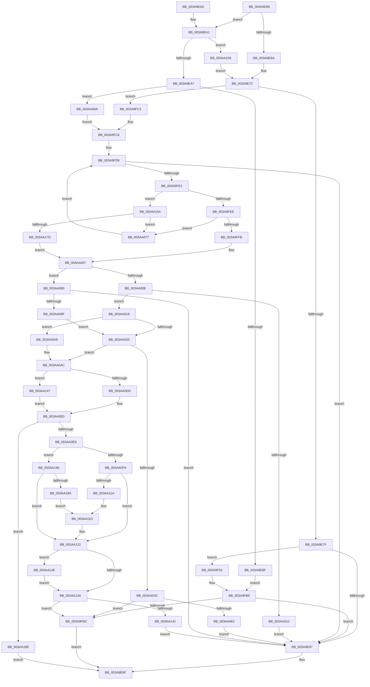

# B_TREE&lt;unsigned long,ST_STORE&lt;SM_TRAITS&gt;::_ST_REGION_ENTRY,4096,NP_CONTEXT,ST_STORE&lt;SM_TRAITS&gt;::ST_REGION_ENTRY_COMPARATOR&gt;::BTreeChangeKey

- RVA: `0x003A9D80`–`0x003AA1BD` (길이 `1,085` bytes)
- VA: `0x00000001403A9D80`
- 실행 섹션: `.text`
- PDB 이름 있음: `예`; PDB Function 태그: `아니요`
- unwind 정보 RVA: `0x0008B75C`
- 디코드: `302`개 명령, `1,085/1,085` bytes 표시
- 미해석 바이트: `0` (있으면 어셈블리에 `.byte`로 보존)

> 이 문서는 커널 이미지의 기계어와 PDB 기호를 분석해 생성했습니다. 4번과 5번은 함수 원형과 자료형을 바이너리 사용 방식에서 추정한 C 해석이며 원본 소스 복구 결과는 아닙니다.

## 1. Dependencies

- 직접 호출 지점: **7**; 고유 호출 대상: **4**
- 직접 호출자로 확인된 함수: **1**
- RIP 상대 이미지 참조: **0**

### Outgoing calls
- `0x003AA055` → [ST_STORE<SM_TRAITS>::ST_REGION_ENTRY_COMPARATOR::Compare](ST_STORE_SM_TRAITS_ST_REGION_ENTRY_COMPARATOR_Compare_function_003AA270.md) (function, `0x003AA270`)
- `0x003AA092` → [ST_STORE<SM_TRAITS>::ST_REGION_ENTRY_COMPARATOR::Compare](ST_STORE_SM_TRAITS_ST_REGION_ENTRY_COMPARATOR_Compare_function_003AA270.md) (function, `0x003AA270`)
- `0x003AA0BC` → [B_TREE<unsigned long,ST_STORE<SM_TRAITS>::_ST_REGION_ENTRY,4096,NP_CONTEXT,ST_STORE<SM_TRAITS>::ST_REGION_ENTRY_COMPARATOR>::BTreeDescendToSibling](B_TREE_unsigned_long_ST_STORE_SM_TRAITS__ST_REGION_ENTRY_4096_NP_CONTEXT_ST_STORE_SM_TRAITS_ST_REGIO_function_003AA1C4.md) (function, `0x003AA1C4`)
- `0x003AA111` → [ST_STORE<SM_TRAITS>::ST_REGION_ENTRY_COMPARATOR::Compare](ST_STORE_SM_TRAITS_ST_REGION_ENTRY_COMPARATOR_Compare_function_003AA270.md) (function, `0x003AA270`)
- `0x003AA147` → [NP_CONTEXT::NpLeafRefInternal](NP_CONTEXT_NpLeafRefInternal_function_003AA340.md) (function, `0x003AA340`)
- `0x003AA152` → [NP_CONTEXT::NpLeafDerefInternal](NP_CONTEXT_NpLeafDerefInternal_function_003A9A70.md) (function, `0x003A9A70`)
- `0x003AA1A8` → [ST_STORE<SM_TRAITS>::ST_REGION_ENTRY_COMPARATOR::Compare](ST_STORE_SM_TRAITS_ST_REGION_ENTRY_COMPARATOR_Compare_function_003AA270.md) (function, `0x003AA270`)

### Direct callers
- [ST_STORE&lt;SM_TRAITS&gt;::StCompactRegions](../4A/ST_STORE_SM_TRAITS_StCompactRegions_function_004A48E0.md) at `0x004A4CE2`
- [ST_STORE&lt;SM_TRAITS&gt;::StCompactRegions](../4A/ST_STORE_SM_TRAITS_StCompactRegions_function_004A48E0.md) at `0x004A4D06`
- [ST_STORE&lt;SM_TRAITS&gt;::StCompactRegions](../4A/ST_STORE_SM_TRAITS_StCompactRegions_function_004A48E0.md) at `0x004A4D35`
- [ST_STORE&lt;SM_TRAITS&gt;::StCompactRegions](../4A/ST_STORE_SM_TRAITS_StCompactRegions_function_004A48E0.md) at `0x004A4E63`

### Static image references
- 디코드된 RIP-relative 메모리 참조가 없습니다.

## 2. Other-region calls and transfers

- 다른 실행 섹션으로 향하는 call: **0**
- 별도 외부 분기/꼬리 이동을 확인하지 못했습니다.

## 3. Assembly (complete function range)

```asm
003A9D80  48 89 4C 24 08                  mov qword ptr [rsp + 8], rcx
003A9D85  55                              push rbp
003A9D86  53                              push rbx
003A9D87  56                              push rsi
003A9D88  57                              push rdi
003A9D89  41 54                           push r12
003A9D8B  41 55                           push r13
003A9D8D  41 56                           push r14
003A9D8F  41 57                           push r15
003A9D91  48 8B EC                        mov rbp, rsp
003A9D94  48 83 EC 48                     sub rsp, 0x48
003A9D98  8B 42 18                        mov eax, dword ptr [rdx + 0x18]
003A9D9B  4C 8B C9                        mov r9, rcx
003A9D9E  48 8B 0A                        mov rcx, qword ptr [rdx]
003A9DA1  45 8B D8                        mov r11d, r8d
003A9DA4  89 45 50                        mov dword ptr [rbp + 0x50], eax
003A9DA7  45 8B F8                        mov r15d, r8d
003A9DAA  48 89 4D E0                     mov qword ptr [rbp - 0x20], rcx
003A9DAE  0F 57 C0                        xorps xmm0, xmm0
003A9DB1  41 8B B9 90 01 00 00            mov edi, dword ptr [r9 + 0x190]
003A9DB8  8D 58 FF                        lea ebx, [rax - 1]
003A9DBB  45 8B A1 88 01 00 00            mov r12d, dword ptr [r9 + 0x188]
003A9DC2  33 C0                           xor eax, eax
003A9DC4  45 8B A9 8C 01 00 00            mov r13d, dword ptr [r9 + 0x18c]
003A9DCB  48 03 DB                        add rbx, rbx
003A9DCE  45 8B B1 98 01 00 00            mov r14d, dword ptr [r9 + 0x198]
003A9DD5  45 8B C5                        mov r8d, r13d
003A9DD8  89 45 58                        mov dword ptr [rbp + 0x58], eax
003A9DDB  45 23 C7                        and r8d, r15d
003A9DDE  B8 01 00 00 00                  mov eax, 1
003A9DE3  89 7D 58                        mov dword ptr [rbp + 0x58], edi
003A9DE6  48 8B 34 D9                     mov rsi, qword ptr [rcx + rbx*8]
003A9DEA  48 8B 5C D9 08                  mov rbx, qword ptr [rcx + rbx*8 + 8]
003A9DEF  41 8B CC                        mov ecx, r12d
003A9DF2  41 D3 EB                        shr r11d, cl
003A9DF5  41 0F BD CB                     bsr ecx, r11d
003A9DF9  44 8B 13                        mov r10d, dword ptr [rbx]
003A9DFC  D3 E0                           shl eax, cl
003A9DFE  41 33 C3                        xor eax, r11d
003A9E01  C7 45 60 00 00 00 00            mov dword ptr [rbp + 0x60], 0
003A9E08  48 03 C0                        add rax, rax
003A9E0B  49 8B 8C C9 80 00 00 00         mov rcx, qword ptr [r9 + rcx*8 + 0x80]
003A9E13  0F 11 45 E8                     movups xmmword ptr [rbp - 0x18], xmm0
003A9E17  48 8B 14 C1                     mov rdx, qword ptr [rcx + rax*8]
003A9E1B  8B C7                           mov eax, edi
003A9E1D  41 0F AF C0                     imul eax, r8d
003A9E21  49 03 D6                        add rdx, r14
003A9E24  41 8B CC                        mov ecx, r12d
003A9E27  45 8B C5                        mov r8d, r13d
003A9E2A  45 23 C2                        and r8d, r10d
003A9E2D  48 89 45 D8                     mov qword ptr [rbp - 0x28], rax
003A9E31  4C 8D 0C 10                     lea r9, [rax + rdx]
003A9E35  41 8B C2                        mov eax, r10d
003A9E38  4C 8B 55 48                     mov r10, qword ptr [rbp + 0x48]
003A9E3C  BA 01 00 00 00                  mov edx, 1
003A9E41  D3 E8                           shr eax, cl
003A9E43  0F BD C8                        bsr ecx, eax
003A9E46  D3 E2                           shl edx, cl
003A9E48  33 C2                           xor eax, edx
003A9E4A  8B D7                           mov edx, edi
003A9E4C  48 03 C0                        add rax, rax
003A9E4F  41 0F AF D0                     imul edx, r8d
003A9E53  49 8B 8C CA 80 00 00 00         mov rcx, qword ptr [r10 + rcx*8 + 0x80]
003A9E5B  48 8B 0C C1                     mov rcx, qword ptr [rcx + rax*8]
003A9E5F  41 8B 01                        mov eax, dword ptr [r9]
003A9E62  49 03 CE                        add rcx, r14
003A9E65  3B 04 0A                        cmp eax, dword ptr [rdx + rcx]
003A9E68  73 37                           jae 0x1403a9ea1
003A9E6A  BF FF FF FF FF                  mov edi, 0xffffffff
003A9E6F  45 33 C0                        xor r8d, r8d
003A9E72  48 8D 46 10                     lea rax, [rsi + 0x10]
003A9E76  48 3B D8                        cmp rbx, rax
003A9E79  0F 86 44 01 00 00               jbe 0x1403a9fc3
003A9E7F  85 FF                           test edi, edi
003A9E81  0F 85 CB 00 00 00               jne 0x1403a9f52
003A9E87  44 89 3B                        mov dword ptr [rbx], r15d
003A9E8A  B8 01 00 00 00                  mov eax, 1
003A9E8F  48 83 C4 48                     add rsp, 0x48
003A9E93  41 5F                           pop r15
003A9E95  41 5E                           pop r14
003A9E97  41 5D                           pop r13
003A9E99  41 5C                           pop r12
003A9E9B  5F                              pop rdi
003A9E9C  5E                              pop rsi
003A9E9D  5B                              pop rbx
003A9E9E  5D                              pop rbp
003A9E9F  C3                              ret
003A9EA0  CC                              int3
003A9EA1  0F 86 B2 02 00 00               jbe 0x1403aa159
003A9EA7  8B 06                           mov eax, dword ptr [rsi]
003A9EA9  0F B7 C8                        movzx ecx, ax
003A9EAC  FF C9                           dec ecx
003A9EAE  48 83 C1 04                     add rcx, 4
003A9EB2  48 8D 0C 8E                     lea rcx, [rsi + rcx*4]
003A9EB6  48 3B D9                        cmp rbx, rcx
003A9EB9  0F 83 AB 01 00 00               jae 0x1403aa06a
003A9EBF  0F AE E8                        lfence
003A9EC2  4C 8B 6D 48                     mov r13, qword ptr [rbp + 0x48]
003A9EC6  41 8B D7                        mov edx, r15d
003A9EC9  45 8B 92 88 01 00 00            mov r10d, dword ptr [r10 + 0x188]
003A9ED0  41 B8 01 00 00 00               mov r8d, 1
003A9ED6  44 8B 4B 04                     mov r9d, dword ptr [rbx + 4]
003A9EDA  41 8B CA                        mov ecx, r10d
003A9EDD  D3 EA                           shr edx, cl
003A9EDF  41 8B B5 8C 01 00 00            mov esi, dword ptr [r13 + 0x18c]
003A9EE6  8B C6                           mov eax, esi
003A9EE8  41 8B BD 90 01 00 00            mov edi, dword ptr [r13 + 0x190]
003A9EEF  41 23 C7                        and eax, r15d
003A9EF2  45 8B B5 98 01 00 00            mov r14d, dword ptr [r13 + 0x198]
003A9EF9  41 23 F1                        and esi, r9d
003A9EFC  0F BD CA                        bsr ecx, edx
003A9EFF  0F AF C7                        imul eax, edi
003A9F02  41 D3 E0                        shl r8d, cl
003A9F05  4C 33 C2                        xor r8, rdx
003A9F08  0F AF F7                        imul esi, edi
003A9F0B  4D 03 C0                        add r8, r8
003A9F0E  49 8B 94 CD 80 00 00 00         mov rdx, qword ptr [r13 + rcx*8 + 0x80]
003A9F16  41 8B CA                        mov ecx, r10d
003A9F19  4E 8B 1C C2                     mov r11, qword ptr [rdx + r8*8]
003A9F1D  41 8B D1                        mov edx, r9d
003A9F20  D3 EA                           shr edx, cl
003A9F22  4C 03 D8                        add r11, rax
003A9F25  0F BD CA                        bsr ecx, edx
003A9F28  41 B8 01 00 00 00               mov r8d, 1
003A9F2E  8B C6                           mov eax, esi
003A9F30  41 D3 E0                        shl r8d, cl
003A9F33  4C 33 C2                        xor r8, rdx
003A9F36  4D 03 C0                        add r8, r8
003A9F39  49 8B 8C CD 80 00 00 00         mov rcx, qword ptr [r13 + rcx*8 + 0x80]
003A9F41  4A 8B 0C C1                     mov rcx, qword ptr [rcx + r8*8]
003A9F45  48 03 C8                        add rcx, rax
003A9F48  42 8B 04 31                     mov eax, dword ptr [rcx + r14]
003A9F4C  43 39 04 33                     cmp dword ptr [r11 + r14], eax
003A9F50  EB 64                           jmp 0x1403a9fb6
003A9F52  44 8B 4B FC                     mov r9d, dword ptr [rbx - 4]
003A9F56  41 8B CC                        mov ecx, r12d
003A9F59  41 8B D1                        mov edx, r9d
003A9F5C  41 B8 01 00 00 00               mov r8d, 1
003A9F62  D3 EA                           shr edx, cl
003A9F64  45 23 CD                        and r9d, r13d
003A9F67  44 0F AF 4D 58                  imul r9d, dword ptr [rbp + 0x58]
003A9F6C  0F BD CA                        bsr ecx, edx
003A9F6F  41 8B C1                        mov eax, r9d
003A9F72  41 D3 E0                        shl r8d, cl
003A9F75  4C 33 C2                        xor r8, rdx
003A9F78  BA 01 00 00 00                  mov edx, 1
003A9F7D  4D 03 C0                        add r8, r8
003A9F80  49 8B 8C CA 80 00 00 00         mov rcx, qword ptr [r10 + rcx*8 + 0x80]
003A9F88  4E 8B 0C C1                     mov r9, qword ptr [rcx + r8*8]
003A9F8C  4C 03 C8                        add r9, rax
003A9F8F  41 8B C3                        mov eax, r11d
003A9F92  41 0F BD CB                     bsr ecx, r11d
003A9F96  D3 E2                           shl edx, cl
003A9F98  48 33 D0                        xor rdx, rax
003A9F9B  48 03 D2                        add rdx, rdx
003A9F9E  49 8B 8C CA 80 00 00 00         mov rcx, qword ptr [r10 + rcx*8 + 0x80]
003A9FA6  48 8B 04 D1                     mov rax, qword ptr [rcx + rdx*8]
003A9FAA  48 03 45 D8                     add rax, qword ptr [rbp - 0x28]
003A9FAE  42 8B 04 30                     mov eax, dword ptr [rax + r14]
003A9FB2  43 39 04 31                     cmp dword ptr [r9 + r14], eax
003A9FB6  0F 82 CB FE FF FF               jb 0x1403a9e87
003A9FBC  33 C0                           xor eax, eax
003A9FBE  E9 CC FE FF FF                  jmp 0x1403a9e8f
003A9FC3  45 8B D8                        mov r11d, r8d
003A9FC6  44 8B 45 50                     mov r8d, dword ptr [rbp + 0x50]
003A9FCA  4C 8B 4D E0                     mov r9, qword ptr [rbp - 0x20]
003A9FCE  49 83 E8 02                     sub r8, 2
003A9FD2  49 C1 E0 04                     shl r8, 4
003A9FD6  4D 03 C1                        add r8, r9
003A9FD9  4D 3B C1                        cmp r8, r9
003A9FDC  0F 82 A5 FE FF FF               jb 0x1403a9e87
003A9FE2  49 8B 08                        mov rcx, qword ptr [r8]
003A9FE5  45 85 DB                        test r11d, r11d
003A9FE8  0F 85 76 01 00 00               jne 0x1403aa164
003A9FEE  4D 8B 70 08                     mov r14, qword ptr [r8 + 8]
003A9FF2  48 8D 41 10                     lea rax, [rcx + 0x10]
003A9FF6  4C 3B F0                        cmp r14, rax
003A9FF9  76 7C                           jbe 0x1403aa077
003A9FFB  49 83 C6 F0                     add r14, -0x10
003A9FFF  48 89 4D E8                     mov qword ptr [rbp - 0x18], rcx
003AA003  4C 89 75 F0                     mov qword ptr [rbp - 0x10], r14
003AA007  41 8B 06                        mov eax, dword ptr [r14]
003AA00A  85 FF                           test edi, edi
003AA00C  7F 72                           jg 0x1403aa080
003AA00E  75 08                           jne 0x1403aa018
003AA010  45 89 3E                        mov dword ptr [r14], r15d
003AA013  E9 6F FE FF FF                  jmp 0x1403a9e87
003AA018  85 FF                           test edi, edi
003AA01A  0F 88 88 00 00 00               js 0x1403aa0a8
003AA020  4D 85 D2                        test r10, r10
003AA023  49 8D 42 10                     lea rax, [r10 + 0x10]
003AA027  B9 00 00 00 00                  mov ecx, 0
003AA02C  4D 8D 62 10                     lea r12, [r10 + 0x10]
003AA030  48 0F 44 C1                     cmove rax, rcx
003AA034  48 8B 00                        mov rax, qword ptr [rax]
003AA037  83 38 FF                        cmp dword ptr [rax], -1
003AA03A  75 70                           jne 0x1403aa0ac
003AA03C  48 8B 46 08                     mov rax, qword ptr [rsi + 8]
003AA040  4C 8D 45 58                     lea r8, [rbp + 0x58]
003AA044  48 8D 55 48                     lea rdx, [rbp + 0x48]
003AA048  44 89 7D 48                     mov dword ptr [rbp + 0x48], r15d
003AA04C  49 8B CA                        mov rcx, r10
003AA04F  8B 78 10                        mov edi, dword ptr [rax + 0x10]
003AA052  89 7D 58                        mov dword ptr [rbp + 0x58], edi
003AA055  E8 16 02 00 00                  call 0x1403aa270
003AA05A  85 C0                           test eax, eax
003AA05C  0F 89 5A FF FF FF               jns 0x1403a9fbc
003AA062  41 89 3E                        mov dword ptr [r14], edi
003AA065  E9 1D FE FF FF                  jmp 0x1403a9e87
003AA06A  BF 01 00 00 00                  mov edi, 1
003AA06F  44 8B DF                        mov r11d, edi
003AA072  E9 4F FF FF FF                  jmp 0x1403a9fc6
003AA077  49 83 E8 10                     sub r8, 0x10
003AA07B  E9 59 FF FF FF                  jmp 0x1403a9fd9
003AA080  4C 8D 45 58                     lea r8, [rbp + 0x58]
003AA084  89 45 58                        mov dword ptr [rbp + 0x58], eax
003AA087  48 8D 55 50                     lea rdx, [rbp + 0x50]
003AA08B  44 89 7D 50                     mov dword ptr [rbp + 0x50], r15d
003AA08F  49 8B CA                        mov rcx, r10
003AA092  E8 D9 01 00 00                  call 0x1403aa270
003AA097  85 C0                           test eax, eax
003AA099  0F 88 E8 FD FF FF               js 0x1403a9e87
003AA09F  4C 8B 55 48                     mov r10, qword ptr [rbp + 0x48]
003AA0A3  E9 78 FF FF FF                  jmp 0x1403aa020
003AA0A8  4D 8D 62 10                     lea r12, [r10 + 0x10]
003AA0AC  33 F6                           xor esi, esi
003AA0AE  48 8D 4D E8                     lea rcx, [rbp - 0x18]
003AA0B2  8B D6                           mov edx, esi
003AA0B4  85 FF                           test edi, edi
003AA0B6  0F 9F C2                        setg dl
003AA0B9  45 33 C0                        xor r8d, r8d
003AA0BC  E8 03 01 00 00                  call 0x1403aa1c4
003AA0C1  4C 8B 6D 48                     mov r13, qword ptr [rbp + 0x48]
003AA0C5  8B CE                           mov ecx, esi
003AA0C7  4D 85 ED                        test r13, r13
003AA0CA  48 89 45 50                     mov qword ptr [rbp + 0x50], rax
003AA0CE  48 8B D0                        mov rdx, rax
003AA0D1  49 0F 45 CC                     cmovne rcx, r12
003AA0D5  48 8B 01                        mov rax, qword ptr [rcx]
003AA0D8  83 38 FF                        cmp dword ptr [rax], -1
003AA0DB  75 6A                           jne 0x1403aa147
003AA0DD  48 8B 02                        mov rax, qword ptr [rdx]
003AA0E0  48 85 C0                        test rax, rax
003AA0E3  0F 84 A5 00 00 00               je 0x1403aa18e
003AA0E9  48 8D 50 10                     lea rdx, [rax + 0x10]
003AA0ED  4C 8D 45 58                     lea r8, [rbp + 0x58]
003AA0F1  85 FF                           test edi, edi
003AA0F3  0F 89 9F 00 00 00               jns 0x1403aa198
003AA0F9  8B 00                           mov eax, dword ptr [rax]
003AA0FB  0F B7 C8                        movzx ecx, ax
003AA0FE  FF C9                           dec ecx
003AA100  44 89 7D 58                     mov dword ptr [rbp + 0x58], r15d
003AA104  8B 0C 8A                        mov ecx, dword ptr [rdx + rcx*4]
003AA107  48 8D 55 48                     lea rdx, [rbp + 0x48]
003AA10B  89 4D 48                        mov dword ptr [rbp + 0x48], ecx
003AA10E  49 8B CD                        mov rcx, r13
003AA111  E8 5A 01 00 00                  call 0x1403aa270
003AA116  85 C0                           test eax, eax
003AA118  79 08                           jns 0x1403aa122
003AA11A  45 89 3E                        mov dword ptr [r14], r15d
003AA11D  BE 01 00 00 00                  mov esi, 1
003AA122  4D 85 ED                        test r13, r13
003AA125  49 8D 4D 10                     lea rcx, [r13 + 0x10]
003AA129  B8 00 00 00 00                  mov eax, 0
003AA12E  48 0F 44 C8                     cmove rcx, rax
003AA132  48 8B 01                        mov rax, qword ptr [rcx]
003AA135  83 38 FF                        cmp dword ptr [rax], -1
003AA138  75 14                           jne 0x1403aa14e
003AA13A  85 F6                           test esi, esi
003AA13C  0F 84 7A FE FF FF               je 0x1403a9fbc
003AA142  E9 40 FD FF FF                  jmp 0x1403a9e87
003AA147  E8 F4 01 00 00                  call 0x1403aa340
003AA14C  EB 92                           jmp 0x1403aa0e0
003AA14E  48 8B 55 50                     mov rdx, qword ptr [rbp + 0x50]
003AA152  E8 19 F9 FF FF                  call 0x1403a9a70
003AA157  EB E1                           jmp 0x1403aa13a
003AA159  45 33 C0                        xor r8d, r8d
003AA15C  41 8B F8                        mov edi, r8d
003AA15F  E9 0E FD FF FF                  jmp 0x1403a9e72
003AA164  8B 01                           mov eax, dword ptr [rcx]
003AA166  0F B7 D0                        movzx edx, ax
003AA169  48 FF C2                        inc rdx
003AA16C  48 C1 E2 04                     shl rdx, 4
003AA170  48 03 D1                        add rdx, rcx
003AA173  49 39 50 08                     cmp qword ptr [r8 + 8], rdx
003AA177  0F 83 FA FE FF FF               jae 0x1403aa077
003AA17D  41 0F 10 00                     movups xmm0, xmmword ptr [r8]
003AA181  4D 8B 70 08                     mov r14, qword ptr [r8 + 8]
003AA185  0F 11 45 E8                     movups xmmword ptr [rbp - 0x18], xmm0
003AA189  E9 79 FE FF FF                  jmp 0x1403aa007
003AA18E  B8 FF FF FF FF                  mov eax, 0xffffffff
003AA193  E9 F7 FC FF FF                  jmp 0x1403a9e8f
003AA198  8B 3A                           mov edi, dword ptr [rdx]
003AA19A  49 8B CD                        mov rcx, r13
003AA19D  48 8D 55 48                     lea rdx, [rbp + 0x48]
003AA1A1  89 7D 58                        mov dword ptr [rbp + 0x58], edi
003AA1A4  44 89 7D 48                     mov dword ptr [rbp + 0x48], r15d
003AA1A8  E8 C3 00 00 00                  call 0x1403aa270
003AA1AD  85 C0                           test eax, eax
003AA1AF  0F 89 6D FF FF FF               jns 0x1403aa122
003AA1B5  41 89 3E                        mov dword ptr [r14], edi
003AA1B8  E9 60 FF FF FF                  jmp 0x1403aa11d
```

## 4. C-style interpretation (structured pseudocode)

```c
__int64 __fastcall B_TREE_unsigned_long_ST_STORE_SM_TRAITS____ST_REGION_ENTRY_4096_NP_CONTEXT_ST_STORE_SM_TRAITS___ST_R(__int64 a1, __int64 a2, int a3)
{
    __int64 result;
    __int64 v_r11;
    __int64 v_r14;
    __int64 v_rbx;
    __int64 v_rsi;
    __int64 v_rsp;
    unsigned __int64 v_stack_m50;
    unsigned __int64 v_stack_m58;
    unsigned __int64 v_stack_m60;
    unsigned __int64 v_stack_m68;
    unsigned int v_stack_p10;
    unsigned int v_stack_p18;
    unsigned int v_stack_p20;
    unsigned __int64 v_stack_p8;

    v_stack_p8 = a1;
    v_rsp = (v_rsp) - (72);
    v_stack_p10 = (unsigned int)((unsigned int)(*(unsigned int *)(a2 + 24)));
    v_stack_m60 = *(unsigned __int64 *)(a2);
    result = 0;
    v_rbx = ((unsigned int)(*(unsigned int *)(a2 + 24)) - 1) + ((unsigned int)(*(unsigned int *)(a2 + 24)) - 1);
    v_stack_p18 = 0;
    a3 = (unsigned int)(((unsigned int)((unsigned int)((unsigned int)(*(unsigned int *)(a1 + 396))))) & ((unsigned int)((unsigned int)(a3))));
    v_stack_p18 = (unsigned int)((unsigned int)(*(unsigned int *)(a1 + 400)));
    v_r11 = (unsigned int)(((unsigned int)(a3)) >> ((unsigned __int8)((unsigned int)((unsigned int)((unsigned int)(*(unsigned int *)(a1 + 392)))))));
    result = (unsigned int)((1) << ((unsigned __int8)((unsigned int)((unsigned int)((unsigned int)(*(unsigned int *)(a1 + 392)))))));
    result = (unsigned int)((result) ^ ((unsigned int)(v_r11)));
    v_stack_p20 = 0;
    result = (result) + (result);
    v_stack_m58 = v_xmm0;
    result = (unsigned int)(((unsigned int)((unsigned int)((unsigned int)(*(unsigned int *)(a1 + 400))))) * (a3));
    a2 = (*(unsigned __int64 *)(*(unsigned __int64 *)(a1 + (unsigned int)((unsigned int)((unsigned int)(*(unsigned int *)(a1 + 392)))) * 8 + 128) + result * 8)) + ((unsigned int)(*(unsigned int *)(a1 + 408)));
    a3 = (unsigned int)(((unsigned int)((unsigned int)((unsigned int)(*(unsigned int *)(a1 + 396))))) & ((unsigned int)((unsigned int)(*(unsigned int *)(*(unsigned __int64 *)(*(unsigned __int64 *)(a2) + v_rbx * 8 + 8))))));
    v_stack_m68 = result;
    result = (unsigned int)(((unsigned int)((unsigned int)((unsigned int)(*(unsigned int *)(*(unsigned __int64 *)(*(unsigned __int64 *)(a2) + v_rbx * 8 + 8)))))) >> ((unsigned __int8)((unsigned int)((unsigned int)((unsigned int)(*(unsigned int *)(a1 + 392)))))));
    a2 = (unsigned int)((1) << ((unsigned __int8)((unsigned int)((unsigned int)((unsigned int)(*(unsigned int *)(a1 + 392)))))));
    result = (unsigned int)((result) ^ ((unsigned int)(a2)));
    result = (result) + (result);
    a2 = (unsigned int)(((unsigned int)((unsigned int)((unsigned int)(*(unsigned int *)(a1 + 400))))) * (a3));
    a1 = (*(unsigned __int64 *)(*(unsigned __int64 *)(v_stack_p8 + (unsigned int)((unsigned int)((unsigned int)(*(unsigned int *)(a1 + 392)))) * 8 + 128) + result * 8)) + ((unsigned int)(*(unsigned int *)(a1 + 408)));
    if (((unsigned int)((unsigned int)(*(unsigned int *)(result + a2 * 1)))) >= (*(unsigned int *)(a2 + a1 * 1))) goto loc_003A9EA1;
    a3 = 0;
loc_003A9E72:
    if ((*(unsigned __int64 *)(*(unsigned __int64 *)(a2) + v_rbx * 8 + 8)) <= (*(unsigned __int64 *)(*(unsigned __int64 *)(a2) + v_rbx * 8) + 16)) goto loc_003A9FC3;
    if ((unsigned int)((unsigned int)(0xFFFFFFFFULL)) != 0) goto loc_003A9F52;
loc_003A9E87:
    *(unsigned int *)(*(unsigned __int64 *)(*(unsigned __int64 *)(a2) + v_rbx * 8 + 8)) = (unsigned int)((unsigned int)(a3));
loc_003A9E8F:
    v_rsp = (v_rsp) + (72);
    return 1;
loc_003A9EA1:
    if (condition_is_below_or_equal) goto loc_003AA159;
    a1 = (unsigned int)(((unsigned __int16)((unsigned int)(*(unsigned int *)(*(unsigned __int64 *)(*(unsigned __int64 *)(a2) + v_rbx * 8))))) - 1);
    a1 = (a1) + (4);
    if ((*(unsigned __int64 *)(*(unsigned __int64 *)(a2) + v_rbx * 8 + 8)) >= (*(unsigned __int64 *)(*(unsigned __int64 *)(a2) + v_rbx * 8) + a1 * 4)) goto loc_003AA06A;
    a2 = (unsigned int)(((unsigned int)((unsigned int)((unsigned int)(a3)))) >> ((unsigned __int8)((unsigned int)((unsigned int)((unsigned int)(*(unsigned int *)(v_stack_p8 + 392)))))));
    result = (unsigned int)(((unsigned int)((unsigned int)((unsigned int)(*(unsigned int *)(v_stack_p8 + 396))))) & ((unsigned int)((unsigned int)(a3))));
    v_rsi = (unsigned int)(((unsigned int)(*(unsigned int *)(v_stack_p8 + 396))) & ((unsigned int)((unsigned int)(*(unsigned int *)(*(unsigned __int64 *)(*(unsigned __int64 *)(a2) + v_rbx * 8 + 8) + 4)))));
    result = (unsigned int)((result) * ((unsigned int)((unsigned int)(*(unsigned int *)(v_stack_p8 + 400)))));
    a3 = (unsigned int)((1) << ((unsigned __int8)((unsigned int)((unsigned int)((unsigned int)(*(unsigned int *)(v_stack_p8 + 392)))))));
    a3 = (a3) ^ (a2);
    v_rsi = (unsigned int)((v_rsi) * ((unsigned int)((unsigned int)(*(unsigned int *)(v_stack_p8 + 400)))));
    a3 = (a3) + (a3);
    a2 = (unsigned int)(((unsigned int)((unsigned int)((unsigned int)(*(unsigned int *)(*(unsigned __int64 *)(*(unsigned __int64 *)(a2) + v_rbx * 8 + 8) + 4))))) >> ((unsigned __int8)((unsigned int)((unsigned int)((unsigned int)(*(unsigned int *)(v_stack_p8 + 392)))))));
    v_r11 = (*(unsigned __int64 *)(*(unsigned __int64 *)(v_stack_p8 + (unsigned int)((unsigned int)((unsigned int)(*(unsigned int *)(v_stack_p8 + 392)))) * 8 + 128) + a3 * 8)) + (result);
    a3 = (unsigned int)((1) << ((unsigned __int8)((unsigned int)((unsigned int)((unsigned int)(*(unsigned int *)(v_stack_p8 + 392)))))));
    a3 = (a3) ^ (a2);
    a3 = (a3) + (a3);
    a1 = (*(unsigned __int64 *)(*(unsigned __int64 *)(v_stack_p8 + (unsigned int)((unsigned int)((unsigned int)(*(unsigned int *)(v_stack_p8 + 392)))) * 8 + 128) + a3 * 8)) + ((unsigned int)((unsigned int)(v_rsi)));
    goto loc_003A9FB6;
loc_003A9F52:
    a2 = (unsigned int)(((unsigned int)((unsigned int)((unsigned int)(*(unsigned int *)(*(unsigned __int64 *)(*(unsigned __int64 *)(a2) + v_rbx * 8 + 8) - 4))))) >> ((unsigned __int8)((unsigned int)((unsigned int)((unsigned int)(*(unsigned int *)(a1 + 392)))))));
    a4 = (unsigned int)(((unsigned int)(*(unsigned int *)(*(unsigned __int64 *)(*(unsigned __int64 *)(a2) + v_rbx * 8 + 8) - 4))) & ((unsigned int)(v_stack_p8)));
    a4 = (unsigned int)((a4) * (v_stack_p18));
    a3 = (unsigned int)((1) << ((unsigned __int8)((unsigned int)((unsigned int)((unsigned int)(*(unsigned int *)(a1 + 392)))))));
    a3 = (a3) ^ (a2);
    a3 = (a3) + (a3);
    a4 = (*(unsigned __int64 *)(*(unsigned __int64 *)((unsigned int)(*(unsigned int *)(v_stack_p8 + 392)) + (unsigned int)((unsigned int)((unsigned int)(*(unsigned int *)(a1 + 392)))) * 8 + 128) + a3 * 8)) + ((unsigned int)((unsigned int)(a4)));
    a2 = (unsigned int)((1) << ((unsigned __int8)(*(unsigned __int64 *)((unsigned int)(*(unsigned int *)(v_stack_p8 + 392)) + (unsigned int)((unsigned int)((unsigned int)(*(unsigned int *)(a1 + 392)))) * 8 + 128))));
    a2 = (a2) ^ ((unsigned int)((unsigned int)(v_r11)));
    a2 = (a2) + (a2);
    result = (*(unsigned __int64 *)(*(unsigned __int64 *)((unsigned int)(*(unsigned int *)(v_stack_p8 + 392)) + *(unsigned __int64 *)((unsigned int)(*(unsigned int *)(v_stack_p8 + 392)) + (unsigned int)((unsigned int)((unsigned int)(*(unsigned int *)(a1 + 392)))) * 8 + 128) * 8 + 128) + a2 * 8)) + (v_stack_m68);
loc_003A9FB6:
    if ((*(unsigned int *)(a4 + (unsigned int)(*(unsigned int *)(v_stack_p8 + 408)) * 1)) < ((unsigned int)((unsigned int)(*(unsigned int *)(result + (unsigned int)(*(unsigned int *)(v_stack_p8 + 408)) * 1))))) goto loc_003A9E87;
loc_003A9FBC:
    result = 0;
    goto loc_003A9E8F;
loc_003A9FC3:
loc_003A9FC6:
    a3 = ((unsigned int)(v_stack_p10)) - (2);
    a3 = (a3) << (4);
    a3 = (a3) + (v_stack_m60);
loc_003A9FD9:
    if (a3 < v_stack_m60) goto loc_003A9E87;
    if ((unsigned int)((unsigned int)(a3)) != 0) goto loc_003AA164;
    if ((*(unsigned __int64 *)(a3 + 8)) <= (*(unsigned __int64 *)(a3) + 16)) goto loc_003AA077;
    v_r14 = (*(unsigned __int64 *)(a3 + 8)) + (-16);
    v_stack_m58 = *(unsigned __int64 *)(a3);
    v_stack_m50 = v_r14;
loc_003AA007:
    if (condition_is_greater) goto loc_003AA080;
    if ((unsigned int)((unsigned int)(*(unsigned int *)(v_stack_p8 + 400))) != 0) goto loc_003AA018;
    *(unsigned int *)(v_r14) = (unsigned int)((unsigned int)(a3));
    goto loc_003A9E87;
loc_003AA018:
    if (sign_flag) goto loc_003AA0A8;
loc_003AA020:
    result = (unsigned int)(*(unsigned int *)(v_stack_p8 + 392)) + 16;
    if ((unsigned int)(*(unsigned int *)(v_stack_p8 + 392)) == 0) { result = 0; }
    if ((*(unsigned int *)(*(unsigned __int64 *)(result))) != -1) goto loc_003AA0AC;
    v_stack_p8 = (unsigned int)((unsigned int)(a3));
    v_stack_p18 = (unsigned int)((unsigned int)(*(unsigned int *)(*(unsigned __int64 *)(v_rsi + 8) + 16)));
    result = ST_STORE_SM_TRAITS___ST_REGION_ENTRY_COMPARATOR__Compare((unsigned int)(*(unsigned int *)(v_stack_p8 + 392)), v_stack_p8, v_stack_p18, v_stack_m60);
    if (!sign_flag) goto loc_003A9FBC;
    *(unsigned int *)(v_r14) = (unsigned int)((unsigned int)(*(unsigned int *)(*(unsigned __int64 *)(v_rsi + 8) + 16)));
    goto loc_003A9E87;
loc_003AA06A:
    goto loc_003A9FC6;
loc_003AA077:
    a3 = (v_stack_p18) - (16);
    goto loc_003A9FD9;
loc_003AA080:
    v_stack_p18 = (unsigned int)(result);
    v_stack_p10 = (unsigned int)((unsigned int)(a3));
    result = ST_STORE_SM_TRAITS___ST_REGION_ENTRY_COMPARATOR__Compare((unsigned int)(*(unsigned int *)(v_stack_p8 + 392)), v_stack_p10, v_stack_p18, v_stack_m60);
    if (sign_flag) goto loc_003A9E87;
    goto loc_003AA020;
loc_003AA0A8:
loc_003AA0AC:
    v_rsi = 0;
    a2 = (condition_is_greater) ? 1 : 0;
    a3 = 0;
    result = B_TREE_unsigned_long_ST_STORE_SM_TRAITS____ST_REGION_ENTRY_4096_NP_CONTEXT_ST_STORE_SM_TRAITS___ST_R(v_stack_m58, a2, a3, v_stack_m60);
    v_stack_p10 = result;
    a1 = 0;
    if (v_stack_p8 != 0) { a1 = v_stack_p8 + 16; }
    if ((*(unsigned int *)(*(unsigned __int64 *)(a1))) != -1) goto loc_003AA147;
loc_003AA0E0:
    if (*(unsigned __int64 *)(result) == 0) goto loc_003AA18E;
    if (!sign_flag) goto loc_003AA198;
    a1 = (unsigned int)(((unsigned __int16)((unsigned int)(*(unsigned int *)(*(unsigned __int64 *)(result))))) - 1);
    v_stack_p18 = (unsigned int)((unsigned int)(a3));
    v_stack_p8 = (unsigned int)((unsigned int)(*(unsigned int *)(*(unsigned __int64 *)(result) + 16 + a1 * 4)));
    result = ST_STORE_SM_TRAITS___ST_REGION_ENTRY_COMPARATOR__Compare(v_stack_p8, v_stack_p8, v_stack_p18, v_stack_m60);
    if (!sign_flag) goto loc_003AA122;
    *(unsigned int *)(v_r14) = (unsigned int)((unsigned int)(a3));
loc_003AA11D:
loc_003AA122:
    a1 = v_stack_p8 + 16;
    if (v_stack_p8 == 0) { a1 = 0; }
    if ((*(unsigned int *)(*(unsigned __int64 *)(a1))) != -1) goto loc_003AA14E;
loc_003AA13A:
    if (1 == 0) goto loc_003A9FBC;
    goto loc_003A9E87;
loc_003AA147:
    result = NP_CONTEXT__NpLeafRefInternal(a1, v_stack_p8, v_stack_p18, v_stack_m60);
    goto loc_003AA0E0;
loc_003AA14E:
    result = NP_CONTEXT__NpLeafDerefInternal(a1, v_stack_p10, v_stack_p18, v_stack_m60);
    goto loc_003AA13A;
loc_003AA159:
    a3 = 0;
    goto loc_003A9E72;
loc_003AA164:
    a2 = ((unsigned __int16)((unsigned int)(*(unsigned int *)(a1)))) + 1;
    a2 = (a2) << (4);
    a2 = (a2) + (a1);
    if ((*(unsigned __int64 *)(a3 + 8)) >= a2) goto loc_003AA077;
    v_stack_m58 = v_xmm0;
    goto loc_003AA007;
loc_003AA18E:
    goto loc_003A9E8F;
loc_003AA198:
    v_stack_p18 = (unsigned int)((unsigned int)(*(unsigned int *)(a2)));
    v_stack_p8 = (unsigned int)((unsigned int)(a3));
    result = ST_STORE_SM_TRAITS___ST_REGION_ENTRY_COMPARATOR__Compare(v_stack_p8, v_stack_p8, a3, v_stack_m60);
    if (!sign_flag) goto loc_003AA122;
    *(unsigned int *)(*(unsigned __int64 *)(a3 + 8)) = (unsigned int)((unsigned int)(*(unsigned int *)(a2)));
    goto loc_003AA11D;
}
```

## 5. (Beta) C Style

```c
int64_t B_TREE_unsigned_long_ST_STORE_SM_TRAITS____ST_REGION_ENTRY_4096_NP_CONTEXT_ST_STORE_SM_TRAITS___ST_R(void *Arg1, void *Arg2, int32_t Arg3)
{
    uint8_t *arg1 = (uint8_t *)Arg1;
    uint8_t *arg2 = (uint8_t *)Arg2;

    int64_t result;
    int64_t local_r11;
    int64_t local_r14;
    int64_t local_rbx;
    int64_t local_rsi;
    int64_t local_rsp;
    uint64_t v_stack_m50;
    uint64_t v_stack_m58;
    uint64_t v_stack_m60;
    uint64_t v_stack_m68;
    uint32_t v_stack_p10;
    uint32_t v_stack_p18;
    uint32_t v_stack_p20;
    uint64_t v_stack_p8;

    v_stack_p8 = Arg1;
    local_rsp = (local_rsp) - (72);
    v_stack_p10 = (uint32_t)((uint32_t)(*(uint32_t *)(arg2 + 0x18)));
    v_stack_m60 = *(uint64_t *)(arg2);
    result = 0;
    local_rbx = ((uint32_t)(*(uint32_t *)(arg2 + 0x18)) - 1) + ((uint32_t)(*(uint32_t *)(arg2 + 0x18)) - 1);
    v_stack_p18 = 0;
    Arg3 = (uint32_t)(((uint32_t)((uint32_t)((uint32_t)(*(uint32_t *)(arg1 + 0x18C))))) & ((uint32_t)((uint32_t)(Arg3))));
    v_stack_p18 = (uint32_t)((uint32_t)(*(uint32_t *)(arg1 + 0x190)));
    local_r11 = (uint32_t)(((uint32_t)(Arg3)) >> ((uint8_t)((uint32_t)((uint32_t)((uint32_t)(*(uint32_t *)(arg1 + 0x188)))))));
    result = (uint32_t)((1) << ((uint8_t)((uint32_t)((uint32_t)((uint32_t)(*(uint32_t *)(arg1 + 0x188)))))));
    result = (uint32_t)((result) ^ ((uint32_t)(local_r11)));
    v_stack_p20 = 0;
    result = (result) + (result);
    v_stack_m58 = v_xmm0;
    result = (uint32_t)(((uint32_t)((uint32_t)((uint32_t)(*(uint32_t *)(arg1 + 0x190))))) * (Arg3));
    Arg2 = (*(uint64_t *)(*(uint64_t *)(arg1 + (uint32_t)((uint32_t)((uint32_t)(*(uint32_t *)(arg1 + 0x188)))) * 8 + 0x80) + result * 8)) + ((uint32_t)(*(uint32_t *)(arg1 + 0x198)));
    Arg3 = (uint32_t)(((uint32_t)((uint32_t)((uint32_t)(*(uint32_t *)(arg1 + 0x18C))))) & ((uint32_t)((uint32_t)(*(uint32_t *)(*(uint64_t *)(*(uint64_t *)(arg2) + local_rbx * 8 + 0x8))))));
    v_stack_m68 = result;
    result = (uint32_t)(((uint32_t)((uint32_t)((uint32_t)(*(uint32_t *)(*(uint64_t *)(*(uint64_t *)(arg2) + local_rbx * 8 + 0x8)))))) >> ((uint8_t)((uint32_t)((uint32_t)((uint32_t)(*(uint32_t *)(arg1 + 0x188)))))));
    Arg2 = (uint32_t)((1) << ((uint8_t)((uint32_t)((uint32_t)((uint32_t)(*(uint32_t *)(arg1 + 0x188)))))));
    result = (uint32_t)((result) ^ ((uint32_t)(Arg2)));
    result = (result) + (result);
    Arg2 = (uint32_t)(((uint32_t)((uint32_t)((uint32_t)(*(uint32_t *)(arg1 + 0x190))))) * (Arg3));
    Arg1 = (*(uint64_t *)(*(uint64_t *)(v_stack_p8 + (uint32_t)((uint32_t)((uint32_t)(*(uint32_t *)(arg1 + 0x188)))) * 8 + 0x80) + result * 8)) + ((uint32_t)(*(uint32_t *)(arg1 + 0x198)));
    if (((uint32_t)((uint32_t)(*(uint32_t *)(result + arg2 * 1)))) >= (*(uint32_t *)(arg2 + arg1 * 1))) goto loc_003A9EA1;
    Arg3 = 0;
loc_003A9E72:
    if ((*(uint64_t *)(*(uint64_t *)(arg2) + local_rbx * 8 + 0x8)) <= (*(uint64_t *)(*(uint64_t *)(arg2) + local_rbx * 8) + 16)) goto loc_003A9FC3;
    if ((uint32_t)((uint32_t)(0xFFFFFFFFULL)) != 0) goto loc_003A9F52;
loc_003A9E87:
    *(uint32_t *)(*(uint64_t *)(*(uint64_t *)(arg2) + local_rbx * 8 + 0x8)) = (uint32_t)((uint32_t)(Arg3));
loc_003A9E8F:
    local_rsp = (local_rsp) + (72);
    return 1;
loc_003A9EA1:
    if (condition_is_below_or_equal) goto loc_003AA159;
    Arg1 = (uint32_t)(((uint16_t)((uint32_t)(*(uint32_t *)(*(uint64_t *)(*(uint64_t *)(arg2) + local_rbx * 8))))) - 1);
    Arg1 = (Arg1) + (4);
    if ((*(uint64_t *)(*(uint64_t *)(arg2) + local_rbx * 8 + 0x8)) >= (*(uint64_t *)(*(uint64_t *)(arg2) + local_rbx * 8) + Arg1 * 4)) goto loc_003AA06A;
    Arg2 = (uint32_t)(((uint32_t)((uint32_t)((uint32_t)(Arg3)))) >> ((uint8_t)((uint32_t)((uint32_t)((uint32_t)(*(uint32_t *)(v_stack_p8 + 0x188)))))));
    result = (uint32_t)(((uint32_t)((uint32_t)((uint32_t)(*(uint32_t *)(v_stack_p8 + 0x18C))))) & ((uint32_t)((uint32_t)(Arg3))));
    local_rsi = (uint32_t)(((uint32_t)(*(uint32_t *)(v_stack_p8 + 0x18C))) & ((uint32_t)((uint32_t)(*(uint32_t *)(*(uint64_t *)(*(uint64_t *)(arg2) + local_rbx * 8 + 0x8) + 0x4)))));
    result = (uint32_t)((result) * ((uint32_t)((uint32_t)(*(uint32_t *)(v_stack_p8 + 0x190)))));
    Arg3 = (uint32_t)((1) << ((uint8_t)((uint32_t)((uint32_t)((uint32_t)(*(uint32_t *)(v_stack_p8 + 0x188)))))));
    Arg3 = (Arg3) ^ (Arg2);
    local_rsi = (uint32_t)((local_rsi) * ((uint32_t)((uint32_t)(*(uint32_t *)(v_stack_p8 + 0x190)))));
    Arg3 = (Arg3) + (Arg3);
    Arg2 = (uint32_t)(((uint32_t)((uint32_t)((uint32_t)(*(uint32_t *)(*(uint64_t *)(*(uint64_t *)(arg2) + local_rbx * 8 + 0x8) + 0x4))))) >> ((uint8_t)((uint32_t)((uint32_t)((uint32_t)(*(uint32_t *)(v_stack_p8 + 0x188)))))));
    local_r11 = (*(uint64_t *)(*(uint64_t *)(v_stack_p8 + (uint32_t)((uint32_t)((uint32_t)(*(uint32_t *)(v_stack_p8 + 0x188)))) * 8 + 0x80) + Arg3 * 8)) + (result);
    Arg3 = (uint32_t)((1) << ((uint8_t)((uint32_t)((uint32_t)((uint32_t)(*(uint32_t *)(v_stack_p8 + 0x188)))))));
    Arg3 = (Arg3) ^ (Arg2);
    Arg3 = (Arg3) + (Arg3);
    Arg1 = (*(uint64_t *)(*(uint64_t *)(v_stack_p8 + (uint32_t)((uint32_t)((uint32_t)(*(uint32_t *)(v_stack_p8 + 0x188)))) * 8 + 0x80) + Arg3 * 8)) + ((uint32_t)((uint32_t)(local_rsi)));
    goto loc_003A9FB6;
loc_003A9F52:
    Arg2 = (uint32_t)(((uint32_t)((uint32_t)((uint32_t)(*(uint32_t *)(*(uint64_t *)(*(uint64_t *)(arg2) + local_rbx * 8 + 0x8) - 0x4))))) >> ((uint8_t)((uint32_t)((uint32_t)((uint32_t)(*(uint32_t *)(arg1 + 0x188)))))));
    a4 = (uint32_t)(((uint32_t)(*(uint32_t *)(*(uint64_t *)(*(uint64_t *)(arg2) + local_rbx * 8 + 0x8) - 0x4))) & ((uint32_t)(v_stack_p8)));
    a4 = (uint32_t)((a4) * (v_stack_p18));
    Arg3 = (uint32_t)((1) << ((uint8_t)((uint32_t)((uint32_t)((uint32_t)(*(uint32_t *)(arg1 + 0x188)))))));
    Arg3 = (Arg3) ^ (Arg2);
    Arg3 = (Arg3) + (Arg3);
    a4 = (*(uint64_t *)(*(uint64_t *)((uint32_t)(*(uint32_t *)(v_stack_p8 + 0x188)) + (uint32_t)((uint32_t)((uint32_t)(*(uint32_t *)(arg1 + 0x188)))) * 8 + 0x80) + Arg3 * 8)) + ((uint32_t)((uint32_t)(a4)));
    Arg2 = (uint32_t)((1) << ((uint8_t)(*(uint64_t *)((uint32_t)(*(uint32_t *)(v_stack_p8 + 0x188)) + (uint32_t)((uint32_t)((uint32_t)(*(uint32_t *)(arg1 + 0x188)))) * 8 + 0x80))));
    Arg2 = (Arg2) ^ ((uint32_t)((uint32_t)(local_r11)));
    Arg2 = (Arg2) + (Arg2);
    result = (*(uint64_t *)(*(uint64_t *)((uint32_t)(*(uint32_t *)(v_stack_p8 + 0x188)) + *(uint64_t *)((uint32_t)(*(uint32_t *)(v_stack_p8 + 0x188)) + (uint32_t)((uint32_t)((uint32_t)(*(uint32_t *)(arg1 + 0x188)))) * 8 + 0x80) * 8 + 0x80) + arg2 * 8)) + (v_stack_m68);
loc_003A9FB6:
    if ((*(uint32_t *)(a4 + (uint32_t)(*(uint32_t *)(v_stack_p8 + 0x198)) * 1)) < ((uint32_t)((uint32_t)(*(uint32_t *)(result + (uint32_t)(*(uint32_t *)(v_stack_p8 + 0x198)) * 1))))) goto loc_003A9E87;
loc_003A9FBC:
    result = 0;
    goto loc_003A9E8F;
loc_003A9FC3:
loc_003A9FC6:
    Arg3 = ((uint32_t)(v_stack_p10)) - (2);
    Arg3 = (Arg3) << (4);
    Arg3 = (Arg3) + (v_stack_m60);
loc_003A9FD9:
    if (Arg3 < v_stack_m60) goto loc_003A9E87;
    if ((uint32_t)((uint32_t)(Arg3)) != 0) goto loc_003AA164;
    if ((*(uint64_t *)(Arg3 + 0x8)) <= (*(uint64_t *)(Arg3) + 16)) goto loc_003AA077;
    local_r14 = (*(uint64_t *)(Arg3 + 0x8)) + (-16);
    v_stack_m58 = *(uint64_t *)(Arg3);
    v_stack_m50 = local_r14;
loc_003AA007:
    if (condition_is_greater) goto loc_003AA080;
    if ((uint32_t)((uint32_t)(*(uint32_t *)(v_stack_p8 + 0x190))) != 0) goto loc_003AA018;
    *(uint32_t *)(local_r14) = (uint32_t)((uint32_t)(Arg3));
    goto loc_003A9E87;
loc_003AA018:
    if (sign_flag) goto loc_003AA0A8;
loc_003AA020:
    result = (uint32_t)(*(uint32_t *)(v_stack_p8 + 0x188)) + 16;
    if ((uint32_t)(*(uint32_t *)(v_stack_p8 + 0x188)) == 0) { result = 0; }
    if ((*(uint32_t *)(*(uint64_t *)(result))) != -1) goto loc_003AA0AC;
    v_stack_p8 = (uint32_t)((uint32_t)(Arg3));
    v_stack_p18 = (uint32_t)((uint32_t)(*(uint32_t *)(*(uint64_t *)(local_rsi + 0x8) + 0x10)));
    result = ST_STORE_SM_TRAITS___ST_REGION_ENTRY_COMPARATOR__Compare((uint32_t)(*(uint32_t *)(v_stack_p8 + 0x188)), v_stack_p8, v_stack_p18, v_stack_m60);
    if (!sign_flag) goto loc_003A9FBC;
    *(uint32_t *)(local_r14) = (uint32_t)((uint32_t)(*(uint32_t *)(*(uint64_t *)(local_rsi + 0x8) + 0x10)));
    goto loc_003A9E87;
loc_003AA06A:
    goto loc_003A9FC6;
loc_003AA077:
    Arg3 = (v_stack_p18) - (16);
    goto loc_003A9FD9;
loc_003AA080:
    v_stack_p18 = (uint32_t)(result);
    v_stack_p10 = (uint32_t)((uint32_t)(Arg3));
    result = ST_STORE_SM_TRAITS___ST_REGION_ENTRY_COMPARATOR__Compare((uint32_t)(*(uint32_t *)(v_stack_p8 + 0x188)), v_stack_p10, v_stack_p18, v_stack_m60);
    if (sign_flag) goto loc_003A9E87;
    goto loc_003AA020;
loc_003AA0A8:
loc_003AA0AC:
    local_rsi = 0;
    Arg2 = (condition_is_greater) ? 1 : 0;
    Arg3 = 0;
    result = B_TREE_unsigned_long_ST_STORE_SM_TRAITS____ST_REGION_ENTRY_4096_NP_CONTEXT_ST_STORE_SM_TRAITS___ST_R(v_stack_m58, Arg2, Arg3, v_stack_m60);
    v_stack_p10 = result;
    Arg1 = 0;
    if (v_stack_p8 != 0) { Arg1 = v_stack_p8 + 16; }
    if ((*(uint32_t *)(*(uint64_t *)(arg1))) != -1) goto loc_003AA147;
loc_003AA0E0:
    if (*(uint64_t *)(result) == 0) goto loc_003AA18E;
    if (!sign_flag) goto loc_003AA198;
    Arg1 = (uint32_t)(((uint16_t)((uint32_t)(*(uint32_t *)(*(uint64_t *)(result))))) - 1);
    v_stack_p18 = (uint32_t)((uint32_t)(Arg3));
    v_stack_p8 = (uint32_t)((uint32_t)(*(uint32_t *)(*(uint64_t *)(result) + 0x10 + arg1 * 4)));
    result = ST_STORE_SM_TRAITS___ST_REGION_ENTRY_COMPARATOR__Compare(v_stack_p8, v_stack_p8, v_stack_p18, v_stack_m60);
    if (!sign_flag) goto loc_003AA122;
    *(uint32_t *)(local_r14) = (uint32_t)((uint32_t)(Arg3));
loc_003AA11D:
loc_003AA122:
    Arg1 = v_stack_p8 + 16;
    if (v_stack_p8 == 0) { Arg1 = 0; }
    if ((*(uint32_t *)(*(uint64_t *)(arg1))) != -1) goto loc_003AA14E;
loc_003AA13A:
    if (1 == 0) goto loc_003A9FBC;
    goto loc_003A9E87;
loc_003AA147:
    result = NP_CONTEXT__NpLeafRefInternal(Arg1, v_stack_p8, v_stack_p18, v_stack_m60);
    goto loc_003AA0E0;
loc_003AA14E:
    result = NP_CONTEXT__NpLeafDerefInternal(Arg1, v_stack_p10, v_stack_p18, v_stack_m60);
    goto loc_003AA13A;
loc_003AA159:
    Arg3 = 0;
    goto loc_003A9E72;
loc_003AA164:
    Arg2 = ((uint16_t)((uint32_t)(*(uint32_t *)(arg1)))) + 1;
    Arg2 = (Arg2) << (4);
    Arg2 = (Arg2) + (Arg1);
    if ((*(uint64_t *)(Arg3 + 0x8)) >= Arg2) goto loc_003AA077;
    v_stack_m58 = v_xmm0;
    goto loc_003AA007;
loc_003AA18E:
    goto loc_003A9E8F;
loc_003AA198:
    v_stack_p18 = (uint32_t)((uint32_t)(*(uint32_t *)(arg2)));
    v_stack_p8 = (uint32_t)((uint32_t)(Arg3));
    result = ST_STORE_SM_TRAITS___ST_REGION_ENTRY_COMPARATOR__Compare(v_stack_p8, v_stack_p8, Arg3, v_stack_m60);
    if (!sign_flag) goto loc_003AA122;
    *(uint32_t *)(*(uint64_t *)(Arg3 + 0x8)) = (uint32_t)((uint32_t)(*(uint32_t *)(arg2)));
    goto loc_003AA11D;
}
```

### 관측된 메모리 오프셋

구조체 형식이 확인되지 않은 접근은 인자 기준의 오프셋으로만 기록했습니다.

| 기준 인자 | 오프셋 표현 | 폭 (bit) | 접근 |
|---|---:|---:|---|
| `Arg1` | `+ 0x80 + rcx*8` | `64` | `R` |
| `Arg1` | `+ 0x188` | `32` | `R` |
| `Arg1` | `+ 0x18C` | `32` | `R` |
| `Arg1` | `+ 0x190` | `32` | `R` |
| `Arg1` | `+ 0x198` | `32` | `R` |
| `Arg2` | `+ 0x0` | `64` | `R` |
| `Arg2` | `+ 0x18` | `32` | `R` |

## 6. Execution-region graph

[열기: 2D/3D 그래프와 함수 탐색 컨트롤 패널](../../../control-panel.html?section=text&rva=0x003A9D80&view=graph)

- 2D 그래프는 위에서 아래로 흐르고, 3D 그래프는 빈 공간을 드래그해 회전합니다. Shift+드래그는 이동, 휠은 확대·축소, 함수 노드 선택은 대상 보고서 이동입니다.

### Static fallback


