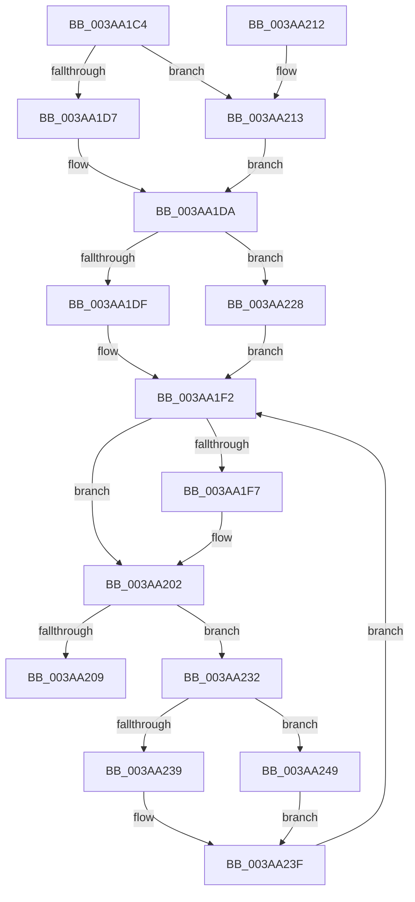

# B_TREE&lt;unsigned long,ST_STORE&lt;SM_TRAITS&gt;::_ST_REGION_ENTRY,4096,NP_CONTEXT,ST_STORE&lt;SM_TRAITS&gt;::ST_REGION_ENTRY_COMPARATOR&gt;::BTreeDescendToSibling

- RVA: `0x003AA1C4`–`0x003AA25C` (길이 `152` bytes)
- VA: `0x00000001403AA1C4`
- 실행 섹션: `.text`
- PDB 이름 있음: `예`; PDB Function 태그: `아니요`
- unwind 정보 RVA: `0x0008B778`
- 디코드: `48`개 명령, `152/152` bytes 표시
- 미해석 바이트: `0` (있으면 어셈블리에 `.byte`로 보존)

> 이 문서는 커널 이미지의 기계어와 PDB 기호를 분석해 생성했습니다. 4번과 5번은 함수 원형과 자료형을 바이너리 사용 방식에서 추정한 C 해석이며 원본 소스 복구 결과는 아닙니다.

## 1. Dependencies

- 직접 호출 지점: **0**; 고유 호출 대상: **0**
- 직접 호출자로 확인된 함수: **2**
- RIP 상대 이미지 참조: **0**

### Outgoing calls
- 직접 디코드된 call 명령이 없습니다.

### Direct callers
- [B_TREE&lt;unsigned long,ST_STORE&lt;SM_TRAITS&gt;::_ST_REGION_ENTRY,4096,NP_CONTEXT,ST_STORE&lt;SM_TRAITS&gt;::ST_REGION_ENTRY_COMPARATOR&gt;::BTreeFindLeafSiblingEx](B_TREE_unsigned_long_ST_STORE_SM_TRAITS__ST_REGION_ENTRY_4096_NP_CONTEXT_ST_STORE_SM_TRAITS_ST_REGIO_function_003A9BD8.md) at `0x003A9C22`
- [B_TREE&lt;unsigned long,ST_STORE&lt;SM_TRAITS&gt;::_ST_REGION_ENTRY,4096,NP_CONTEXT,ST_STORE&lt;SM_TRAITS&gt;::ST_REGION_ENTRY_COMPARATOR&gt;::BTreeFindLeafSiblingEx](B_TREE_unsigned_long_ST_STORE_SM_TRAITS__ST_REGION_ENTRY_4096_NP_CONTEXT_ST_STORE_SM_TRAITS_ST_REGIO_function_003A9BD8.md) at `0x003A9CA6`
- [B_TREE&lt;unsigned long,ST_STORE&lt;SM_TRAITS&gt;::_ST_REGION_ENTRY,4096,NP_CONTEXT,ST_STORE&lt;SM_TRAITS&gt;::ST_REGION_ENTRY_COMPARATOR&gt;::BTreeChangeKey](B_TREE_unsigned_long_ST_STORE_SM_TRAITS__ST_REGION_ENTRY_4096_NP_CONTEXT_ST_STORE_SM_TRAITS_ST_REGIO_function_003A9D80.md) at `0x003AA0BC`

### Static image references
- 디코드된 RIP-relative 메모리 참조가 없습니다.

## 2. Other-region calls and transfers

- 다른 실행 섹션으로 향하는 call: **0**
- 별도 외부 분기/꼬리 이동을 확인하지 못했습니다.

## 3. Assembly (complete function range)

```asm
003AA1C4  48 89 5C 24 08                  mov qword ptr [rsp + 8], rbx
003AA1C9  4C 8B 59 08                     mov r11, qword ptr [rcx + 8]
003AA1CD  8B DA                           mov ebx, edx
003AA1CF  4C 8B 11                        mov r10, qword ptr [rcx]
003AA1D2  4D 85 C0                        test r8, r8
003AA1D5  75 3C                           jne 0x1403aa213
003AA1D7  45 33 C9                        xor r9d, r9d
003AA1DA  83 E3 01                        and ebx, 1
003AA1DD  75 49                           jne 0x1403aa228
003AA1DF  49 8D 4A 10                     lea rcx, [r10 + 0x10]
003AA1E3  4C 3B D9                        cmp r11, rcx
003AA1E6  49 8D 42 08                     lea rax, [r10 + 8]
003AA1EA  49 8D 53 F8                     lea rdx, [r11 - 8]
003AA1EE  48 0F 46 D0                     cmovbe rdx, rax
003AA1F2  4D 85 C9                        test r9, r9
003AA1F5  74 0B                           je 0x1403aa202
003AA1F7  4D 89 11                        mov qword ptr [r9], r10
003AA1FA  4D 89 59 08                     mov qword ptr [r9 + 8], r11
003AA1FE  49 83 C1 10                     add r9, 0x10
003AA202  41 80 7A 02 02                  cmp byte ptr [r10 + 2], 2
003AA207  75 29                           jne 0x1403aa232
003AA209  48 8B 5C 24 08                  mov rbx, qword ptr [rsp + 8]
003AA20E  48 8B C2                        mov rax, rdx
003AA211  C3                              ret
003AA212  CC                              int3
003AA213  45 8B 48 18                     mov r9d, dword ptr [r8 + 0x18]
003AA217  41 0F B6 42 02                  movzx eax, byte ptr [r10 + 2]
003AA21C  44 2B C8                        sub r9d, eax
003AA21F  49 C1 E1 04                     shl r9, 4
003AA223  4D 03 08                        add r9, qword ptr [r8]
003AA226  EB B2                           jmp 0x1403aa1da
003AA228  49 8D 53 08                     lea rdx, [r11 + 8]
003AA22C  49 83 C3 10                     add r11, 0x10
003AA230  EB C0                           jmp 0x1403aa1f2
003AA232  4C 8B 12                        mov r10, qword ptr [rdx]
003AA235  85 DB                           test ebx, ebx
003AA237  74 10                           je 0x1403aa249
003AA239  4D 8B DA                        mov r11, r10
003AA23C  49 8B D2                        mov rdx, r10
003AA23F  49 83 C3 10                     add r11, 0x10
003AA243  48 83 C2 08                     add rdx, 8
003AA247  EB A9                           jmp 0x1403aa1f2
003AA249  41 8B 02                        mov eax, dword ptr [r10]
003AA24C  44 0F B7 D8                     movzx r11d, ax
003AA250  49 C1 E3 04                     shl r11, 4
003AA254  4D 03 DA                        add r11, r10
003AA257  49 8B D3                        mov rdx, r11
003AA25A  EB E3                           jmp 0x1403aa23f
```

## 4. C-style interpretation (structured pseudocode)

```c
__int64 __fastcall B_TREE_unsigned_long_ST_STORE_SM_TRAITS____ST_REGION_ENTRY_4096_NP_CONTEXT_ST_STORE_SM_TRAITS___ST_R(__int64 a1, int a2, __int64 a3, int a4)
{
    __int64 v_r11;
    __int64 v_rbx;
    unsigned __int64 v_stack_p8;

    v_stack_p8 = v_rbx;
    if (a3 != 0) goto loc_003AA213;
    a4 = 0;
loc_003AA1DA:
    v_rbx = (unsigned int)(((unsigned int)(a2)) & (1));
    if (condition_is_not_equal) goto loc_003AA228;
    a2 = *(unsigned __int64 *)(a1 + 8) - 8;
    if ((*(unsigned __int64 *)(a1 + 8)) <= (*(unsigned __int64 *)(a1) + 16)) { a2 = *(unsigned __int64 *)(a1) + 8; }
loc_003AA1F2:
    if (0 != 0) {
        *(unsigned __int64 *)(a4) = *(unsigned __int64 *)(a1);
        *(unsigned __int64 *)(a4 + 8) = *(unsigned __int64 *)(a1 + 8);
        a4 = (a4) + (16);
    }
    if ((*(unsigned __int8 *)(*(unsigned __int64 *)(a1) + 2)) != 2) goto loc_003AA232;
    return a2;
loc_003AA213:
    a4 = (unsigned int)(((unsigned int)(*(unsigned int *)(a3 + 24))) - ((unsigned int)(*(unsigned __int8 *)(*(unsigned __int64 *)(a1) + 2))));
    a4 = (a4) << (4);
    a4 = (a4) + (*(unsigned __int64 *)(a3));
    goto loc_003AA1DA;
loc_003AA228:
    v_r11 = (*(unsigned __int64 *)(a1 + 8)) + (16);
    goto loc_003AA1F2;
loc_003AA232:
    if ((unsigned int)(v_stack_p8) == 0) goto loc_003AA249;
loc_003AA23F:
    v_r11 = (*(unsigned __int64 *)(*(unsigned __int64 *)(a1 + 8) + 8)) + (16);
    a2 = (*(unsigned __int64 *)(*(unsigned __int64 *)(a1 + 8) + 8)) + (8);
    goto loc_003AA1F2;
loc_003AA249:
    v_r11 = ((unsigned __int16)((unsigned int)(*(unsigned int *)(*(unsigned __int64 *)(*(unsigned __int64 *)(a1 + 8) + 8))))) << (4);
    v_r11 = (v_r11) + (*(unsigned __int64 *)(*(unsigned __int64 *)(a1 + 8) + 8));
    goto loc_003AA23F;
}
```

## 5. (Beta) C Style

```c
int64_t B_TREE_unsigned_long_ST_STORE_SM_TRAITS____ST_REGION_ENTRY_4096_NP_CONTEXT_ST_STORE_SM_TRAITS___ST_R(void *Arg1, int32_t Arg2, int64_t Arg3, int32_t Arg4)
{
    uint8_t *arg1 = (uint8_t *)Arg1;

    int64_t local_r11;
    int64_t local_rbx;
    uint64_t v_stack_p8;

    v_stack_p8 = local_rbx;
    if (Arg3 != 0) goto loc_003AA213;
    Arg4 = 0;
loc_003AA1DA:
    local_rbx = (uint32_t)(((uint32_t)(Arg2)) & (1));
    if (condition_is_not_equal) goto loc_003AA228;
    Arg2 = *(uint64_t *)(arg1 + 0x8) - 8;
    if ((*(uint64_t *)(arg1 + 0x8)) <= (*(uint64_t *)(arg1) + 16)) { Arg2 = *(uint64_t *)(arg1) + 8; }
loc_003AA1F2:
    if (0 != 0) {
        *(uint64_t *)(Arg4) = *(uint64_t *)(arg1);
        *(uint64_t *)(Arg4 + 0x8) = *(uint64_t *)(arg1 + 0x8);
        Arg4 = (Arg4) + (16);
    }
    if ((*(uint8_t *)(*(uint64_t *)(arg1) + 0x2)) != 2) goto loc_003AA232;
    return Arg2;
loc_003AA213:
    Arg4 = (uint32_t)(((uint32_t)(*(uint32_t *)(Arg3 + 0x18))) - ((uint32_t)(*(uint8_t *)(*(uint64_t *)(arg1) + 0x2))));
    Arg4 = (Arg4) << (4);
    Arg4 = (Arg4) + (*(uint64_t *)(Arg3));
    goto loc_003AA1DA;
loc_003AA228:
    local_r11 = (*(uint64_t *)(arg1 + 0x8)) + (16);
    goto loc_003AA1F2;
loc_003AA232:
    if ((uint32_t)(v_stack_p8) == 0) goto loc_003AA249;
loc_003AA23F:
    local_r11 = (*(uint64_t *)(*(uint64_t *)(arg1 + 0x8) + 0x8)) + (16);
    Arg2 = (*(uint64_t *)(*(uint64_t *)(arg1 + 0x8) + 0x8)) + (8);
    goto loc_003AA1F2;
loc_003AA249:
    local_r11 = ((uint16_t)((uint32_t)(*(uint32_t *)(*(uint64_t *)(*(uint64_t *)(arg1 + 0x8) + 0x8))))) << (4);
    local_r11 = (local_r11) + (*(uint64_t *)(*(uint64_t *)(arg1 + 0x8) + 0x8));
    goto loc_003AA23F;
}
```

### 관측된 메모리 오프셋

구조체 형식이 확인되지 않은 접근은 인자 기준의 오프셋으로만 기록했습니다.

| 기준 인자 | 오프셋 표현 | 폭 (bit) | 접근 |
|---|---:|---:|---|
| `Arg1` | `+ 0x0` | `64` | `R` |
| `Arg1` | `+ 0x8` | `64` | `R` |

## 6. Execution-region graph

[열기: 2D/3D 그래프와 함수 탐색 컨트롤 패널](../../../control-panel.html?section=text&rva=0x003AA1C4&view=graph)

- 2D 그래프는 위에서 아래로 흐르고, 3D 그래프는 빈 공간을 드래그해 회전합니다. Shift+드래그는 이동, 휠은 확대·축소, 함수 노드 선택은 대상 보고서 이동입니다.

### Static fallback


