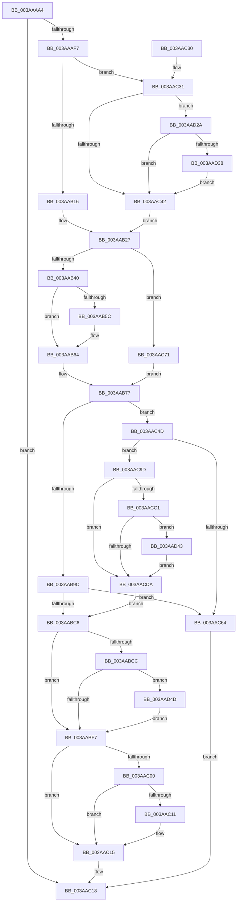

# B_TREE&lt;unsigned long,ST_STORE&lt;SM_TRAITS&gt;::_ST_REGION_ENTRY,4096,NP_CONTEXT,ST_STORE&lt;SM_TRAITS&gt;::ST_REGION_ENTRY_COMPARATOR&gt;::BTreeSplitChild

- RVA: `0x003AAAA4`–`0x003AAD5A` (길이 `694` bytes)
- VA: `0x00000001403AAAA4`
- 실행 섹션: `.text`
- PDB 이름 있음: `예`; PDB Function 태그: `아니요`
- unwind 정보 RVA: `0x0008B82C`
- 디코드: `188`개 명령, `694/694` bytes 표시
- 미해석 바이트: `0` (있으면 어셈블리에 `.byte`로 보존)

> 이 문서는 커널 이미지의 기계어와 PDB 기호를 분석해 생성했습니다. 4번과 5번은 함수 원형과 자료형을 바이너리 사용 방식에서 추정한 C 해석이며 원본 소스 복구 결과는 아닙니다.

## 1. Dependencies

- 직접 호출 지점: **9**; 고유 호출 대상: **5**
- 직접 호출자로 확인된 함수: **1**
- RIP 상대 이미지 참조: **0**

### Outgoing calls
- `0x003AAAE6` → [B_TREE<_SM_PAGE_KEY,ST_STORE<SM_TRAITS>::_ST_PAGE_ENTRY,4096,NP_CONTEXT,B_TREE_KEY_COMPARATOR<_SM_PAGE_KEY> >::BTreeNewNode](B_TREE__SM_PAGE_KEY_ST_STORE_SM_TRAITS__ST_PAGE_ENTRY_4096_NP_CONTEXT_B_TREE_KEY_COMPARATOR__SM_PAGE_function_003AAD60.md) (function, `0x003AAD60`)
- `0x003AAB72` → [memcpy](../6C/memcpy_function_006C6840.md) (function, `0x006C6840`)
- `0x003AABA9` → [B_TREE<unsigned long,ST_STORE<SM_TRAITS>::_ST_REGION_ENTRY,4096,NP_CONTEXT,ST_STORE<SM_TRAITS>::ST_REGION_ENTRY_COMPARATOR>::BTreeInsertEx](B_TREE_unsigned_long_ST_STORE_SM_TRAITS__ST_REGION_ENTRY_4096_NP_CONTEXT_ST_STORE_SM_TRAITS_ST_REGIO_function_003ABB70.md) (function, `0x003ABB70`)
- `0x003AAC57` → [B_TREE<_SM_PAGE_KEY,ST_STORE<SM_TRAITS>::_ST_PAGE_ENTRY,4096,NP_CONTEXT,B_TREE_KEY_COMPARATOR<_SM_PAGE_KEY> >::BTreeNewNode](B_TREE__SM_PAGE_KEY_ST_STORE_SM_TRAITS__ST_PAGE_ENTRY_4096_NP_CONTEXT_B_TREE_KEY_COMPARATOR__SM_PAGE_function_003AAD60.md) (function, `0x003AAD60`)
- `0x003AAC6A` → [B_TREE<_SM_PAGE_KEY,ST_STORE<SM_TRAITS>::_ST_PAGE_ENTRY,4096,NP_CONTEXT,B_TREE_KEY_COMPARATOR<_SM_PAGE_KEY> >::BTreeDeleteNode](B_TREE__SM_PAGE_KEY_ST_STORE_SM_TRAITS__ST_PAGE_ENTRY_4096_NP_CONTEXT_B_TREE_KEY_COMPARATOR__SM_PAGE_function_003AA598.md) (function, `0x003AA598`)
- `0x003AAC8B` → [memcpy](../6C/memcpy_function_006C6840.md) (function, `0x006C6840`)
- `0x003AACF5` → [memcpy](../6C/memcpy_function_006C6840.md) (function, `0x006C6840`)
- `0x003AAD46` → [NP_CONTEXT::NpGetResidentLeaf](../60/NP_CONTEXT_NpGetResidentLeaf_function_0060BED0.md) (function, `0x0060BED0`)
- `0x003AAD50` → [NP_CONTEXT::NpGetResidentLeaf](../60/NP_CONTEXT_NpGetResidentLeaf_function_0060BED0.md) (function, `0x0060BED0`)

### Direct callers
- [sub_003ABC8C](Unknown_function_003ABC8C.md) at `0x003ABCE6`

### Static image references
- 디코드된 RIP-relative 메모리 참조가 없습니다.

## 2. Other-region calls and transfers

- 다른 실행 섹션으로 향하는 call: **0**
- 별도 외부 분기/꼬리 이동을 확인하지 못했습니다.

## 3. Assembly (complete function range)

```asm
003AAAA4  48 89 5C 24 08                  mov qword ptr [rsp + 8], rbx
003AAAA9  55                              push rbp
003AAAAA  56                              push rsi
003AAAAB  57                              push rdi
003AAAAC  41 54                           push r12
003AAAAE  41 55                           push r13
003AAAB0  41 56                           push r14
003AAAB2  41 57                           push r15
003AAAB4  48 83 EC 30                     sub rsp, 0x30
003AAAB8  44 8B 7A 18                     mov r15d, dword ptr [rdx + 0x18]
003AAABC  4C 8B E2                        mov r12, rdx
003AAABF  33 FF                           xor edi, edi
003AAAC1  48 8B F1                        mov rsi, rcx
003AAAC4  44 8D 6F 01                     lea r13d, [rdi + 1]
003AAAC8  45 2B FD                        sub r15d, r13d
003AAACB  49 C1 E7 04                     shl r15, 4
003AAACF  4C 03 3A                        add r15, qword ptr [rdx]
003AAAD2  4C 89 BC 24 80 00 00 00         mov qword ptr [rsp + 0x80], r15
003AAADA  49 8B 1F                        mov rbx, qword ptr [r15]
003AAADD  44 0F B6 43 02                  movzx r8d, byte ptr [rbx + 2]
003AAAE2  0F B6 53 03                     movzx edx, byte ptr [rbx + 3]
003AAAE6  E8 75 02 00 00                  call 0x1403aad60
003AAAEB  4C 8B F0                        mov r14, rax
003AAAEE  48 85 C0                        test rax, rax
003AAAF1  0F 84 21 01 00 00               je 0x1403aac18
003AAAF7  89 7C 24 24                     mov dword ptr [rsp + 0x24], edi
003AAAFB  48 89 44 24 28                  mov qword ptr [rsp + 0x28], rax
003AAB00  8B 03                           mov eax, dword ptr [rbx]
003AAB02  8B E8                           mov ebp, eax
003AAB04  D1 ED                           shr ebp, 1
003AAB06  81 E5 FF 7F 00 00               and ebp, 0x7fff
003AAB0C  40 38 7B 03                     cmp byte ptr [rbx + 3], dil
003AAB10  0F 85 1B 01 00 00               jne 0x1403aac31
003AAB16  4C 8D 7D 01                     lea r15, [rbp + 1]
003AAB1A  44 8B CF                        mov r9d, edi
003AAB1D  49 C1 E7 04                     shl r15, 4
003AAB21  4C 03 FB                        add r15, rbx
003AAB24  41 8B 07                        mov eax, dword ptr [r15]
003AAB27  89 44 24 20                     mov dword ptr [rsp + 0x20], eax
003AAB2B  8B 03                           mov eax, dword ptr [rbx]
003AAB2D  0F B7 D0                        movzx edx, ax
003AAB30  2B D5                           sub edx, ebp
003AAB32  89 54 24 78                     mov dword ptr [rsp + 0x78], edx
003AAB36  40 38 7B 03                     cmp byte ptr [rbx + 3], dil
003AAB3A  0F 84 31 01 00 00               je 0x1403aac71
003AAB40  48 8B C6                        mov rax, rsi
003AAB43  4C 8D 46 10                     lea r8, [rsi + 0x10]
003AAB47  48 F7 D8                        neg rax
003AAB4A  48 1B C9                        sbb rcx, rcx
003AAB4D  41 83 CD FF                     or r13d, 0xffffffff
003AAB51  49 23 C8                        and rcx, r8
003AAB54  48 8B 01                        mov rax, qword ptr [rcx]
003AAB57  44 39 28                        cmp dword ptr [rax], r13d
003AAB5A  75 08                           jne 0x1403aab64
003AAB5C  48 8B 43 08                     mov rax, qword ptr [rbx + 8]
003AAB60  49 89 46 08                     mov qword ptr [r14 + 8], rax
003AAB64  44 8B C2                        mov r8d, edx
003AAB67  49 8D 4E 10                     lea rcx, [r14 + 0x10]
003AAB6B  49 C1 E0 02                     shl r8, 2
003AAB6F  49 8B D1                        mov rdx, r9
003AAB72  E8 C9 BC 31 00                  call 0x1406c6840
003AAB77  B8 10 00 00 00                  mov eax, 0x10
003AAB7C  48 8B CE                        mov rcx, rsi
003AAB7F  4C 8D 3C 01                     lea r15, [rcx + rax]
003AAB83  8B 44 24 78                     mov eax, dword ptr [rsp + 0x78]
003AAB87  66 41 89 06                     mov word ptr [r14], ax
003AAB8B  4C 89 BC 24 88 00 00 00         mov qword ptr [rsp + 0x88], r15
003AAB93  48 39 1E                        cmp qword ptr [rsi], rbx
003AAB96  0F 84 B1 00 00 00               je 0x1403aac4d
003AAB9C  45 01 6C 24 18                  add dword ptr [r12 + 0x18], r13d
003AABA1  4C 8D 44 24 20                  lea r8, [rsp + 0x20]
003AABA6  49 8B D4                        mov rdx, r12
003AABA9  E8 C2 0F 00 00                  call 0x1403abb70
003AABAE  41 B9 01 00 00 00               mov r9d, 1
003AABB4  45 01 4C 24 18                  add dword ptr [r12 + 0x18], r9d
003AABB9  41 8B 4C 24 18                  mov ecx, dword ptr [r12 + 0x18]
003AABBE  85 C0                           test eax, eax
003AABC0  0F 88 9E 00 00 00               js 0x1403aac64
003AABC6  40 38 7B 03                     cmp byte ptr [rbx + 3], dil
003AABCA  74 2B                           je 0x1403aabf7
003AABCC  49 8B 04 24                     mov rax, qword ptr [r12]
003AABD0  83 C1 FE                        add ecx, -2
003AABD3  48 03 C9                        add rcx, rcx
003AABD6  48 8B 54 C8 08                  mov rdx, qword ptr [rax + rcx*8 + 8]
003AABDB  48 8B C6                        mov rax, rsi
003AABDE  48 83 C2 08                     add rdx, 8
003AABE2  48 F7 D8                        neg rax
003AABE5  48 1B C0                        sbb rax, rax
003AABE8  49 23 C7                        and rax, r15
003AABEB  48 8B 00                        mov rax, qword ptr [rax]
003AABEE  44 39 28                        cmp dword ptr [rax], r13d
003AABF1  0F 85 56 01 00 00               jne 0x1403aad4d
003AABF7  66 89 2B                        mov word ptr [rbx], bp
003AABFA  40 38 7B 03                     cmp byte ptr [rbx + 3], dil
003AABFE  74 15                           je 0x1403aac15
003AAC00  48 F7 DE                        neg rsi
003AAC03  48 1B C0                        sbb rax, rax
003AAC06  49 23 C7                        and rax, r15
003AAC09  48 8B 00                        mov rax, qword ptr [rax]
003AAC0C  44 39 28                        cmp dword ptr [rax], r13d
003AAC0F  75 04                           jne 0x1403aac15
003AAC11  4C 89 73 08                     mov qword ptr [rbx + 8], r14
003AAC15  49 8B FE                        mov rdi, r14
003AAC18  48 8B 5C 24 70                  mov rbx, qword ptr [rsp + 0x70]
003AAC1D  48 8B C7                        mov rax, rdi
003AAC20  48 83 C4 30                     add rsp, 0x30
003AAC24  41 5F                           pop r15
003AAC26  41 5E                           pop r14
003AAC28  41 5D                           pop r13
003AAC2A  41 5C                           pop r12
003AAC2C  5F                              pop rdi
003AAC2D  5E                              pop rsi
003AAC2E  5D                              pop rbp
003AAC2F  C3                              ret
003AAC30  CC                              int3
003AAC31  4C 8D 4B 10                     lea r9, [rbx + 0x10]
003AAC35  4D 8D 0C A9                     lea r9, [r9 + rbp*4]
003AAC39  41 84 C5                        test r13b, al
003AAC3C  0F 85 E8 00 00 00               jne 0x1403aad2a
003AAC42  41 8B 01                        mov eax, dword ptr [r9]
003AAC45  4C 8B FF                        mov r15, rdi
003AAC48  E9 DA FE FF FF                  jmp 0x1403aab27
003AAC4D  44 0F B6 43 02                  movzx r8d, byte ptr [rbx + 2]
003AAC52  33 D2                           xor edx, edx
003AAC54  41 FF C0                        inc r8d
003AAC57  E8 04 01 00 00                  call 0x1403aad60
003AAC5C  4C 8B F8                        mov r15, rax
003AAC5F  48 85 C0                        test rax, rax
003AAC62  75 39                           jne 0x1403aac9d
003AAC64  49 8B D6                        mov rdx, r14
003AAC67  48 8B CE                        mov rcx, rsi
003AAC6A  E8 29 F9 FF FF                  call 0x1403aa598
003AAC6F  EB A7                           jmp 0x1403aac18
003AAC71  41 83 CD FF                     or r13d, 0xffffffff
003AAC75  49 8D 4E 10                     lea rcx, [r14 + 0x10]
003AAC79  41 03 D5                        add edx, r13d
003AAC7C  44 8B C2                        mov r8d, edx
003AAC7F  89 54 24 78                     mov dword ptr [rsp + 0x78], edx
003AAC83  49 8D 57 10                     lea rdx, [r15 + 0x10]
003AAC87  49 C1 E0 04                     shl r8, 4
003AAC8B  E8 B0 BB 31 00                  call 0x1406c6840
003AAC90  49 8B 47 08                     mov rax, qword ptr [r15 + 8]
003AAC94  49 89 46 08                     mov qword ptr [r14 + 8], rax
003AAC98  E9 DA FE FF FF                  jmp 0x1403aab77
003AAC9D  48 8D 50 08                     lea rdx, [rax + 8]
003AACA1  41 B8 01 00 00 00               mov r8d, 1
003AACA7  48 89 1A                        mov qword ptr [rdx], rbx
003AACAA  0F 10 44 24 20                  movups xmm0, xmmword ptr [rsp + 0x20]
003AACAF  F3 0F 7F 40 10                  movdqu xmmword ptr [rax + 0x10], xmm0
003AACB4  66 44 89 00                     mov word ptr [rax], r8w
003AACB8  4C 89 3E                        mov qword ptr [rsi], r15
003AACBB  40 38 7B 03                     cmp byte ptr [rbx + 3], dil
003AACBF  74 19                           je 0x1403aacda
003AACC1  48 8B C6                        mov rax, rsi
003AACC4  48 F7 D8                        neg rax
003AACC7  48 1B C0                        sbb rax, rax
003AACCA  48 23 84 24 88 00 00 00         and rax, qword ptr [rsp + 0x88]
003AACD2  48 8B 00                        mov rax, qword ptr [rax]
003AACD5  44 39 28                        cmp dword ptr [rax], r13d
003AACD8  75 69                           jne 0x1403aad43
003AACDA  41 8B 44 24 1C                  mov eax, dword ptr [r12 + 0x1c]
003AACDF  48 8B 94 24 80 00 00 00         mov rdx, qword ptr [rsp + 0x80]
003AACE7  41 2B C0                        sub eax, r8d
003AACEA  44 8B C0                        mov r8d, eax
003AACED  49 C1 E0 04                     shl r8, 4
003AACF1  48 8D 4A 10                     lea rcx, [rdx + 0x10]
003AACF5  E8 46 BB 31 00                  call 0x1406c6840
003AACFA  48 8B 84 24 80 00 00 00         mov rax, qword ptr [rsp + 0x80]
003AAD02  49 8D 4F 10                     lea rcx, [r15 + 0x10]
003AAD06  41 B9 01 00 00 00               mov r9d, 1
003AAD0C  4C 89 38                        mov qword ptr [rax], r15
003AAD0F  4C 8B BC 24 88 00 00 00         mov r15, qword ptr [rsp + 0x88]
003AAD17  48 89 48 08                     mov qword ptr [rax + 8], rcx
003AAD1B  45 01 4C 24 18                  add dword ptr [r12 + 0x18], r9d
003AAD20  41 8B 4C 24 18                  mov ecx, dword ptr [r12 + 0x18]
003AAD25  E9 9C FE FF FF                  jmp 0x1403aabc6
003AAD2A  49 8D 41 04                     lea rax, [r9 + 4]
003AAD2E  49 3B 47 08                     cmp rax, qword ptr [r15 + 8]
003AAD32  0F 83 0A FF FF FF               jae 0x1403aac42
003AAD38  4C 8B C8                        mov r9, rax
003AAD3B  41 03 ED                        add ebp, r13d
003AAD3E  E9 FF FE FF FF                  jmp 0x1403aac42
003AAD43  44 09 02                        or dword ptr [rdx], r8d
003AAD46  E8 85 11 26 00                  call 0x14060bed0
003AAD4B  EB 8D                           jmp 0x1403aacda
003AAD4D  44 09 0A                        or dword ptr [rdx], r9d
003AAD50  E8 7B 11 26 00                  call 0x14060bed0
003AAD55  E9 9D FE FF FF                  jmp 0x1403aabf7
```

## 4. C-style interpretation (structured pseudocode)

```c
__int64 __fastcall B_TREE_unsigned_long_ST_STORE_SM_TRAITS____ST_REGION_ENTRY_4096_NP_CONTEXT_ST_STORE_SM_TRAITS___ST_R(__int64 a1, __int64 a2)
{
    __int64 result;
    __int64 v_r13;
    __int64 v_r15;
    __int64 v_rbp;
    __int64 v_rdi;
    __int64 v_rsi;
    __int64 v_rsp;
    unsigned __int64 v_stack_m40;
    unsigned int v_stack_m44;
    unsigned int v_stack_m48;
    unsigned int v_stack_p10;
    unsigned __int64 v_stack_p18;
    unsigned __int64 v_stack_p20;
    unsigned int v_stack_p78;
    unsigned __int64 v_stack_p8;
    unsigned __int64 v_stack_p80;
    unsigned __int64 v_stack_p88;

    v_stack_p8 = v_rbx;
    v_rsp = (v_rsp) - (48);
    v_rdi = 0;
    v_r15 = (unsigned int)(((unsigned int)(*(unsigned int *)(a2 + 24))) - ((unsigned int)(v_rdi + 1)));
    v_r15 = (v_r15) << (4);
    v_r15 = (v_r15) + (*(unsigned __int64 *)(a2));
    v_stack_p18 = v_r15;
    result = B_TREE__SM_PAGE_KEY_ST_STORE_SM_TRAITS____ST_PAGE_ENTRY_4096_NP_CONTEXT_B_TREE_KEY_COMPARATOR__SM_PA(a1, *(unsigned __int8 *)(*(unsigned __int64 *)(v_r15) + 3), *(unsigned __int8 *)(*(unsigned __int64 *)(v_r15) + 2), a4);
    if (result == 0) goto loc_003AAC18;
    v_stack_m44 = 0;
    v_stack_m40 = result;
    v_rbp = (unsigned int)(((unsigned int)((unsigned int)((unsigned int)(*(unsigned int *)(*(unsigned __int64 *)(v_r15)))))) >> (1));
    v_rbp = (unsigned int)((v_rbp) & (0x7FFFULL));
    if ((*(unsigned __int8 *)(*(unsigned __int64 *)(v_r15) + 3)) != 0) goto loc_003AAC31;
    v_r15 = (v_rbp + 1) << (4);
    v_r15 = (v_r15) + (*(unsigned __int64 *)(v_r15));
loc_003AAB27:
    v_stack_m48 = (unsigned int)((unsigned int)(*(unsigned int *)(v_r15)));
    a2 = (unsigned int)(((unsigned __int16)((unsigned int)(*(unsigned int *)(*(unsigned __int64 *)(v_r15))))) - ((unsigned int)(v_rbp)));
    v_stack_p10 = (unsigned int)(a2);
    if ((*(unsigned __int8 *)(*(unsigned __int64 *)(v_r15) + 3)) == 0) goto loc_003AAC71;
    result = -(a1);
    v_r13 = (unsigned int)((v_rdi + 1) | (0xFFFFFFFFULL));
    a1 = (a1) & (a1 + 16);
    result = *(unsigned __int64 *)(a1);
    if ((*(unsigned int *)(*(unsigned __int64 *)(a1))) == ((unsigned int)(v_r13))) {
        result = *(unsigned __int64 *)(*(unsigned __int64 *)(v_r15) + 8);
        *(unsigned __int64 *)(result + 8) = result;
    }
    a3 = ((unsigned int)((unsigned int)(a2))) << (2);
    result = memcpy(result + 16, 0, a3, 0);
loc_003AAB77:
    *(unsigned __int16 *)(result) = (unsigned __int16)((unsigned int)(v_stack_p10));
    v_stack_p20 = a1 + 16 * 1;
    if ((*(unsigned __int64 *)(a1)) == (*(unsigned __int64 *)(v_r15))) goto loc_003AAC4D;
    result = B_TREE_unsigned_long_ST_STORE_SM_TRAITS____ST_REGION_ENTRY_4096_NP_CONTEXT_ST_STORE_SM_TRAITS___ST_R(a1, a2, v_stack_m48, 0);
    if (sign_flag) goto loc_003AAC64;
loc_003AABC6:
    if ((*(unsigned __int8 *)(*(unsigned __int64 *)(v_r15) + 3)) == 0) goto loc_003AABF7;
    a1 = (unsigned int)(((unsigned int)(*(unsigned int *)(a2 + 24))) + (-2));
    a1 = (a1) + (a1);
    a2 = (*(unsigned __int64 *)(*(unsigned __int64 *)(a2) + a1 * 8 + 8)) + (8);
    result = -(a1);
    result = (result) & (a1 + 16 * 1);
    if ((*(unsigned int *)(*(unsigned __int64 *)(result))) != ((unsigned int)(v_r13))) goto loc_003AAD4D;
loc_003AABF7:
    *(unsigned __int16 *)(*(unsigned __int64 *)(v_r15)) = (unsigned __int16)(v_rbp);
    if ((*(unsigned __int8 *)(*(unsigned __int64 *)(v_r15) + 3)) == 0) goto loc_003AAC15;
    v_rsi = -(a1);
    result = (*(unsigned __int64 *)(result)) & (a1 + 16 * 1);
    if ((*(unsigned int *)(*(unsigned __int64 *)(result))) == ((unsigned int)(v_r13))) {
        *(unsigned __int64 *)(*(unsigned __int64 *)(v_r15) + 8) = result;
    }
loc_003AAC18:
    v_rsp = (v_rsp) + (48);
    return result;
loc_003AAC31:
    if ((((unsigned __int8)(v_r13)) & ((unsigned __int8)(result))) != 0) goto loc_003AAD2A;
loc_003AAC42:
    goto loc_003AAB27;
loc_003AAC4D:
    a2 = 0;
    a3 = (unsigned int)((*(unsigned __int8 *)(v_stack_p8 + 2)) + 1);
    result = B_TREE__SM_PAGE_KEY_ST_STORE_SM_TRAITS____ST_PAGE_ENTRY_4096_NP_CONTEXT_B_TREE_KEY_COMPARATOR__SM_PA(a1, a2, a3, v_stack_p8 + 16 + v_rbp * 4);
    if (result != 0) goto loc_003AAC9D;
loc_003AAC64:
    result = B_TREE__SM_PAGE_KEY_ST_STORE_SM_TRAITS____ST_PAGE_ENTRY_4096_NP_CONTEXT_B_TREE_KEY_COMPARATOR__SM_PA(v_rsi, result, a3, v_stack_p8 + 16 + v_rbp * 4);
    goto loc_003AAC18;
loc_003AAC71:
    v_r13 = (unsigned int)((v_r13) | (0xFFFFFFFFULL));
    a2 = (unsigned int)((result) + ((unsigned int)(v_r13)));
    v_stack_p78 = (unsigned int)(a2);
    a3 = ((unsigned int)((unsigned int)(a2))) << (4);
    result = memcpy(result + 16, result + 16, a3, v_stack_p8 + 16 + v_rbp * 4);
    *(unsigned __int64 *)(result + 8) = *(unsigned __int64 *)(result + 8);
    goto loc_003AAB77;
loc_003AAC9D:
    *(unsigned __int64 *)(*(unsigned __int64 *)(result + 8) + 8) = v_stack_p8;
    *(unsigned __int64 *)(*(unsigned __int64 *)(result + 8) + 16) = v_xmm0;
    *(unsigned __int16 *)(*(unsigned __int64 *)(result + 8)) = 1;
    *(unsigned __int64 *)(v_rsi) = result;
    if ((*(unsigned __int8 *)(v_stack_p8 + 3)) == ((unsigned __int8)(result))) goto loc_003AACDA;
    result = -(v_rsi);
    result = (result) & (v_stack_p88);
    if ((*(unsigned int *)(*(unsigned __int64 *)(result))) != ((unsigned int)(v_r13))) goto loc_003AAD43;
loc_003AACDA:
    result = (unsigned int)(((unsigned int)(*(unsigned int *)(a2 + 28))) - (1));
    a3 = ((unsigned int)((unsigned int)(result))) << (4);
    result = memcpy(v_stack_p80 + 16, v_stack_p80, a3, v_stack_p8 + 16 + v_rbp * 4);
    *(unsigned __int64 *)(v_stack_p80) = result;
    *(unsigned __int64 *)(v_stack_p80 + 8) = result + 16;
    goto loc_003AABC6;
loc_003AAD2A:
    if ((1 + 4) >= (*(unsigned __int64 *)(v_stack_p88 + 8))) goto loc_003AAC42;
    v_rbp = (unsigned int)((v_rbp) + ((unsigned int)(v_r13)));
    goto loc_003AAC42;
loc_003AAD43:
    result = NP_CONTEXT__NpGetResidentLeaf((unsigned int)(*(unsigned int *)(a2 + 24)), v_stack_p80, a3, 1 + 4);
    goto loc_003AACDA;
loc_003AAD4D:
    result = NP_CONTEXT__NpGetResidentLeaf((unsigned int)(*(unsigned int *)(a2 + 24)), v_stack_p80, a3, 1 + 4);
    goto loc_003AABF7;
}
```

## 5. (Beta) C Style

```c
int64_t B_TREE_unsigned_long_ST_STORE_SM_TRAITS____ST_REGION_ENTRY_4096_NP_CONTEXT_ST_STORE_SM_TRAITS___ST_R(void *Arg1, void *Arg2)
{
    uint8_t *arg1 = (uint8_t *)Arg1;
    uint8_t *arg2 = (uint8_t *)Arg2;

    int64_t result;
    int64_t local_r13;
    int64_t local_r15;
    int64_t local_rbp;
    int64_t local_rdi;
    int64_t local_rsi;
    int64_t local_rsp;
    uint64_t v_stack_m40;
    uint32_t v_stack_m44;
    uint32_t v_stack_m48;
    uint32_t v_stack_p10;
    uint64_t v_stack_p18;
    uint64_t v_stack_p20;
    uint32_t v_stack_p78;
    uint64_t v_stack_p8;
    uint64_t v_stack_p80;
    uint64_t v_stack_p88;

    v_stack_p8 = local_rbx;
    local_rsp = (local_rsp) - (48);
    local_rdi = 0;
    local_r15 = (uint32_t)(((uint32_t)(*(uint32_t *)(arg2 + 0x18))) - ((uint32_t)(local_rdi + 1)));
    local_r15 = (local_r15) << (4);
    local_r15 = (local_r15) + (*(uint64_t *)(arg2));
    v_stack_p18 = local_r15;
    result = B_TREE__SM_PAGE_KEY_ST_STORE_SM_TRAITS____ST_PAGE_ENTRY_4096_NP_CONTEXT_B_TREE_KEY_COMPARATOR__SM_PA(Arg1, *(uint8_t *)(*(uint64_t *)(local_r15) + 0x3), *(uint8_t *)(*(uint64_t *)(local_r15) + 0x2), a4);
    if (result == 0) goto loc_003AAC18;
    v_stack_m44 = 0;
    v_stack_m40 = result;
    local_rbp = (uint32_t)(((uint32_t)((uint32_t)((uint32_t)(*(uint32_t *)(*(uint64_t *)(local_r15)))))) >> (1));
    local_rbp = (uint32_t)((local_rbp) & (0x7FFFULL));
    if ((*(uint8_t *)(*(uint64_t *)(local_r15) + 0x3)) != 0) goto loc_003AAC31;
    local_r15 = (local_rbp + 1) << (4);
    local_r15 = (local_r15) + (*(uint64_t *)(local_r15));
loc_003AAB27:
    v_stack_m48 = (uint32_t)((uint32_t)(*(uint32_t *)(local_r15)));
    Arg2 = (uint32_t)(((uint16_t)((uint32_t)(*(uint32_t *)(*(uint64_t *)(local_r15))))) - ((uint32_t)(local_rbp)));
    v_stack_p10 = (uint32_t)(Arg2);
    if ((*(uint8_t *)(*(uint64_t *)(local_r15) + 0x3)) == 0) goto loc_003AAC71;
    result = -(Arg1);
    local_r13 = (uint32_t)((local_rdi + 1) | (0xFFFFFFFFULL));
    Arg1 = (Arg1) & (Arg1 + 16);
    result = *(uint64_t *)(arg1);
    if ((*(uint32_t *)(*(uint64_t *)(arg1))) == ((uint32_t)(local_r13))) {
        result = *(uint64_t *)(*(uint64_t *)(local_r15) + 0x8);
        *(uint64_t *)(result + 0x8) = result;
    }
    a3 = ((uint32_t)((uint32_t)(Arg2))) << (2);
    result = memcpy(result + 16, 0, a3, 0);
loc_003AAB77:
    *(uint16_t *)(result) = (uint16_t)((uint32_t)(v_stack_p10));
    v_stack_p20 = Arg1 + 16 * 1;
    if ((*(uint64_t *)(arg1)) == (*(uint64_t *)(local_r15))) goto loc_003AAC4D;
    result = B_TREE_unsigned_long_ST_STORE_SM_TRAITS____ST_REGION_ENTRY_4096_NP_CONTEXT_ST_STORE_SM_TRAITS___ST_R(Arg1, Arg2, v_stack_m48, 0);
    if (sign_flag) goto loc_003AAC64;
loc_003AABC6:
    if ((*(uint8_t *)(*(uint64_t *)(local_r15) + 0x3)) == 0) goto loc_003AABF7;
    Arg1 = (uint32_t)(((uint32_t)(*(uint32_t *)(arg2 + 0x18))) + (-2));
    Arg1 = (Arg1) + (Arg1);
    Arg2 = (*(uint64_t *)(*(uint64_t *)(arg2) + arg1 * 8 + 0x8)) + (8);
    result = -(Arg1);
    result = (result) & (Arg1 + 16 * 1);
    if ((*(uint32_t *)(*(uint64_t *)(result))) != ((uint32_t)(local_r13))) goto loc_003AAD4D;
loc_003AABF7:
    *(uint16_t *)(*(uint64_t *)(local_r15)) = (uint16_t)(local_rbp);
    if ((*(uint8_t *)(*(uint64_t *)(local_r15) + 0x3)) == 0) goto loc_003AAC15;
    local_rsi = -(Arg1);
    result = (*(uint64_t *)(result)) & (Arg1 + 16 * 1);
    if ((*(uint32_t *)(*(uint64_t *)(result))) == ((uint32_t)(local_r13))) {
        *(uint64_t *)(*(uint64_t *)(local_r15) + 0x8) = result;
    }
loc_003AAC18:
    local_rsp = (local_rsp) + (48);
    return result;
loc_003AAC31:
    if ((((uint8_t)(local_r13)) & ((uint8_t)(result))) != 0) goto loc_003AAD2A;
loc_003AAC42:
    goto loc_003AAB27;
loc_003AAC4D:
    Arg2 = 0;
    a3 = (uint32_t)((*(uint8_t *)(v_stack_p8 + 0x2)) + 1);
    result = B_TREE__SM_PAGE_KEY_ST_STORE_SM_TRAITS____ST_PAGE_ENTRY_4096_NP_CONTEXT_B_TREE_KEY_COMPARATOR__SM_PA(Arg1, Arg2, a3, v_stack_p8 + 16 + local_rbp * 4);
    if (result != 0) goto loc_003AAC9D;
loc_003AAC64:
    result = B_TREE__SM_PAGE_KEY_ST_STORE_SM_TRAITS____ST_PAGE_ENTRY_4096_NP_CONTEXT_B_TREE_KEY_COMPARATOR__SM_PA(local_rsi, result, a3, v_stack_p8 + 16 + local_rbp * 4);
    goto loc_003AAC18;
loc_003AAC71:
    local_r13 = (uint32_t)((local_r13) | (0xFFFFFFFFULL));
    Arg2 = (uint32_t)((result) + ((uint32_t)(local_r13)));
    v_stack_p78 = (uint32_t)(Arg2);
    a3 = ((uint32_t)((uint32_t)(Arg2))) << (4);
    result = memcpy(result + 16, result + 16, a3, v_stack_p8 + 16 + local_rbp * 4);
    *(uint64_t *)(result + 0x8) = *(uint64_t *)(result + 0x8);
    goto loc_003AAB77;
loc_003AAC9D:
    *(uint64_t *)(*(uint64_t *)(result + 0x8) + 0x8) = v_stack_p8;
    *(uint64_t *)(*(uint64_t *)(result + 0x8) + 0x10) = v_xmm0;
    *(uint16_t *)(*(uint64_t *)(result + 0x8)) = 1;
    *(uint64_t *)(local_rsi) = result;
    if ((*(uint8_t *)(v_stack_p8 + 0x3)) == ((uint8_t)(result))) goto loc_003AACDA;
    result = -(local_rsi);
    result = (result) & (v_stack_p88);
    if ((*(uint32_t *)(*(uint64_t *)(result))) != ((uint32_t)(local_r13))) goto loc_003AAD43;
loc_003AACDA:
    result = (uint32_t)(((uint32_t)(*(uint32_t *)(arg2 + 0x1C))) - (1));
    a3 = ((uint32_t)((uint32_t)(result))) << (4);
    result = memcpy(v_stack_p80 + 16, v_stack_p80, a3, v_stack_p8 + 16 + local_rbp * 4);
    *(uint64_t *)(v_stack_p80) = result;
    *(uint64_t *)(v_stack_p80 + 0x8) = result + 16;
    goto loc_003AABC6;
loc_003AAD2A:
    if ((1 + 4) >= (*(uint64_t *)(v_stack_p88 + 0x8))) goto loc_003AAC42;
    local_rbp = (uint32_t)((local_rbp) + ((uint32_t)(local_r13)));
    goto loc_003AAC42;
loc_003AAD43:
    result = NP_CONTEXT__NpGetResidentLeaf((uint32_t)(*(uint32_t *)(arg2 + 0x18)), v_stack_p80, a3, 1 + 4);
    goto loc_003AACDA;
loc_003AAD4D:
    result = NP_CONTEXT__NpGetResidentLeaf((uint32_t)(*(uint32_t *)(arg2 + 0x18)), v_stack_p80, a3, 1 + 4);
    goto loc_003AABF7;
}
```

### 관측된 메모리 오프셋

구조체 형식이 확인되지 않은 접근은 인자 기준의 오프셋으로만 기록했습니다.

| 기준 인자 | 오프셋 표현 | 폭 (bit) | 접근 |
|---|---:|---:|---|
| `Arg1` | `+ 0x0` | `64` | `R` |
| `Arg1` | `+ 0x0` | `64` | `W` |
| `Arg1` | `+ 0x0 + rax*1` | `64` | `R` |
| `Arg1` | `+ 0x10` | `64` | `R` |
| `Arg2` | `+ 0x0` | `64` | `R` |
| `Arg2` | `+ 0x18` | `32` | `R` |
| `Arg2` | `+ 0x18` | `32` | `R/W` |
| `Arg2` | `+ 0x1C` | `32` | `R` |

## 6. Execution-region graph

[열기: 2D/3D 그래프와 함수 탐색 컨트롤 패널](../../../control-panel.html?section=text&rva=0x003AAAA4&view=graph)

- 2D 그래프는 위에서 아래로 흐르고, 3D 그래프는 빈 공간을 드래그해 회전합니다. Shift+드래그는 이동, 휠은 확대·축소, 함수 노드 선택은 대상 보고서 이동입니다.

### Static fallback


