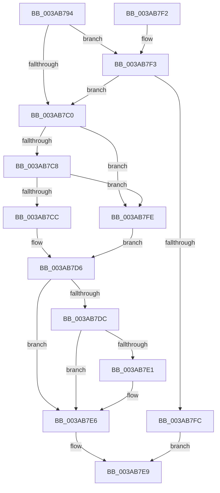

# B_TREE&lt;unsigned long,ST_STORE&lt;SM_TRAITS&gt;::_ST_REGION_ENTRY,4096,NP_CONTEXT,ST_STORE&lt;SM_TRAITS&gt;::ST_REGION_ENTRY_COMPARATOR&gt;::BTreeSearchResultIterStart

- RVA: `0x003AB794`–`0x003AB804` (길이 `112` bytes)
- VA: `0x00000001403AB794`
- 실행 섹션: `.text`
- PDB 이름 있음: `예`; PDB Function 태그: `아니요`
- unwind 정보 RVA: `0x0008B9A4`
- 디코드: `38`개 명령, `112/112` bytes 표시
- 미해석 바이트: `0` (있으면 어셈블리에 `.byte`로 보존)

> 이 문서는 커널 이미지의 기계어와 PDB 기호를 분석해 생성했습니다. 4번과 5번은 함수 원형과 자료형을 바이너리 사용 방식에서 추정한 C 해석이며 원본 소스 복구 결과는 아닙니다.

## 1. Dependencies

- 직접 호출 지점: **1**; 고유 호출 대상: **1**
- 직접 호출자로 확인된 함수: **2**
- RIP 상대 이미지 참조: **0**

### Outgoing calls
- `0x003AB7AB` → [B_TREE<unsigned long,ST_STORE<SM_TRAITS>::_ST_REGION_ENTRY,4096,NP_CONTEXT,ST_STORE<SM_TRAITS>::ST_REGION_ENTRY_COMPARATOR>::BTreeSearchKey](B_TREE_unsigned_long_ST_STORE_SM_TRAITS__ST_REGION_ENTRY_4096_NP_CONTEXT_ST_STORE_SM_TRAITS_ST_REGIO_function_003ACD20.md) (function, `0x003ACD20`)

### Direct callers
- [ST_STORE&lt;SM_TRAITS&gt;::StDmCombineRegion](../3B/ST_STORE_SM_TRAITS_StDmCombineRegion_function_003B0E34.md) at `0x003B0EE0`
- [ST_STORE&lt;SM_TRAITS&gt;::StDmCombineRegion](../3B/ST_STORE_SM_TRAITS_StDmCombineRegion_function_003B0E34.md) at `0x003B0FED`
- [ST_STORE&lt;SM_TRAITS&gt;::StDmCombineBufferProcess](../4E/ST_STORE_SM_TRAITS_StDmCombineBufferProcess_function_004EB9AC.md) at `0x004EBAF0`

### Static image references
- 디코드된 RIP-relative 메모리 참조가 없습니다.

## 2. Other-region calls and transfers

- 다른 실행 섹션으로 향하는 call: **0**
- 별도 외부 분기/꼬리 이동을 확인하지 못했습니다.

## 3. Assembly (complete function range)

```asm
003AB794  40 53                           push rbx
003AB796  48 83 EC 20                     sub rsp, 0x20
003AB79A  41 8B C0                        mov eax, r8d
003AB79D  4C 8B CA                        mov r9, rdx
003AB7A0  4C 8B C1                        mov r8, rcx
003AB7A3  48 8B D9                        mov rbx, rcx
003AB7A6  8B D0                           mov edx, eax
003AB7A8  49 8B C9                        mov rcx, r9
003AB7AB  E8 70 15 00 00                  call 0x1403acd20
003AB7B0  44 8B C0                        mov r8d, eax
003AB7B3  B8 00 00 00 80                  mov eax, 0x80000000
003AB7B8  41 8D 14 00                     lea edx, [r8 + rax]
003AB7BC  85 D0                           test eax, edx
003AB7BE  74 33                           je 0x1403ab7f3
003AB7C0  8B 43 18                        mov eax, dword ptr [rbx + 0x18]
003AB7C3  83 F8 FF                        cmp eax, -1
003AB7C6  74 36                           je 0x1403ab7fe
003AB7C8  85 C0                           test eax, eax
003AB7CA  74 32                           je 0x1403ab7fe
003AB7CC  8D 48 FF                        lea ecx, [rax - 1]
003AB7CF  48 C1 E1 04                     shl rcx, 4
003AB7D3  48 03 0B                        add rcx, qword ptr [rbx]
003AB7D6  48 83 39 00                     cmp qword ptr [rcx], 0
003AB7DA  74 0A                           je 0x1403ab7e6
003AB7DC  45 85 C0                        test r8d, r8d
003AB7DF  75 05                           jne 0x1403ab7e6
003AB7E1  48 83 41 08 04                  add qword ptr [rcx + 8], 4
003AB7E6  45 33 C0                        xor r8d, r8d
003AB7E9  41 8B C0                        mov eax, r8d
003AB7EC  48 83 C4 20                     add rsp, 0x20
003AB7F0  5B                              pop rbx
003AB7F1  C3                              ret
003AB7F2  CC                              int3
003AB7F3  41 81 F8 25 02 00 C0            cmp r8d, 0xc0000225
003AB7FA  74 C4                           je 0x1403ab7c0
003AB7FC  EB EB                           jmp 0x1403ab7e9
003AB7FE  48 8D 4B 08                     lea rcx, [rbx + 8]
003AB802  EB D2                           jmp 0x1403ab7d6
```

## 4. C-style interpretation (structured pseudocode)

```c
__int64 __fastcall B_TREE_unsigned_long_ST_STORE_SM_TRAITS____ST_REGION_ENTRY_4096_NP_CONTEXT_ST_STORE_SM_TRAITS___ST_R(__int64 a1, __int64 a2, int a3)
{
    __int64 result;
    __int64 v_rsp;

    v_rsp = (v_rsp) - (32);
    result = B_TREE_unsigned_long_ST_STORE_SM_TRAITS____ST_REGION_ENTRY_4096_NP_CONTEXT_ST_STORE_SM_TRAITS___ST_R(a2, (unsigned int)((unsigned int)((unsigned int)(a3))), a1, a2);
    if ((((unsigned int)((unsigned int)(0x80000000ULL))) & ((unsigned int)((unsigned int)((unsigned int)(result)) + (unsigned int)(0x80000000ULL) * 1))) == 0) goto loc_003AB7F3;
loc_003AB7C0:
    if (((unsigned int)((unsigned int)(*(unsigned int *)(a1 + 24)))) == -1) goto loc_003AB7FE;
    if ((unsigned int)((unsigned int)(*(unsigned int *)(a1 + 24))) == 0) goto loc_003AB7FE;
    a1 = ((unsigned int)(*(unsigned int *)(a1 + 24)) - 1) << (4);
    a1 = (a1) + (*(unsigned __int64 *)(a1));
loc_003AB7D6:
    if ((*(unsigned __int64 *)(a1)) == 0) goto loc_003AB7E6;
    if ((unsigned int)((unsigned int)((unsigned int)(result))) == 0) {
    }
    a3 = 0;
loc_003AB7E9:
    v_rsp = (v_rsp) + (32);
    return 0;
loc_003AB7F3:
    if (0 == 0xC0000225ULL) goto loc_003AB7C0;
    goto loc_003AB7E9;
loc_003AB7FE:
    goto loc_003AB7D6;
}
```

## 5. (Beta) C Style

```c
int64_t B_TREE_unsigned_long_ST_STORE_SM_TRAITS____ST_REGION_ENTRY_4096_NP_CONTEXT_ST_STORE_SM_TRAITS___ST_R(void *Arg1, int64_t Arg2, int32_t Arg3)
{
    uint8_t *arg1 = (uint8_t *)Arg1;

    int64_t result;
    int64_t local_rsp;

    local_rsp = (local_rsp) - (32);
    result = B_TREE_unsigned_long_ST_STORE_SM_TRAITS____ST_REGION_ENTRY_4096_NP_CONTEXT_ST_STORE_SM_TRAITS___ST_R(Arg2, (uint32_t)((uint32_t)((uint32_t)(Arg3))), Arg1, Arg2);
    if ((((uint32_t)((uint32_t)(0x80000000ULL))) & ((uint32_t)((uint32_t)((uint32_t)(result)) + (uint32_t)(0x80000000ULL) * 1))) == 0) goto loc_003AB7F3;
loc_003AB7C0:
    if (((uint32_t)((uint32_t)(*(uint32_t *)(arg1 + 0x18)))) == -1) goto loc_003AB7FE;
    if ((uint32_t)((uint32_t)(*(uint32_t *)(arg1 + 0x18))) == 0) goto loc_003AB7FE;
    Arg1 = ((uint32_t)(*(uint32_t *)(arg1 + 0x18)) - 1) << (4);
    Arg1 = (Arg1) + (*(uint64_t *)(arg1));
loc_003AB7D6:
    if ((*(uint64_t *)(arg1)) == 0) goto loc_003AB7E6;
    if ((uint32_t)((uint32_t)((uint32_t)(result))) == 0) {
    }
    Arg3 = 0;
loc_003AB7E9:
    local_rsp = (local_rsp) + (32);
    return 0;
loc_003AB7F3:
    if (0 == 0xC0000225ULL) goto loc_003AB7C0;
    goto loc_003AB7E9;
loc_003AB7FE:
    goto loc_003AB7D6;
}
```

### 관측된 메모리 오프셋

구조체 형식이 확인되지 않은 접근은 인자 기준의 오프셋으로만 기록했습니다.

| 기준 인자 | 오프셋 표현 | 폭 (bit) | 접근 |
|---|---:|---:|---|
| `Arg1` | `+ 0x0` | `64` | `R` |
| `Arg1` | `+ 0x8` | `64` | `R` |
| `Arg1` | `+ 0x18` | `32` | `R` |

## 6. Execution-region graph

[열기: 2D/3D 그래프와 함수 탐색 컨트롤 패널](../../../control-panel.html?section=text&rva=0x003AB794&view=graph)

- 2D 그래프는 위에서 아래로 흐르고, 3D 그래프는 빈 공간을 드래그해 회전합니다. Shift+드래그는 이동, 휠은 확대·축소, 함수 노드 선택은 대상 보고서 이동입니다.

### Static fallback


