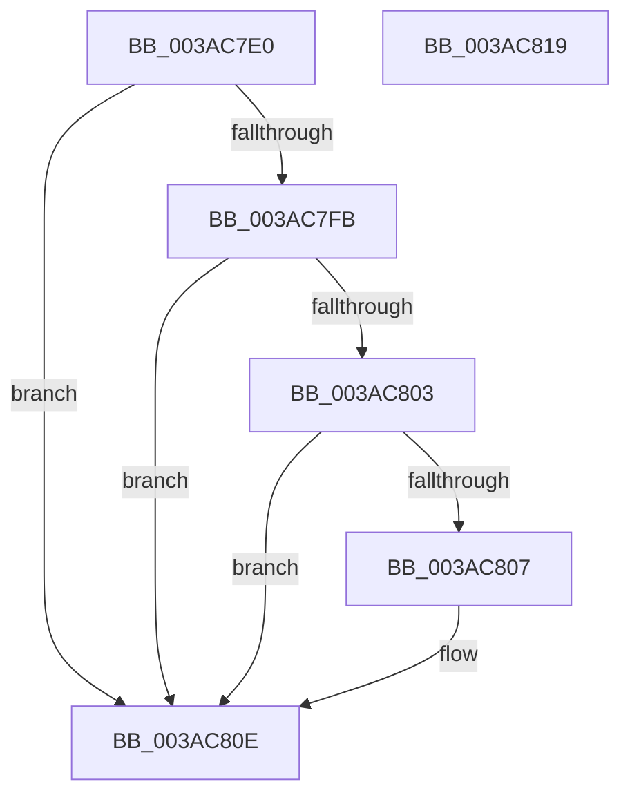

# B_TREE&lt;unsigned long,ST_STORE&lt;SM_TRAITS&gt;::_ST_REGION_ENTRY,4096,NP_CONTEXT,ST_STORE&lt;SM_TRAITS&gt;::ST_REGION_ENTRY_COMPARATOR&gt;::BTreeSearchResultCleanup

- RVA: `0x003AC7E0`–`0x003AC81A` (길이 `58` bytes)
- VA: `0x00000001403AC7E0`
- 실행 섹션: `.text`
- PDB 이름 있음: `예`; PDB Function 태그: `아니요`
- unwind 정보 RVA: `0x0005CAAC`
- 디코드: `20`개 명령, `58/58` bytes 표시
- 미해석 바이트: `0` (있으면 어셈블리에 `.byte`로 보존)

> 이 문서는 커널 이미지의 기계어와 PDB 기호를 분석해 생성했습니다. 4번과 5번은 함수 원형과 자료형을 바이너리 사용 방식에서 추정한 C 해석이며 원본 소스 복구 결과는 아닙니다.

## 1. Dependencies

- 직접 호출 지점: **2**; 고유 호출 대상: **2**
- 직접 호출자로 확인된 함수: **2**
- RIP 상대 이미지 참조: **0**

### Outgoing calls
- `0x003AC7F0` → [B_TREE<unsigned long,ST_STORE<SM_TRAITS>::_ST_REGION_ENTRY,4096,NP_CONTEXT,ST_STORE<SM_TRAITS>::ST_REGION_ENTRY_COMPARATOR>::BTreeSearchResultDeref](B_TREE_unsigned_long_ST_STORE_SM_TRAITS__ST_REGION_ENTRY_4096_NP_CONTEXT_ST_STORE_SM_TRAITS_ST_REGIO_function_003AD260.md) (function, `0x003AD260`)
- `0x003AC809` → [ExFreePoolWithTag](../../poolcode/B8/ExFreePoolWithTag_function_00B82870.md) (function, `0x00B82870`)

### Direct callers
- [ST_STORE&lt;SM_TRAITS&gt;::StDmCleanup](ST_STORE_SM_TRAITS_StDmCleanup_function_003AF8D4.md) at `0x003AF960`
- [ST_STORE&lt;SM_TRAITS&gt;::StDmCombineBufferProcess](../4E/ST_STORE_SM_TRAITS_StDmCombineBufferProcess_function_004EB9AC.md) at `0x004EBA63`

### Static image references
- 디코드된 RIP-relative 메모리 참조가 없습니다.

## 2. Other-region calls and transfers

- 다른 실행 섹션으로 향하는 call: **1**
  - `0x003AC809` → [ExFreePoolWithTag](../../poolcode/B8/ExFreePoolWithTag_function_00B82870.md) (`.text` → `POOLCODE`)
- 별도 외부 분기/꼬리 이동을 확인하지 못했습니다.

## 3. Assembly (complete function range)

```asm
003AC7E0  48 89 5C 24 08                  mov qword ptr [rsp + 8], rbx
003AC7E5  57                              push rdi
003AC7E6  48 83 EC 20                     sub rsp, 0x20
003AC7EA  41 8B F8                        mov edi, r8d
003AC7ED  48 8B DA                        mov rbx, rdx
003AC7F0  E8 6B 0A 00 00                  call 0x1403ad260
003AC7F5  83 7B 18 FF                     cmp dword ptr [rbx + 0x18], -1
003AC7F9  74 13                           je 0x1403ac80e
003AC7FB  48 8B 0B                        mov rcx, qword ptr [rbx]
003AC7FE  48 85 C9                        test rcx, rcx
003AC801  74 0B                           je 0x1403ac80e
003AC803  85 FF                           test edi, edi
003AC805  75 07                           jne 0x1403ac80e
003AC807  33 D2                           xor edx, edx
003AC809  E8 62 60 7D 00                  call 0x140b82870
003AC80E  48 8B 5C 24 30                  mov rbx, qword ptr [rsp + 0x30]
003AC813  48 83 C4 20                     add rsp, 0x20
003AC817  5F                              pop rdi
003AC818  C3                              ret
003AC819  CC                              int3
```

## 4. C-style interpretation (structured pseudocode)

```c
__int64 __fastcall B_TREE_unsigned_long_ST_STORE_SM_TRAITS____ST_REGION_ENTRY_4096_NP_CONTEXT_ST_STORE_SM_TRAITS___ST_R(__int64 a1, __int64 a2, int a3)
{
    __int64 result;
    __int64 v_rsp;
    unsigned __int64 v_stack_p8;

    v_stack_p8 = v_rbx;
    v_rsp = (v_rsp) - (32);
    result = B_TREE_unsigned_long_ST_STORE_SM_TRAITS____ST_REGION_ENTRY_4096_NP_CONTEXT_ST_STORE_SM_TRAITS___ST_R(a1, a2, a3, a4);
    if ((*(unsigned int *)(a2 + 24)) == -1) goto loc_003AC80E;
    if (*(unsigned __int64 *)(a2) == 0) goto loc_003AC80E;
    if ((unsigned int)((unsigned int)(a3)) == 0) {
        a2 = 0;
        result = ExFreePoolWithTag(*(unsigned __int64 *)(a2), a2, a3, a4);
    }
    v_rsp = (v_rsp) + (32);
    return result;
}
```

## 5. (Beta) C Style

```c
int64_t B_TREE_unsigned_long_ST_STORE_SM_TRAITS____ST_REGION_ENTRY_4096_NP_CONTEXT_ST_STORE_SM_TRAITS___ST_R(int64_t Arg1, void *Arg2, int32_t Arg3)
{
    uint8_t *arg2 = (uint8_t *)Arg2;

    int64_t result;
    int64_t local_rsp;
    uint64_t v_stack_p8;

    v_stack_p8 = local_rbx;
    local_rsp = (local_rsp) - (32);
    result = B_TREE_unsigned_long_ST_STORE_SM_TRAITS____ST_REGION_ENTRY_4096_NP_CONTEXT_ST_STORE_SM_TRAITS___ST_R(Arg1, Arg2, Arg3, a4);
    if ((*(uint32_t *)(arg2 + 0x18)) == -1) goto loc_003AC80E;
    if (*(uint64_t *)(arg2) == 0) goto loc_003AC80E;
    if ((uint32_t)((uint32_t)(Arg3)) == 0) {
        Arg2 = 0;
        result = ExFreePoolWithTag(*(uint64_t *)(arg2), Arg2, Arg3, a4);
    }
    local_rsp = (local_rsp) + (32);
    return result;
}
```

### 관측된 메모리 오프셋

구조체 형식이 확인되지 않은 접근은 인자 기준의 오프셋으로만 기록했습니다.

| 기준 인자 | 오프셋 표현 | 폭 (bit) | 접근 |
|---|---:|---:|---|
| `Arg2` | `+ 0x0` | `64` | `R` |
| `Arg2` | `+ 0x18` | `32` | `R` |

## 6. Execution-region graph

[열기: 2D/3D 그래프와 함수 탐색 컨트롤 패널](../../../control-panel.html?section=text&rva=0x003AC7E0&view=graph)

- 2D 그래프는 위에서 아래로 흐르고, 3D 그래프는 빈 공간을 드래그해 회전합니다. Shift+드래그는 이동, 휠은 확대·축소, 함수 노드 선택은 대상 보고서 이동입니다.

### Static fallback


