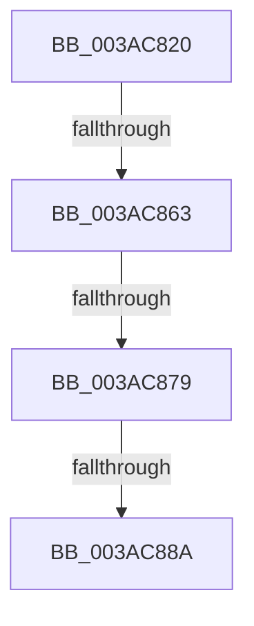

# B_TREE&lt;unsigned long,ST_STORE&lt;SM_TRAITS&gt;::_ST_REGION_ENTRY,4096,NP_CONTEXT,ST_STORE&lt;SM_TRAITS&gt;::ST_REGION_ENTRY_COMPARATOR&gt;::BTreeInsert

- RVA: `0x003AC820`–`0x003AC88E` (길이 `110` bytes)
- VA: `0x00000001403AC820`
- 실행 섹션: `.text`
- PDB 이름 있음: `예`; PDB Function 태그: `아니요`
- unwind 정보 RVA: `0x0008BB84`
- 디코드: `28`개 명령, `110/110` bytes 표시
- 미해석 바이트: `0` (있으면 어셈블리에 `.byte`로 보존)

> 이 문서는 커널 이미지의 기계어와 PDB 기호를 분석해 생성했습니다. 4번과 5번은 함수 원형과 자료형을 바이너리 사용 방식에서 추정한 C 해석이며 원본 소스 복구 결과는 아닙니다.

## 1. Dependencies

- 직접 호출 지점: **1**; 고유 호출 대상: **1**
- 직접 호출자로 확인된 함수: **2**
- RIP 상대 이미지 참조: **0**

### Outgoing calls
- `0x003AC84F` → [B_TREE<unsigned long,ST_STORE<SM_TRAITS>::_ST_REGION_ENTRY,4096,NP_CONTEXT,ST_STORE<SM_TRAITS>::ST_REGION_ENTRY_COMPARATOR>::BTreeSearchResultDeref](B_TREE_unsigned_long_ST_STORE_SM_TRAITS__ST_REGION_ENTRY_4096_NP_CONTEXT_ST_STORE_SM_TRAITS_ST_REGIO_function_003AD260.md) (function, `0x003AD260`)

### Direct callers
- [ST_STORE&lt;SM_TRAITS&gt;::StCompactRegions](../4A/ST_STORE_SM_TRAITS_StCompactRegions_function_004A48E0.md) at `0x004A4D9B`
- [ST_STORE&lt;SM_TRAITS&gt;::StDmpSinglePageInsert](../4E/ST_STORE_SM_TRAITS_StDmpSinglePageInsert_function_004EBDF0.md) at `0x004EBEBC`

### Static image references
- 디코드된 RIP-relative 메모리 참조가 없습니다.

## 2. Other-region calls and transfers

- 다른 실행 섹션으로 향하는 call: **0**
- call이 아닌 외부 분기/꼬리 이동: **3**
  - `0x003AC85D` → [sub_003ACB83](Unknown_function_003ACB83.md) (`tail-transfer`)
  - `0x003AC873` → [sub_003ACB3C + 0x11](Unknown_function_003ACB3C.md) (`tail-transfer`)
  - `0x003AC884` → [sub_003ACB3C + 0x18](Unknown_function_003ACB3C.md) (`tail-transfer`)

## 3. Assembly (complete function range)

```asm
003AC820  4C 89 44 24 18                  mov qword ptr [rsp + 0x18], r8
003AC825  48 89 54 24 10                  mov qword ptr [rsp + 0x10], rdx
003AC82A  48 89 4C 24 08                  mov qword ptr [rsp + 8], rcx
003AC82F  55                              push rbp
003AC830  56                              push rsi
003AC831  41 54                           push r12
003AC833  41 55                           push r13
003AC835  41 56                           push r14
003AC837  48 81 EC 80 00 00 00            sub rsp, 0x80
003AC83E  44 8B 2A                        mov r13d, dword ptr [rdx]
003AC841  49 8B E8                        mov rbp, r8
003AC844  49 8B D0                        mov rdx, r8
003AC847  44 89 6C 24 20                  mov dword ptr [rsp + 0x20], r13d
003AC84C  4C 8B E1                        mov r12, rcx
003AC84F  E8 0C 0A 00 00                  call 0x1403ad260
003AC854  83 7D 18 FF                     cmp dword ptr [rbp + 0x18], -1
003AC858  BE 01 00 00 00                  mov esi, 1
003AC85D  0F 84 20 03 00 00               je 0x1403acb83
003AC863  49 8B 04 24                     mov rax, qword ptr [r12]
003AC867  8B D6                           mov edx, esi
003AC869  89 94 24 C8 00 00 00            mov dword ptr [rsp + 0xc8], edx
003AC870  48 85 C0                        test rax, rax
003AC873  0F 84 D4 02 00 00               je 0x1403acb4d
003AC879  0F B6 48 02                     movzx ecx, byte ptr [rax + 2]
003AC87D  39 4D 1C                        cmp dword ptr [rbp + 0x1c], ecx
003AC880  4C 8D 45 1C                     lea r8, [rbp + 0x1c]
003AC884  0F 82 CA 02 00 00               jb 0x1403acb54
003AC88A  4C 8B 75 00                     mov r14, qword ptr [rbp]
```

## 4. C-style interpretation (structured pseudocode)

```c
__int64 __fastcall B_TREE_unsigned_long_ST_STORE_SM_TRAITS____ST_REGION_ENTRY_4096_NP_CONTEXT_ST_STORE_SM_TRAITS___ST_R(__int64 a1, __int64 a2, __int64 a3)
{
    __int64 result;
    __int64 v_rsp;
    unsigned int v_stack_m88;
    unsigned __int64 v_stack_p10;
    unsigned __int64 v_stack_p18;
    unsigned int v_stack_p20;
    unsigned __int64 v_stack_p8;

    v_stack_p18 = a3;
    v_stack_p10 = a2;
    v_stack_p8 = a1;
    v_rsp = (v_rsp) - (128);
    v_stack_m88 = (unsigned int)((unsigned int)(*(unsigned int *)(a2)));
    result = B_TREE_unsigned_long_ST_STORE_SM_TRAITS____ST_REGION_ENTRY_4096_NP_CONTEXT_ST_STORE_SM_TRAITS___ST_R(a1, a3, a3, a4);
    v_stack_p20 = 1;
    return *(unsigned __int64 *)(a1);
}
```

## 5. (Beta) C Style

```c
int64_t B_TREE_unsigned_long_ST_STORE_SM_TRAITS____ST_REGION_ENTRY_4096_NP_CONTEXT_ST_STORE_SM_TRAITS___ST_R(void *Arg1, void *Arg2, void *Arg3)
{
    uint8_t *arg1 = (uint8_t *)Arg1;
    uint8_t *arg2 = (uint8_t *)Arg2;
    uint8_t *arg3 = (uint8_t *)Arg3;

    int64_t result;
    int64_t local_rsp;
    uint32_t v_stack_m88;
    uint64_t v_stack_p10;
    uint64_t v_stack_p18;
    uint32_t v_stack_p20;
    uint64_t v_stack_p8;

    v_stack_p18 = Arg3;
    v_stack_p10 = Arg2;
    v_stack_p8 = Arg1;
    local_rsp = (local_rsp) - (128);
    v_stack_m88 = (uint32_t)((uint32_t)(*(uint32_t *)(arg2)));
    result = B_TREE_unsigned_long_ST_STORE_SM_TRAITS____ST_REGION_ENTRY_4096_NP_CONTEXT_ST_STORE_SM_TRAITS___ST_R(Arg1, Arg3, Arg3, a4);
    v_stack_p20 = 1;
    return *(uint64_t *)(arg1);
}
```

### 관측된 메모리 오프셋

구조체 형식이 확인되지 않은 접근은 인자 기준의 오프셋으로만 기록했습니다.

| 기준 인자 | 오프셋 표현 | 폭 (bit) | 접근 |
|---|---:|---:|---|
| `Arg1` | `+ 0x0` | `64` | `R` |
| `Arg2` | `+ 0x0` | `32` | `R` |
| `Arg3` | `+ 0x0` | `64` | `R` |
| `Arg3` | `+ 0x18` | `32` | `R` |
| `Arg3` | `+ 0x1C` | `32` | `R` |
| `Arg3` | `+ 0x1C` | `64` | `R` |

## 6. Execution-region graph

[열기: 2D/3D 그래프와 함수 탐색 컨트롤 패널](../../../control-panel.html?section=text&rva=0x003AC820&view=graph)

- 2D 그래프는 위에서 아래로 흐르고, 3D 그래프는 빈 공간을 드래그해 회전합니다. Shift+드래그는 이동, 휠은 확대·축소, 함수 노드 선택은 대상 보고서 이동입니다.

### Static fallback


