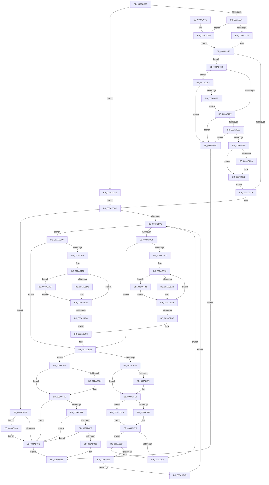

# B_TREE&lt;unsigned long,ST_STORE&lt;SM_TRAITS&gt;::_ST_REGION_ENTRY,4096,NP_CONTEXT,ST_STORE&lt;SM_TRAITS&gt;::ST_REGION_ENTRY_COMPARATOR&gt;::BTreeSearchKey

- RVA: `0x003ACD20`–`0x003AD256` (길이 `1,334` bytes)
- VA: `0x00000001403ACD20`
- 실행 섹션: `.text`
- PDB 이름 있음: `예`; PDB Function 태그: `예`
- unwind 정보 RVA: `0x0008BC3C`
- 디코드: `336`개 명령, `1,334/1,334` bytes 표시
- 미해석 바이트: `0` (있으면 어셈블리에 `.byte`로 보존)

> 이 문서는 커널 이미지의 기계어와 PDB 기호를 분석해 생성했습니다. 4번과 5번은 함수 원형과 자료형을 바이너리 사용 방식에서 추정한 C 해석이며 원본 소스 복구 결과는 아닙니다.

## 1. Dependencies

- 직접 호출 지점: **6**; 고유 호출 대상: **6**
- 직접 호출자로 확인된 함수: **11**
- RIP 상대 이미지 참조: **0**

### Outgoing calls
- `0x003ACD4A` → [B_TREE<unsigned long,ST_STORE<SM_TRAITS>::_ST_REGION_ENTRY,4096,NP_CONTEXT,ST_STORE<SM_TRAITS>::ST_REGION_ENTRY_COMPARATOR>::BTreeSearchResultDeref](B_TREE_unsigned_long_ST_STORE_SM_TRAITS__ST_REGION_ENTRY_4096_NP_CONTEXT_ST_STORE_SM_TRAITS_ST_REGIO_function_003AD260.md) (function, `0x003AD260`)
- `0x003AD071` → [ExAllocatePool2](../../poolcode/B8/ExAllocatePool2_function_00B820F0.md) (function, `0x00B820F0`)
- `0x003AD091` → [memset](../6C/memset_function_006C6C40.md) (function, `0x006C6C40`)
- `0x003AD0A3` → [memcpy](../6C/memcpy_function_006C6840.md) (function, `0x006C6840`)
- `0x003AD0AD` → [ExFreePoolWithTag](../../poolcode/B8/ExFreePoolWithTag_function_00B82870.md) (function, `0x00B82870`)
- `0x003AD235` → [NP_CONTEXT::NpLeafRefInternal](NP_CONTEXT_NpLeafRefInternal_function_003AA340.md) (function, `0x003AA340`)

### Direct callers
- [ST_STORE&lt;SM_TRAITS&gt;::StDmPageRemove](../20/ST_STORE_SM_TRAITS_StDmPageRemove_function_002049A0.md) at `0x00204CD9`
- [B_TREE&lt;unsigned long,ST_STORE&lt;SM_TRAITS&gt;::_ST_REGION_ENTRY,4096,NP_CONTEXT,ST_STORE&lt;SM_TRAITS&gt;::ST_REGION_ENTRY_COMPARATOR&gt;::BTreeSearchResultIterStart](B_TREE_unsigned_long_ST_STORE_SM_TRAITS__ST_REGION_ENTRY_4096_NP_CONTEXT_ST_STORE_SM_TRAITS_ST_REGIO_function_003AB794.md) at `0x003AB7AB`
- [B_TREE&lt;unsigned long,ST_STORE&lt;SM_TRAITS&gt;::_ST_REGION_ENTRY,4096,NP_CONTEXT,ST_STORE&lt;SM_TRAITS&gt;::ST_REGION_ENTRY_COMPARATOR&gt;::BTreeDelete](B_TREE_unsigned_long_ST_STORE_SM_TRAITS__ST_REGION_ENTRY_4096_NP_CONTEXT_ST_STORE_SM_TRAITS_ST_REGIO_function_003AC7A8.md) at `0x003AC7B8`
- [B_TREE&lt;unsigned long,ST_STORE&lt;SM_TRAITS&gt;::_ST_REGION_ENTRY,4096,NP_CONTEXT,ST_STORE&lt;SM_TRAITS&gt;::ST_REGION_ENTRY_COMPARATOR&gt;::BTreeSearchResultDeref](B_TREE_unsigned_long_ST_STORE_SM_TRAITS__ST_REGION_ENTRY_4096_NP_CONTEXT_ST_STORE_SM_TRAITS_ST_REGIO_function_003AD260.md) at `0x003AD36E`
- [B_TREE&lt;unsigned long,ST_STORE&lt;SM_TRAITS&gt;::_ST_REGION_ENTRY,4096,NP_CONTEXT,ST_STORE&lt;SM_TRAITS&gt;::ST_REGION_ENTRY_COMPARATOR&gt;::BTreeFindLeafSibling](../45/B_TREE_unsigned_long_ST_STORE_SM_TRAITS__ST_REGION_ENTRY_4096_NP_CONTEXT_ST_STORE_SM_TRAITS_ST_REGIO_function_00450FB8.md) at `0x00451050`
- [ST_STORE&lt;SM_TRAITS&gt;::StCompactRegions](../4A/ST_STORE_SM_TRAITS_StCompactRegions_function_004A48E0.md) at `0x004A49C3`
- [ST_STORE&lt;SM_TRAITS&gt;::StCompactRegions](../4A/ST_STORE_SM_TRAITS_StCompactRegions_function_004A48E0.md) at `0x004A4A16`
- [ST_STORE&lt;SM_TRAITS&gt;::StCompactRegions](../4A/ST_STORE_SM_TRAITS_StCompactRegions_function_004A48E0.md) at `0x004A4C9A`
- [ST_STORE&lt;SM_TRAITS&gt;::StCompactRegions](../4A/ST_STORE_SM_TRAITS_StCompactRegions_function_004A48E0.md) at `0x004A4F00`
- [ST_STORE&lt;SM_TRAITS&gt;::StDmCombineBufferProcess](../4E/ST_STORE_SM_TRAITS_StDmCombineBufferProcess_function_004EB9AC.md) at `0x004EBBC8`
- [ST_STORE&lt;SM_TRAITS&gt;::StDmGetStatsBitmap](../60/ST_STORE_SM_TRAITS_StDmGetStatsBitmap_function_0060D838.md) at `0x0060D8C5`
- [ST_STORE&lt;SM_TRAITS&gt;::StDmRegionGetKeys](../60/ST_STORE_SM_TRAITS_StDmRegionGetKeys_function_0060E140.md) at `0x0060E1C0`
- [sub_006EFF4C](../6E/Unknown_function_006EFF4C.md) at `0x006EFF9E`
- [sub_006F026C](../6F/Unknown_function_006F026C.md) at `0x006F02D1`

### Static image references
- 디코드된 RIP-relative 메모리 참조가 없습니다.

## 2. Other-region calls and transfers

- 다른 실행 섹션으로 향하는 call: **2**
  - `0x003AD071` → [ExAllocatePool2](../../poolcode/B8/ExAllocatePool2_function_00B820F0.md) (`.text` → `POOLCODE`)
  - `0x003AD0AD` → [ExFreePoolWithTag](../../poolcode/B8/ExFreePoolWithTag_function_00B82870.md) (`.text` → `POOLCODE`)
- call이 아닌 외부 분기/꼬리 이동: **1**
  - `0x003AD245` → [sub_006E6DDA](../6E/Unknown_function_006E6DDA.md) (`tail-transfer`)

## 3. Assembly (complete function range)

```asm
003ACD20  4C 89 44 24 18                  mov qword ptr [rsp + 0x18], r8
003ACD25  89 54 24 10                     mov dword ptr [rsp + 0x10], edx
003ACD29  48 89 4C 24 08                  mov qword ptr [rsp + 8], rcx
003ACD2E  53                              push rbx
003ACD2F  55                              push rbp
003ACD30  56                              push rsi
003ACD31  57                              push rdi
003ACD32  41 54                           push r12
003ACD34  41 55                           push r13
003ACD36  41 56                           push r14
003ACD38  41 57                           push r15
003ACD3A  48 83 EC 58                     sub rsp, 0x58
003ACD3E  44 8B EA                        mov r13d, edx
003ACD41  49 8B F8                        mov rdi, r8
003ACD44  49 8B D0                        mov rdx, r8
003ACD47  4C 8B E1                        mov r12, rcx
003ACD4A  E8 11 05 00 00                  call 0x1403ad260
003ACD4F  41 B8 FF FF FF FF               mov r8d, 0xffffffff
003ACD55  BE 01 00 00 00                  mov esi, 1
003ACD5A  44 39 47 18                     cmp dword ptr [rdi + 0x18], r8d
003ACD5E  0F 84 6A 03 00 00               je 0x1403ad0ce
003ACD64  49 8B 04 24                     mov rax, qword ptr [r12]
003ACD68  8B D6                           mov edx, esi
003ACD6A  89 94 24 B8 00 00 00            mov dword ptr [rsp + 0xb8], edx
003ACD71  48 85 C0                        test rax, rax
003ACD74  0F 84 C3 02 00 00               je 0x1403ad03d
003ACD7A  0F B6 40 02                     movzx eax, byte ptr [rax + 2]
003ACD7E  8B 4F 1C                        mov ecx, dword ptr [rdi + 0x1c]
003ACD81  3B C8                           cmp ecx, eax
003ACD83  0F 82 B9 02 00 00               jb 0x1403ad042
003ACD89  4C 8B 37                        mov r14, qword ptr [rdi]
003ACD8C  49 8B 1C 24                     mov rbx, qword ptr [r12]
003ACD90  4C 89 74 24 30                  mov qword ptr [rsp + 0x30], r14
003ACD95  48 89 5C 24 38                  mov qword ptr [rsp + 0x38], rbx
003ACD9A  48 85 DB                        test rbx, rbx
003ACD9D  0F 84 47 03 00 00               je 0x1403ad0ea
003ACDA3  8B 0B                           mov ecx, dword ptr [rbx]
003ACDA5  4C 8D 7B 10                     lea r15, [rbx + 0x10]
003ACDA9  0F B7 C1                        movzx eax, cx
003ACDAC  45 8B D8                        mov r11d, r8d
003ACDAF  C1 E9 18                        shr ecx, 0x18
003ACDB2  4C 89 7C 24 28                  mov qword ptr [rsp + 0x28], r15
003ACDB7  84 C9                           test cl, cl
003ACDB9  0F 84 3D 03 00 00               je 0x1403ad0fc
003ACDBF  85 C0                           test eax, eax
003ACDC1  0F 84 1D 01 00 00               je 0x1403acee4
003ACDC7  45 8B BC 24 8C 01 00 00         mov r15d, dword ptr [r12 + 0x18c]
003ACDCF  41 8B FD                        mov edi, r13d
003ACDD2  41 8B AC 24 88 01 00 00         mov ebp, dword ptr [r12 + 0x188]
003ACDDA  41 8B D7                        mov edx, r15d
003ACDDD  4C 8B 74 24 28                  mov r14, qword ptr [rsp + 0x28]
003ACDE2  8B CD                           mov ecx, ebp
003ACDE4  41 23 D5                        and edx, r13d
003ACDE7  D3 EF                           shr edi, cl
003ACDE9  45 8B AC 24 98 01 00 00         mov r13d, dword ptr [r12 + 0x198]
003ACDF1  BB 01 00 00 00                  mov ebx, 1
003ACDF6  45 8B A4 24 90 01 00 00         mov r12d, dword ptr [r12 + 0x190]
003ACDFE  41 8B CC                        mov ecx, r12d
003ACE01  0F AF CA                        imul ecx, edx
003ACE04  48 89 4C 24 40                  mov qword ptr [rsp + 0x40], rcx
003ACE09  0F 1F 80 00 00 00 00            nop dword ptr [rax]
003ACE10  42 8D 0C 18                     lea ecx, [rax + r11]
003ACE14  C7 44 24 20 00 00 00 00         mov dword ptr [rsp + 0x20], 0
003ACE1C  D1 E9                           shr ecx, 1
003ACE1E  45 8B D7                        mov r10d, r15d
003ACE21  8B F1                           mov esi, ecx
003ACE23  44 8B C3                        mov r8d, ebx
003ACE26  C7 44 24 20 00 00 00 00         mov dword ptr [rsp + 0x20], 0
003ACE2E  41 8B 14 8E                     mov edx, dword ptr [r14 + rcx*4]
003ACE32  44 8B CA                        mov r9d, edx
003ACE35  44 23 D2                        and r10d, edx
003ACE38  8B CD                           mov ecx, ebp
003ACE3A  48 8B 94 24 A0 00 00 00         mov rdx, qword ptr [rsp + 0xa0]
003ACE42  41 D3 E9                        shr r9d, cl
003ACE45  41 0F BD C9                     bsr ecx, r9d
003ACE49  41 D3 E0                        shl r8d, cl
003ACE4C  45 33 C1                        xor r8d, r9d
003ACE4F  45 8B CC                        mov r9d, r12d
003ACE52  45 0F AF CA                     imul r9d, r10d
003ACE56  48 8B 94 CA 80 00 00 00         mov rdx, qword ptr [rdx + rcx*8 + 0x80]
003ACE5E  41 8B C8                        mov ecx, r8d
003ACE61  44 8B C3                        mov r8d, ebx
003ACE64  48 03 C9                        add rcx, rcx
003ACE67  48 8B 14 CA                     mov rdx, qword ptr [rdx + rcx*8]
003ACE6B  49 03 D5                        add rdx, r13
003ACE6E  4C 03 CA                        add r9, rdx
003ACE71  48 8B 94 24 A0 00 00 00         mov rdx, qword ptr [rsp + 0xa0]
003ACE79  0F BD CF                        bsr ecx, edi
003ACE7C  41 D3 E0                        shl r8d, cl
003ACE7F  44 33 C7                        xor r8d, edi
003ACE82  48 8B 94 CA 80 00 00 00         mov rdx, qword ptr [rdx + rcx*8 + 0x80]
003ACE8A  41 8B C8                        mov ecx, r8d
003ACE8D  48 03 C9                        add rcx, rcx
003ACE90  48 8B 14 CA                     mov rdx, qword ptr [rdx + rcx*8]
003ACE94  48 8B 4C 24 40                  mov rcx, qword ptr [rsp + 0x40]
003ACE99  49 03 D5                        add rdx, r13
003ACE9C  8B 0C 11                        mov ecx, dword ptr [rcx + rdx]
003ACE9F  41 39 09                        cmp dword ptr [r9], ecx
003ACEA2  0F 83 99 00 00 00               jae 0x1403acf41
003ACEA8  44 8B DE                        mov r11d, esi
003ACEAB  41 8D 4B 01                     lea ecx, [r11 + 1]
003ACEAF  3B C8                           cmp ecx, eax
003ACEB1  0F 85 59 FF FF FF               jne 0x1403ace10
003ACEB7  4C 8B A4 24 A0 00 00 00         mov r12, qword ptr [rsp + 0xa0]
003ACEBF  BE 01 00 00 00                  mov esi, 1
003ACEC4  44 8B AC 24 A8 00 00 00         mov r13d, dword ptr [rsp + 0xa8]
003ACECC  41 B8 FF FF FF FF               mov r8d, 0xffffffff
003ACED2  48 8B BC 24 B0 00 00 00         mov rdi, qword ptr [rsp + 0xb0]
003ACEDA  4C 8B 74 24 30                  mov r14, qword ptr [rsp + 0x30]
003ACEDF  48 8B 5C 24 38                  mov rbx, qword ptr [rsp + 0x38]
003ACEE4  80 7B 03 00                     cmp byte ptr [rbx + 3], 0
003ACEE8  75 5E                           jne 0x1403acf48
003ACEEA  83 BC 24 B8 00 00 00 00         cmp dword ptr [rsp + 0xb8], 0
003ACEF2  74 1C                           je 0x1403acf10
003ACEF4  8B C8                           mov ecx, eax
003ACEF6  48 FF C1                        inc rcx
003ACEF9  49 89 1E                        mov qword ptr [r14], rbx
003ACEFC  48 C1 E1 04                     shl rcx, 4
003ACF00  48 03 CB                        add rcx, rbx
003ACF03  49 89 4E 08                     mov qword ptr [r14 + 8], rcx
003ACF07  49 83 C6 10                     add r14, 0x10
003ACF0B  4C 89 74 24 30                  mov qword ptr [rsp + 0x30], r14
003ACF10  85 C0                           test eax, eax
003ACF12  0F 84 AD 01 00 00               je 0x1403ad0c5
003ACF18  8D 48 FF                        lea ecx, [rax - 1]
003ACF1B  48 C1 E1 04                     shl rcx, 4
003ACF1F  48 83 C1 18                     add rcx, 0x18
003ACF23  48 03 CB                        add rcx, rbx
003ACF26  49 8B 44 24 10                  mov rax, qword ptr [r12 + 0x10]
003ACF2B  44 39 00                        cmp dword ptr [rax], r8d
003ACF2E  0F 85 E3 02 00 00               jne 0x1403ad217
003ACF34  48 8B 19                        mov rbx, qword ptr [rcx]
003ACF37  48 89 5C 24 38                  mov qword ptr [rsp + 0x38], rbx
003ACF3C  E9 62 FE FF FF                  jmp 0x1403acda3
003ACF41  8B C6                           mov eax, esi
003ACF43  E9 63 FF FF FF                  jmp 0x1403aceab
003ACF48  44 8B C8                        mov r9d, eax
003ACF4B  49 83 C1 04                     add r9, 4
003ACF4F  49 89 1E                        mov qword ptr [r14], rbx
003ACF52  83 BC 24 B8 00 00 00 00         cmp dword ptr [rsp + 0xb8], 0
003ACF5A  4E 8D 0C 8B                     lea r9, [rbx + r9*4]
003ACF5E  4D 89 4E 08                     mov qword ptr [r14 + 8], r9
003ACF62  74 0E                           je 0x1403acf72
003ACF64  4C 2B 37                        sub r14, qword ptr [rdi]
003ACF67  49 C1 FE 04                     sar r14, 4
003ACF6B  41 FF C6                        inc r14d
003ACF6E  44 89 77 18                     mov dword ptr [rdi + 0x18], r14d
003ACF72  8B 0B                           mov ecx, dword ptr [rbx]
003ACF74  0F B7 D1                        movzx edx, cx
003ACF77  3B C2                           cmp eax, edx
003ACF79  0F 83 73 01 00 00               jae 0x1403ad0f2
003ACF7F  45 8B 09                        mov r9d, dword ptr [r9]
003ACF82  44 8B C6                        mov r8d, esi
003ACF85  45 8B 94 24 88 01 00 00         mov r10d, dword ptr [r12 + 0x188]
003ACF8D  41 8B D1                        mov edx, r9d
003ACF90  41 8B 9C 24 8C 01 00 00         mov ebx, dword ptr [r12 + 0x18c]
003ACF98  41 8B CA                        mov ecx, r10d
003ACF9B  45 8B 9C 24 90 01 00 00         mov r11d, dword ptr [r12 + 0x190]
003ACFA3  44 23 CB                        and r9d, ebx
003ACFA6  41 8B BC 24 98 01 00 00         mov edi, dword ptr [r12 + 0x198]
003ACFAE  41 23 DD                        and ebx, r13d
003ACFB1  D3 EA                           shr edx, cl
003ACFB3  0F BD CA                        bsr ecx, edx
003ACFB6  45 0F AF CB                     imul r9d, r11d
003ACFBA  41 D3 E0                        shl r8d, cl
003ACFBD  4C 33 C2                        xor r8, rdx
003ACFC0  41 0F AF DB                     imul ebx, r11d
003ACFC4  4D 03 C0                        add r8, r8
003ACFC7  C7 84 24 B0 00 00 00 00 00 00 00  mov dword ptr [rsp + 0xb0], 0
003ACFD2  49 8B 94 CC 80 00 00 00         mov rdx, qword ptr [r12 + rcx*8 + 0x80]
003ACFDA  41 8B CA                        mov ecx, r10d
003ACFDD  41 8B C1                        mov eax, r9d
003ACFE0  C7 84 24 B0 00 00 00 00 00 00 00  mov dword ptr [rsp + 0xb0], 0
003ACFEB  4E 8B 0C C2                     mov r9, qword ptr [rdx + r8*8]
003ACFEF  41 8B D5                        mov edx, r13d
003ACFF2  D3 EA                           shr edx, cl
003ACFF4  4C 03 C8                        add r9, rax
003ACFF7  0F BD CA                        bsr ecx, edx
003ACFFA  8B C3                           mov eax, ebx
003ACFFC  D3 E6                           shl esi, cl
003ACFFE  44 8B C6                        mov r8d, esi
003AD001  4C 33 C2                        xor r8, rdx
003AD004  49 8B 8C CC 80 00 00 00         mov rcx, qword ptr [r12 + rcx*8 + 0x80]
003AD00C  4D 03 C0                        add r8, r8
003AD00F  4A 8B 14 C1                     mov rdx, qword ptr [rcx + r8*8]
003AD013  41 8B 0C 39                     mov ecx, dword ptr [r9 + rdi]
003AD017  48 03 D0                        add rdx, rax
003AD01A  3B 0C 3A                        cmp ecx, dword ptr [rdx + rdi]
003AD01D  0F 82 CF 00 00 00               jb 0x1403ad0f2
003AD023  0F 87 C9 00 00 00               ja 0x1403ad0f2
003AD029  33 C0                           xor eax, eax
003AD02B  48 83 C4 58                     add rsp, 0x58
003AD02F  41 5F                           pop r15
003AD031  41 5E                           pop r14
003AD033  41 5D                           pop r13
003AD035  41 5C                           pop r12
003AD037  5F                              pop rdi
003AD038  5E                              pop rsi
003AD039  5D                              pop rbp
003AD03A  5B                              pop rbx
003AD03B  C3                              ret
003AD03C  CC                              int3
003AD03D  E9 3C FD FF FF                  jmp 0x1403acd7e
003AD042  8D 2C 09                        lea ebp, [rcx + rcx]
003AD045  B9 08 00 00 00                  mov ecx, 8
003AD04A  3B E9                           cmp ebp, ecx
003AD04C  0F 42 E9                        cmovb ebp, ecx
003AD04F  3B C5                           cmp eax, ebp
003AD051  0F 83 9C 01 00 00               jae 0x1403ad1f3
003AD057  44 8B F5                        mov r14d, ebp
003AD05A  49 C1 E6 04                     shl r14, 4
003AD05E  4D 3B F0                        cmp r14, r8
003AD061  77 7D                           ja 0x1403ad0e0
003AD063  41 8B D6                        mov edx, r14d
003AD066  B9 40 00 00 00                  mov ecx, 0x40
003AD06B  41 B8 73 6D 41 72               mov r8d, 0x72416d73
003AD071  E8 7A 50 7D 00                  call 0x140b820f0
003AD076  4C 8B F8                        mov r15, rax
003AD079  48 85 C0                        test rax, rax
003AD07C  74 62                           je 0x1403ad0e0
003AD07E  8B 5F 1C                        mov ebx, dword ptr [rdi + 0x1c]
003AD081  33 D2                           xor edx, edx
003AD083  C1 E3 04                        shl ebx, 4
003AD086  8B CB                           mov ecx, ebx
003AD088  44 2B F3                        sub r14d, ebx
003AD08B  45 8B C6                        mov r8d, r14d
003AD08E  48 03 C8                        add rcx, rax
003AD091  E8 AA 9B 31 00                  call 0x1406c6c40
003AD096  85 DB                           test ebx, ebx
003AD098  74 18                           je 0x1403ad0b2
003AD09A  48 8B 17                        mov rdx, qword ptr [rdi]
003AD09D  49 8B CF                        mov rcx, r15
003AD0A0  44 8B C3                        mov r8d, ebx
003AD0A3  E8 98 97 31 00                  call 0x1406c6840
003AD0A8  48 8B 0F                        mov rcx, qword ptr [rdi]
003AD0AB  33 D2                           xor edx, edx
003AD0AD  E8 BE 57 7D 00                  call 0x140b82870
003AD0B2  4C 89 3F                        mov qword ptr [rdi], r15
003AD0B5  8B D6                           mov edx, esi
003AD0B7  89 6F 1C                        mov dword ptr [rdi + 0x1c], ebp
003AD0BA  41 B8 FF FF FF FF               mov r8d, 0xffffffff
003AD0C0  E9 C4 FC FF FF                  jmp 0x1403acd89
003AD0C5  48 8D 4B 08                     lea rcx, [rbx + 8]
003AD0C9  E9 58 FE FF FF                  jmp 0x1403acf26
003AD0CE  33 D2                           xor edx, edx
003AD0D0  4C 8D 77 08                     lea r14, [rdi + 8]
003AD0D4  89 94 24 B8 00 00 00            mov dword ptr [rsp + 0xb8], edx
003AD0DB  E9 AC FC FF FF                  jmp 0x1403acd8c
003AD0E0  B8 9A 00 00 C0                  mov eax, 0xc000009a
003AD0E5  E9 41 FF FF FF                  jmp 0x1403ad02b
003AD0EA  85 D2                           test edx, edx
003AD0EC  0F 84 11 01 00 00               je 0x1403ad203
003AD0F2  B8 25 02 00 C0                  mov eax, 0xc0000225
003AD0F7  E9 2F FF FF FF                  jmp 0x1403ad02b
003AD0FC  85 C0                           test eax, eax
003AD0FE  0F 84 E0 FD FF FF               je 0x1403acee4
003AD104  45 8B B4 24 88 01 00 00         mov r14d, dword ptr [r12 + 0x188]
003AD10C  41 8B ED                        mov ebp, r13d
003AD10F  41 8B 9C 24 8C 01 00 00         mov ebx, dword ptr [r12 + 0x18c]
003AD117  41 8B CE                        mov ecx, r14d
003AD11A  D3 ED                           shr ebp, cl
003AD11C  8B D3                           mov edx, ebx
003AD11E  41 8B 8C 24 98 01 00 00         mov ecx, dword ptr [r12 + 0x198]
003AD126  41 23 D5                        and edx, r13d
003AD129  48 89 4C 24 40                  mov qword ptr [rsp + 0x40], rcx
003AD12E  41 8B 8C 24 90 01 00 00         mov ecx, dword ptr [r12 + 0x190]
003AD136  4C 8B 6C 24 40                  mov r13, qword ptr [rsp + 0x40]
003AD13B  89 4C 24 20                     mov dword ptr [rsp + 0x20], ecx
003AD13F  0F AF CA                        imul ecx, edx
003AD142  48 89 4C 24 48                  mov qword ptr [rsp + 0x48], rcx
003AD147  66 0F 1F 84 00 00 00 00 00      nop word ptr [rax + rax]
003AD150  42 8D 0C 18                     lea ecx, [rax + r11]
003AD154  C7 44 24 28 00 00 00 00         mov dword ptr [rsp + 0x28], 0
003AD15C  D1 E9                           shr ecx, 1
003AD15E  44 8B C6                        mov r8d, esi
003AD161  8B F9                           mov edi, ecx
003AD163  44 8B D3                        mov r10d, ebx
003AD166  48 03 C9                        add rcx, rcx
003AD169  C7 44 24 28 00 00 00 00         mov dword ptr [rsp + 0x28], 0
003AD171  41 8B 14 CF                     mov edx, dword ptr [r15 + rcx*8]
003AD175  44 8B CA                        mov r9d, edx
003AD178  44 23 D2                        and r10d, edx
003AD17B  41 8B CE                        mov ecx, r14d
003AD17E  41 D3 E9                        shr r9d, cl
003AD181  41 0F BD C9                     bsr ecx, r9d
003AD185  41 D3 E0                        shl r8d, cl
003AD188  45 33 C1                        xor r8d, r9d
003AD18B  44 8B 4C 24 20                  mov r9d, dword ptr [rsp + 0x20]
003AD190  45 0F AF CA                     imul r9d, r10d
003AD194  49 8B 94 CC 80 00 00 00         mov rdx, qword ptr [r12 + rcx*8 + 0x80]
003AD19C  41 8B C8                        mov ecx, r8d
003AD19F  44 8B C6                        mov r8d, esi
003AD1A2  48 03 C9                        add rcx, rcx
003AD1A5  48 8B 14 CA                     mov rdx, qword ptr [rdx + rcx*8]
003AD1A9  49 03 D5                        add rdx, r13
003AD1AC  4C 03 CA                        add r9, rdx
003AD1AF  0F BD CD                        bsr ecx, ebp
003AD1B2  41 D3 E0                        shl r8d, cl
003AD1B5  44 33 C5                        xor r8d, ebp
003AD1B8  49 8B 94 CC 80 00 00 00         mov rdx, qword ptr [r12 + rcx*8 + 0x80]
003AD1C0  41 8B C8                        mov ecx, r8d
003AD1C3  4C 8B 44 24 48                  mov r8, qword ptr [rsp + 0x48]
003AD1C8  48 03 C9                        add rcx, rcx
003AD1CB  48 8B 14 CA                     mov rdx, qword ptr [rdx + rcx*8]
003AD1CF  41 8B 09                        mov ecx, dword ptr [r9]
003AD1D2  49 03 D5                        add rdx, r13
003AD1D5  41 3B 0C 10                     cmp ecx, dword ptr [r8 + rdx]
003AD1D9  77 14                           ja 0x1403ad1ef
003AD1DB  44 8B DF                        mov r11d, edi
003AD1DE  41 8D 4B 01                     lea ecx, [r11 + 1]
003AD1E2  3B C8                           cmp ecx, eax
003AD1E4  0F 85 66 FF FF FF               jne 0x1403ad150
003AD1EA  E9 D5 FC FF FF                  jmp 0x1403acec4
003AD1EF  8B C7                           mov eax, edi
003AD1F1  EB EB                           jmp 0x1403ad1de
003AD1F3  8D 68 08                        lea ebp, [rax + 8]
003AD1F6  3B E8                           cmp ebp, eax
003AD1F8  0F 82 E2 FE FF FF               jb 0x1403ad0e0
003AD1FE  E9 54 FE FF FF                  jmp 0x1403ad057
003AD203  49 C7 06 00 00 00 00            mov qword ptr [r14], 0
003AD20A  49 C7 46 08 00 00 00 00         mov qword ptr [r14 + 8], 0
003AD212  E9 DB FE FF FF                  jmp 0x1403ad0f2
003AD217  80 7B 02 02                     cmp byte ptr [rbx + 2], 2
003AD21B  0F 85 13 FD FF FF               jne 0x1403acf34
003AD221  44 0F B6 47 20                  movzx r8d, byte ptr [rdi + 0x20]
003AD226  48 8B D1                        mov rdx, rcx
003AD229  41 83 E0 01                     and r8d, 1
003AD22D  49 8D 4C 24 10                  lea rcx, [r12 + 0x10]
003AD232  45 03 C0                        add r8d, r8d
003AD235  E8 06 D1 FF FF                  call 0x1403aa340
003AD23A  48 89 44 24 38                  mov qword ptr [rsp + 0x38], rax
003AD23F  48 8B D8                        mov rbx, rax
003AD242  48 85 C0                        test rax, rax
003AD245  0F 84 8F 9B 33 00               je 0x1406e6dda
003AD24B  41 B8 FF FF FF FF               mov r8d, 0xffffffff
003AD251  E9 4D FB FF FF                  jmp 0x1403acda3
```

## 4. C-style interpretation (structured pseudocode)

```c
__int64 __fastcall B_TREE_unsigned_long_ST_STORE_SM_TRAITS____ST_REGION_ENTRY_4096_NP_CONTEXT_ST_STORE_SM_TRAITS___ST_R(__int64 a1, int a2, __int64 a3)
{
    __int64 result;
    __int64 v_r10;
    __int64 v_r14;
    __int64 v_rbp;
    __int64 v_rbx;
    __int64 v_rdi;
    __int64 v_rsi;
    __int64 v_rsp;
    unsigned __int64 v_stack_m58;
    unsigned __int64 v_stack_m60;
    unsigned __int64 v_stack_m68;
    unsigned __int64 v_stack_m70;
    unsigned int v_stack_m78;
    unsigned int v_stack_p10;
    unsigned __int64 v_stack_p18;
    unsigned int v_stack_p20;
    unsigned int v_stack_p28;
    unsigned __int64 v_stack_p38;
    unsigned __int64 v_stack_p40;
    unsigned __int64 v_stack_p48;
    unsigned __int64 v_stack_p8;
    unsigned int v_stack_pB8;

    v_stack_p18 = a3;
    v_stack_p10 = a2;
    v_stack_p8 = a1;
    v_rsp = (v_rsp) - (88);
    result = B_TREE_unsigned_long_ST_STORE_SM_TRAITS____ST_REGION_ENTRY_4096_NP_CONTEXT_ST_STORE_SM_TRAITS___ST_R(a1, a3, a3, a4);
    if ((*(unsigned int *)(a3 + 24)) == ((unsigned int)((unsigned int)(0xFFFFFFFFULL)))) goto loc_003AD0CE;
    v_stack_p20 = 1;
    if (*(unsigned __int64 *)(a1) == 0) goto loc_003AD03D;
loc_003ACD7E:
    if (((unsigned int)((unsigned int)(*(unsigned int *)(a3 + 28)))) < ((unsigned int)(*(unsigned __int8 *)(*(unsigned __int64 *)(a1) + 2)))) goto loc_003AD042;
loc_003ACD89:
loc_003ACD8C:
    v_stack_m68 = *(unsigned __int64 *)(a3);
    v_stack_m60 = *(unsigned __int64 *)(a1);
    if (*(unsigned __int64 *)(a1) == 0) goto loc_003AD0EA;
loc_003ACDA3:
    a1 = (unsigned int)(((unsigned int)(*(unsigned int *)(*(unsigned __int64 *)(a1)))) >> (24));
    v_stack_m70 = *(unsigned __int64 *)(a1) + 16;
    if ((unsigned __int8)(a1) == 0) goto loc_003AD0FC;
    if ((unsigned int)((unsigned __int16)((unsigned int)(*(unsigned int *)(*(unsigned __int64 *)(a1))))) == 0) goto loc_003ACEE4;
    a2 = (unsigned int)(((unsigned int)((unsigned int)((unsigned int)(*(unsigned int *)(a1 + 396))))) & ((unsigned int)((unsigned int)(a2))));
    v_rdi = (unsigned int)(((unsigned int)((unsigned int)((unsigned int)(a2)))) >> ((unsigned __int8)((unsigned int)((unsigned int)((unsigned int)(*(unsigned int *)(a1 + 392)))))));
    a1 = (unsigned int)(((unsigned int)((unsigned int)((unsigned int)(*(unsigned int *)(a1 + 400))))) * (a2));
    v_stack_m58 = a1;
loc_003ACE10:
    v_stack_m78 = 0;
    a1 = (unsigned int)(((unsigned __int16)((unsigned int)(*(unsigned int *)(*(unsigned __int64 *)(a1)))) + (unsigned int)((unsigned int)((unsigned int)(0xFFFFFFFFULL))) * 1) >> (1));
    v_stack_m78 = 0;
    v_r10 = (unsigned int)(((unsigned int)((unsigned int)((unsigned int)(*(unsigned int *)(a1 + 396))))) & ((unsigned int)((unsigned int)(*(unsigned int *)(v_stack_m70 + a1 * 4)))));
    a4 = (unsigned int)(((unsigned int)((unsigned int)((unsigned int)(*(unsigned int *)(v_stack_m70 + a1 * 4))))) >> ((unsigned __int8)((unsigned int)((unsigned int)((unsigned int)(*(unsigned int *)(a1 + 392)))))));
    a3 = (unsigned int)((1) << ((unsigned __int8)((unsigned int)((unsigned int)((unsigned int)(*(unsigned int *)(a1 + 392)))))));
    a3 = (unsigned int)((a3) ^ ((unsigned int)(a4)));
    a4 = (unsigned int)(((unsigned int)((unsigned int)((unsigned int)(*(unsigned int *)(a1 + 400))))) * ((unsigned int)(v_r10)));
    a1 = ((unsigned int)((unsigned int)(a3))) + ((unsigned int)((unsigned int)(a3)));
    a2 = (*(unsigned __int64 *)(*(unsigned __int64 *)(v_stack_p8 + (unsigned int)((unsigned int)((unsigned int)(*(unsigned int *)(a1 + 392)))) * 8 + 128) + a1 * 8)) + ((unsigned int)(*(unsigned int *)(a1 + 408)));
    a4 = (a4) + (a2);
    a3 = (unsigned int)((1) << ((unsigned __int8)(a1)));
    a3 = (unsigned int)((a3) ^ ((unsigned int)(v_rdi)));
    a1 = ((unsigned int)((unsigned int)(a3))) + ((unsigned int)((unsigned int)(a3)));
    a2 = (*(unsigned __int64 *)(*(unsigned __int64 *)(v_stack_p8 + a1 * 8 + 128) + a1 * 8)) + ((unsigned int)(*(unsigned int *)(a1 + 408)));
    if ((*(unsigned int *)(a4)) >= ((unsigned int)((unsigned int)(*(unsigned int *)(v_stack_m58 + a2 * 1))))) goto loc_003ACF41;
loc_003ACEAB:
    if (((unsigned int)((unsigned int)((unsigned int)((unsigned int)((unsigned int)(a1)))) + 1)) != ((unsigned int)((unsigned __int16)((unsigned int)(*(unsigned int *)(*(unsigned __int64 *)(a1))))))) goto loc_003ACE10;
loc_003ACEC4:
loc_003ACEE4:
    if ((*(unsigned __int8 *)(v_stack_m60 + 3)) != 0) goto loc_003ACF48;
    v_r14 = v_stack_m68;
    if (v_stack_p20 != 0) {
        a1 = (unsigned int)((unsigned __int16)((unsigned int)(*(unsigned int *)(*(unsigned __int64 *)(a1)))));
        a1 = (a1) + 1;
        *(unsigned __int64 *)(v_stack_m68) = v_stack_m60;
        a1 = (a1) << (4);
        a1 = (a1) + (v_stack_m60);
        *(unsigned __int64 *)(v_stack_m68 + 8) = a1;
        v_r14 = (v_stack_m68) + (16);
        v_stack_m68 = v_r14;
    }
    if ((unsigned int)((unsigned __int16)((unsigned int)(*(unsigned int *)(*(unsigned __int64 *)(a1))))) == 0) goto loc_003AD0C5;
    a1 = ((unsigned __int16)((unsigned int)(*(unsigned int *)(*(unsigned __int64 *)(a1)))) - 1) << (4);
    a1 = (a1) + (24);
    a1 = (a1) + (v_stack_m60);
loc_003ACF26:
    if ((*(unsigned int *)(*(unsigned __int64 *)(v_stack_p8 + 16))) != ((unsigned int)((unsigned int)(0xFFFFFFFFULL)))) goto loc_003AD217;
loc_003ACF34:
    v_stack_m60 = *(unsigned __int64 *)(a1);
    goto loc_003ACDA3;
loc_003ACF41:
    goto loc_003ACEAB;
loc_003ACF48:
    a4 = (1) + (4);
    *(unsigned __int64 *)(v_r14) = *(unsigned __int64 *)(a1);
    *(unsigned __int64 *)(v_r14 + 8) = *(unsigned __int64 *)(a1) + a4 * 4;
    if (v_stack_p20 != 0) {
        v_r14 = (v_r14) - (*(unsigned __int64 *)(v_stack_p18));
        v_r14 = (v_r14) >> (4);
        v_r14 = (unsigned int)((v_r14) + 1);
        *(unsigned int *)(v_stack_p18 + 24) = (unsigned int)(v_r14);
    }
    if (1 >= ((unsigned int)((unsigned __int16)((unsigned int)(*(unsigned int *)(*(unsigned __int64 *)(a1))))))) goto loc_003AD0F2;
    a4 = (unsigned int)(((unsigned int)(*(unsigned int *)(*(unsigned __int64 *)(a1) + a4 * 4))) & ((unsigned int)((unsigned int)(*(unsigned int *)(v_stack_p8 + 396)))));
    v_rbx = (unsigned int)(((unsigned int)(*(unsigned int *)(v_stack_p8 + 396))) & ((unsigned int)((unsigned int)(v_stack_p10))));
    a2 = (unsigned int)(((unsigned int)((unsigned int)((unsigned int)(*(unsigned int *)(*(unsigned __int64 *)(a1) + a4 * 4))))) >> ((unsigned __int8)((unsigned int)((unsigned int)((unsigned int)(*(unsigned int *)(v_stack_p8 + 392)))))));
    a4 = (unsigned int)((a4) * ((unsigned int)((unsigned int)(*(unsigned int *)(v_stack_p8 + 400)))));
    a3 = (unsigned int)((1) << ((unsigned __int8)((unsigned int)((unsigned int)((unsigned int)(*(unsigned int *)(v_stack_p8 + 392)))))));
    a3 = (a3) ^ (a2);
    v_rbx = (unsigned int)((v_rbx) * ((unsigned int)((unsigned int)(*(unsigned int *)(v_stack_p8 + 400)))));
    a3 = (a3) + (a3);
    v_stack_p18 = 0;
    v_stack_p18 = 0;
    a2 = (unsigned int)(((unsigned int)((unsigned int)((unsigned int)(v_stack_p10)))) >> ((unsigned __int8)((unsigned int)((unsigned int)((unsigned int)(*(unsigned int *)(v_stack_p8 + 392)))))));
    a4 = (*(unsigned __int64 *)(*(unsigned __int64 *)(v_stack_p8 + (unsigned int)((unsigned int)((unsigned int)(*(unsigned int *)(v_stack_p8 + 392)))) * 8 + 128) + a3 * 8)) + ((unsigned int)((unsigned int)(a4)));
    v_rsi = (unsigned int)((1) << ((unsigned __int8)((unsigned int)((unsigned int)((unsigned int)(*(unsigned int *)(v_stack_p8 + 392)))))));
    a3 = ((unsigned int)((unsigned int)(v_rsi))) ^ (a2);
    a3 = (a3) + (a3);
    a2 = (*(unsigned __int64 *)(*(unsigned __int64 *)(v_stack_p8 + (unsigned int)((unsigned int)((unsigned int)(*(unsigned int *)(v_stack_p8 + 392)))) * 8 + 128) + a3 * 8)) + ((unsigned int)((unsigned int)(v_rbx)));
    if (((unsigned int)((unsigned int)(*(unsigned int *)(a4 + (unsigned int)(*(unsigned int *)(v_stack_p8 + 408)) * 1)))) < (*(unsigned int *)(a2 + (unsigned int)(*(unsigned int *)(v_stack_p8 + 408)) * 1))) goto loc_003AD0F2;
    if (((unsigned int)((unsigned int)(*(unsigned int *)(a4 + (unsigned int)(*(unsigned int *)(v_stack_p8 + 408)) * 1)))) > (*(unsigned int *)(a2 + (unsigned int)(*(unsigned int *)(v_stack_p8 + 408)) * 1))) goto loc_003AD0F2;
    result = 0;
loc_003AD02B:
    v_rsp = (v_rsp) + (88);
    return result;
loc_003AD03D:
    goto loc_003ACD7E;
loc_003AD042:
    v_rbp = (unsigned int)(*(unsigned int *)(a4 + (unsigned int)(*(unsigned int *)(v_stack_p8 + 408)) * 1)) + (unsigned int)(*(unsigned int *)(a4 + (unsigned int)(*(unsigned int *)(v_stack_p8 + 408)) * 1)) * 1;
    if (((unsigned int)((unsigned int)(*(unsigned int *)(a4 + (unsigned int)(*(unsigned int *)(v_stack_p8 + 408)) * 1)) + (unsigned int)(*(unsigned int *)(a4 + (unsigned int)(*(unsigned int *)(v_stack_p8 + 408)) * 1)) * 1)) < 8) { v_rbp = 8; }
    if (0 >= ((unsigned int)(v_rbp))) goto loc_003AD1F3;
loc_003AD057:
    v_r14 = ((unsigned int)((unsigned int)(v_rbp))) << (4);
    if (v_r14 > a3) goto loc_003AD0E0;
    result = ExAllocatePool2(64, (unsigned int)((unsigned int)(v_r14)), (unsigned int)(0x72416D73ULL), a4);
    if (result == 0) goto loc_003AD0E0;
    a2 = 0;
    v_rbx = (unsigned int)(((unsigned int)(*(unsigned int *)((unsigned int)(*(unsigned int *)(v_stack_p8 + 408)) + 28))) << (4));
    v_r14 = (unsigned int)((v_r14) - ((unsigned int)(v_rbx)));
    a1 = ((unsigned int)((unsigned int)(v_rbx))) + (result);
    result = memset(a1, a2, (unsigned int)((unsigned int)(v_r14)), a4);
    if ((unsigned int)(v_rbx) != 0) {
        a2 = *(unsigned __int64 *)((unsigned int)(*(unsigned int *)(v_stack_p8 + 408)));
        a1 = result;
        a3 = (unsigned int)(v_rbx);
        result = memcpy(a1, a2, a3, a4);
        a1 = *(unsigned __int64 *)((unsigned int)(*(unsigned int *)(v_stack_p8 + 408)));
        a2 = 0;
        result = ExFreePoolWithTag(a1, a2, a3, a4);
    }
    *(unsigned __int64 *)((unsigned int)(*(unsigned int *)(v_stack_p8 + 408))) = result;
    *(unsigned int *)((unsigned int)(*(unsigned int *)(v_stack_p8 + 408)) + 28) = (unsigned int)(v_rbp);
    goto loc_003ACD89;
loc_003AD0C5:
    goto loc_003ACF26;
loc_003AD0CE:
    a2 = 0;
    v_stack_pB8 = 0;
    goto loc_003ACD8C;
loc_003AD0E0:
    goto loc_003AD02B;
loc_003AD0EA:
    if (0 == 0) goto loc_003AD203;
loc_003AD0F2:
    goto loc_003AD02B;
loc_003AD0FC:
    if ((unsigned int)((unsigned int)(0xC0000225ULL)) == 0) goto loc_003ACEE4;
    v_rbp = (unsigned int)(((unsigned int)((unsigned int)((unsigned int)(v_stack_p10)))) >> ((unsigned __int8)((unsigned int)((unsigned int)((unsigned int)(*(unsigned int *)(v_stack_p8 + 392)))))));
    a2 = (unsigned int)(((unsigned int)((unsigned int)((unsigned int)(*(unsigned int *)(v_stack_p8 + 396))))) & ((unsigned int)((unsigned int)(v_stack_p10))));
    v_stack_p40 = (unsigned int)(*(unsigned int *)(v_stack_p8 + 408));
    v_stack_p20 = (unsigned int)((unsigned int)(*(unsigned int *)(v_stack_p8 + 400)));
    a1 = (unsigned int)(((unsigned int)(*(unsigned int *)(v_stack_p8 + 400))) * (a2));
    v_stack_p48 = a1;
loc_003AD150:
    v_stack_p28 = 0;
    a1 = (unsigned int)(((unsigned int)(0xC0000225ULL) + (unsigned int)(*(unsigned int *)(v_stack_p8 + 400)) * 1) >> (1));
    a1 = (a1) + (a1);
    v_stack_p28 = 0;
    v_r10 = (unsigned int)(((unsigned int)((unsigned int)((unsigned int)(*(unsigned int *)(v_stack_p8 + 396))))) & ((unsigned int)((unsigned int)(*(unsigned int *)(result + a1 * 8)))));
    a4 = (unsigned int)(((unsigned int)((unsigned int)((unsigned int)(*(unsigned int *)(result + a1 * 8))))) >> ((unsigned __int8)((unsigned int)((unsigned int)((unsigned int)(*(unsigned int *)(v_stack_p8 + 392)))))));
    a3 = (unsigned int)(((unsigned int)((unsigned int)(v_rsi))) << ((unsigned __int8)((unsigned int)((unsigned int)((unsigned int)(*(unsigned int *)(v_stack_p8 + 392)))))));
    a3 = (unsigned int)((a3) ^ ((unsigned int)(a4)));
    a4 = (unsigned int)(((unsigned int)(v_stack_p20)) * ((unsigned int)(v_r10)));
    a1 = ((unsigned int)((unsigned int)(a3))) + ((unsigned int)((unsigned int)(a3)));
    a2 = (*(unsigned __int64 *)(*(unsigned __int64 *)(v_stack_p8 + (unsigned int)((unsigned int)((unsigned int)(*(unsigned int *)(v_stack_p8 + 392)))) * 8 + 128) + a1 * 8)) + (v_stack_p40);
    a4 = (a4) + (a2);
    a3 = (unsigned int)(((unsigned int)((unsigned int)(v_rsi))) << ((unsigned __int8)(a1)));
    a3 = (unsigned int)((a3) ^ ((unsigned int)(v_rbp)));
    a1 = ((unsigned int)((unsigned int)(a3))) + ((unsigned int)((unsigned int)(a3)));
    a2 = (*(unsigned __int64 *)(*(unsigned __int64 *)(v_stack_p8 + a1 * 8 + 128) + a1 * 8)) + (v_stack_p40);
    if (((unsigned int)((unsigned int)(*(unsigned int *)(a4)))) > (*(unsigned int *)(v_stack_p48 + a2 * 1))) goto loc_003AD1EF;
loc_003AD1DE:
    if (((unsigned int)((unsigned int)((unsigned int)((unsigned int)((unsigned int)(a1)))) + 1)) != ((unsigned int)((unsigned int)(0xC0000225ULL)))) goto loc_003AD150;
    goto loc_003ACEC4;
loc_003AD1EF:
    goto loc_003AD1DE;
loc_003AD1F3:
    if (((unsigned int)((unsigned int)((unsigned int)((unsigned int)((unsigned int)(a1)))) + 8)) < ((unsigned int)((unsigned int)((unsigned int)((unsigned int)((unsigned int)(a1))))))) goto loc_003AD0E0;
    goto loc_003AD057;
loc_003AD203:
    *(unsigned __int64 *)((unsigned int)(*(unsigned int *)(v_stack_p8 + 392))) = 0;
    *(unsigned __int64 *)((unsigned int)(*(unsigned int *)(v_stack_p8 + 392)) + 8) = 0;
    goto loc_003AD0F2;
loc_003AD217:
    if ((*(unsigned __int8 *)((unsigned int)(*(unsigned int *)(v_stack_p8 + 396)) + 2)) != 2) goto loc_003ACF34;
    a3 = (unsigned int)((*(unsigned __int8 *)((unsigned int)((unsigned int)(a1)) + 32)) & (1));
    a3 = (unsigned int)((a3) + ((unsigned int)(a3)));
    result = NP_CONTEXT__NpLeafRefInternal(v_stack_p8 + 16, (unsigned int)((unsigned int)((unsigned int)((unsigned int)(a1)))) + 1, a3, a4);
    v_stack_p38 = result;
    goto loc_003ACDA3;
}
```

## 5. (Beta) C Style

```c
int64_t B_TREE_unsigned_long_ST_STORE_SM_TRAITS____ST_REGION_ENTRY_4096_NP_CONTEXT_ST_STORE_SM_TRAITS___ST_R(void *Arg1, int32_t Arg2, void *Arg3)
{
    uint8_t *arg1 = (uint8_t *)Arg1;
    uint8_t *arg3 = (uint8_t *)Arg3;

    int64_t result;
    int64_t local_r10;
    int64_t local_r14;
    int64_t local_rbp;
    int64_t local_rbx;
    int64_t local_rdi;
    int64_t local_rsi;
    int64_t local_rsp;
    uint64_t v_stack_m58;
    uint64_t v_stack_m60;
    uint64_t v_stack_m68;
    uint64_t v_stack_m70;
    uint32_t v_stack_m78;
    uint32_t v_stack_p10;
    uint64_t v_stack_p18;
    uint32_t v_stack_p20;
    uint32_t v_stack_p28;
    uint64_t v_stack_p38;
    uint64_t v_stack_p40;
    uint64_t v_stack_p48;
    uint64_t v_stack_p8;
    uint32_t v_stack_pB8;

    v_stack_p18 = Arg3;
    v_stack_p10 = Arg2;
    v_stack_p8 = Arg1;
    local_rsp = (local_rsp) - (88);
    result = B_TREE_unsigned_long_ST_STORE_SM_TRAITS____ST_REGION_ENTRY_4096_NP_CONTEXT_ST_STORE_SM_TRAITS___ST_R(Arg1, Arg3, Arg3, a4);
    if ((*(uint32_t *)(arg3 + 0x18)) == ((uint32_t)((uint32_t)(0xFFFFFFFFULL)))) goto loc_003AD0CE;
    v_stack_p20 = 1;
    if (*(uint64_t *)(arg1) == 0) goto loc_003AD03D;
loc_003ACD7E:
    if (((uint32_t)((uint32_t)(*(uint32_t *)(arg3 + 0x1C)))) < ((uint32_t)(*(uint8_t *)(*(uint64_t *)(arg1) + 0x2)))) goto loc_003AD042;
loc_003ACD89:
loc_003ACD8C:
    v_stack_m68 = *(uint64_t *)(arg3);
    v_stack_m60 = *(uint64_t *)(arg1);
    if (*(uint64_t *)(arg1) == 0) goto loc_003AD0EA;
loc_003ACDA3:
    Arg1 = (uint32_t)(((uint32_t)(*(uint32_t *)(*(uint64_t *)(arg1)))) >> (24));
    v_stack_m70 = *(uint64_t *)(arg1) + 16;
    if ((uint8_t)(Arg1) == 0) goto loc_003AD0FC;
    if ((uint32_t)((uint16_t)((uint32_t)(*(uint32_t *)(*(uint64_t *)(arg1))))) == 0) goto loc_003ACEE4;
    Arg2 = (uint32_t)(((uint32_t)((uint32_t)((uint32_t)(*(uint32_t *)(arg1 + 0x18C))))) & ((uint32_t)((uint32_t)(Arg2))));
    local_rdi = (uint32_t)(((uint32_t)((uint32_t)((uint32_t)(Arg2)))) >> ((uint8_t)((uint32_t)((uint32_t)((uint32_t)(*(uint32_t *)(arg1 + 0x188)))))));
    Arg1 = (uint32_t)(((uint32_t)((uint32_t)((uint32_t)(*(uint32_t *)(arg1 + 0x190))))) * (Arg2));
    v_stack_m58 = Arg1;
loc_003ACE10:
    v_stack_m78 = 0;
    Arg1 = (uint32_t)(((uint16_t)((uint32_t)(*(uint32_t *)(*(uint64_t *)(arg1)))) + (uint32_t)((uint32_t)((uint32_t)(0xFFFFFFFFULL))) * 1) >> (1));
    v_stack_m78 = 0;
    local_r10 = (uint32_t)(((uint32_t)((uint32_t)((uint32_t)(*(uint32_t *)(arg1 + 0x18C))))) & ((uint32_t)((uint32_t)(*(uint32_t *)(v_stack_m70 + arg1 * 4)))));
    a4 = (uint32_t)(((uint32_t)((uint32_t)((uint32_t)(*(uint32_t *)(v_stack_m70 + arg1 * 4))))) >> ((uint8_t)((uint32_t)((uint32_t)((uint32_t)(*(uint32_t *)(arg1 + 0x188)))))));
    Arg3 = (uint32_t)((1) << ((uint8_t)((uint32_t)((uint32_t)((uint32_t)(*(uint32_t *)(arg1 + 0x188)))))));
    Arg3 = (uint32_t)((Arg3) ^ ((uint32_t)(a4)));
    a4 = (uint32_t)(((uint32_t)((uint32_t)((uint32_t)(*(uint32_t *)(arg1 + 0x190))))) * ((uint32_t)(local_r10)));
    Arg1 = ((uint32_t)((uint32_t)(Arg3))) + ((uint32_t)((uint32_t)(Arg3)));
    Arg2 = (*(uint64_t *)(*(uint64_t *)(v_stack_p8 + (uint32_t)((uint32_t)((uint32_t)(*(uint32_t *)(arg1 + 0x188)))) * 8 + 0x80) + arg1 * 8)) + ((uint32_t)(*(uint32_t *)(arg1 + 0x198)));
    a4 = (a4) + (Arg2);
    Arg3 = (uint32_t)((1) << ((uint8_t)(Arg1)));
    Arg3 = (uint32_t)((Arg3) ^ ((uint32_t)(local_rdi)));
    Arg1 = ((uint32_t)((uint32_t)(Arg3))) + ((uint32_t)((uint32_t)(Arg3)));
    Arg2 = (*(uint64_t *)(*(uint64_t *)(v_stack_p8 + arg1 * 8 + 0x80) + arg1 * 8)) + ((uint32_t)(*(uint32_t *)(arg1 + 0x198)));
    if ((*(uint32_t *)(a4)) >= ((uint32_t)((uint32_t)(*(uint32_t *)(v_stack_m58 + Arg2 * 1))))) goto loc_003ACF41;
loc_003ACEAB:
    if (((uint32_t)((uint32_t)((uint32_t)((uint32_t)((uint32_t)(Arg1)))) + 1)) != ((uint32_t)((uint16_t)((uint32_t)(*(uint32_t *)(*(uint64_t *)(arg1))))))) goto loc_003ACE10;
loc_003ACEC4:
loc_003ACEE4:
    if ((*(uint8_t *)(v_stack_m60 + 0x3)) != 0) goto loc_003ACF48;
    local_r14 = v_stack_m68;
    if (v_stack_p20 != 0) {
        Arg1 = (uint32_t)((uint16_t)((uint32_t)(*(uint32_t *)(*(uint64_t *)(arg1)))));
        Arg1 = (Arg1) + 1;
        *(uint64_t *)(v_stack_m68) = v_stack_m60;
        Arg1 = (Arg1) << (4);
        Arg1 = (Arg1) + (v_stack_m60);
        *(void **)(v_stack_m68 + 0x8) = Arg1;
        local_r14 = (v_stack_m68) + (16);
        v_stack_m68 = local_r14;
    }
    if ((uint32_t)((uint16_t)((uint32_t)(*(uint32_t *)(*(uint64_t *)(arg1))))) == 0) goto loc_003AD0C5;
    Arg1 = ((uint16_t)((uint32_t)(*(uint32_t *)(*(uint64_t *)(arg1)))) - 1) << (4);
    Arg1 = (Arg1) + (24);
    Arg1 = (Arg1) + (v_stack_m60);
loc_003ACF26:
    if ((*(uint32_t *)(*(uint64_t *)(v_stack_p8 + 0x10))) != ((uint32_t)((uint32_t)(0xFFFFFFFFULL)))) goto loc_003AD217;
loc_003ACF34:
    v_stack_m60 = *(uint64_t *)(arg1);
    goto loc_003ACDA3;
loc_003ACF41:
    goto loc_003ACEAB;
loc_003ACF48:
    a4 = (1) + (4);
    *(uint64_t *)(local_r14) = *(uint64_t *)(arg1);
    *(uint64_t *)(local_r14 + 0x8) = *(uint64_t *)(arg1) + a4 * 4;
    if (v_stack_p20 != 0) {
        local_r14 = (local_r14) - (*(uint64_t *)(v_stack_p18));
        local_r14 = (local_r14) >> (4);
        local_r14 = (uint32_t)((local_r14) + 1);
        *(uint32_t *)(v_stack_p18 + 0x18) = (uint32_t)(local_r14);
    }
    if (1 >= ((uint32_t)((uint16_t)((uint32_t)(*(uint32_t *)(*(uint64_t *)(arg1))))))) goto loc_003AD0F2;
    a4 = (uint32_t)(((uint32_t)(*(uint32_t *)(*(uint64_t *)(arg1) + a4 * 4))) & ((uint32_t)((uint32_t)(*(uint32_t *)(v_stack_p8 + 0x18C)))));
    local_rbx = (uint32_t)(((uint32_t)(*(uint32_t *)(v_stack_p8 + 0x18C))) & ((uint32_t)((uint32_t)(v_stack_p10))));
    Arg2 = (uint32_t)(((uint32_t)((uint32_t)((uint32_t)(*(uint32_t *)(*(uint64_t *)(arg1) + a4 * 4))))) >> ((uint8_t)((uint32_t)((uint32_t)((uint32_t)(*(uint32_t *)(v_stack_p8 + 0x188)))))));
    a4 = (uint32_t)((a4) * ((uint32_t)((uint32_t)(*(uint32_t *)(v_stack_p8 + 0x190)))));
    Arg3 = (uint32_t)((1) << ((uint8_t)((uint32_t)((uint32_t)((uint32_t)(*(uint32_t *)(v_stack_p8 + 0x188)))))));
    Arg3 = (Arg3) ^ (Arg2);
    local_rbx = (uint32_t)((local_rbx) * ((uint32_t)((uint32_t)(*(uint32_t *)(v_stack_p8 + 0x190)))));
    Arg3 = (Arg3) + (Arg3);
    v_stack_p18 = 0;
    v_stack_p18 = 0;
    Arg2 = (uint32_t)(((uint32_t)((uint32_t)((uint32_t)(v_stack_p10)))) >> ((uint8_t)((uint32_t)((uint32_t)((uint32_t)(*(uint32_t *)(v_stack_p8 + 0x188)))))));
    a4 = (*(uint64_t *)(*(uint64_t *)(v_stack_p8 + (uint32_t)((uint32_t)((uint32_t)(*(uint32_t *)(v_stack_p8 + 0x188)))) * 8 + 0x80) + arg3 * 8)) + ((uint32_t)((uint32_t)(a4)));
    local_rsi = (uint32_t)((1) << ((uint8_t)((uint32_t)((uint32_t)((uint32_t)(*(uint32_t *)(v_stack_p8 + 0x188)))))));
    Arg3 = ((uint32_t)((uint32_t)(local_rsi))) ^ (Arg2);
    Arg3 = (Arg3) + (Arg3);
    Arg2 = (*(uint64_t *)(*(uint64_t *)(v_stack_p8 + (uint32_t)((uint32_t)((uint32_t)(*(uint32_t *)(v_stack_p8 + 0x188)))) * 8 + 0x80) + arg3 * 8)) + ((uint32_t)((uint32_t)(local_rbx)));
    if (((uint32_t)((uint32_t)(*(uint32_t *)(a4 + (uint32_t)(*(uint32_t *)(v_stack_p8 + 0x198)) * 1)))) < (*(uint32_t *)(Arg2 + (uint32_t)(*(uint32_t *)(v_stack_p8 + 0x198)) * 1))) goto loc_003AD0F2;
    if (((uint32_t)((uint32_t)(*(uint32_t *)(a4 + (uint32_t)(*(uint32_t *)(v_stack_p8 + 0x198)) * 1)))) > (*(uint32_t *)(Arg2 + (uint32_t)(*(uint32_t *)(v_stack_p8 + 0x198)) * 1))) goto loc_003AD0F2;
    result = 0;
loc_003AD02B:
    local_rsp = (local_rsp) + (88);
    return result;
loc_003AD03D:
    goto loc_003ACD7E;
loc_003AD042:
    local_rbp = (uint32_t)(*(uint32_t *)(a4 + (uint32_t)(*(uint32_t *)(v_stack_p8 + 0x198)) * 1)) + (uint32_t)(*(uint32_t *)(a4 + (uint32_t)(*(uint32_t *)(v_stack_p8 + 0x198)) * 1)) * 1;
    if (((uint32_t)((uint32_t)(*(uint32_t *)(a4 + (uint32_t)(*(uint32_t *)(v_stack_p8 + 0x198)) * 1)) + (uint32_t)(*(uint32_t *)(a4 + (uint32_t)(*(uint32_t *)(v_stack_p8 + 0x198)) * 1)) * 1)) < 8) { local_rbp = 8; }
    if (0 >= ((uint32_t)(local_rbp))) goto loc_003AD1F3;
loc_003AD057:
    local_r14 = ((uint32_t)((uint32_t)(local_rbp))) << (4);
    if (local_r14 > Arg3) goto loc_003AD0E0;
    result = ExAllocatePool2(64, (uint32_t)((uint32_t)(local_r14)), (uint32_t)(0x72416D73ULL), a4);
    if (result == 0) goto loc_003AD0E0;
    Arg2 = 0;
    local_rbx = (uint32_t)(((uint32_t)(*(uint32_t *)((uint32_t)(*(uint32_t *)(v_stack_p8 + 0x198)) + 0x1C))) << (4));
    local_r14 = (uint32_t)((local_r14) - ((uint32_t)(local_rbx)));
    Arg1 = ((uint32_t)((uint32_t)(local_rbx))) + (result);
    result = memset(Arg1, Arg2, (uint32_t)((uint32_t)(local_r14)), a4);
    if ((uint32_t)(local_rbx) != 0) {
        Arg2 = *(uint64_t *)((uint32_t)(*(uint32_t *)(v_stack_p8 + 0x198)));
        Arg1 = result;
        Arg3 = (uint32_t)(local_rbx);
        result = memcpy(Arg1, Arg2, Arg3, a4);
        Arg1 = *(uint64_t *)((uint32_t)(*(uint32_t *)(v_stack_p8 + 0x198)));
        Arg2 = 0;
        result = ExFreePoolWithTag(Arg1, Arg2, Arg3, a4);
    }
    *(uint64_t *)((uint32_t)(*(uint32_t *)(v_stack_p8 + 0x198))) = result;
    *(uint32_t *)((uint32_t)(*(uint32_t *)(v_stack_p8 + 0x198)) + 0x1C) = (uint32_t)(local_rbp);
    goto loc_003ACD89;
loc_003AD0C5:
    goto loc_003ACF26;
loc_003AD0CE:
    Arg2 = 0;
    v_stack_pB8 = 0;
    goto loc_003ACD8C;
loc_003AD0E0:
    goto loc_003AD02B;
loc_003AD0EA:
    if (0 == 0) goto loc_003AD203;
loc_003AD0F2:
    goto loc_003AD02B;
loc_003AD0FC:
    if ((uint32_t)((uint32_t)(0xC0000225ULL)) == 0) goto loc_003ACEE4;
    local_rbp = (uint32_t)(((uint32_t)((uint32_t)((uint32_t)(v_stack_p10)))) >> ((uint8_t)((uint32_t)((uint32_t)((uint32_t)(*(uint32_t *)(v_stack_p8 + 0x188)))))));
    Arg2 = (uint32_t)(((uint32_t)((uint32_t)((uint32_t)(*(uint32_t *)(v_stack_p8 + 0x18C))))) & ((uint32_t)((uint32_t)(v_stack_p10))));
    v_stack_p40 = (uint32_t)(*(uint32_t *)(v_stack_p8 + 0x198));
    v_stack_p20 = (uint32_t)((uint32_t)(*(uint32_t *)(v_stack_p8 + 0x190)));
    Arg1 = (uint32_t)(((uint32_t)(*(uint32_t *)(v_stack_p8 + 0x190))) * (Arg2));
    v_stack_p48 = Arg1;
loc_003AD150:
    v_stack_p28 = 0;
    Arg1 = (uint32_t)(((uint32_t)(0xC0000225ULL) + (uint32_t)(*(uint32_t *)(v_stack_p8 + 0x190)) * 1) >> (1));
    Arg1 = (Arg1) + (Arg1);
    v_stack_p28 = 0;
    local_r10 = (uint32_t)(((uint32_t)((uint32_t)((uint32_t)(*(uint32_t *)(v_stack_p8 + 0x18C))))) & ((uint32_t)((uint32_t)(*(uint32_t *)(result + arg1 * 8)))));
    a4 = (uint32_t)(((uint32_t)((uint32_t)((uint32_t)(*(uint32_t *)(result + arg1 * 8))))) >> ((uint8_t)((uint32_t)((uint32_t)((uint32_t)(*(uint32_t *)(v_stack_p8 + 0x188)))))));
    Arg3 = (uint32_t)(((uint32_t)((uint32_t)(local_rsi))) << ((uint8_t)((uint32_t)((uint32_t)((uint32_t)(*(uint32_t *)(v_stack_p8 + 0x188)))))));
    Arg3 = (uint32_t)((Arg3) ^ ((uint32_t)(a4)));
    a4 = (uint32_t)(((uint32_t)(v_stack_p20)) * ((uint32_t)(local_r10)));
    Arg1 = ((uint32_t)((uint32_t)(Arg3))) + ((uint32_t)((uint32_t)(Arg3)));
    Arg2 = (*(uint64_t *)(*(uint64_t *)(v_stack_p8 + (uint32_t)((uint32_t)((uint32_t)(*(uint32_t *)(v_stack_p8 + 0x188)))) * 8 + 0x80) + arg1 * 8)) + (v_stack_p40);
    a4 = (a4) + (Arg2);
    Arg3 = (uint32_t)(((uint32_t)((uint32_t)(local_rsi))) << ((uint8_t)(Arg1)));
    Arg3 = (uint32_t)((Arg3) ^ ((uint32_t)(local_rbp)));
    Arg1 = ((uint32_t)((uint32_t)(Arg3))) + ((uint32_t)((uint32_t)(Arg3)));
    Arg2 = (*(uint64_t *)(*(uint64_t *)(v_stack_p8 + arg1 * 8 + 0x80) + arg1 * 8)) + (v_stack_p40);
    if (((uint32_t)((uint32_t)(*(uint32_t *)(a4)))) > (*(uint32_t *)(v_stack_p48 + Arg2 * 1))) goto loc_003AD1EF;
loc_003AD1DE:
    if (((uint32_t)((uint32_t)((uint32_t)((uint32_t)((uint32_t)(Arg1)))) + 1)) != ((uint32_t)((uint32_t)(0xC0000225ULL)))) goto loc_003AD150;
    goto loc_003ACEC4;
loc_003AD1EF:
    goto loc_003AD1DE;
loc_003AD1F3:
    if (((uint32_t)((uint32_t)((uint32_t)((uint32_t)((uint32_t)(Arg1)))) + 8)) < ((uint32_t)((uint32_t)((uint32_t)((uint32_t)((uint32_t)(Arg1))))))) goto loc_003AD0E0;
    goto loc_003AD057;
loc_003AD203:
    *(uint64_t *)((uint32_t)(*(uint32_t *)(v_stack_p8 + 0x188))) = 0;
    *(uint64_t *)((uint32_t)(*(uint32_t *)(v_stack_p8 + 0x188)) + 0x8) = 0;
    goto loc_003AD0F2;
loc_003AD217:
    if ((*(uint8_t *)((uint32_t)(*(uint32_t *)(v_stack_p8 + 0x18C)) + 0x2)) != 2) goto loc_003ACF34;
    Arg3 = (uint32_t)((*(uint8_t *)((uint32_t)((uint32_t)(arg1)) + 0x20)) & (1));
    Arg3 = (uint32_t)((Arg3) + ((uint32_t)(Arg3)));
    result = NP_CONTEXT__NpLeafRefInternal(v_stack_p8 + 16, (uint32_t)((uint32_t)((uint32_t)((uint32_t)(Arg1)))) + 1, Arg3, a4);
    v_stack_p38 = result;
    goto loc_003ACDA3;
}
```

### 관측된 메모리 오프셋

구조체 형식이 확인되지 않은 접근은 인자 기준의 오프셋으로만 기록했습니다.

| 기준 인자 | 오프셋 표현 | 폭 (bit) | 접근 |
|---|---:|---:|---|
| `Arg1` | `+ 0x0` | `64` | `R` |
| `Arg3` | `+ 0x0` | `64` | `R` |
| `Arg3` | `+ 0x0` | `64` | `W` |
| `Arg3` | `+ 0x8` | `64` | `R` |
| `Arg3` | `+ 0x18` | `32` | `R` |
| `Arg3` | `+ 0x1C` | `32` | `R` |
| `Arg3` | `+ 0x1C` | `32` | `W` |

## 6. Execution-region graph

[열기: 2D/3D 그래프와 함수 탐색 컨트롤 패널](../../../control-panel.html?section=text&rva=0x003ACD20&view=graph)

- 2D 그래프는 위에서 아래로 흐르고, 3D 그래프는 빈 공간을 드래그해 회전합니다. Shift+드래그는 이동, 휠은 확대·축소, 함수 노드 선택은 대상 보고서 이동입니다.

### Static fallback


