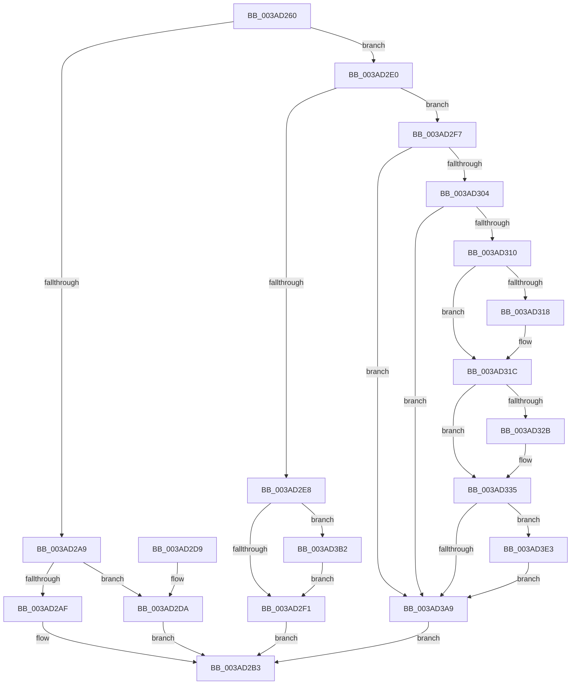

# B_TREE&lt;unsigned long,ST_STORE&lt;SM_TRAITS&gt;::_ST_REGION_ENTRY,4096,NP_CONTEXT,ST_STORE&lt;SM_TRAITS&gt;::ST_REGION_ENTRY_COMPARATOR&gt;::BTreeSearchResultDeref

- RVA: `0x003AD260`–`0x003AD3ED` (길이 `397` bytes)
- VA: `0x00000001403AD260`
- 실행 섹션: `.text`
- PDB 이름 있음: `예`; PDB Function 태그: `아니요`
- unwind 정보 RVA: `0x0008BC68`
- 디코드: `110`개 명령, `397/397` bytes 표시
- 미해석 바이트: `0` (있으면 어셈블리에 `.byte`로 보존)

> 이 문서는 커널 이미지의 기계어와 PDB 기호를 분석해 생성했습니다. 4번과 5번은 함수 원형과 자료형을 바이너리 사용 방식에서 추정한 C 해석이며 원본 소스 복구 결과는 아닙니다.

## 1. Dependencies

- 직접 호출 지점: **6**; 고유 호출 대상: **5**
- 직접 호출자로 확인된 함수: **15**
- RIP 상대 이미지 참조: **1**

### Outgoing calls
- `0x003AD2BA` → [_security_check_cookie](../6A/_security_check_cookie_function_006AC640.md) (function, `0x006AC640`)
- `0x003AD33C` → [_chkstk](../6B/_chkstk_function_006BA960.md) (function, `0x006BA960`)
- `0x003AD36E` → [B_TREE<unsigned long,ST_STORE<SM_TRAITS>::_ST_REGION_ENTRY,4096,NP_CONTEXT,ST_STORE<SM_TRAITS>::ST_REGION_ENTRY_COMPARATOR>::BTreeSearchKey](B_TREE_unsigned_long_ST_STORE_SM_TRAITS__ST_REGION_ENTRY_4096_NP_CONTEXT_ST_STORE_SM_TRAITS_ST_REGIO_function_003ACD20.md) (function, `0x003ACD20`)
- `0x003AD389` → [B_TREE<unsigned long,ST_STORE<SM_TRAITS>::_ST_REGION_ENTRY,4096,NP_CONTEXT,ST_STORE<SM_TRAITS>::ST_REGION_ENTRY_COMPARATOR>::BTreeSearchResultDeref](B_TREE_unsigned_long_ST_STORE_SM_TRAITS__ST_REGION_ENTRY_4096_NP_CONTEXT_ST_STORE_SM_TRAITS_ST_REGIO_function_003AD260.md) (function, `0x003AD260`)
- `0x003AD3D9` → [NP_CONTEXT::NpLeafDerefInternal](NP_CONTEXT_NpLeafDerefInternal_function_003A9A70.md) (function, `0x003A9A70`)
- `0x003AD3E6` → [NP_CONTEXT::NpLeafDerefInternal](NP_CONTEXT_NpLeafDerefInternal_function_003A9A70.md) (function, `0x003A9A70`)

### Direct callers
- [ST_STORE&lt;SM_TRAITS&gt;::StDmPageRemove](../20/ST_STORE_SM_TRAITS_StDmPageRemove_function_002049A0.md) at `0x00204A2D`
- [SMKM_STORE&lt;SM_TRAITS&gt;::SmStDirectReadCallout](../2F/SMKM_STORE_SM_TRAITS_SmStDirectReadCallout_function_002FA3E0.md) at `0x002FA432`
- [ST_STORE&lt;SM_TRAITS&gt;::StReleaseReadContext](ST_STORE_SM_TRAITS_StReleaseReadContext_function_003ABF84.md) at `0x003ABFB2`
- [B_TREE&lt;unsigned long,ST_STORE&lt;SM_TRAITS&gt;::_ST_REGION_ENTRY,4096,NP_CONTEXT,ST_STORE&lt;SM_TRAITS&gt;::ST_REGION_ENTRY_COMPARATOR&gt;::BTreeSearchResultCleanup](B_TREE_unsigned_long_ST_STORE_SM_TRAITS__ST_REGION_ENTRY_4096_NP_CONTEXT_ST_STORE_SM_TRAITS_ST_REGIO_function_003AC7E0.md) at `0x003AC7F0`
- [B_TREE&lt;unsigned long,ST_STORE&lt;SM_TRAITS&gt;::_ST_REGION_ENTRY,4096,NP_CONTEXT,ST_STORE&lt;SM_TRAITS&gt;::ST_REGION_ENTRY_COMPARATOR&gt;::BTreeInsert](B_TREE_unsigned_long_ST_STORE_SM_TRAITS__ST_REGION_ENTRY_4096_NP_CONTEXT_ST_STORE_SM_TRAITS_ST_REGIO_function_003AC820.md) at `0x003AC84F`
- [B_TREE&lt;unsigned long,ST_STORE&lt;SM_TRAITS&gt;::_ST_REGION_ENTRY,4096,NP_CONTEXT,ST_STORE&lt;SM_TRAITS&gt;::ST_REGION_ENTRY_COMPARATOR&gt;::BTreeSearchKey](B_TREE_unsigned_long_ST_STORE_SM_TRAITS__ST_REGION_ENTRY_4096_NP_CONTEXT_ST_STORE_SM_TRAITS_ST_REGIO_function_003ACD20.md) at `0x003ACD4A`
- [B_TREE&lt;unsigned long,ST_STORE&lt;SM_TRAITS&gt;::_ST_REGION_ENTRY,4096,NP_CONTEXT,ST_STORE&lt;SM_TRAITS&gt;::ST_REGION_ENTRY_COMPARATOR&gt;::BTreeSearchResultDeref](B_TREE_unsigned_long_ST_STORE_SM_TRAITS__ST_REGION_ENTRY_4096_NP_CONTEXT_ST_STORE_SM_TRAITS_ST_REGIO_function_003AD260.md) at `0x003AD389`
- [ST_STORE&lt;SM_TRAITS&gt;::StDmCombineRegion](../3B/ST_STORE_SM_TRAITS_StDmCombineRegion_function_003B0E34.md) at `0x003B0EB1`
- [ST_STORE&lt;SM_TRAITS&gt;::StDmCombineRegion](../3B/ST_STORE_SM_TRAITS_StDmCombineRegion_function_003B0E34.md) at `0x003B0FCB`
- [ST_STORE&lt;SM_TRAITS&gt;::StCompactRegions](../4A/ST_STORE_SM_TRAITS_StCompactRegions_function_004A48E0.md) at `0x004A4995`
- [ST_STORE&lt;SM_TRAITS&gt;::StCompactRegions](../4A/ST_STORE_SM_TRAITS_StCompactRegions_function_004A48E0.md) at `0x004A4C7B`
- [ST_STORE&lt;SM_TRAITS&gt;::StCompactRegions](../4A/ST_STORE_SM_TRAITS_StCompactRegions_function_004A48E0.md) at `0x004A4DAC`
- [ST_STORE&lt;SM_TRAITS&gt;::StCompactRegions](../4A/ST_STORE_SM_TRAITS_StCompactRegions_function_004A48E0.md) at `0x004A4F1B`
- [ST_STORE&lt;SM_TRAITS&gt;::StDmCombineBufferProcess](../4E/ST_STORE_SM_TRAITS_StDmCombineBufferProcess_function_004EB9AC.md) at `0x004EBAD0`
- [ST_STORE&lt;SM_TRAITS&gt;::StDmpSinglePageInsert](../4E/ST_STORE_SM_TRAITS_StDmpSinglePageInsert_function_004EBDF0.md) at `0x004EBE2C`
- [ST_STORE&lt;SM_TRAITS&gt;::StDmGetStatsBitmap](../60/ST_STORE_SM_TRAITS_StDmGetStatsBitmap_function_0060D838.md) at `0x0060D897`
- [ST_STORE&lt;SM_TRAITS&gt;::StDmRegionGetKeys](../60/ST_STORE_SM_TRAITS_StDmRegionGetKeys_function_0060E140.md) at `0x0060E1A2`
- [sub_006EFF4C](../6E/Unknown_function_006EFF4C.md) at `0x006EFFB9`
- [sub_006F026C](../6F/Unknown_function_006F026C.md) at `0x006F02EC`

### Static image references
- `0x003AD27F` → RVA `0x00E0A740` (`.data`; read)

## 2. Other-region calls and transfers

- 다른 실행 섹션으로 향하는 call: **0**
- 별도 외부 분기/꼬리 이동을 확인하지 못했습니다.

## 3. Assembly (complete function range)

```asm
003AD260  40 55                           push rbp
003AD262  41 56                           push r14
003AD264  41 57                           push r15
003AD266  48 83 EC 50                     sub rsp, 0x50
003AD26A  48 8D 6C 24 20                  lea rbp, [rsp + 0x20]
003AD26F  48 89 5D 50                     mov qword ptr [rbp + 0x50], rbx
003AD273  48 89 75 58                     mov qword ptr [rbp + 0x58], rsi
003AD277  48 89 7D 60                     mov qword ptr [rbp + 0x60], rdi
003AD27B  4C 89 65 68                     mov qword ptr [rbp + 0x68], r12
003AD27F  48 8B 05 BA D4 A5 00            mov rax, qword ptr [rip + 0xa5d4ba]
003AD286  48 33 C5                        xor rax, rbp
003AD289  48 89 45 28                     mov qword ptr [rbp + 0x28], rax
003AD28D  45 33 E4                        xor r12d, r12d
003AD290  48 8D 59 10                     lea rbx, [rcx + 0x10]
003AD294  48 85 C9                        test rcx, rcx
003AD297  4C 8B F2                        mov r14, rdx
003AD29A  4C 8B F9                        mov r15, rcx
003AD29D  49 0F 44 DC                     cmove rbx, r12
003AD2A1  48 8B 03                        mov rax, qword ptr [rbx]
003AD2A4  83 38 FF                        cmp dword ptr [rax], -1
003AD2A7  75 37                           jne 0x1403ad2e0
003AD2A9  83 7A 18 FF                     cmp dword ptr [rdx + 0x18], -1
003AD2AD  74 2B                           je 0x1403ad2da
003AD2AF  44 89 62 18                     mov dword ptr [rdx + 0x18], r12d
003AD2B3  48 8B 4D 28                     mov rcx, qword ptr [rbp + 0x28]
003AD2B7  48 33 CD                        xor rcx, rbp
003AD2BA  E8 81 F3 2F 00                  call 0x1406ac640
003AD2BF  48 8B 5D 50                     mov rbx, qword ptr [rbp + 0x50]
003AD2C3  48 8B 75 58                     mov rsi, qword ptr [rbp + 0x58]
003AD2C7  48 8B 7D 60                     mov rdi, qword ptr [rbp + 0x60]
003AD2CB  4C 8B 65 68                     mov r12, qword ptr [rbp + 0x68]
003AD2CF  48 8D 65 30                     lea rsp, [rbp + 0x30]
003AD2D3  41 5F                           pop r15
003AD2D5  41 5E                           pop r14
003AD2D7  5D                              pop rbp
003AD2D8  C3                              ret
003AD2D9  CC                              int3
003AD2DA  4C 89 62 08                     mov qword ptr [rdx + 8], r12
003AD2DE  EB D3                           jmp 0x1403ad2b3
003AD2E0  8B 42 18                        mov eax, dword ptr [rdx + 0x18]
003AD2E3  83 F8 FF                        cmp eax, -1
003AD2E6  74 0F                           je 0x1403ad2f7
003AD2E8  83 F8 01                        cmp eax, 1
003AD2EB  0F 87 C1 00 00 00               ja 0x1403ad3b2
003AD2F1  45 89 66 18                     mov dword ptr [r14 + 0x18], r12d
003AD2F5  EB BC                           jmp 0x1403ad2b3
003AD2F7  48 8B 52 08                     mov rdx, qword ptr [rdx + 8]
003AD2FB  48 85 D2                        test rdx, rdx
003AD2FE  0F 84 A5 00 00 00               je 0x1403ad3a9
003AD304  48 8B 01                        mov rax, qword ptr [rcx]
003AD307  48 3B D0                        cmp rdx, rax
003AD30A  0F 84 99 00 00 00               je 0x1403ad3a9
003AD310  41 8B F4                        mov esi, r12d
003AD313  48 85 C0                        test rax, rax
003AD316  74 04                           je 0x1403ad31c
003AD318  0F B6 70 02                     movzx esi, byte ptr [rax + 2]
003AD31C  8B C6                           mov eax, esi
003AD31E  48 C1 E0 04                     shl rax, 4
003AD322  48 8D 48 0F                     lea rcx, [rax + 0xf]
003AD326  48 3B C8                        cmp rcx, rax
003AD329  77 0A                           ja 0x1403ad335
003AD32B  48 B9 F0 FF FF FF FF FF FF 0F   movabs rcx, 0xffffffffffffff0
003AD335  48 83 E1 F0                     and rcx, 0xfffffffffffffff0
003AD339  48 8B C1                        mov rax, rcx
003AD33C  E8 1F D6 30 00                  call 0x1406ba960
003AD341  8B 52 10                        mov edx, dword ptr [rdx + 0x10]
003AD344  4C 8D 45 00                     lea r8, [rbp]
003AD348  48 2B E1                        sub rsp, rcx
003AD34B  48 C7 45 20 01 00 00 00         mov qword ptr [rbp + 0x20], 1
003AD353  0F 57 C0                        xorps xmm0, xmm0
003AD356  44 89 65 18                     mov dword ptr [rbp + 0x18], r12d
003AD35A  49 8B CF                        mov rcx, r15
003AD35D  89 75 1C                        mov dword ptr [rbp + 0x1c], esi
003AD360  F3 0F 7F 45 08                  movdqu xmmword ptr [rbp + 8], xmm0
003AD365  48 8D 7C 24 20                  lea rdi, [rsp + 0x20]
003AD36A  48 89 7D 00                     mov qword ptr [rbp], rdi
003AD36E  E8 AD F9 FF FF                  call 0x1403acd20
003AD373  8D 4E FE                        lea ecx, [rsi - 2]
003AD376  48 03 C9                        add rcx, rcx
003AD379  48 8D 55 00                     lea rdx, [rbp]
003AD37D  48 8B 74 CF 08                  mov rsi, qword ptr [rdi + rcx*8 + 8]
003AD382  48 8B 3C CF                     mov rdi, qword ptr [rdi + rcx*8]
003AD386  49 8B CF                        mov rcx, r15
003AD389  E8 D2 FE FF FF                  call 0x1403ad260
003AD38E  48 8D 47 08                     lea rax, [rdi + 8]
003AD392  48 8D 4F 10                     lea rcx, [rdi + 0x10]
003AD396  48 3B F1                        cmp rsi, rcx
003AD399  48 8D 56 F8                     lea rdx, [rsi - 8]
003AD39D  48 0F 46 D0                     cmovbe rdx, rax
003AD3A1  48 8B 03                        mov rax, qword ptr [rbx]
003AD3A4  83 38 FF                        cmp dword ptr [rax], -1
003AD3A7  75 3A                           jne 0x1403ad3e3
003AD3A9  4D 89 66 08                     mov qword ptr [r14 + 8], r12
003AD3AD  E9 01 FF FF FF                  jmp 0x1403ad2b3
003AD3B2  83 C0 FE                        add eax, -2
003AD3B5  48 C1 E0 04                     shl rax, 4
003AD3B9  48 03 02                        add rax, qword ptr [rdx]
003AD3BC  4C 8B 40 08                     mov r8, qword ptr [rax + 8]
003AD3C0  48 8B 00                        mov rax, qword ptr [rax]
003AD3C3  49 8D 50 F8                     lea rdx, [r8 - 8]
003AD3C7  48 8D 48 10                     lea rcx, [rax + 0x10]
003AD3CB  48 83 C0 08                     add rax, 8
003AD3CF  4C 3B C1                        cmp r8, rcx
003AD3D2  48 8B CB                        mov rcx, rbx
003AD3D5  48 0F 46 D0                     cmovbe rdx, rax
003AD3D9  E8 92 C6 FF FF                  call 0x1403a9a70
003AD3DE  E9 0E FF FF FF                  jmp 0x1403ad2f1
003AD3E3  48 8B CB                        mov rcx, rbx
003AD3E6  E8 85 C6 FF FF                  call 0x1403a9a70
003AD3EB  EB BC                           jmp 0x1403ad3a9
```

## 4. C-style interpretation (structured pseudocode)

```c
__int64 __fastcall B_TREE_unsigned_long_ST_STORE_SM_TRAITS____ST_REGION_ENTRY_4096_NP_CONTEXT_ST_STORE_SM_TRAITS___ST_R(__int64 a1, __int64 a2)
{
    __int64 result;
    __int64 v_r12;
    __int64 v_rbx;
    __int64 v_rsi;
    __int64 v_rsp;
    unsigned __int64 v_stack_m18;
    unsigned __int64 v_stack_m20;
    unsigned __int64 v_stack_m28;
    unsigned int v_stack_m2C;
    unsigned int v_stack_m30;
    unsigned __int64 v_stack_m40;
    unsigned __int64 v_stack_m48;
    unsigned __int64 v_stack_p10;
    unsigned __int64 v_stack_p18;
    unsigned __int64 v_stack_p20;
    unsigned __int64 v_stack_p8;

    v_rsp = (v_rsp) - (80);
    v_stack_p8 = v_rbx;
    v_stack_p10 = v_rsi;
    v_stack_p18 = v_rdi;
    v_stack_p20 = v_r12;
    result = (*(unsigned __int64 *)(v_rip + 10867898)) ^ (v_stack_m48);
    v_stack_m20 = result;
    v_r12 = 0;
    v_rbx = a1 + 16;
    if (a1 == 0) { v_rbx = 0; }
    if ((*(unsigned int *)(*(unsigned __int64 *)(v_rbx))) != -1) goto loc_003AD2E0;
    if ((*(unsigned int *)(a2 + 24)) == -1) goto loc_003AD2DA;
    *(unsigned int *)(a2 + 24) = 0;
loc_003AD2B3:
    a1 = (v_stack_m20) ^ (v_stack_m48);
    result = _security_check_cookie(a1, a2, a3, a4);
    return result;
loc_003AD2DA:
    *(unsigned __int64 *)(a2 + 8) = v_stack_p20;
    goto loc_003AD2B3;
loc_003AD2E0:
    if (((unsigned int)((unsigned int)(*(unsigned int *)(a2 + 24)))) == -1) goto loc_003AD2F7;
    if (((unsigned int)((unsigned int)(*(unsigned int *)(a2 + 24)))) > 1) goto loc_003AD3B2;
loc_003AD2F1:
    *(unsigned int *)(a2 + 24) = (unsigned int)(v_stack_p20);
    goto loc_003AD2B3;
loc_003AD2F7:
    if (*(unsigned __int64 *)(a2 + 8) == 0) goto loc_003AD3A9;
    if ((*(unsigned __int64 *)(a2 + 8)) == (*(unsigned __int64 *)(a1))) goto loc_003AD3A9;
    v_rsi = (unsigned int)((unsigned int)(v_stack_p20));
    if (*(unsigned __int64 *)(a1) != 0) {
        v_rsi = *(unsigned __int8 *)(*(unsigned __int64 *)(a1) + 2);
    }
    result = ((unsigned int)((unsigned int)(v_rsi))) << (4);
    if ((result + 15) <= result) {
    }
    a1 = (result + 15) & (-16);
    result = _chkstk(a1, *(unsigned __int64 *)(a2 + 8), a3, a4);
    v_rsp = (v_stack_m18) - (a1);
    v_stack_m28 = 1;
    v_stack_m30 = (unsigned int)(v_stack_p20);
    v_stack_m2C = (unsigned int)(v_rsi);
    v_stack_m40 = v_xmm0;
    v_stack_m48 = v_stack_p20;
    result = B_TREE_unsigned_long_ST_STORE_SM_TRAITS____ST_REGION_ENTRY_4096_NP_CONTEXT_ST_STORE_SM_TRAITS___ST_R(a1, (unsigned int)(*(unsigned int *)(*(unsigned __int64 *)(a2 + 8) + 16)), v_stack_m48, a4);
    a1 = (v_rsi - 2) + (v_rsi - 2);
    result = B_TREE_unsigned_long_ST_STORE_SM_TRAITS____ST_REGION_ENTRY_4096_NP_CONTEXT_ST_STORE_SM_TRAITS___ST_R(a1, v_stack_m48, v_stack_m48, a4);
    a2 = *(unsigned __int64 *)(v_stack_p20 + a1 * 8 + 8) - 8;
    if ((*(unsigned __int64 *)(v_stack_p20 + a1 * 8 + 8)) <= (*(unsigned __int64 *)(v_stack_p20 + a1 * 8) + 16)) { a2 = *(unsigned __int64 *)(v_stack_p20 + a1 * 8) + 8; }
    if ((*(unsigned int *)(*(unsigned __int64 *)(v_stack_p8))) != -1) goto loc_003AD3E3;
loc_003AD3A9:
    *(unsigned __int64 *)(a2 + 8) = v_stack_p20;
    goto loc_003AD2B3;
loc_003AD3B2:
    result = (unsigned int)((*(unsigned __int64 *)(v_stack_p8)) + (-2));
    result = (result) << (4);
    result = (result) + (*(unsigned __int64 *)(a2));
    result = (*(unsigned __int64 *)(result)) + (8);
    a2 = *(unsigned __int64 *)(result + 8) - 8;
    if ((*(unsigned __int64 *)(result + 8)) <= (*(unsigned __int64 *)(result) + 16)) { a2 = result; }
    result = NP_CONTEXT__NpLeafDerefInternal(v_stack_p8, a2, *(unsigned __int64 *)(result + 8), a4);
    goto loc_003AD2F1;
loc_003AD3E3:
    result = NP_CONTEXT__NpLeafDerefInternal(v_stack_p8, a2, *(unsigned __int64 *)(result + 8), a4);
    goto loc_003AD3A9;
}
```

## 5. (Beta) C Style

```c
int64_t B_TREE_unsigned_long_ST_STORE_SM_TRAITS____ST_REGION_ENTRY_4096_NP_CONTEXT_ST_STORE_SM_TRAITS___ST_R(void *Arg1, void *Arg2)
{
    uint8_t *arg1 = (uint8_t *)Arg1;
    uint8_t *arg2 = (uint8_t *)Arg2;

    int64_t result;
    int64_t local_r12;
    int64_t local_rbx;
    int64_t local_rsi;
    int64_t local_rsp;
    uint64_t v_stack_m18;
    uint64_t v_stack_m20;
    uint64_t v_stack_m28;
    uint32_t v_stack_m2C;
    uint32_t v_stack_m30;
    uint64_t v_stack_m40;
    uint64_t v_stack_m48;
    uint64_t v_stack_p10;
    uint64_t v_stack_p18;
    uint64_t v_stack_p20;
    uint64_t v_stack_p8;

    local_rsp = (local_rsp) - (80);
    v_stack_p8 = local_rbx;
    v_stack_p10 = local_rsi;
    v_stack_p18 = local_rdi;
    v_stack_p20 = local_r12;
    result = (*(uint64_t *)(v_rip + 0xA5D4BA)) ^ (v_stack_m48);
    v_stack_m20 = result;
    local_r12 = 0;
    local_rbx = Arg1 + 16;
    if (Arg1 == NULL) { local_rbx = 0; }
    if ((*(uint32_t *)(*(uint64_t *)(local_rbx))) != -1) goto loc_003AD2E0;
    if ((*(uint32_t *)(arg2 + 0x18)) == -1) goto loc_003AD2DA;
    *(uint32_t *)(arg2 + 0x18) = 0;
loc_003AD2B3:
    Arg1 = (v_stack_m20) ^ (v_stack_m48);
    result = _security_check_cookie(Arg1, Arg2, a3, a4);
    return result;
loc_003AD2DA:
    *(uint64_t *)(arg2 + 0x8) = v_stack_p20;
    goto loc_003AD2B3;
loc_003AD2E0:
    if (((uint32_t)((uint32_t)(*(uint32_t *)(arg2 + 0x18)))) == -1) goto loc_003AD2F7;
    if (((uint32_t)((uint32_t)(*(uint32_t *)(arg2 + 0x18)))) > 1) goto loc_003AD3B2;
loc_003AD2F1:
    *(uint32_t *)(arg2 + 0x18) = (uint32_t)(v_stack_p20);
    goto loc_003AD2B3;
loc_003AD2F7:
    if (*(uint64_t *)(arg2 + 0x8) == 0) goto loc_003AD3A9;
    if ((*(uint64_t *)(arg2 + 0x8)) == (*(uint64_t *)(arg1))) goto loc_003AD3A9;
    local_rsi = (uint32_t)((uint32_t)(v_stack_p20));
    if (*(uint64_t *)(arg1) != 0) {
        local_rsi = *(uint8_t *)(*(uint64_t *)(arg1) + 0x2);
    }
    result = ((uint32_t)((uint32_t)(local_rsi))) << (4);
    if ((result + 15) <= result) {
    }
    Arg1 = (result + 15) & (-16);
    result = _chkstk(Arg1, *(uint64_t *)(arg2 + 0x8), a3, a4);
    local_rsp = (v_stack_m18) - (Arg1);
    v_stack_m28 = 1;
    v_stack_m30 = (uint32_t)(v_stack_p20);
    v_stack_m2C = (uint32_t)(local_rsi);
    v_stack_m40 = v_xmm0;
    v_stack_m48 = v_stack_p20;
    result = B_TREE_unsigned_long_ST_STORE_SM_TRAITS____ST_REGION_ENTRY_4096_NP_CONTEXT_ST_STORE_SM_TRAITS___ST_R(Arg1, (uint32_t)(*(uint32_t *)(*(uint64_t *)(arg2 + 0x8) + 0x10)), v_stack_m48, a4);
    Arg1 = (local_rsi - 2) + (local_rsi - 2);
    result = B_TREE_unsigned_long_ST_STORE_SM_TRAITS____ST_REGION_ENTRY_4096_NP_CONTEXT_ST_STORE_SM_TRAITS___ST_R(Arg1, v_stack_m48, v_stack_m48, a4);
    Arg2 = *(uint64_t *)(v_stack_p20 + arg1 * 8 + 0x8) - 8;
    if ((*(uint64_t *)(v_stack_p20 + arg1 * 8 + 0x8)) <= (*(uint64_t *)(v_stack_p20 + arg1 * 8) + 16)) { Arg2 = *(uint64_t *)(v_stack_p20 + arg1 * 8) + 8; }
    if ((*(uint32_t *)(*(uint64_t *)(v_stack_p8))) != -1) goto loc_003AD3E3;
loc_003AD3A9:
    *(uint64_t *)(arg2 + 0x8) = v_stack_p20;
    goto loc_003AD2B3;
loc_003AD3B2:
    result = (uint32_t)((*(uint64_t *)(v_stack_p8)) + (-2));
    result = (result) << (4);
    result = (result) + (*(uint64_t *)(arg2));
    result = (*(uint64_t *)(result)) + (8);
    Arg2 = *(uint64_t *)(result + 0x8) - 8;
    if ((*(uint64_t *)(result + 0x8)) <= (*(uint64_t *)(result) + 16)) { Arg2 = result; }
    result = NP_CONTEXT__NpLeafDerefInternal(v_stack_p8, Arg2, *(uint64_t *)(result + 0x8), a4);
    goto loc_003AD2F1;
loc_003AD3E3:
    result = NP_CONTEXT__NpLeafDerefInternal(v_stack_p8, Arg2, *(uint64_t *)(result + 0x8), a4);
    goto loc_003AD3A9;
}
```

### 관측된 메모리 오프셋

구조체 형식이 확인되지 않은 접근은 인자 기준의 오프셋으로만 기록했습니다.

| 기준 인자 | 오프셋 표현 | 폭 (bit) | 접근 |
|---|---:|---:|---|
| `Arg1` | `+ 0x10` | `64` | `R` |
| `Arg2` | `+ 0x0` | `64` | `R` |
| `Arg2` | `+ 0x8` | `64` | `R` |
| `Arg2` | `+ 0x8` | `64` | `W` |
| `Arg2` | `+ 0x18` | `32` | `R` |
| `Arg2` | `+ 0x18` | `32` | `W` |

## 6. Execution-region graph

[열기: 2D/3D 그래프와 함수 탐색 컨트롤 패널](../../../control-panel.html?section=text&rva=0x003AD260&view=graph)

- 2D 그래프는 위에서 아래로 흐르고, 3D 그래프는 빈 공간을 드래그해 회전합니다. Shift+드래그는 이동, 휠은 확대·축소, 함수 노드 선택은 대상 보고서 이동입니다.

### Static fallback


