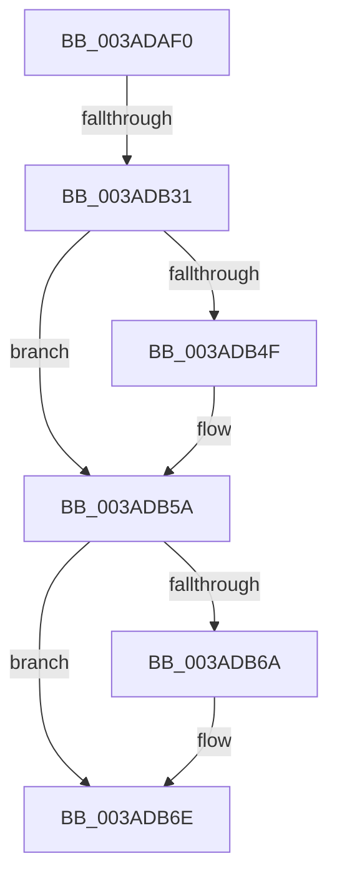

# B_TREE&lt;unsigned long,ST_STORE&lt;SM_TRAITS&gt;::_ST_REGION_ENTRY,4096,NP_CONTEXT,ST_STORE&lt;SM_TRAITS&gt;::ST_REGION_ENTRY_COMPARATOR&gt;::BTreeDeleteEx

- RVA: `0x003ADAF0`–`0x003ADB78` (길이 `136` bytes)
- VA: `0x00000001403ADAF0`
- 실행 섹션: `.text`
- PDB 이름 있음: `예`; PDB Function 태그: `예`
- unwind 정보 RVA: `0x0008BDBC`
- 디코드: `40`개 명령, `136/136` bytes 표시
- 미해석 바이트: `0` (있으면 어셈블리에 `.byte`로 보존)

> 이 문서는 커널 이미지의 기계어와 PDB 기호를 분석해 생성했습니다. 4번과 5번은 함수 원형과 자료형을 바이너리 사용 방식에서 추정한 C 해석이며 원본 소스 복구 결과는 아닙니다.

## 1. Dependencies

- 직접 호출 지점: **1**; 고유 호출 대상: **1**
- 직접 호출자로 확인된 함수: **4**
- RIP 상대 이미지 참조: **0**

### Outgoing calls
- `0x003ADB55` → [memcpy](../6C/memcpy_function_006C6840.md) (function, `0x006C6840`)

### Direct callers
- [B_TREE&lt;unsigned long,ST_STORE&lt;SM_TRAITS&gt;::_ST_REGION_ENTRY,4096,NP_CONTEXT,ST_STORE&lt;SM_TRAITS&gt;::ST_REGION_ENTRY_COMPARATOR&gt;::BTreeDelete](B_TREE_unsigned_long_ST_STORE_SM_TRAITS__ST_REGION_ENTRY_4096_NP_CONTEXT_ST_STORE_SM_TRAITS_ST_REGIO_function_003AC7A8.md) at `0x003AC7C7`
- [sub_003AD47D](Unknown_function_003AD47D.md) at `0x003AD4AB`
- [B_TREE&lt;unsigned long,ST_STORE&lt;SM_TRAITS&gt;::_ST_REGION_ENTRY,4096,NP_CONTEXT,ST_STORE&lt;SM_TRAITS&gt;::ST_REGION_ENTRY_COMPARATOR&gt;::BTreeMergeNodes](B_TREE_unsigned_long_ST_STORE_SM_TRAITS__ST_REGION_ENTRY_4096_NP_CONTEXT_ST_STORE_SM_TRAITS_ST_REGIO_function_003AF47C.md) at `0x003AF586`
- [sub_004EBED8](../4E/Unknown_function_004EBED8.md) at `0x004EBF18`

### Static image references
- 디코드된 RIP-relative 메모리 참조가 없습니다.

## 2. Other-region calls and transfers

- 다른 실행 섹션으로 향하는 call: **0**
- call이 아닌 외부 분기/꼬리 이동: **2**
  - `0x003ADB2B` → [sub_003ADC82](Unknown_function_003ADC82.md) (`tail-transfer`)
  - `0x003ADB76` → [sub_003ADBE7](Unknown_function_003ADBE7.md) (`tail-transfer`)

## 3. Assembly (complete function range)

```asm
003ADAF0  48 89 5C 24 10                  mov qword ptr [rsp + 0x10], rbx
003ADAF5  48 89 6C 24 18                  mov qword ptr [rsp + 0x18], rbp
003ADAFA  56                              push rsi
003ADAFB  57                              push rdi
003ADAFC  41 55                           push r13
003ADAFE  41 56                           push r14
003ADB00  41 57                           push r15
003ADB02  48 83 EC 20                     sub rsp, 0x20
003ADB06  8B 7A 18                        mov edi, dword ptr [rdx + 0x18]
003ADB09  48 8B F1                        mov rsi, rcx
003ADB0C  FF CF                           dec edi
003ADB0E  4C 8B EA                        mov r13, rdx
003ADB11  48 C1 E7 04                     shl rdi, 4
003ADB15  48 03 3A                        add rdi, qword ptr [rdx]
003ADB18  48 8B 1F                        mov rbx, qword ptr [rdi]
003ADB1B  80 7B 03 00                     cmp byte ptr [rbx + 3], 0
003ADB1F  8B 03                           mov eax, dword ptr [rbx]
003ADB21  0F B7 C8                        movzx ecx, ax
003ADB24  48 8B 47 08                     mov rax, qword ptr [rdi + 8]
003ADB28  4C 8B C8                        mov r9, rax
003ADB2B  0F 84 51 01 00 00               je 0x1403adc82
003ADB31  48 8D 50 04                     lea rdx, [rax + 4]
003ADB35  41 BE FE 01 00 00               mov r14d, 0x1fe
003ADB3B  48 8D 0C 8D 0C 00 00 00         lea rcx, [rcx*4 + 0xc]
003ADB43  48 2B C8                        sub rcx, rax
003ADB46  48 8D 2C 0B                     lea rbp, [rbx + rcx]
003ADB4A  48 85 ED                        test rbp, rbp
003ADB4D  74 0B                           je 0x1403adb5a
003ADB4F  4C 8B C5                        mov r8, rbp
003ADB52  49 8B C9                        mov rcx, r9
003ADB55  E8 E6 8C 31 00                  call 0x1406c6840
003ADB5A  41 BF FF FF 00 00               mov r15d, 0xffff
003ADB60  66 44 01 3B                     add word ptr [rbx], r15w
003ADB64  80 7B 03 00                     cmp byte ptr [rbx + 3], 0
003ADB68  74 04                           je 0x1403adb6e
003ADB6A  48 FF 4E 08                     dec qword ptr [rsi + 8]
003ADB6E  8B 03                           mov eax, dword ptr [rbx]
003ADB70  0F B7 C8                        movzx ecx, ax
003ADB73  48 39 1E                        cmp qword ptr [rsi], rbx
003ADB76  74 6F                           je 0x1403adbe7
```

## 4. C-style interpretation (structured pseudocode)

```c
__int64 __fastcall B_TREE_unsigned_long_ST_STORE_SM_TRAITS____ST_REGION_ENTRY_4096_NP_CONTEXT_ST_STORE_SM_TRAITS___ST_R(__int64 a1, __int64 a2)
{
    __int64 result;
    __int64 v_rdi;
    __int64 v_rsp;
    unsigned __int64 v_stack_p10;
    unsigned __int64 v_stack_p18;

    v_stack_p10 = v_rbx;
    v_stack_p18 = v_rbp;
    v_rsp = (v_rsp) - (32);
    v_rdi = (unsigned int)(((unsigned int)(*(unsigned int *)(a2 + 24))) - 1);
    v_rdi = (v_rdi) << (4);
    v_rdi = (v_rdi) + (*(unsigned __int64 *)(a2));
    a1 = ((unsigned __int16)((unsigned int)(*(unsigned int *)(*(unsigned __int64 *)(v_rdi)))) * 4 + 12) - (*(unsigned __int64 *)(v_rdi + 8));
    result = *(unsigned __int64 *)(v_rdi + 8);
    if (*(unsigned __int64 *)(v_rdi) + a1 * 1 != 0) {
        a3 = *(unsigned __int64 *)(v_rdi) + a1 * 1;
        a1 = *(unsigned __int64 *)(v_rdi + 8);
        result = memcpy(a1, *(unsigned __int64 *)(v_rdi + 8) + 4, a3, *(unsigned __int64 *)(v_rdi + 8));
    }
    if ((*(unsigned __int8 *)(*(unsigned __int64 *)(v_rdi) + 3)) != 0) {
    }
}
```

## 5. (Beta) C Style

```c
int64_t B_TREE_unsigned_long_ST_STORE_SM_TRAITS____ST_REGION_ENTRY_4096_NP_CONTEXT_ST_STORE_SM_TRAITS___ST_R(void *Arg1, void *Arg2)
{
    uint8_t *arg1 = (uint8_t *)Arg1;
    uint8_t *arg2 = (uint8_t *)Arg2;

    int64_t result;
    int64_t local_rdi;
    int64_t local_rsp;
    uint64_t v_stack_p10;
    uint64_t v_stack_p18;

    v_stack_p10 = local_rbx;
    v_stack_p18 = local_rbp;
    local_rsp = (local_rsp) - (32);
    local_rdi = (uint32_t)(((uint32_t)(*(uint32_t *)(arg2 + 0x18))) - 1);
    local_rdi = (local_rdi) << (4);
    local_rdi = (local_rdi) + (*(uint64_t *)(arg2));
    Arg1 = ((uint16_t)((uint32_t)(*(uint32_t *)(*(uint64_t *)(local_rdi)))) * 4 + 12) - (*(uint64_t *)(local_rdi + 0x8));
    result = *(uint64_t *)(local_rdi + 0x8);
    if (*(uint64_t *)(local_rdi) + Arg1 * 1 != 0) {
        a3 = *(uint64_t *)(local_rdi) + Arg1 * 1;
        Arg1 = *(uint64_t *)(local_rdi + 0x8);
        result = memcpy(Arg1, *(uint64_t *)(local_rdi + 0x8) + 4, a3, *(uint64_t *)(local_rdi + 0x8));
    }
    if ((*(uint8_t *)(*(uint64_t *)(local_rdi) + 0x3)) != 0) {
    }
}
```

### 관측된 메모리 오프셋

구조체 형식이 확인되지 않은 접근은 인자 기준의 오프셋으로만 기록했습니다.

| 기준 인자 | 오프셋 표현 | 폭 (bit) | 접근 |
|---|---:|---:|---|
| `Arg1` | `+ 0x0` | `64` | `R` |
| `Arg1` | `+ 0x8` | `64` | `R/W` |
| `Arg2` | `+ 0x0` | `64` | `R` |
| `Arg2` | `+ 0x18` | `32` | `R` |

## 6. Execution-region graph

[열기: 2D/3D 그래프와 함수 탐색 컨트롤 패널](../../../control-panel.html?section=text&rva=0x003ADAF0&view=graph)

- 2D 그래프는 위에서 아래로 흐르고, 3D 그래프는 빈 공간을 드래그해 회전합니다. Shift+드래그는 이동, 휠은 확대·축소, 함수 노드 선택은 대상 보고서 이동입니다.

### Static fallback


