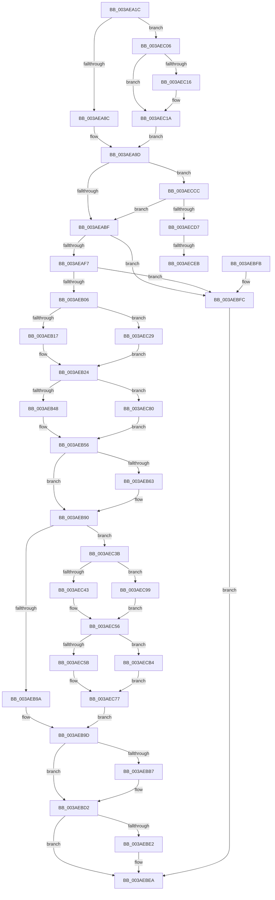

# B_TREE&lt;unsigned long,ST_STORE&lt;SM_TRAITS&gt;::_ST_REGION_ENTRY,4096,NP_CONTEXT,ST_STORE&lt;SM_TRAITS&gt;::ST_REGION_ENTRY_COMPARATOR&gt;::BTreeRedistribute

- RVA: `0x003AEA1C`–`0x003AECF3` (길이 `727` bytes)
- VA: `0x00000001403AEA1C`
- 실행 섹션: `.text`
- PDB 이름 있음: `예`; PDB Function 태그: `예`
- unwind 정보 RVA: `0x0008B978`
- 디코드: `205`개 명령, `727/727` bytes 표시
- 미해석 바이트: `0` (있으면 어셈블리에 `.byte`로 보존)

> 이 문서는 커널 이미지의 기계어와 PDB 기호를 분석해 생성했습니다. 4번과 5번은 함수 원형과 자료형을 바이너리 사용 방식에서 추정한 C 해석이며 원본 소스 복구 결과는 아닙니다.

## 1. Dependencies

- 직접 호출 지점: **3**; 고유 호출 대상: **1**
- 직접 호출자로 확인된 함수: **2**
- RIP 상대 이미지 참조: **0**

### Outgoing calls
- `0x003AEB79` → [memcpy](../6C/memcpy_function_006C6840.md) (function, `0x006C6840`)
- `0x003AEBA7` → [memcpy](../6C/memcpy_function_006C6840.md) (function, `0x006C6840`)
- `0x003AEBCD` → [memcpy](../6C/memcpy_function_006C6840.md) (function, `0x006C6840`)

### Direct callers
- [sub_003ABC8C](Unknown_function_003ABC8C.md) at `0x003ABD2A`
- [sub_003ADBF3](Unknown_function_003ADBF3.md) at `0x003ADBF9`

### Static image references
- 디코드된 RIP-relative 메모리 참조가 없습니다.

## 2. Other-region calls and transfers

- 다른 실행 섹션으로 향하는 call: **0**
- call이 아닌 외부 분기/꼬리 이동: **2**
  - `0x003AECE5` → [sub_006E6F9A](../6E/Unknown_function_006E6F9A.md) (`tail-transfer`)
  - `0x003AECEE` → [sub_006E6F9A + 0xB](../6E/Unknown_function_006E6F9A.md) (`tail-transfer`)

## 3. Assembly (complete function range)

```asm
003AEA1C  40 53                           push rbx
003AEA1E  55                              push rbp
003AEA1F  56                              push rsi
003AEA20  57                              push rdi
003AEA21  41 54                           push r12
003AEA23  41 55                           push r13
003AEA25  41 56                           push r14
003AEA27  41 57                           push r15
003AEA29  48 83 EC 28                     sub rsp, 0x28
003AEA2D  44 8B 42 18                     mov r8d, dword ptr [rdx + 0x18]
003AEA31  4C 8B D9                        mov r11, rcx
003AEA34  48 83 64 24 78 00               and qword ptr [rsp + 0x78], 0
003AEA3A  41 BC 01 00 00 00               mov r12d, 1
003AEA40  48 83 64 24 70 00               and qword ptr [rsp + 0x70], 0
003AEA46  45 2B C4                        sub r8d, r12d
003AEA49  49 C1 E0 04                     shl r8, 4
003AEA4D  4C 03 02                        add r8, qword ptr [rdx]
003AEA50  45 8D 7C 24 0F                  lea r15d, [r12 + 0xf]
003AEA55  4D 8B 50 F0                     mov r10, qword ptr [r8 - 0x10]
003AEA59  49 8B 10                        mov rdx, qword ptr [r8]
003AEA5C  4D 8B 70 F8                     mov r14, qword ptr [r8 - 8]
003AEA60  8A 42 03                        mov al, byte ptr [rdx + 3]
003AEA63  F6 D8                           neg al
003AEA65  41 8B 02                        mov eax, dword ptr [r10]
003AEA68  1B FF                           sbb edi, edi
003AEA6A  0F B7 C8                        movzx ecx, ax
003AEA6D  49 03 CC                        add rcx, r12
003AEA70  81 E7 FD 02 00 00               and edi, 0x2fd
003AEA76  48 C1 E1 04                     shl rcx, 4
003AEA7A  81 C7 FF 00 00 00               add edi, 0xff
003AEA80  49 03 CA                        add rcx, r10
003AEA83  4C 3B F1                        cmp r14, rcx
003AEA86  0F 84 7A 01 00 00               je 0x1403aec06
003AEA8C  48 89 54 24 78                  mov qword ptr [rsp + 0x78], rdx
003AEA91  4D 8D 4E 08                     lea r9, [r14 + 8]
003AEA95  48 8D 5C 24 70                  lea rbx, [rsp + 0x70]
003AEA9A  45 33 E4                        xor r12d, r12d
003AEA9D  49 8D 53 10                     lea rdx, [r11 + 0x10]
003AEAA1  49 8B C3                        mov rax, r11
003AEAA4  48 F7 D8                        neg rax
003AEAA7  4D 8D 43 10                     lea r8, [r11 + 0x10]
003AEAAB  48 1B C9                        sbb rcx, rcx
003AEAAE  48 23 CA                        and rcx, rdx
003AEAB1  83 CA FF                        or edx, 0xffffffff
003AEAB4  48 8B 01                        mov rax, qword ptr [rcx]
003AEAB7  39 10                           cmp dword ptr [rax], edx
003AEAB9  0F 85 0D 02 00 00               jne 0x1403aeccc
003AEABF  49 8B 01                        mov rax, qword ptr [r9]
003AEAC2  48 89 03                        mov qword ptr [rbx], rax
003AEAC5  4C 8B 4C 24 78                  mov r9, qword ptr [rsp + 0x78]
003AEACA  4C 0B E0                        or r12, rax
003AEACD  B8 FF FF 00 00                  mov eax, 0xffff
003AEAD2  4C 89 A4 24 80 00 00 00         mov qword ptr [rsp + 0x80], r12
003AEADA  4C 8B 64 24 70                  mov r12, qword ptr [rsp + 0x70]
003AEADF  41 8B 11                        mov edx, dword ptr [r9]
003AEAE2  23 D0                           and edx, eax
003AEAE4  45 8B 04 24                     mov r8d, dword ptr [r12]
003AEAE8  44 23 C0                        and r8d, eax
003AEAEB  42 8D 0C 02                     lea ecx, [rdx + r8]
003AEAEF  3B CF                           cmp ecx, edi
003AEAF1  0F 82 05 01 00 00               jb 0x1403aebfc
003AEAF7  8D 04 7D FF FF FF FF            lea eax, [rdi*2 - 1]
003AEAFE  3B C8                           cmp ecx, eax
003AEB00  0F 83 F6 00 00 00               jae 0x1403aebfc
003AEB06  D1 E9                           shr ecx, 1
003AEB08  4D 8B D1                        mov r10, r9
003AEB0B  49 8B E9                        mov rbp, r9
003AEB0E  41 3B D0                        cmp edx, r8d
003AEB11  0F 87 12 01 00 00               ja 0x1403aec29
003AEB17  8B F9                           mov edi, ecx
003AEB19  49 8B DC                        mov rbx, r12
003AEB1C  2B FA                           sub edi, edx
003AEB1E  49 8B F1                        mov rsi, r9
003AEB21  44 8B DA                        mov r11d, edx
003AEB24  44 3B C2                        cmp r8d, edx
003AEB27  44 89 5C 24 70                  mov dword ptr [rsp + 0x70], r11d
003AEB2C  45 8B EB                        mov r13d, r11d
003AEB2F  1B C0                           sbb eax, eax
003AEB31  23 C1                           and eax, ecx
003AEB33  80 7B 03 00                     cmp byte ptr [rbx + 3], 0
003AEB37  44 8B C0                        mov r8d, eax
003AEB3A  4C 89 84 24 88 00 00 00         mov qword ptr [rsp + 0x88], r8
003AEB42  0F 84 38 01 00 00               je 0x1403aec80
003AEB48  41 BF 04 00 00 00               mov r15d, 4
003AEB4E  48 8D 2C 83                     lea rbp, [rbx + rax*4]
003AEB52  4E 8D 2C AE                     lea r13, [rsi + r13*4]
003AEB56  49 83 C5 10                     add r13, 0x10
003AEB5A  48 83 C5 10                     add rbp, 0x10
003AEB5E  49 3B DA                        cmp rbx, r10
003AEB61  75 2D                           jne 0x1403aeb90
003AEB63  8B 06                           mov eax, dword ptr [rsi]
003AEB65  8B CF                           mov ecx, edi
003AEB67  41 0F AF CF                     imul ecx, r15d
003AEB6B  49 8B D5                        mov rdx, r13
003AEB6E  44 0F B7 C0                     movzx r8d, ax
003AEB72  45 0F AF C7                     imul r8d, r15d
003AEB76  49 03 CD                        add rcx, r13
003AEB79  E8 C2 7C 31 00                  call 0x1406c6840
003AEB7E  4C 8B 4C 24 78                  mov r9, qword ptr [rsp + 0x78]
003AEB83  44 8B 5C 24 70                  mov r11d, dword ptr [rsp + 0x70]
003AEB88  4C 8B 84 24 88 00 00 00         mov r8, qword ptr [rsp + 0x88]
003AEB90  80 7B 03 00                     cmp byte ptr [rbx + 3], 0
003AEB94  0F 84 A1 00 00 00               je 0x1403aec3b
003AEB9A  44 8B C7                        mov r8d, edi
003AEB9D  45 0F AF C7                     imul r8d, r15d
003AEBA1  48 8B D5                        mov rdx, rbp
003AEBA4  49 8B CD                        mov rcx, r13
003AEBA7  E8 94 7C 31 00                  call 0x1406c6840
003AEBAC  66 01 3E                        add word ptr [rsi], di
003AEBAF  66 29 3B                        sub word ptr [rbx], di
003AEBB2  49 3B DC                        cmp rbx, r12
003AEBB5  75 1B                           jne 0x1403aebd2
003AEBB7  8B 03                           mov eax, dword ptr [rbx]
003AEBB9  48 8B CD                        mov rcx, rbp
003AEBBC  41 0F AF FF                     imul edi, r15d
003AEBC0  44 0F B7 C0                     movzx r8d, ax
003AEBC4  45 0F AF C7                     imul r8d, r15d
003AEBC8  8B D7                           mov edx, edi
003AEBCA  48 03 D5                        add rdx, rbp
003AEBCD  E8 6E 7C 31 00                  call 0x1406c6840
003AEBD2  41 80 7C 24 03 00               cmp byte ptr [r12 + 3], 0
003AEBD8  48 8B 84 24 80 00 00 00         mov rax, qword ptr [rsp + 0x80]
003AEBE0  74 08                           je 0x1403aebea
003AEBE2  41 8B 4C 24 10                  mov ecx, dword ptr [r12 + 0x10]
003AEBE7  41 89 0E                        mov dword ptr [r14], ecx
003AEBEA  48 83 C4 28                     add rsp, 0x28
003AEBEE  41 5F                           pop r15
003AEBF0  41 5E                           pop r14
003AEBF2  41 5D                           pop r13
003AEBF4  41 5C                           pop r12
003AEBF6  5F                              pop rdi
003AEBF7  5E                              pop rsi
003AEBF8  5D                              pop rbp
003AEBF9  5B                              pop rbx
003AEBFA  C3                              ret
003AEBFB  CC                              int3
003AEBFC  48 8B 84 24 80 00 00 00         mov rax, qword ptr [rsp + 0x80]
003AEC04  EB E4                           jmp 0x1403aebea
003AEC06  4D 2B F7                        sub r14, r15
003AEC09  49 8D 42 10                     lea rax, [r10 + 0x10]
003AEC0D  4D 8D 4E F8                     lea r9, [r14 - 8]
003AEC11  4C 3B F0                        cmp r14, rax
003AEC14  77 04                           ja 0x1403aec1a
003AEC16  4D 8D 4A 08                     lea r9, [r10 + 8]
003AEC1A  48 8D 5C 24 78                  lea rbx, [rsp + 0x78]
003AEC1F  48 89 54 24 70                  mov qword ptr [rsp + 0x70], rdx
003AEC24  E9 74 FE FF FF                  jmp 0x1403aea9d
003AEC29  45 33 DB                        xor r11d, r11d
003AEC2C  8B FA                           mov edi, edx
003AEC2E  2B F9                           sub edi, ecx
003AEC30  49 8B D9                        mov rbx, r9
003AEC33  49 8B F4                        mov rsi, r12
003AEC36  E9 E9 FE FF FF                  jmp 0x1403aeb24
003AEC3B  41 8B 16                        mov edx, dword ptr [r14]
003AEC3E  49 3B D9                        cmp rbx, r9
003AEC41  75 56                           jne 0x1403aec99
003AEC43  8D 4F FF                        lea ecx, [rdi - 1]
003AEC46  48 03 C9                        add rcx, rcx
003AEC49  89 54 CE 10                     mov dword ptr [rsi + rcx*8 + 0x10], edx
003AEC4D  48 8B 46 08                     mov rax, qword ptr [rsi + 8]
003AEC51  48 89 44 CE 18                  mov qword ptr [rsi + rcx*8 + 0x18], rax
003AEC56  49 3B D9                        cmp rbx, r9
003AEC59  75 59                           jne 0x1403aecb4
003AEC5B  41 8B C8                        mov ecx, r8d
003AEC5E  48 03 C9                        add rcx, rcx
003AEC61  8B 44 CB 10                     mov eax, dword ptr [rbx + rcx*8 + 0x10]
003AEC65  41 89 06                        mov dword ptr [r14], eax
003AEC68  48 8B 44 CB 18                  mov rax, qword ptr [rbx + rcx*8 + 0x18]
003AEC6D  48 89 46 08                     mov qword ptr [rsi + 8], rax
003AEC71  41 8B C7                        mov eax, r15d
003AEC74  48 03 E8                        add rbp, rax
003AEC77  44 8D 47 FF                     lea r8d, [rdi - 1]
003AEC7B  E9 1D FF FF FF                  jmp 0x1403aeb9d
003AEC80  4C 8B D5                        mov r10, rbp
003AEC83  49 C1 E5 04                     shl r13, 4
003AEC87  49 8B E8                        mov rbp, r8
003AEC8A  48 C1 E5 04                     shl rbp, 4
003AEC8E  48 03 EB                        add rbp, rbx
003AEC91  4C 03 EE                        add r13, rsi
003AEC94  E9 BD FE FF FF                  jmp 0x1403aeb56
003AEC99  41 8B CB                        mov ecx, r11d
003AEC9C  48 03 C9                        add rcx, rcx
003AEC9F  89 54 CE 10                     mov dword ptr [rsi + rcx*8 + 0x10], edx
003AECA3  48 8B 43 08                     mov rax, qword ptr [rbx + 8]
003AECA7  48 89 44 CE 18                  mov qword ptr [rsi + rcx*8 + 0x18], rax
003AECAC  41 8B C7                        mov eax, r15d
003AECAF  4C 03 E8                        add r13, rax
003AECB2  EB A2                           jmp 0x1403aec56
003AECB4  8D 57 FF                        lea edx, [rdi - 1]
003AECB7  48 03 D2                        add rdx, rdx
003AECBA  8B 44 D3 10                     mov eax, dword ptr [rbx + rdx*8 + 0x10]
003AECBE  41 89 06                        mov dword ptr [r14], eax
003AECC1  48 8B 44 D3 18                  mov rax, qword ptr [rbx + rdx*8 + 0x18]
003AECC6  48 89 43 08                     mov qword ptr [rbx + 8], rax
003AECCA  EB AB                           jmp 0x1403aec77
003AECCC  41 80 7A 02 02                  cmp byte ptr [r10 + 2], 2
003AECD1  0F 85 E8 FD FF FF               jne 0x1403aeabf
003AECD7  49 F7 DB                        neg r11
003AECDA  48 1B C9                        sbb rcx, rcx
003AECDD  49 23 C8                        and rcx, r8
003AECE0  48 8B 01                        mov rax, qword ptr [rcx]
003AECE3  39 10                           cmp dword ptr [rax], edx
003AECE5  0F 85 AF 82 33 00               jne 0x1406e6f9a
003AECEB  49 8B 01                        mov rax, qword ptr [r9]
003AECEE  E9 B2 82 33 00                  jmp 0x1406e6fa5
```

## 4. C-style interpretation (structured pseudocode)

```c
__int64 __fastcall B_TREE_unsigned_long_ST_STORE_SM_TRAITS____ST_REGION_ENTRY_4096_NP_CONTEXT_ST_STORE_SM_TRAITS___ST_R(__int64 a1, __int64 a2)
{
    __int64 result;
    __int64 v_r11;
    __int64 v_r12;
    __int64 v_r13;
    __int64 v_r14;
    __int64 v_rbp;
    __int64 v_rdi;
    __int64 v_rsp;
    unsigned __int64 v_stack_p10;
    unsigned __int64 v_stack_p18;
    unsigned __int64 v_stack_p20;
    unsigned __int64 v_stack_p70;
    unsigned __int64 v_stack_p78;
    unsigned __int64 v_stack_p8;
    unsigned __int64 v_stack_p80;

    v_rsp = (v_rsp) - (40);
    a3 = (unsigned int)(((unsigned int)(*(unsigned int *)(a2 + 24))) - (1));
    a3 = (a3) << (4);
    a3 = (a3) + (*(unsigned __int64 *)(a2));
    result = (unsigned __int8)(-(*(unsigned __int8 *)(*(unsigned __int64 *)(a3) + 3)));
    a1 = ((unsigned __int16)((unsigned int)(*(unsigned int *)(*(unsigned __int64 *)(a3 - 16))))) + (1);
    v_rdi = (unsigned int)((v_rdi) & (765));
    a1 = (a1) << (4);
    v_rdi = (unsigned int)((v_rdi) + (255));
    a1 = (a1) + (*(unsigned __int64 *)(a3 - 16));
    if ((*(unsigned __int64 *)(a3 - 8)) == a1) goto loc_003AEC06;
    v_stack_p10 = *(unsigned __int64 *)(a3);
    v_r12 = 0;
loc_003AEA9D:
    result = -(a1);
    a1 = (a1) & (a1 + 16);
    a2 = (unsigned int)((a1 + 16) | (0xFFFFFFFFULL));
    if ((*(unsigned int *)(*(unsigned __int64 *)(a1))) != ((unsigned int)(a2))) goto loc_003AECCC;
loc_003AEABF:
    *(unsigned __int64 *)(v_stack_p8) = *(unsigned __int64 *)(*(unsigned __int64 *)(a3 - 8) + 8);
    v_r12 = (v_r12) | (*(unsigned __int64 *)(*(unsigned __int64 *)(a3 - 8) + 8));
    v_stack_p18 = v_r12;
    a2 = (unsigned int)(((unsigned int)(*(unsigned int *)(v_stack_p10))) & ((unsigned int)((unsigned int)(0xFFFFULL))));
    a3 = (unsigned int)(((unsigned int)(*(unsigned int *)(v_stack_p8))) & ((unsigned int)((unsigned int)(0xFFFFULL))));
    if (((unsigned int)(a2 + a3 * 1)) < ((unsigned int)(v_rdi))) goto loc_003AEBFC;
    if (((unsigned int)(a2 + a3 * 1)) >= ((unsigned int)(v_rdi * 2 - 1))) goto loc_003AEBFC;
    a1 = (unsigned int)((a2 + a3 * 1) >> (1));
    if (((unsigned int)(a2)) > ((unsigned int)(a3))) goto loc_003AEC29;
    v_rdi = (unsigned int)(((unsigned int)((unsigned int)(a1))) - ((unsigned int)(a2)));
loc_003AEB24:
    v_stack_p8 = (unsigned int)((unsigned int)((unsigned int)(a2)));
    result = (unsigned int)((v_rdi * 2 - 1) & ((unsigned int)(a1)));
    v_stack_p20 = (unsigned int)((unsigned int)(result));
    if ((*(unsigned __int8 *)(v_stack_p8 + 3)) == 0) goto loc_003AEC80;
loc_003AEB56:
    v_r13 = (v_stack_p10 + (unsigned int)((unsigned int)((unsigned int)((unsigned int)(a2)))) * 4) + (16);
    v_rbp = (v_stack_p8 + result * 4) + (16);
    v_r11 = (unsigned int)((unsigned int)(a2));
    if (v_stack_p8 == v_stack_p10) {
        result = *(unsigned int *)(v_stack_p10);
        a1 = (unsigned int)(v_rdi);
        a1 = (unsigned int)((a1) * (4));
        a2 = v_r13;
        a3 = (unsigned __int16)(result);
        a3 = (unsigned int)((a3) * (4));
        a1 = (a1) + (v_r13);
        result = memcpy(a1, a2, a3, v_stack_p10);
        a4 = v_stack_p10;
        v_r11 = v_stack_p8;
        a3 = v_stack_p20;
    }
    if ((*(unsigned __int8 *)(v_stack_p8 + 3)) == 0) goto loc_003AEC3B;
loc_003AEB9D:
    a3 = (unsigned int)(((unsigned int)((unsigned int)(v_rdi))) * (4));
    result = memcpy(v_r13, v_rbp, a3, a4);
    if (v_stack_p8 == v_stack_p8) {
        result = *(unsigned int *)(v_stack_p8);
        a1 = v_rbp;
        v_rdi = (unsigned int)((v_rdi) * (4));
        a3 = (unsigned __int16)(result);
        a3 = (unsigned int)((a3) * (4));
        a2 = (unsigned int)(v_rdi);
        a2 = (a2) + (v_rbp);
        result = memcpy(a1, a2, a3, a4);
    }
    if ((*(unsigned __int8 *)(v_stack_p8 + 3)) != 0) {
        a1 = *(unsigned int *)(v_stack_p8 + 16);
        *(unsigned int *)(*(unsigned __int64 *)(a3 - 8)) = (unsigned int)(a1);
    }
    v_rsp = (v_rsp) + (40);
    return v_stack_p18;
loc_003AEBFC:
    goto loc_003AEBEA;
loc_003AEC06:
    v_r14 = (*(unsigned __int64 *)(a3 - 8)) - (4);
    if (v_r14 <= (v_stack_p10 + 16)) {
        a4 = v_stack_p10 + 8;
    }
    v_stack_p70 = a2;
    goto loc_003AEA9D;
loc_003AEC29:
    v_r11 = 0;
    v_rdi = (unsigned int)(((unsigned int)((unsigned int)(a2))) - ((unsigned int)(a1)));
    goto loc_003AEB24;
loc_003AEC3B:
    if (a4 != a4) goto loc_003AEC99;
    a1 = (v_rdi - 1) + (v_rdi - 1);
    *(unsigned int *)(v_stack_p8 + a1 * 8 + 16) = (unsigned int)((unsigned int)(*(unsigned int *)(v_r14)));
    *(unsigned __int64 *)(v_stack_p8 + a1 * 8 + 24) = *(unsigned __int64 *)(v_stack_p8 + 8);
loc_003AEC56:
    if (a4 != a4) goto loc_003AECB4;
    a1 = ((unsigned int)((unsigned int)(a3))) + ((unsigned int)((unsigned int)(a3)));
    *(unsigned int *)(v_r14) = (unsigned int)((unsigned int)(*(unsigned int *)(a4 + a1 * 8 + 16)));
    *(unsigned __int64 *)(v_stack_p8 + 8) = *(unsigned __int64 *)(a4 + a1 * 8 + 24);
    v_rbp = (v_rbp) + (4);
loc_003AEC77:
    goto loc_003AEB9D;
loc_003AEC80:
    v_r13 = (v_r13) << (4);
    v_rbp = (v_rdi - 1) << (4);
    v_rbp = (v_rbp) + (a4);
    v_r13 = (v_r13) + (v_stack_p8);
    goto loc_003AEB56;
loc_003AEC99:
    a1 = (0) + (0);
    *(unsigned int *)(v_stack_p8 + a1 * 8 + 16) = (unsigned int)((unsigned int)(*(unsigned int *)(v_r14)));
    *(unsigned __int64 *)(v_stack_p8 + a1 * 8 + 24) = *(unsigned __int64 *)(a4 + 8);
    v_r13 = (v_r13) + (4);
    goto loc_003AEC56;
loc_003AECB4:
    a2 = (v_rdi - 1) + (v_rdi - 1);
    *(unsigned int *)(v_r14) = (unsigned int)((unsigned int)(*(unsigned int *)(a4 + a2 * 8 + 16)));
    *(unsigned __int64 *)(a4 + 8) = *(unsigned __int64 *)(a4 + a2 * 8 + 24);
    goto loc_003AEC77;
loc_003AECCC:
    if ((*(unsigned __int8 *)(v_rbp + 2)) != 2) goto loc_003AEABF;
    v_r11 = -(v_r11);
    a1 = (a1) & (v_rdi - 1);
}
```

## 5. (Beta) C Style

```c
int64_t B_TREE_unsigned_long_ST_STORE_SM_TRAITS____ST_REGION_ENTRY_4096_NP_CONTEXT_ST_STORE_SM_TRAITS___ST_R(void *Arg1, void *Arg2)
{
    uint8_t *arg1 = (uint8_t *)Arg1;
    uint8_t *arg2 = (uint8_t *)Arg2;

    int64_t result;
    int64_t local_r11;
    int64_t local_r12;
    int64_t local_r13;
    int64_t local_r14;
    int64_t local_rbp;
    int64_t local_rdi;
    int64_t local_rsp;
    uint64_t v_stack_p10;
    uint64_t v_stack_p18;
    uint64_t v_stack_p20;
    uint64_t v_stack_p70;
    uint64_t v_stack_p78;
    uint64_t v_stack_p8;
    uint64_t v_stack_p80;

    local_rsp = (local_rsp) - (40);
    a3 = (uint32_t)(((uint32_t)(*(uint32_t *)(arg2 + 0x18))) - (1));
    a3 = (a3) << (4);
    a3 = (a3) + (*(uint64_t *)(arg2));
    result = (uint8_t)(-(*(uint8_t *)(*(uint64_t *)(a3) + 0x3)));
    Arg1 = ((uint16_t)((uint32_t)(*(uint32_t *)(*(uint64_t *)(a3 - 0x10))))) + (1);
    local_rdi = (uint32_t)((local_rdi) & (765));
    Arg1 = (Arg1) << (4);
    local_rdi = (uint32_t)((local_rdi) + (255));
    Arg1 = (Arg1) + (*(uint64_t *)(a3 - 0x10));
    if ((*(uint64_t *)(a3 - 0x8)) == Arg1) goto loc_003AEC06;
    v_stack_p10 = *(uint64_t *)(a3);
    local_r12 = 0;
loc_003AEA9D:
    result = -(Arg1);
    Arg1 = (Arg1) & (Arg1 + 16);
    Arg2 = (uint32_t)((Arg1 + 16) | (0xFFFFFFFFULL));
    if ((*(uint32_t *)(*(uint64_t *)(arg1))) != ((uint32_t)(Arg2))) goto loc_003AECCC;
loc_003AEABF:
    *(uint64_t *)(v_stack_p8) = *(uint64_t *)(*(uint64_t *)(a3 - 0x8) + 0x8);
    local_r12 = (local_r12) | (*(uint64_t *)(*(uint64_t *)(a3 - 0x8) + 0x8));
    v_stack_p18 = local_r12;
    Arg2 = (uint32_t)(((uint32_t)(*(uint32_t *)(v_stack_p10))) & ((uint32_t)((uint32_t)(0xFFFFULL))));
    a3 = (uint32_t)(((uint32_t)(*(uint32_t *)(v_stack_p8))) & ((uint32_t)((uint32_t)(0xFFFFULL))));
    if (((uint32_t)(Arg2 + a3 * 1)) < ((uint32_t)(local_rdi))) goto loc_003AEBFC;
    if (((uint32_t)(Arg2 + a3 * 1)) >= ((uint32_t)(local_rdi * 2 - 1))) goto loc_003AEBFC;
    Arg1 = (uint32_t)((Arg2 + a3 * 1) >> (1));
    if (((uint32_t)(Arg2)) > ((uint32_t)(a3))) goto loc_003AEC29;
    local_rdi = (uint32_t)(((uint32_t)((uint32_t)(Arg1))) - ((uint32_t)(Arg2)));
loc_003AEB24:
    v_stack_p8 = (uint32_t)((uint32_t)((uint32_t)(Arg2)));
    result = (uint32_t)((local_rdi * 2 - 1) & ((uint32_t)(Arg1)));
    v_stack_p20 = (uint32_t)((uint32_t)(result));
    if ((*(uint8_t *)(v_stack_p8 + 0x3)) == 0) goto loc_003AEC80;
loc_003AEB56:
    local_r13 = (v_stack_p10 + (uint32_t)((uint32_t)((uint32_t)((uint32_t)(Arg2)))) * 4) + (16);
    local_rbp = (v_stack_p8 + result * 4) + (16);
    local_r11 = (uint32_t)((uint32_t)(Arg2));
    if (v_stack_p8 == v_stack_p10) {
        result = *(uint32_t *)(v_stack_p10);
        Arg1 = (uint32_t)(local_rdi);
        Arg1 = (uint32_t)((Arg1) * (4));
        Arg2 = local_r13;
        a3 = (uint16_t)(result);
        a3 = (uint32_t)((a3) * (4));
        Arg1 = (Arg1) + (local_r13);
        result = memcpy(Arg1, Arg2, a3, v_stack_p10);
        a4 = v_stack_p10;
        local_r11 = v_stack_p8;
        a3 = v_stack_p20;
    }
    if ((*(uint8_t *)(v_stack_p8 + 0x3)) == 0) goto loc_003AEC3B;
loc_003AEB9D:
    a3 = (uint32_t)(((uint32_t)((uint32_t)(local_rdi))) * (4));
    result = memcpy(local_r13, local_rbp, a3, a4);
    if (v_stack_p8 == v_stack_p8) {
        result = *(uint32_t *)(v_stack_p8);
        Arg1 = local_rbp;
        local_rdi = (uint32_t)((local_rdi) * (4));
        a3 = (uint16_t)(result);
        a3 = (uint32_t)((a3) * (4));
        Arg2 = (uint32_t)(local_rdi);
        Arg2 = (Arg2) + (local_rbp);
        result = memcpy(Arg1, Arg2, a3, a4);
    }
    if ((*(uint8_t *)(v_stack_p8 + 0x3)) != 0) {
        Arg1 = *(uint32_t *)(v_stack_p8 + 0x10);
        *(uint32_t *)(*(uint64_t *)(a3 - 0x8)) = (uint32_t)(Arg1);
    }
    local_rsp = (local_rsp) + (40);
    return v_stack_p18;
loc_003AEBFC:
    goto loc_003AEBEA;
loc_003AEC06:
    local_r14 = (*(uint64_t *)(a3 - 0x8)) - (4);
    if (local_r14 <= (v_stack_p10 + 16)) {
        a4 = v_stack_p10 + 8;
    }
    v_stack_p70 = Arg2;
    goto loc_003AEA9D;
loc_003AEC29:
    local_r11 = 0;
    local_rdi = (uint32_t)(((uint32_t)((uint32_t)(Arg2))) - ((uint32_t)(Arg1)));
    goto loc_003AEB24;
loc_003AEC3B:
    if (a4 != a4) goto loc_003AEC99;
    Arg1 = (local_rdi - 1) + (local_rdi - 1);
    *(uint32_t *)(v_stack_p8 + arg1 * 8 + 0x10) = (uint32_t)((uint32_t)(*(uint32_t *)(local_r14)));
    *(uint64_t *)(v_stack_p8 + arg1 * 8 + 0x18) = *(uint64_t *)(v_stack_p8 + 0x8);
loc_003AEC56:
    if (a4 != a4) goto loc_003AECB4;
    Arg1 = ((uint32_t)((uint32_t)(a3))) + ((uint32_t)((uint32_t)(a3)));
    *(uint32_t *)(local_r14) = (uint32_t)((uint32_t)(*(uint32_t *)(a4 + arg1 * 8 + 0x10)));
    *(uint64_t *)(v_stack_p8 + 0x8) = *(uint64_t *)(a4 + arg1 * 8 + 0x18);
    local_rbp = (local_rbp) + (4);
loc_003AEC77:
    goto loc_003AEB9D;
loc_003AEC80:
    local_r13 = (local_r13) << (4);
    local_rbp = (local_rdi - 1) << (4);
    local_rbp = (local_rbp) + (a4);
    local_r13 = (local_r13) + (v_stack_p8);
    goto loc_003AEB56;
loc_003AEC99:
    Arg1 = (0) + (0);
    *(uint32_t *)(v_stack_p8 + arg1 * 8 + 0x10) = (uint32_t)((uint32_t)(*(uint32_t *)(local_r14)));
    *(uint64_t *)(v_stack_p8 + arg1 * 8 + 0x18) = *(uint64_t *)(a4 + 0x8);
    local_r13 = (local_r13) + (4);
    goto loc_003AEC56;
loc_003AECB4:
    Arg2 = (local_rdi - 1) + (local_rdi - 1);
    *(uint32_t *)(local_r14) = (uint32_t)((uint32_t)(*(uint32_t *)(a4 + arg2 * 8 + 0x10)));
    *(uint64_t *)(a4 + 0x8) = *(uint64_t *)(a4 + arg2 * 8 + 0x18);
    goto loc_003AEC77;
loc_003AECCC:
    if ((*(uint8_t *)(local_rbp + 0x2)) != 2) goto loc_003AEABF;
    local_r11 = -(local_r11);
    Arg1 = (Arg1) & (local_rdi - 1);
}
```

### 관측된 메모리 오프셋

구조체 형식이 확인되지 않은 접근은 인자 기준의 오프셋으로만 기록했습니다.

| 기준 인자 | 오프셋 표현 | 폭 (bit) | 접근 |
|---|---:|---:|---|
| `Arg1` | `+ 0x10` | `64` | `R` |
| `Arg2` | `+ 0x0` | `64` | `R` |
| `Arg2` | `+ 0x18` | `32` | `R` |

## 6. Execution-region graph

[열기: 2D/3D 그래프와 함수 탐색 컨트롤 패널](../../../control-panel.html?section=text&rva=0x003AEA1C&view=graph)

- 2D 그래프는 위에서 아래로 흐르고, 3D 그래프는 빈 공간을 드래그해 회전합니다. Shift+드래그는 이동, 휠은 확대·축소, 함수 노드 선택은 대상 보고서 이동입니다.

### Static fallback


