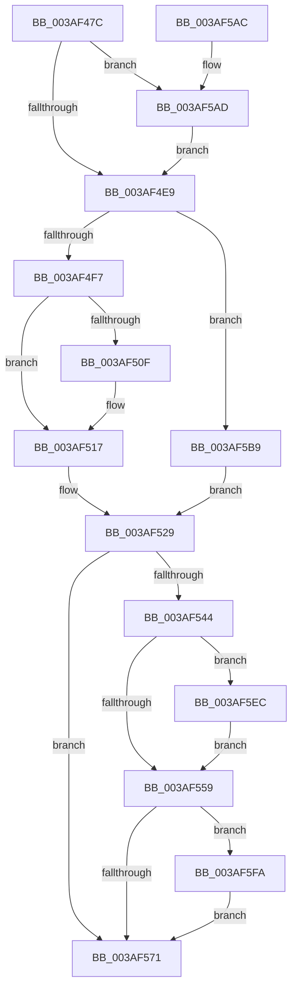

# B_TREE&lt;unsigned long,ST_STORE&lt;SM_TRAITS&gt;::_ST_REGION_ENTRY,4096,NP_CONTEXT,ST_STORE&lt;SM_TRAITS&gt;::ST_REGION_ENTRY_COMPARATOR&gt;::BTreeMergeNodes

- RVA: `0x003AF47C`–`0x003AF608` (길이 `396` bytes)
- VA: `0x00000001403AF47C`
- 실행 섹션: `.text`
- PDB 이름 있음: `예`; PDB Function 태그: `아니요`
- unwind 정보 RVA: `0x0008B7A4`
- 디코드: `114`개 명령, `396/396` bytes 표시
- 미해석 바이트: `0` (있으면 어셈블리에 `.byte`로 보존)

> 이 문서는 커널 이미지의 기계어와 PDB 기호를 분석해 생성했습니다. 4번과 5번은 함수 원형과 자료형을 바이너리 사용 방식에서 추정한 C 해석이며 원본 소스 복구 결과는 아닙니다.

## 1. Dependencies

- 직접 호출 지점: **5**; 고유 호출 대상: **5**
- 직접 호출자로 확인된 함수: **1**
- RIP 상대 이미지 참조: **0**

### Outgoing calls
- `0x003AF52D` → [memcpy](../6C/memcpy_function_006C6840.md) (function, `0x006C6840`)
- `0x003AF577` → [B_TREE<_SM_PAGE_KEY,ST_STORE<SM_TRAITS>::_ST_PAGE_ENTRY,4096,NP_CONTEXT,B_TREE_KEY_COMPARATOR<_SM_PAGE_KEY> >::BTreeDeleteNode](B_TREE__SM_PAGE_KEY_ST_STORE_SM_TRAITS__ST_PAGE_ENTRY_4096_NP_CONTEXT_B_TREE_KEY_COMPARATOR__SM_PAGE_function_003AA598.md) (function, `0x003AA598`)
- `0x003AF586` → [B_TREE<unsigned long,ST_STORE<SM_TRAITS>::_ST_REGION_ENTRY,4096,NP_CONTEXT,ST_STORE<SM_TRAITS>::ST_REGION_ENTRY_COMPARATOR>::BTreeDeleteEx](B_TREE_unsigned_long_ST_STORE_SM_TRAITS__ST_REGION_ENTRY_4096_NP_CONTEXT_ST_STORE_SM_TRAITS_ST_REGIO_function_003ADAF0.md) (function, `0x003ADAF0`)
- `0x003AF5F0` → [NP_CONTEXT::NpLeafDerefInternal](NP_CONTEXT_NpLeafDerefInternal_function_003A9A70.md) (function, `0x003A9A70`)
- `0x003AF5FE` → [NP_CONTEXT::NpLeafRemoveInternal](../60/NP_CONTEXT_NpLeafRemoveInternal_function_0060BF04.md) (function, `0x0060BF04`)

### Direct callers
- [sub_003ADC95](Unknown_function_003ADC95.md) at `0x003ADC9E`

### Static image references
- 디코드된 RIP-relative 메모리 참조가 없습니다.

## 2. Other-region calls and transfers

- 다른 실행 섹션으로 향하는 call: **0**
- 별도 외부 분기/꼬리 이동을 확인하지 못했습니다.

## 3. Assembly (complete function range)

```asm
003AF47C  48 89 5C 24 08                  mov qword ptr [rsp + 8], rbx
003AF481  48 89 6C 24 10                  mov qword ptr [rsp + 0x10], rbp
003AF486  48 89 74 24 18                  mov qword ptr [rsp + 0x18], rsi
003AF48B  57                              push rdi
003AF48C  41 54                           push r12
003AF48E  41 55                           push r13
003AF490  41 56                           push r14
003AF492  41 57                           push r15
003AF494  48 83 EC 20                     sub rsp, 0x20
003AF498  44 8B 4A 18                     mov r9d, dword ptr [rdx + 0x18]
003AF49C  48 8B D9                        mov rbx, rcx
003AF49F  41 FF C9                        dec r9d
003AF4A2  4C 8B F2                        mov r14, rdx
003AF4A5  49 C1 E1 04                     shl r9, 4
003AF4A9  49 8B F0                        mov rsi, r8
003AF4AC  4C 03 0A                        add r9, qword ptr [rdx]
003AF4AF  49 8B C8                        mov rcx, r8
003AF4B2  49 8B D0                        mov rdx, r8
003AF4B5  41 BC 10 00 00 00               mov r12d, 0x10
003AF4BB  83 E2 01                        and edx, 1
003AF4BE  49 8B 01                        mov rax, qword ptr [r9]
003AF4C1  4D 8B 79 F8                     mov r15, qword ptr [r9 - 8]
003AF4C5  48 0F 45 F0                     cmovne rsi, rax
003AF4C9  48 83 E1 FE                     and rcx, 0xfffffffffffffffe
003AF4CD  48 85 D2                        test rdx, rdx
003AF4D0  48 8B F9                        mov rdi, rcx
003AF4D3  48 0F 44 F8                     cmove rdi, rax
003AF4D7  49 0F 44 C8                     cmove rcx, r8
003AF4DB  8B 07                           mov eax, dword ptr [rdi]
003AF4DD  0F B7 E8                        movzx ebp, ax
003AF4E0  48 3B F9                        cmp rdi, rcx
003AF4E3  0F 84 C4 00 00 00               je 0x1403af5ad
003AF4E9  41 83 CD FF                     or r13d, 0xffffffff
003AF4ED  80 7F 03 00                     cmp byte ptr [rdi + 3], 0
003AF4F1  0F 84 C2 00 00 00               je 0x1403af5b9
003AF4F7  48 8B C3                        mov rax, rbx
003AF4FA  48 8D 4B 10                     lea rcx, [rbx + 0x10]
003AF4FE  48 F7 D8                        neg rax
003AF501  48 1B C0                        sbb rax, rax
003AF504  48 23 C1                        and rax, rcx
003AF507  48 8B 00                        mov rax, qword ptr [rax]
003AF50A  44 39 28                        cmp dword ptr [rax], r13d
003AF50D  75 08                           jne 0x1403af517
003AF50F  48 8B 46 08                     mov rax, qword ptr [rsi + 8]
003AF513  48 89 47 08                     mov qword ptr [rdi + 8], rax
003AF517  8B 06                           mov eax, dword ptr [rsi]
003AF519  44 0F B7 C0                     movzx r8d, ax
003AF51D  48 8D 47 10                     lea rax, [rdi + 0x10]
003AF521  48 8D 0C A8                     lea rcx, [rax + rbp*4]
003AF525  49 C1 E0 02                     shl r8, 2
003AF529  48 8D 56 10                     lea rdx, [rsi + 0x10]
003AF52D  E8 0E 73 31 00                  call 0x1406c6840
003AF532  66 03 2E                        add bp, word ptr [rsi]
003AF535  48 8B C3                        mov rax, rbx
003AF538  4C 03 E0                        add r12, rax
003AF53B  66 89 2F                        mov word ptr [rdi], bp
003AF53E  80 7F 03 00                     cmp byte ptr [rdi + 3], 0
003AF542  74 2D                           je 0x1403af571
003AF544  48 F7 D8                        neg rax
003AF547  48 1B C9                        sbb rcx, rcx
003AF54A  49 23 CC                        and rcx, r12
003AF54D  48 8B 01                        mov rax, qword ptr [rcx]
003AF550  44 39 28                        cmp dword ptr [rax], r13d
003AF553  0F 85 93 00 00 00               jne 0x1403af5ec
003AF559  48 8B C3                        mov rax, rbx
003AF55C  48 F7 D8                        neg rax
003AF55F  48 1B C9                        sbb rcx, rcx
003AF562  49 23 CC                        and rcx, r12
003AF565  48 8B 01                        mov rax, qword ptr [rcx]
003AF568  44 39 28                        cmp dword ptr [rax], r13d
003AF56B  0F 85 89 00 00 00               jne 0x1403af5fa
003AF571  48 8B D6                        mov rdx, rsi
003AF574  48 8B CB                        mov rcx, rbx
003AF577  E8 1C B0 FF FF                  call 0x1403aa598
003AF57C  45 01 6E 18                     add dword ptr [r14 + 0x18], r13d
003AF580  49 8B D6                        mov rdx, r14
003AF583  48 8B CB                        mov rcx, rbx
003AF586  E8 65 E5 FF FF                  call 0x1403adaf0
003AF58B  41 FF 46 18                     inc dword ptr [r14 + 0x18]
003AF58F  48 8B 5C 24 50                  mov rbx, qword ptr [rsp + 0x50]
003AF594  48 8B 6C 24 58                  mov rbp, qword ptr [rsp + 0x58]
003AF599  48 8B 74 24 60                  mov rsi, qword ptr [rsp + 0x60]
003AF59E  48 83 C4 20                     add rsp, 0x20
003AF5A2  41 5F                           pop r15
003AF5A4  41 5E                           pop r14
003AF5A6  41 5D                           pop r13
003AF5A8  41 5C                           pop r12
003AF5AA  5F                              pop rdi
003AF5AB  C3                              ret
003AF5AC  CC                              int3
003AF5AD  4D 2B FC                        sub r15, r12
003AF5B0  4D 89 79 F8                     mov qword ptr [r9 - 8], r15
003AF5B4  E9 30 FF FF FF                  jmp 0x1403af4e9
003AF5B9  41 8B 07                        mov eax, dword ptr [r15]
003AF5BC  48 8B CD                        mov rcx, rbp
003AF5BF  48 03 C9                        add rcx, rcx
003AF5C2  FF C5                           inc ebp
003AF5C4  89 44 CF 10                     mov dword ptr [rdi + rcx*8 + 0x10], eax
003AF5C8  48 8B 46 08                     mov rax, qword ptr [rsi + 8]
003AF5CC  48 89 44 CF 18                  mov qword ptr [rdi + rcx*8 + 0x18], rax
003AF5D1  8B 06                           mov eax, dword ptr [rsi]
003AF5D3  8B CD                           mov ecx, ebp
003AF5D5  48 FF C1                        inc rcx
003AF5D8  44 0F B7 C0                     movzx r8d, ax
003AF5DC  49 C1 E0 04                     shl r8, 4
003AF5E0  48 C1 E1 04                     shl rcx, 4
003AF5E4  48 03 CF                        add rcx, rdi
003AF5E7  E9 3D FF FF FF                  jmp 0x1403af529
003AF5EC  49 8D 57 08                     lea rdx, [r15 + 8]
003AF5F0  E8 7B A4 FF FF                  call 0x1403a9a70
003AF5F5  E9 5F FF FF FF                  jmp 0x1403af559
003AF5FA  49 8D 57 08                     lea rdx, [r15 + 8]
003AF5FE  E8 01 C9 25 00                  call 0x14060bf04
003AF603  E9 69 FF FF FF                  jmp 0x1403af571
```

## 4. C-style interpretation (structured pseudocode)

```c
__int64 __fastcall B_TREE_unsigned_long_ST_STORE_SM_TRAITS____ST_REGION_ENTRY_4096_NP_CONTEXT_ST_STORE_SM_TRAITS___ST_R(__int64 a1, __int64 a2, __int64 a3)
{
    __int64 result;
    __int64 v_r12;
    __int64 v_r13;
    __int64 v_r15;
    __int64 v_rbp;
    __int64 v_rsp;
    unsigned __int64 v_stack_p10;
    unsigned __int64 v_stack_p18;
    unsigned __int64 v_stack_p8;

    v_stack_p8 = v_rbx;
    v_stack_p10 = v_rbp;
    v_stack_p18 = v_rsi;
    v_rsp = (v_rsp) - (32);
    a4 = (unsigned int)(((unsigned int)(*(unsigned int *)(a2 + 24))) - 1);
    a4 = (a4) << (4);
    a4 = (a4) + (*(unsigned __int64 *)(a2));
    a2 = (unsigned int)((a3) & (1));
    if (condition_is_not_equal) { a3 = *(unsigned __int64 *)(a4); }
    a1 = (a3) & (-2);
    if (a2 == 0) {
        a1 = *(unsigned __int64 *)(a4);
        a1 = a3;
    }
    if (a1 == a1) goto loc_003AF5AD;
loc_003AF4E9:
    v_r13 = (unsigned int)((v_r13) | (0xFFFFFFFFULL));
    if ((*(unsigned __int8 *)(a1 + 3)) == 0) goto loc_003AF5B9;
    result = -(a1);
    result = (result) & (a1 + 16);
    result = *(unsigned __int64 *)(result);
    if ((*(unsigned int *)(*(unsigned __int64 *)(result))) == ((unsigned int)(v_r13))) {
        result = *(unsigned __int64 *)(a3 + 8);
        *(unsigned __int64 *)(a1 + 8) = result;
    }
    a3 = ((unsigned __int16)((unsigned int)(*(unsigned int *)(a3)))) << (2);
loc_003AF529:
    result = memcpy(a1 + 16 + (unsigned __int16)((unsigned int)(*(unsigned int *)(a1))) * 4, a3 + 16, a3, a4);
    v_rbp = (unsigned __int16)(((unsigned __int16)((unsigned int)(*(unsigned int *)(a1)))) + (*(unsigned __int16 *)(a3)));
    v_r12 = (16) + (a1);
    *(unsigned __int16 *)(a1) = (unsigned __int16)(v_rbp);
    if ((*(unsigned __int8 *)(a1 + 3)) == 0) goto loc_003AF571;
    result = -(a1);
    a1 = (a1 + 16 + (unsigned __int16)((unsigned int)(*(unsigned int *)(a1))) * 4) & (v_r12);
    if ((*(unsigned int *)(*(unsigned __int64 *)(a1))) != ((unsigned int)(v_r13))) goto loc_003AF5EC;
loc_003AF559:
    result = -(a1);
    a1 = (a1) & (v_r12);
    if ((*(unsigned int *)(*(unsigned __int64 *)(a1))) != ((unsigned int)(v_r13))) goto loc_003AF5FA;
loc_003AF571:
    result = B_TREE__SM_PAGE_KEY_ST_STORE_SM_TRAITS____ST_PAGE_ENTRY_4096_NP_CONTEXT_B_TREE_KEY_COMPARATOR__SM_PA(a1, a3, a3, a4);
    result = B_TREE_unsigned_long_ST_STORE_SM_TRAITS____ST_REGION_ENTRY_4096_NP_CONTEXT_ST_STORE_SM_TRAITS___ST_R(a1, a2, a3, a4);
    v_rsp = (v_rsp) + (32);
    return result;
loc_003AF5AD:
    v_r15 = (*(unsigned __int64 *)(a4 - 8)) - (v_r12);
    *(unsigned __int64 *)(a4 - 8) = v_r15;
    goto loc_003AF4E9;
loc_003AF5B9:
    a1 = (v_stack_p10) + (v_stack_p10);
    v_rbp = (unsigned int)((v_stack_p10) + 1);
    *(unsigned int *)(a1 + a1 * 8 + 16) = (unsigned int)((unsigned int)(*(unsigned int *)(v_r15)));
    *(unsigned __int64 *)(a1 + a1 * 8 + 24) = *(unsigned __int64 *)(v_stack_p18 + 8);
    a1 = ((unsigned int)((unsigned int)(v_rbp))) + 1;
    a3 = ((unsigned __int16)((unsigned int)(*(unsigned int *)(v_stack_p18)))) << (4);
    a1 = (a1) << (4);
    a1 = (a1) + (a1);
    goto loc_003AF529;
loc_003AF5EC:
    result = NP_CONTEXT__NpLeafDerefInternal(a1, v_r15 + 8, a3, a4);
    goto loc_003AF559;
loc_003AF5FA:
    result = NP_CONTEXT__NpLeafRemoveInternal(a1, v_r15 + 8, a3, a4);
    goto loc_003AF571;
}
```

## 5. (Beta) C Style

```c
int64_t B_TREE_unsigned_long_ST_STORE_SM_TRAITS____ST_REGION_ENTRY_4096_NP_CONTEXT_ST_STORE_SM_TRAITS___ST_R(void *Arg1, void *Arg2, int64_t Arg3)
{
    uint8_t *arg1 = (uint8_t *)Arg1;
    uint8_t *arg2 = (uint8_t *)Arg2;

    int64_t result;
    int64_t local_r12;
    int64_t local_r13;
    int64_t local_r15;
    int64_t local_rbp;
    int64_t local_rsp;
    uint64_t v_stack_p10;
    uint64_t v_stack_p18;
    uint64_t v_stack_p8;

    v_stack_p8 = local_rbx;
    v_stack_p10 = local_rbp;
    v_stack_p18 = local_rsi;
    local_rsp = (local_rsp) - (32);
    a4 = (uint32_t)(((uint32_t)(*(uint32_t *)(arg2 + 0x18))) - 1);
    a4 = (a4) << (4);
    a4 = (a4) + (*(uint64_t *)(arg2));
    Arg2 = (uint32_t)((Arg3) & (1));
    if (condition_is_not_equal) { Arg3 = *(uint64_t *)(a4); }
    Arg1 = (Arg3) & (-2);
    if (Arg2 == NULL) {
        Arg1 = *(uint64_t *)(a4);
        Arg1 = Arg3;
    }
    if (Arg1 == Arg1) goto loc_003AF5AD;
loc_003AF4E9:
    local_r13 = (uint32_t)((local_r13) | (0xFFFFFFFFULL));
    if ((*(uint8_t *)(arg1 + 0x3)) == 0) goto loc_003AF5B9;
    result = -(Arg1);
    result = (result) & (Arg1 + 16);
    result = *(uint64_t *)(result);
    if ((*(uint32_t *)(*(uint64_t *)(result))) == ((uint32_t)(local_r13))) {
        result = *(uint64_t *)(Arg3 + 0x8);
        *(uint64_t *)(arg1 + 0x8) = result;
    }
    Arg3 = ((uint16_t)((uint32_t)(*(uint32_t *)(Arg3)))) << (2);
loc_003AF529:
    result = memcpy(Arg1 + 16 + (uint16_t)((uint32_t)(*(uint32_t *)(arg1))) * 4, Arg3 + 16, Arg3, a4);
    local_rbp = (uint16_t)(((uint16_t)((uint32_t)(*(uint32_t *)(arg1)))) + (*(uint16_t *)(Arg3)));
    local_r12 = (16) + (Arg1);
    *(uint16_t *)(arg1) = (uint16_t)(local_rbp);
    if ((*(uint8_t *)(arg1 + 0x3)) == 0) goto loc_003AF571;
    result = -(Arg1);
    Arg1 = (Arg1 + 16 + (uint16_t)((uint32_t)(*(uint32_t *)(arg1))) * 4) & (local_r12);
    if ((*(uint32_t *)(*(uint64_t *)(arg1))) != ((uint32_t)(local_r13))) goto loc_003AF5EC;
loc_003AF559:
    result = -(Arg1);
    Arg1 = (Arg1) & (local_r12);
    if ((*(uint32_t *)(*(uint64_t *)(arg1))) != ((uint32_t)(local_r13))) goto loc_003AF5FA;
loc_003AF571:
    result = B_TREE__SM_PAGE_KEY_ST_STORE_SM_TRAITS____ST_PAGE_ENTRY_4096_NP_CONTEXT_B_TREE_KEY_COMPARATOR__SM_PA(Arg1, Arg3, Arg3, a4);
    result = B_TREE_unsigned_long_ST_STORE_SM_TRAITS____ST_REGION_ENTRY_4096_NP_CONTEXT_ST_STORE_SM_TRAITS___ST_R(Arg1, Arg2, Arg3, a4);
    local_rsp = (local_rsp) + (32);
    return result;
loc_003AF5AD:
    local_r15 = (*(uint64_t *)(a4 - 0x8)) - (local_r12);
    *(uint64_t *)(a4 - 0x8) = local_r15;
    goto loc_003AF4E9;
loc_003AF5B9:
    Arg1 = (v_stack_p10) + (v_stack_p10);
    local_rbp = (uint32_t)((v_stack_p10) + 1);
    *(uint32_t *)(arg1 + arg1 * 8 + 0x10) = (uint32_t)((uint32_t)(*(uint32_t *)(local_r15)));
    *(uint64_t *)(arg1 + arg1 * 8 + 0x18) = *(uint64_t *)(v_stack_p18 + 0x8);
    Arg1 = ((uint32_t)((uint32_t)(local_rbp))) + 1;
    Arg3 = ((uint16_t)((uint32_t)(*(uint32_t *)(v_stack_p18)))) << (4);
    Arg1 = (Arg1) << (4);
    Arg1 = (Arg1) + (Arg1);
    goto loc_003AF529;
loc_003AF5EC:
    result = NP_CONTEXT__NpLeafDerefInternal(Arg1, local_r15 + 8, Arg3, a4);
    goto loc_003AF559;
loc_003AF5FA:
    result = NP_CONTEXT__NpLeafRemoveInternal(Arg1, local_r15 + 8, Arg3, a4);
    goto loc_003AF571;
}
```

### 관측된 메모리 오프셋

구조체 형식이 확인되지 않은 접근은 인자 기준의 오프셋으로만 기록했습니다.

| 기준 인자 | 오프셋 표현 | 폭 (bit) | 접근 |
|---|---:|---:|---|
| `Arg1` | `+ 0x10` | `64` | `R` |
| `Arg2` | `+ 0x0` | `64` | `R` |
| `Arg2` | `+ 0x18` | `32` | `R` |
| `Arg2` | `+ 0x18` | `32` | `R/W` |

## 6. Execution-region graph

[열기: 2D/3D 그래프와 함수 탐색 컨트롤 패널](../../../control-panel.html?section=text&rva=0x003AF47C&view=graph)

- 2D 그래프는 위에서 아래로 흐르고, 3D 그래프는 빈 공간을 드래그해 회전합니다. Shift+드래그는 이동, 휠은 확대·축소, 함수 노드 선택은 대상 보고서 이동입니다.

### Static fallback


