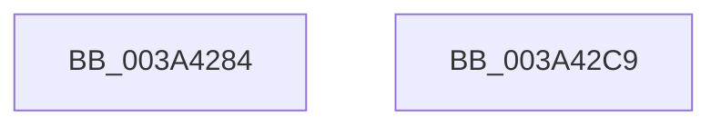

# EtwTraceHvHypercall

- RVA: `0x003A4284`–`0x003A42CA` (길이 `70` bytes)
- VA: `0x00000001403A4284`
- 실행 섹션: `.text`
- PDB 이름 있음: `예`; PDB Function 태그: `아니요`
- unwind 정보 RVA: `0x00082420`
- 디코드: `17`개 명령, `70/70` bytes 표시
- 미해석 바이트: `0` (있으면 어셈블리에 `.byte`로 보존)

> 이 문서는 커널 이미지의 기계어와 PDB 기호를 분석해 생성했습니다. 4번과 5번은 함수 원형과 자료형을 바이너리 사용 방식에서 추정한 C 해석이며 원본 소스 복구 결과는 아닙니다.

## 1. Dependencies

- 직접 호출 지점: **1**; 고유 호출 대상: **1**
- 직접 호출자로 확인된 함수: **3**
- RIP 상대 이미지 참조: **0**

### Outgoing calls
- `0x003A42BF` → [EtwTraceTimedEvent](EtwTraceTimedEvent_function_003A3430.md) (function, `0x003A3430`)

### Direct callers
- [HvlSendSyntheticClusterIpi](../30/HvlSendSyntheticClusterIpi_function_00304E50.md) at `0x00304F66`
- [sub_003136E0](../31/Unknown_function_003136E0.md) at `0x003136FD`
- [HvlUpdatePerformanceStateCountersForLp](../44/HvlUpdatePerformanceStateCountersForLp_function_0044D5B0.md) at `0x0044D659`

### Static image references
- 디코드된 RIP-relative 메모리 참조가 없습니다.

## 2. Other-region calls and transfers

- 다른 실행 섹션으로 향하는 call: **0**
- 별도 외부 분기/꼬리 이동을 확인하지 못했습니다.

## 3. Assembly (complete function range)

```asm
003A4284  4C 8B DC                        mov r11, rsp
003A4287  48 83 EC 48                     sub rsp, 0x48
003A428B  49 83 63 E8 00                  and qword ptr [r11 - 0x18], 0
003A4290  48 8B C1                        mov rax, rcx
003A4293  89 54 24 30                     mov dword ptr [rsp + 0x30], edx
003A4297  B9 72 0F 00 00                  mov ecx, 0xf72
003A429C  45 88 43 EC                     mov byte ptr [r11 - 0x14], r8b
003A42A0  BA 10 00 00 A0                  mov edx, 0xa0000010
003A42A5  45 88 4B ED                     mov byte ptr [r11 - 0x13], r9b
003A42A9  4D 8D 43 E8                     lea r8, [r11 - 0x18]
003A42AD  49 89 43 E0                     mov qword ptr [r11 - 0x20], rax
003A42B1  41 B9 08 00 00 00               mov r9d, 8
003A42B7  C7 44 24 20 02 0E 50 00         mov dword ptr [rsp + 0x20], 0x500e02
003A42BF  E8 6C F1 FF FF                  call 0x1403a3430
003A42C4  48 83 C4 48                     add rsp, 0x48
003A42C8  C3                              ret
003A42C9  CC                              int3
```

## 4. C-style interpretation (structured pseudocode)

```c
__int64 __fastcall EtwTraceHvHypercall(__int64 a1, int a2, unsigned __int8 a3, unsigned __int8 a4)
{
    __int64 result;
    __int64 v_rsp;
    unsigned int v_stack_m18;
    unsigned int v_stack_m28;

    v_rsp = (v_rsp) - (72);
    v_stack_m18 = a2;
    *(unsigned __int8 *)(v_rsp - 20) = a3;
    *(unsigned __int8 *)(v_rsp - 19) = a4;
    *(unsigned __int64 *)(v_rsp - 32) = a1;
    v_stack_m28 = 0x500E02ULL;
    result = EtwTraceTimedEvent((unsigned int)(0xF72ULL), (unsigned int)(0xA0000010ULL), v_rsp - 24, 8);
    v_rsp = (v_rsp) + (72);
    return result;
}
```

## 5. (Beta) C Style

```c
int64_t EtwTraceHvHypercall(int64_t Arg1, int32_t Arg2, uint8_t Arg3, uint8_t Arg4)
{
    int64_t result;
    int64_t local_rsp;
    uint32_t v_stack_m18;
    uint32_t v_stack_m28;

    local_rsp = (local_rsp) - (72);
    v_stack_m18 = Arg2;
    *(uint8_t *)(local_rsp - 0x14) = Arg3;
    *(uint8_t *)(local_rsp - 0x13) = Arg4;
    *(uint64_t *)(local_rsp - 0x20) = Arg1;
    v_stack_m28 = 0x500E02ULL;
    result = EtwTraceTimedEvent((uint32_t)(0xF72ULL), (uint32_t)(0xA0000010ULL), local_rsp - 24, 8);
    local_rsp = (local_rsp) + (72);
    return result;
}
```

## 6. Execution-region graph

[열기: 2D/3D 그래프와 함수 탐색 컨트롤 패널](../../../control-panel.html?section=text&rva=0x003A4284&view=graph)

- 2D 그래프는 위에서 아래로 흐르고, 3D 그래프는 빈 공간을 드래그해 회전합니다. Shift+드래그는 이동, 휠은 확대·축소, 함수 노드 선택은 대상 보고서 이동입니다.

### Static fallback


