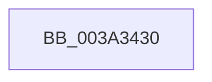

# EtwTraceTimedEvent

- RVA: `0x003A3430`–`0x003A347B` (길이 `75` bytes)
- VA: `0x00000001403A3430`
- 실행 섹션: `.text`
- PDB 이름 있음: `예`; PDB Function 태그: `아니요`
- unwind 정보 RVA: `0x000821B0`
- 디코드: `19`개 명령, `75/75` bytes 표시
- 미해석 바이트: `0` (있으면 어셈블리에 `.byte`로 보존)

> 이 문서는 커널 이미지의 기계어와 PDB 기호를 분석해 생성했습니다. 4번과 5번은 함수 원형과 자료형을 바이너리 사용 방식에서 추정한 C 해석이며 원본 소스 복구 결과는 아닙니다.

## 1. Dependencies

- 직접 호출 지점: **0**; 고유 호출 대상: **0**
- 직접 호출자로 확인된 함수: **9**
- RIP 상대 이미지 참조: **2**

### Outgoing calls
- 직접 디코드된 call 명령이 없습니다.

### Direct callers
- [HvlpFastFlushAddressSpaceTb](../31/HvlpFastFlushAddressSpaceTb_function_00314AF4.md) at `0x00314BCA`
- [KeDisableTimer2](../39/KeDisableTimer2_function_0039FD58.md) at `0x003A00A7`
- [KiFinalizeTimer2Disablement](KiFinalizeTimer2Disablement_function_003A2198.md) at `0x003A2350`
- [KiExpireTimer2](KiExpireTimer2_function_003A24E0.md) at `0x003A2B22`
- [IopTimerDispatch](IopTimerDispatch_function_003A3900.md) at `0x003A3A7A`
- [PerfInfoLogIpiReceive](PerfInfoLogIpiReceive_function_003A40F0.md) at `0x003A4122`
- [EtwTraceHvHypercall](EtwTraceHvHypercall_function_003A4284.md) at `0x003A42BF`
- [EtwTraceCpuCacheFlush](../64/EtwTraceCpuCacheFlush_function_0064F5EC.md) at `0x0064F631`
- [EtwpTraceFltTimedIo](../65/EtwpTraceFltTimedIo_function_00650DB0.md) at `0x00650DDA`

### Static image references
- `0x003A3440` → RVA `0x00E0A740` (`.data`; read)
- `0x003A344F` → RVA `0x00FC6AA8` (`ALMOSTRO`; read)

## 2. Other-region calls and transfers

- 다른 실행 섹션으로 향하는 call: **0**
- call이 아닌 외부 분기/꼬리 이동: **1**
  - `0x003A3475` → [sub_003A352A](Unknown_function_003A352A.md) (`tail-transfer`)

## 3. Assembly (complete function range)

```asm
003A3430  4C 8B DC                        mov r11, rsp
003A3433  49 89 5B 20                     mov qword ptr [r11 + 0x20], rbx
003A3437  57                              push rdi
003A3438  41 56                           push r14
003A343A  41 57                           push r15
003A343C  48 83 EC 60                     sub rsp, 0x60
003A3440  48 8B 05 F9 72 A6 00            mov rax, qword ptr [rip + 0xa672f9]
003A3447  48 33 C4                        xor rax, rsp
003A344A  48 89 44 24 58                  mov qword ptr [rsp + 0x58], rax
003A344F  48 8B 1D 52 36 C2 00            mov rbx, qword ptr [rip + 0xc23652]
003A3456  45 33 FF                        xor r15d, r15d
003A3459  4D 89 43 D0                     mov qword ptr [r11 - 0x30], r8
003A345D  44 0F B7 F1                     movzx r14d, cx
003A3461  8B FA                           mov edi, edx
003A3463  45 89 4B D8                     mov dword ptr [r11 - 0x28], r9d
003A3467  8B 9B A8 11 00 00               mov ebx, dword ptr [rbx + 0x11a8]
003A346D  44 0F BC C3                     bsf r8d, ebx
003A3471  45 89 7B DC                     mov dword ptr [r11 - 0x24], r15d
003A3475  0F 84 AF 00 00 00               je 0x1403a352a
```

## 4. C-style interpretation (structured pseudocode)

```c
__int64 __fastcall EtwTraceTimedEvent(unsigned __int16 a1, int a2, __int64 a3, int a4)
{
    __int64 result;
    __int64 v_r15;
    __int64 v_rsp;
    unsigned __int64 v_stack_m20;

    *(unsigned __int64 *)(v_rsp + 32) = v_rbx;
    v_rsp = (v_rsp) - (96);
    result = (*(unsigned __int64 *)(v_rip + 10908409)) ^ (v_rsp);
    v_stack_m20 = result;
    v_r15 = 0;
    *(unsigned __int64 *)(v_rsp - 48) = a3;
    *(unsigned int *)(v_rsp - 40) = a4;
    *(unsigned int *)(v_rsp - 36) = 0;
}
```

## 5. (Beta) C Style

```c
int64_t EtwTraceTimedEvent(uint16_t Arg1, int32_t Arg2, int64_t Arg3, int32_t Arg4)
{
    int64_t result;
    int64_t local_r15;
    int64_t local_rsp;
    uint64_t v_stack_m20;

    *(uint64_t *)(local_rsp + 0x20) = local_rbx;
    local_rsp = (local_rsp) - (96);
    result = (*(uint64_t *)(v_rip + 0xA672F9)) ^ (local_rsp);
    v_stack_m20 = result;
    local_r15 = 0;
    *(uint64_t *)(local_rsp - 0x30) = Arg3;
    *(uint32_t *)(local_rsp - 0x28) = Arg4;
    *(uint32_t *)(local_rsp - 0x24) = 0;
}
```

## 6. Execution-region graph

[열기: 2D/3D 그래프와 함수 탐색 컨트롤 패널](../../../control-panel.html?section=text&rva=0x003A3430&view=graph)

- 2D 그래프는 위에서 아래로 흐르고, 3D 그래프는 빈 공간을 드래그해 회전합니다. Shift+드래그는 이동, 휠은 확대·축소, 함수 노드 선택은 대상 보고서 이동입니다.

### Static fallback


