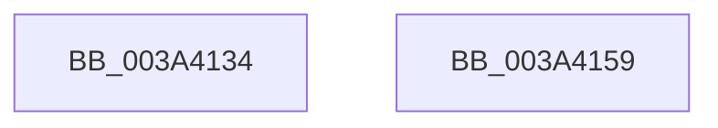

# EtwpGetHostPerfCounter

- RVA: `0x003A4134`–`0x003A415A` (길이 `38` bytes)
- VA: `0x00000001403A4134`
- 실행 섹션: `.text`
- PDB 이름 있음: `예`; PDB Function 태그: `아니요`
- unwind 정보 RVA: `0x0005C788`
- 디코드: `9`개 명령, `38/38` bytes 표시
- 미해석 바이트: `0` (있으면 어셈블리에 `.byte`로 보존)

> 이 문서는 커널 이미지의 기계어와 PDB 기호를 분석해 생성했습니다. 4번과 5번은 함수 원형과 자료형을 바이너리 사용 방식에서 추정한 C 해석이며 원본 소스 복구 결과는 아닙니다.

## 1. Dependencies

- 직접 호출 지점: **1**; 고유 호출 대상: **1**
- 직접 호출자로 확인된 함수: **8**
- RIP 상대 이미지 참조: **1**

### Outgoing calls
- `0x003A414A` → [guard_dispatch_icall](../6B/guard_dispatch_icall_function_006BAAD0.md) (function, `0x006BAAD0`)

### Direct callers
- [KiProcessExpiredTimerList](../23/KiProcessExpiredTimerList_function_00234200.md) at `0x002346E6`
- [KiExecuteAllDpcs](../25/KiExecuteAllDpcs_function_0025B740.md) at `0x0025C7F2`
- [HvcallFastExtended](../31/HvcallFastExtended_function_003130E0.md) at `0x003133AA`
- [HvlpFastFlushAddressSpaceTb](../31/HvlpFastFlushAddressSpaceTb_function_00314AF4.md) at `0x00314CAA`
- [sub_0037E7C8](../37/Unknown_function_0037E7C8.md) at `0x0037E7CF`
- [EtwGetKernelTraceTimestampSilo](../37/EtwGetKernelTraceTimestampSilo_function_0037FBD0.md) at `0x0037FCD1`
- [EtwGetKernelTraceTimestamp](../39/EtwGetKernelTraceTimestamp_function_0039FC50.md) at `0x0039FD35`
- [sub_003A3F33](Unknown_function_003A3F33.md) at `0x003A3FB7`

### Static image references
- `0x003A4143` → RVA `0x00E00C40` (`.data`; read)

## 2. Other-region calls and transfers

- 다른 실행 섹션으로 향하는 call: **0**
- 별도 외부 분기/꼬리 이동을 확인하지 못했습니다.

## 3. Assembly (complete function range)

```asm
003A4134  48 83 EC 28                     sub rsp, 0x28
003A4138  48 83 64 24 30 00               and qword ptr [rsp + 0x30], 0
003A413E  48 8D 4C 24 30                  lea rcx, [rsp + 0x30]
003A4143  48 8B 05 F6 CA A5 00            mov rax, qword ptr [rip + 0xa5caf6]
003A414A  E8 81 69 31 00                  call 0x1406baad0
003A414F  48 8B 44 24 30                  mov rax, qword ptr [rsp + 0x30]
003A4154  48 83 C4 28                     add rsp, 0x28
003A4158  C3                              ret
003A4159  CC                              int3
```

## 4. C-style interpretation (structured pseudocode)

```c
__int64 __fastcall EtwpGetHostPerfCounter(void)
{
    __int64 result;
    __int64 v_rsp;
    unsigned __int64 v_stack_p8;

    v_rsp = (v_rsp) - (40);
    result = guard_dispatch_icall(v_stack_p8, a2, a3, a4);
    v_rsp = (v_rsp) + (40);
    return v_stack_p8;
}
```

## 5. (Beta) C Style

```c
void EtwpGetHostPerfCounter(void)
{
    int64_t result;
    int64_t local_rsp;
    uint64_t v_stack_p8;

    local_rsp = (local_rsp) - (40);
    result = guard_dispatch_icall(v_stack_p8, a2, a3, a4);
    local_rsp = (local_rsp) + (40);
    return v_stack_p8;
}
```

## 6. Execution-region graph

[열기: 2D/3D 그래프와 함수 탐색 컨트롤 패널](../../../control-panel.html?section=text&rva=0x003A4134&view=graph)

- 2D 그래프는 위에서 아래로 흐르고, 3D 그래프는 빈 공간을 드래그해 회전합니다. Shift+드래그는 이동, 휠은 확대·축소, 함수 노드 선택은 대상 보고서 이동입니다.

### Static fallback


