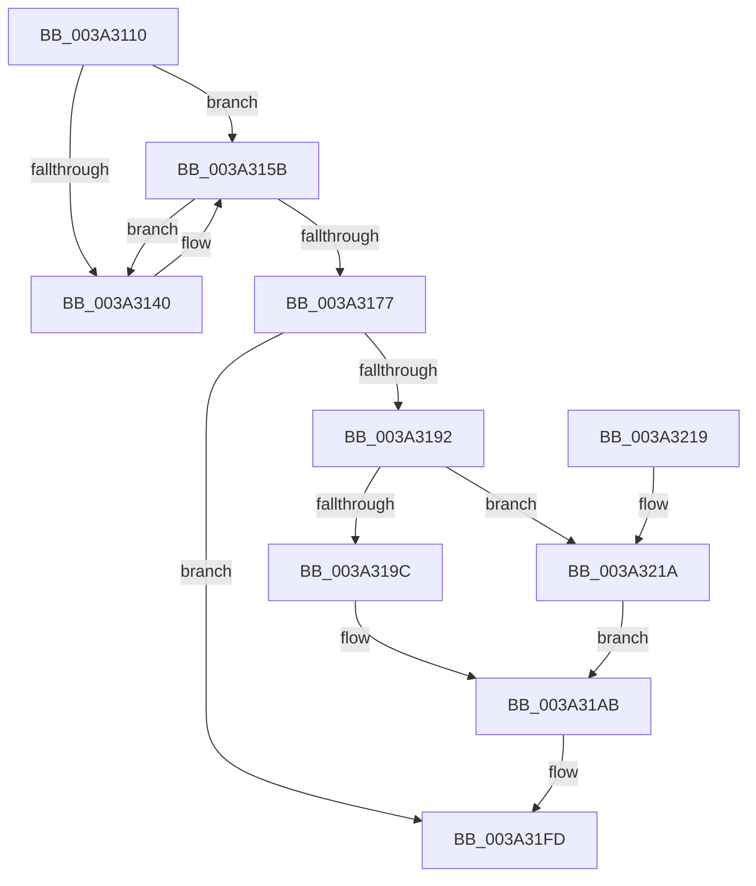

# ExAllocateTimerInternal2

- RVA: `0x003A3110`–`0x003A3243` (길이 `307` bytes)
- VA: `0x00000001403A3110`
- 실행 섹션: `.text`
- PDB 이름 있음: `예`; PDB Function 태그: `아니요`
- unwind 정보 RVA: `0x00082194`
- 디코드: `83`개 명령, `307/307` bytes 표시
- 미해석 바이트: `0` (있으면 어셈블리에 `.byte`로 보존)

> 이 문서는 커널 이미지의 기계어와 PDB 기호를 분석해 생성했습니다. 4번과 5번은 함수 원형과 자료형을 바이너리 사용 방식에서 추정한 C 해석이며 원본 소스 복구 결과는 아닙니다.

## 1. Dependencies

- 직접 호출 지점: **5**; 고유 호출 대상: **5**
- 직접 호출자로 확인된 함수: **2**
- RIP 상대 이미지 참조: **3**

### Outgoing calls
- `0x003A3137` → [ExpExTimerAttributesAreValid](ExpExTimerAttributesAreValid_function_003A324C.md) (function, `0x003A324C`)
- `0x003A3155` → [KeBugCheckEx](../4F/KeBugCheckEx_function_004FD660.md) (function, `0x004FD660`)
- `0x003A3185` → [ExAllocatePool2](../../poolcode/B8/ExAllocatePool2_function_00B820F0.md) (function, `0x00B820F0`)
- `0x003A31A6` → [KiInitializeTimer2](KiInitializeTimer2_function_003A3288.md) (function, `0x003A3288`)
- `0x003A3239` → [KeInitializeIRTimer](KeInitializeIRTimer_function_003A4204.md) (function, `0x003A4204`)

### Direct callers
- [ExAllocateTimer](ExAllocateTimer_function_003A30D0.md) at `0x003A30E0`
- [ExAllocateTimerInternal](../65/ExAllocateTimerInternal_function_006591C0.md) at `0x006591DF`

### Static image references
- `0x003A31AB` → RVA `0x00FC6F78` (`ALMOSTRO`; read)
- `0x003A31B2` → RVA `0x00FC7250` (`ALMOSTRO`; read)
- `0x003A31EA` → RVA `0x00FC6AF6` (`ALMOSTRO`; read)

## 2. Other-region calls and transfers

- 다른 실행 섹션으로 향하는 call: **1**
  - `0x003A3185` → [ExAllocatePool2](../../poolcode/B8/ExAllocatePool2_function_00B820F0.md) (`.text` → `POOLCODE`)
- 별도 외부 분기/꼬리 이동을 확인하지 못했습니다.

## 3. Assembly (complete function range)

```asm
003A3110  48 89 5C 24 08                  mov qword ptr [rsp + 8], rbx
003A3115  48 89 6C 24 10                  mov qword ptr [rsp + 0x10], rbp
003A311A  48 89 74 24 18                  mov qword ptr [rsp + 0x18], rsi
003A311F  57                              push rdi
003A3120  41 56                           push r14
003A3122  41 57                           push r15
003A3124  48 83 EC 40                     sub rsp, 0x40
003A3128  4C 8B F9                        mov r15, rcx
003A312B  41 8B F9                        mov edi, r9d
003A312E  41 8B C9                        mov ecx, r9d
003A3131  4D 8B F0                        mov r14, r8
003A3134  48 8B EA                        mov rbp, rdx
003A3137  E8 10 01 00 00                  call 0x1403a324c
003A313C  84 C0                           test al, al
003A313E  75 1B                           jne 0x1403a315b
003A3140  48 83 64 24 20 00               and qword ptr [rsp + 0x20], 0
003A3146  45 33 C0                        xor r8d, r8d
003A3149  4C 8B CF                        mov r9, rdi
003A314C  B9 C7 00 00 00                  mov ecx, 0xc7
003A3151  41 8D 50 09                     lea edx, [r8 + 9]
003A3155  E8 06 A5 15 00                  call 0x1404fd660
003A315A  CC                              int3
003A315B  41 B9 00 00 00 00               mov r9d, 0
003A3161  8B F7                           mov esi, edi
003A3163  83 E6 02                        and esi, 2
003A3166  41 0F 95 C1                     setne r9b
003A316A  33 C0                           xor eax, eax
003A316C  4D 85 F6                        test r14, r14
003A316F  0F 95 C0                        setne al
003A3172  44 3B C8                        cmp r9d, eax
003A3175  75 C9                           jne 0x1403a3140
003A3177  BA A0 00 00 00                  mov edx, 0xa0
003A317C  41 B8 45 78 54 6D               mov r8d, 0x6d547845
003A3182  8D 4A A0                        lea ecx, [rdx - 0x60]
003A3185  E8 66 EF 7D 00                  call 0x140b820f0
003A318A  48 8B D8                        mov rbx, rax
003A318D  48 85 C0                        test rax, rax
003A3190  74 6B                           je 0x1403a31fd
003A3192  4C 8B C5                        mov r8, rbp
003A3195  49 8B D7                        mov rdx, r15
003A3198  85 F6                           test esi, esi
003A319A  75 7E                           jne 0x1403a321a
003A319C  66 21 70 02                     and word ptr [rax + 2], si
003A31A0  44 8B CF                        mov r9d, edi
003A31A3  48 8B C8                        mov rcx, rax
003A31A6  E8 DD 00 00 00                  call 0x1403a3288
003A31AB  48 8B 05 C6 3D C2 00            mov rax, qword ptr [rip + 0xc23dc6]
003A31B2  48 8B 15 97 40 C2 00            mov rdx, qword ptr [rip + 0xc24097]
003A31B9  8B C8                           mov ecx, eax
003A31BB  48 0F CA                        bswap rdx
003A31BE  48 33 D3                        xor rdx, rbx
003A31C1  48 D3 CA                        ror rdx, cl
003A31C4  48 33 D0                        xor rdx, rax
003A31C7  48 89 93 88 00 00 00            mov qword ptr [rbx + 0x88], rdx
003A31CE  48 8B 05 A3 3D C2 00            mov rax, qword ptr [rip + 0xc23da3]
003A31D5  48 8B 15 74 40 C2 00            mov rdx, qword ptr [rip + 0xc24074]
003A31DC  8B C8                           mov ecx, eax
003A31DE  48 0F CA                        bswap rdx
003A31E1  48 33 D3                        xor rdx, rbx
003A31E4  48 D3 CA                        ror rdx, cl
003A31E7  48 33 D0                        xor rdx, rax
003A31EA  8A 05 06 39 C2 00               mov al, byte ptr [rip + 0xc23906]
003A31F0  88 83 98 00 00 00               mov byte ptr [rbx + 0x98], al
003A31F6  48 89 93 90 00 00 00            mov qword ptr [rbx + 0x90], rdx
003A31FD  48 8B 6C 24 68                  mov rbp, qword ptr [rsp + 0x68]
003A3202  48 8B C3                        mov rax, rbx
003A3205  48 8B 5C 24 60                  mov rbx, qword ptr [rsp + 0x60]
003A320A  48 8B 74 24 70                  mov rsi, qword ptr [rsp + 0x70]
003A320F  48 83 C4 40                     add rsp, 0x40
003A3213  41 5F                           pop r15
003A3215  41 5E                           pop r14
003A3217  5F                              pop rdi
003A3218  C3                              ret
003A3219  CC                              int3
003A321A  41 0F B7 0E                     movzx ecx, word ptr [r14]
003A321E  4C 8D 4C 24 30                  lea r9, [rsp + 0x30]
003A3223  66 89 4C 24 30                  mov word ptr [rsp + 0x30], cx
003A3228  41 0F B7 4E 02                  movzx ecx, word ptr [r14 + 2]
003A322D  66 89 4C 24 32                  mov word ptr [rsp + 0x32], cx
003A3232  48 8B CB                        mov rcx, rbx
003A3235  89 7C 24 20                     mov dword ptr [rsp + 0x20], edi
003A3239  E8 C6 0F 00 00                  call 0x1403a4204
003A323E  E9 68 FF FF FF                  jmp 0x1403a31ab
```

## 4. C-style interpretation (structured pseudocode)

```c
__int64 __fastcall ExAllocateTimerInternal2(__int64 a1, __int64 a2, __int64 a3, int a4)
{
    __int64 result;
    __int64 v_rsi;
    __int64 v_rsp;
    unsigned __int64 v_stack_m38;
    unsigned __int64 v_stack_p10;
    unsigned __int64 v_stack_p18;
    unsigned int v_stack_p20;
    unsigned __int64 v_stack_p30;
    unsigned __int16 v_stack_p32;
    unsigned __int64 v_stack_p8;

    v_stack_p8 = v_rbx;
    v_stack_p10 = v_rbp;
    v_stack_p18 = v_rsi;
    v_rsp = (v_rsp) - (64);
    result = ExpExTimerAttributesAreValid((unsigned int)(a4), a2, a3, a4);
    if ((unsigned __int8)(result) == 0) {
        a3 = 0;
        a4 = (unsigned int)(a4);
        a1 = 199;
        a2 = a3 + 9;
        result = KeBugCheckEx(a1, a2, a3, a4);
    }
    v_rsi = (unsigned int)(((unsigned int)((unsigned int)((unsigned int)(a4)))) & (2));
    a4 = (condition_is_not_equal) ? 1 : 0;
    result = 0;
    result = (0 != 0) ? 1 : 0;
    if (a4 != ((unsigned int)(result))) goto loc_003A3140;
    result = ExAllocatePool2(160 - 96, 160, (unsigned int)(0x6D547845ULL), a4);
    if (result == 0) goto loc_003A31FD;
    if ((unsigned int)(v_rsi) != 0) goto loc_003A321A;
    result = KiInitializeTimer2(result, a1, a2, (unsigned int)((unsigned int)((unsigned int)(a4))));
loc_003A31AB:
    a2 = (*(unsigned __int64 *)(v_rip + 12730519)) ^ (result);
    a2 = (a2) ^ (*(unsigned __int64 *)(v_rip + 12729798));
    *(unsigned __int64 *)(result + 136) = a2;
    a2 = (*(unsigned __int64 *)(v_rip + 12730484)) ^ (result);
    a2 = (a2) ^ (*(unsigned __int64 *)(v_rip + 12729763));
    *(unsigned __int8 *)(result + 152) = (unsigned __int8)(*(unsigned __int8 *)(v_rip + 12728582));
    *(unsigned __int64 *)(result + 144) = a2;
loc_003A31FD:
    v_rsp = (v_rsp) + (64);
    return result;
loc_003A321A:
    v_stack_p30 = (unsigned __int16)(*(unsigned __int16 *)(a3));
    v_stack_p32 = (unsigned __int16)(*(unsigned __int16 *)(a3 + 2));
    v_stack_p20 = (unsigned int)((unsigned int)(a4));
    result = KeInitializeIRTimer(v_stack_p8, a2, a2, v_stack_p30);
    goto loc_003A31AB;
}
```

## 5. (Beta) C Style

```c
int64_t ExAllocateTimerInternal2(int64_t Arg1, int64_t Arg2, int64_t Arg3, int32_t Arg4)
{
    int64_t result;
    int64_t local_rsi;
    int64_t local_rsp;
    uint64_t v_stack_m38;
    uint64_t v_stack_p10;
    uint64_t v_stack_p18;
    uint32_t v_stack_p20;
    uint64_t v_stack_p30;
    uint16_t v_stack_p32;
    uint64_t v_stack_p8;

    v_stack_p8 = local_rbx;
    v_stack_p10 = local_rbp;
    v_stack_p18 = local_rsi;
    local_rsp = (local_rsp) - (64);
    result = ExpExTimerAttributesAreValid((uint32_t)(Arg4), Arg2, Arg3, Arg4);
    if ((uint8_t)(result) == 0) {
        Arg3 = 0;
        Arg4 = (uint32_t)(Arg4);
        Arg1 = 199;
        Arg2 = Arg3 + 9;
        result = KeBugCheckEx(Arg1, Arg2, Arg3, Arg4);
    }
    local_rsi = (uint32_t)(((uint32_t)((uint32_t)((uint32_t)(Arg4)))) & (2));
    Arg4 = (condition_is_not_equal) ? 1 : 0;
    result = 0;
    result = (0 != 0) ? 1 : 0;
    if (Arg4 != ((uint32_t)(result))) goto loc_003A3140;
    result = ExAllocatePool2(160 - 96, 160, (uint32_t)(0x6D547845ULL), Arg4);
    if (result == 0) goto loc_003A31FD;
    if ((uint32_t)(local_rsi) != 0) goto loc_003A321A;
    result = KiInitializeTimer2(result, Arg1, Arg2, (uint32_t)((uint32_t)((uint32_t)(Arg4))));
loc_003A31AB:
    Arg2 = (*(uint64_t *)(v_rip + 0xC24097)) ^ (result);
    Arg2 = (Arg2) ^ (*(uint64_t *)(v_rip + 0xC23DC6));
    *(uint64_t *)(result + 0x88) = Arg2;
    Arg2 = (*(uint64_t *)(v_rip + 0xC24074)) ^ (result);
    Arg2 = (Arg2) ^ (*(uint64_t *)(v_rip + 0xC23DA3));
    *(uint8_t *)(result + 0x98) = (uint8_t)(*(uint8_t *)(v_rip + 0xC23906));
    *(uint64_t *)(result + 0x90) = Arg2;
loc_003A31FD:
    local_rsp = (local_rsp) + (64);
    return result;
loc_003A321A:
    v_stack_p30 = (uint16_t)(*(uint16_t *)(Arg3));
    v_stack_p32 = (uint16_t)(*(uint16_t *)(Arg3 + 0x2));
    v_stack_p20 = (uint32_t)((uint32_t)(Arg4));
    result = KeInitializeIRTimer(v_stack_p8, Arg2, Arg2, v_stack_p30);
    goto loc_003A31AB;
}
```

## 6. Execution-region graph

[열기: 2D/3D 그래프와 함수 탐색 컨트롤 패널](../../../control-panel.html?section=text&rva=0x003A3110&view=graph)

- 2D 그래프는 위에서 아래로 흐르고, 3D 그래프는 빈 공간을 드래그해 회전합니다. Shift+드래그는 이동, 휠은 확대·축소, 함수 노드 선택은 대상 보고서 이동입니다.

### Static fallback


