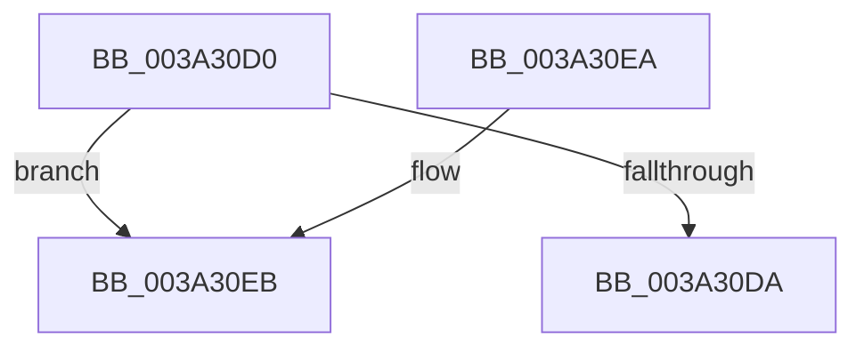

# ExAllocateTimer

- RVA: `0x003A30D0`–`0x003A3106` (길이 `54` bytes)
- VA: `0x00000001403A30D0`
- 실행 섹션: `.text`
- PDB 이름 있음: `예`; PDB Function 태그: `아니요`
- unwind 정보 RVA: `0x00082188`
- 디코드: `16`개 명령, `54/54` bytes 표시
- 미해석 바이트: `0` (있으면 어셈블리에 `.byte`로 보존)

> 이 문서는 커널 이미지의 기계어와 PDB 기호를 분석해 생성했습니다. 4번과 5번은 함수 원형과 자료형을 바이너리 사용 방식에서 추정한 C 해석이며 원본 소스 복구 결과는 아닙니다.

## 1. Dependencies

- 직접 호출 지점: **2**; 고유 호출 대상: **2**
- 직접 호출자로 확인된 함수: **8**
- RIP 상대 이미지 참조: **0**

### Outgoing calls
- `0x003A30E0` → [ExAllocateTimerInternal2](ExAllocateTimerInternal2_function_003A3110.md) (function, `0x003A3110`)
- `0x003A3100` → [KeBugCheckEx](../4F/KeBugCheckEx_function_004FD660.md) (function, `0x004FD660`)

### Direct callers
- [ExpHeapInitPhase1](../65/ExpHeapInitPhase1_function_0065C890.md) at `0x0065C8CC`
- [ExpHeapInitPhase1](../65/ExpHeapInitPhase1_function_0065C890.md) at `0x0065C8EB`
- [HalpRegisterPmuNotification](../../page/70/HalpRegisterPmuNotification_function_0070C38C.md) at `0x0070C4D5`
- [WdipSemStartTimeoutCheck](../../page/7B/WdipSemStartTimeoutCheck_function_007B13B0.md) at `0x007B13D6`
- [EtwpUpdatePeriodicCaptureState](../../page/7B/EtwpUpdatePeriodicCaptureState_function_007BCC4C.md) at `0x007BCDF7`
- [CreateTlgAggregateSession](../../page/83/CreateTlgAggregateSession_function_00835FFC.md) at `0x008360F6`
- [WdtpAllocateTimer](../../page/A2/WdtpAllocateTimer_function_00A26C94.md) at `0x00A26CC9`
- [sub_00BF16D0](../../init/BF/Unknown_function_00BF16D0.md) at `0x00BF7CC4`
- [CmFcManagerStartRuntimePhase](../../init/C5/CmFcManagerStartRuntimePhase_function_00C5DC70.md) at `0x00C5DFFD`
- [CmFcManagerStartRuntimePhase](../../init/C5/CmFcManagerStartRuntimePhase_function_00C5DC70.md) at `0x00C5E063`
- [CmFcManagerStartRuntimePhase](../../init/C5/CmFcManagerStartRuntimePhase_function_00C5DC70.md) at `0x00C5E08A`

### Static image references
- 디코드된 RIP-relative 메모리 참조가 없습니다.

## 2. Other-region calls and transfers

- 다른 실행 섹션으로 향하는 call: **0**
- 별도 외부 분기/꼬리 이동을 확인하지 못했습니다.

## 3. Assembly (complete function range)

```asm
003A30D0  48 83 EC 38                     sub rsp, 0x38
003A30D4  41 F6 C0 02                     test r8b, 2
003A30D8  75 11                           jne 0x1403a30eb
003A30DA  45 8B C8                        mov r9d, r8d
003A30DD  45 33 C0                        xor r8d, r8d
003A30E0  E8 2B 00 00 00                  call 0x1403a3110
003A30E5  48 83 C4 38                     add rsp, 0x38
003A30E9  C3                              ret
003A30EA  CC                              int3
003A30EB  48 83 64 24 20 00               and qword ptr [rsp + 0x20], 0
003A30F1  B9 C7 00 00 00                  mov ecx, 0xc7
003A30F6  45 8B C8                        mov r9d, r8d
003A30F9  45 33 C0                        xor r8d, r8d
003A30FC  41 8D 50 09                     lea edx, [r8 + 9]
003A3100  E8 5B A5 15 00                  call 0x1404fd660
003A3105  CC                              int3
```

## 4. C-style interpretation (structured pseudocode)

```c
__int64 __fastcall ExAllocateTimer(__int64 a1, __int64 a2, int a3)
{
    __int64 result;
    __int64 v_rsp;
    unsigned __int64 v_stack_p20;

    v_rsp = (v_rsp) - (56);
    if ((((unsigned __int8)(a3)) & (2)) != 0) goto loc_003A30EB;
    a3 = 0;
    result = ExAllocateTimerInternal2(a1, a2, a3, (unsigned int)(a3));
    v_rsp = (v_rsp) + (56);
    return result;
loc_003A30EB:
    a3 = 0;
    result = KeBugCheckEx(199, a3 + 9, a3, 0);
    return result;
}
```

## 5. (Beta) C Style

```c
int64_t ExAllocateTimer(int64_t Arg1, int64_t Arg2, int32_t Arg3)
{
    int64_t result;
    int64_t local_rsp;
    uint64_t v_stack_p20;

    local_rsp = (local_rsp) - (56);
    if ((((uint8_t)(Arg3)) & (2)) != 0) goto loc_003A30EB;
    Arg3 = 0;
    result = ExAllocateTimerInternal2(Arg1, Arg2, Arg3, (uint32_t)(Arg3));
    local_rsp = (local_rsp) + (56);
    return result;
loc_003A30EB:
    Arg3 = 0;
    result = KeBugCheckEx(199, Arg3 + 9, Arg3, 0);
    return result;
}
```

## 6. Execution-region graph

[열기: 2D/3D 그래프와 함수 탐색 컨트롤 패널](../../../control-panel.html?section=text&rva=0x003A30D0&view=graph)

- 2D 그래프는 위에서 아래로 흐르고, 3D 그래프는 빈 공간을 드래그해 회전합니다. Shift+드래그는 이동, 휠은 확대·축소, 함수 노드 선택은 대상 보고서 이동입니다.

### Static fallback


